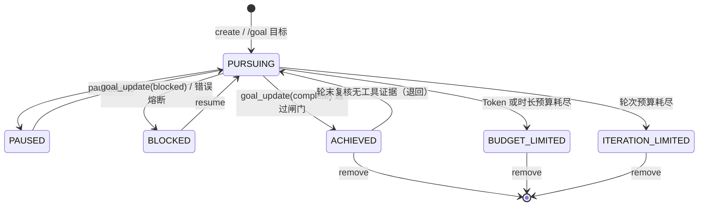
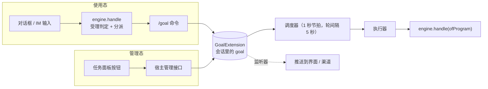

# solon-ai-harness-goal — 会话目标（/goal）

`solon-ai-harness` 的会话插件之一，提供「会话目标」能力：给定一个目标，插件按状态驱动一轮轮自动执行，直到**达成 / 预算耗尽 / 熔断阻塞**。

- 归属是**会话**，每会话最多一个 goal（单槽）；
- 状态以投影存放在会话快照中，随对话持久化，重启后仍在；
- 宿主从装配到运行期只接触一个类：`GoalExtension`；对外只交只读快照 `GoalSnapshot`。

包名：`org.noear.solon.ai.harness.extension.goal`（验证器在子包 `validate`）。本模块只依赖核心契约 `solon-ai-harness-core`，不依赖其它插件。

**两种时态**（第三章总览，第四、五章分别给出完整示例）：

| 时态 | 用户在哪里操作 | 宿主入口 | 本插件的入口 |
|---|---|---|---|
| 使用态 | 对话框 / IM 里输入 `/goal 让测试全绿` | `engine.handle`（唯一执行入口，第 0 步受理判定） | `/goal` 命令（引擎内分派） |
| 管理态 | 任务面板里点「新建 / 编辑 / 暂停 / 删除」 | 宿主自己的管理接口（HTTP 等） | `GoalExtension` 门面方法 |

---

## 一、功能介绍

### 1.1 与 loop 的区别

| 维度 | goal（本模块） | loop（`solon-ai-harness-loop`） |
|---|---|---|
| 数量 | 每会话最多 1 个 | 每会话可多条 |
| 驱动方式 | 状态驱动：上一轮结束后间隔 5 秒再跑，每轮自判是否续行 | 时间表驱动：间隔 / cron 独立触发 |
| 终止判据 | 模型声明完成并通过校验、预算（Token / 时长 / 轮次）、熔断 | 由任务定义决定 |
| 存储 | 会话快照投影（`session.goal`） | 独立任务文件 |
| 执行通道 | 自持，与 loop 不共享任何执行通道 | 自持 |

两者的执行器、结论类型（`GoalOutcome` / `LoopOutcome`）各自独立，互不共享。

### 1.2 状态机

`GoalStatus` 共 6 个值，转移只能经门面、命令或模型工具发生：



- 仅 `PURSUING` 可暂停；`PAUSED` / `BLOCKED` 可恢复；三个终态不可恢复、不可编辑，只能清除（`remove` 对任意状态都可用）。
- `BLOCKED` 的两个来源：模型主动 `goal_update(blocked)`，或异常分级熔断（见 1.5）。熔断后调度自动注销，`resume` 可续。

### 1.3 调度与每轮执行流程

调度由 `GoalScheduler` 完成：每个扩展实例**一个节拍 job**（`goal-<实例序号>:tick`，1 秒一拍），扫描到期会话并派发到有界线程池（`roundConcurrency`，缺省 4）；同一会话不并发，上一轮结束 5 秒后再到期；线程池满额时本拍不再派发（背压）。`runNow = true` 时首轮立即到期，否则等一个间隔。节拍 job 在第一个会话登记时注册、最后一个注销时移除。到期时只取**已存在**的会话（`getSessionOrNull`），会话不存在或 goal 已非活跃时自行注销。登记 / 注销同时维护状态来源下的活跃索引 `goal/active/`（供无参 `recover()` 使用）。

每轮 `runRound` 的守卫顺序（任一条命中即退出本轮）：

1. goal 不存在或状态非 `PURSUING` → 退出；
2. 没有任何执行器（宿主注册与内置缺省都没有）→ 退出（`GoalExtension` 恒会装入缺省执行器，正常不会命中）；
3. `engine.isIdle(session) == false`（占用、HITL 挂起或有积压）或会话不存在 → 跳过，不计错误，等下一次调度；
4. 轮前预算守卫，按顺序：
   - 时长：`maxDurationMs > 0` 且已耗时 ≥ 上限 → 先跑一轮「收尾总结」，再转 `BUDGET_LIMITED`；
   - Token：`maxTokens > 0` 且已消耗 ≥ 上限 → 同上，转 `BUDGET_LIMITED`；
   - 轮次：`maxIterations > 0` 且已完成轮次 ≥ 上限 → 直接转 `ITERATION_LIMITED`（无收尾轮）；
5. CAS 防重入：本会话已有一轮在跑则退出（同一会话轮次不会并发）。

轮内流程：

1. `GoalPromptBuilder` 构建本轮提示词（按 Token 剩余比例切换：≥30% 完整引导、15%~30% 精简、<15% 极简；未设 Token 预算按完整引导）。连续无进展达 `stagnation` 阈值时注入「进展质疑」段，有连续同类错误时注入「错误警告」段；
2. 选择执行器：按注册顺序取首个认领者，全部不认领时用内置缺省执行器；
3. 按结论处理：
   - `skip` → 本轮放弃，不计错误、不推进、不改状态；
   - `failed` / 抛异常 / 返回 null → 进入错误分级熔断（见 1.5）；
   - `done` → 记录结果、清零连续错误、轮次 +1、累计 Token、计算执行指纹（无进展检测）；
4. 完成复核（见 1.4）；
5. 轮后预算：Token 超限 → 收尾轮后转 `BUDGET_LIMITED`；轮次达上限 → 转 `ITERATION_LIMITED`；
6. `commit`：写投影、`updateSnapshot()` 落盘，并广播给监听器。

> 无进展检测只做提示：执行指纹 = `是否有工具调用 : 文本长度/200 : 行数/10`，与上一轮相同则停滞计数 +1，达到阈值后在提示词中要求模型换策略或声明阻塞，**不会自动熔断**。

### 1.4 完成判定的几道闸

`goal_update(complete)` 只是声明。工具内按顺序校验，任一不过即返回错误 JSON、状态不变：

| # | 闸门 | 不满足时的错误码 |
|---|---|---|
| 1 | goal 处于 `PURSUING` | `GOAL_NOT_ACTIVE` |
| 2 | 执行证据（提示性）：目标含执行型关键词且「上一轮已写入的证据」为 false 时提前拦截。由于每轮执行前证据会被置空，轮内通常放行 | `ACTION_EVIDENCE_REQUIRED` |
| 3 | TODO 联动：经 `engine.getTalents().getTodo().readTodo(cwd, sessionId)` 读取清单（cwd 为本轮会话工作目录），存在 `- [ ]` 或 `- [/]` 项则拒绝 | `TODO_UNFINISHED` |
| 4 | 验证器（`validatorEnabled = true` 时）：按目标文本匹配验证器链，在本轮会话工作目录下执行 | `VALIDATION_FAILED` |

全部通过后状态转 `ACHIEVED`。**权威复核在轮末**：目标为执行型且本轮 `GoalOutcome.hasToolCalls() == false` 时，`ACHIEVED` 被退回 `PURSUING`，`lastResult` 记为「完成声明被拒绝：本轮没有实际工具执行证据……」。

执行型关键词（目标转小写后包含任一即为执行型）：

`create` `generate` `write` `implement` `modify` `edit` `fix` `add` `delete` `remove` `refactor` `build` `test` `run` `install` `configure` `deploy` `file` `生成` `创建` `新建` `编写` `写入` `修改` `编辑` `修复` `实现` `添加` `删除` `重构` `构建` `测试` `运行` `安装` `配置` `部署` `文件`

### 1.5 熔断规则

错误由核心 `ErrorClassifier` 分类（`SSL` / `NETWORK` / `HTTP_4XX` / `HTTP_5XX` / `TOOL_EXECUTION` / `OTHER`）。每次失败记录错误类型与摘要（截断 200 字符），然后：

1. goal 已非活跃或 Token 已超限 → 只落盘，不计数；
2. 连续错误数 +1；
3. 不可恢复错误（`SSL`、`HTTP_4XX`）连续同类 ≥ 2 次 → `BLOCKED`；
4. 任意类型连续同类 ≥ 3 次 → `BLOCKED`；
5. 连续错误数 ≥ `maxErrors`（缺省 3）→ `BLOCKED`；
6. 否则只落盘，由下一次到期重试（单一驱动源，不另行延迟补发）。

一轮 `done` 会清零连续错误与同类计数。

---

## 二、依赖

```xml
<dependency>
    <groupId>org.noear</groupId>
    <artifactId>solon-ai-harness-goal</artifactId>
    <version>${solon-ai.version}</version>
</dependency>
```

本模块传递依赖 `solon-ai-harness-core` 与 `solon-scheduling-simple`（调度使用 `JobManager`）。聚合包 `solon-ai-harness` 已包含本模块；聚合包只聚合依赖、不自动装配，仍需宿主显式挂载扩展。

---

## 三、装配与两种时态

### 3.1 最小装配

```java
HarnessEngine engine = HarnessEngine.of("/data/work", ".solon/")
        .sessionProvider((id, create) -> InMemoryAgentSession.of(id)) // 生产环境应缓存实例
        .modelAdd(chatConfig)
        .defaultModel("deepseek")
        .build();

// 按类型幂等挂载；onAttach 内装配运行态、调度、/goal 命令与模型工具
GoalExtension goal = engine.addExtensionIfAbsent(GoalExtension.builder().build());
```

装配完成后两种时态都已可用：用户输入 `/goal ...` 会被引擎识别（使用态），宿主也可以直接调用 `goal.create(...)`（管理态）。不注册执行器时，每一轮走内置缺省执行器 `engine.handle(HarnessInput.ofProgram(session, prompt, "goal")).call()`，结果只记进 `lastResult`。

需要 Solon 容器提供 `JobManager`（`solon-scheduling-simple` 已启动）；取不到且未显式 `jobManager(null)` 时会打印 warn：goal 只存不跑。

### 3.2 Builder 全配置

```java
GoalExtension goal = engine.addExtensionIfAbsent(GoalExtension.builder()
        .budget(70, 85)            // 预算提示阈值：警告% / 紧急%
        .stagnation(3)             // 连续无进展多少轮注入进展质疑
        .maxErrors(3)              // 连续错误多少次熔断
        .validatorEnabled(true)    // 完成前验证（验证器在本轮会话工作目录下执行）
        .jobManager(JobManager.getInstance()) // 缺省即取此单例；显式 null = 关闭调度
        .listener((sid, t, removed) -> log.info("goal {} -> {}", sid, t.getStatus()))
        .build());
```

测试中不依赖 Solon 容器、也不让 goal 自动推进：

```java
GoalExtension ext = GoalExtension.builder().jobManager(null).build(); // 显式关闭调度，不打 warn
HarnessEngine engine = HarnessEngine.of(workspace, home)
        .sessionProvider((id, c) -> c ? sessions.computeIfAbsent(id, InMemoryAgentSession::of) : sessions.get(id))
        .extensionAdd(ext)
        .build();

GoalSnapshot t = ext.create("s1", GoalSpec.of("目标").runNow(false));
assert ext.hasScheduler() == false;   // 不会自动推进
assert ext.hasActiveGoals() == false; // 无调度器时恒为 false
```

### 3.3 两种时态



| 对比项 | 使用态 | 管理态 |
|---|---|---|
| 用户动作 | 在对话中输入 `/goal 目标`、`/goal pause` 等 | 在任务面板里新建、编辑、暂停、恢复、立即执行、清除 |
| 宿主入口 | 统一输入入口：`engine.handle(HarnessInput)` | 宿主自己的管理接口，直接调门面 |
| 是否经过 `handle` 受理判定 | 是：goal 的一轮正在跑时，`/goal ...` 由引擎入积压，返回 `DEFERRED` | 否：随时可调，门面自己保证时序（如 `update` 先停流再改写） |
| 本插件入口 | `GoalCommand`（引擎内分派，宿主不用注册） | `create` / `get` / `update` / `pause` / `resume` / `trigger` / `remove` |
| 结果怎么返回 | 回执文本：`outcome.getCommandOutput()` | 返回值：`GoalSnapshot` 快照 / `boolean` / 异常 |
| 只有这一态能做的 | — | 编辑目标与预算（`update`）、立即跑一轮（`trigger`）、`runNow(false)`、`displayObjective` |

两种时态操作的是**同一份状态**：对话里 `/goal` 建的目标会出现在任务面板里；面板上暂停后，对话里 `/goal` 打印的也是 `PAUSED`。之后每一轮怎么跑、输出回到哪里，由执行器决定（3.4），与目标是哪种时态创建的无关。

### 3.4 执行器：每一轮怎么跑、输出回到哪

`addExecutor` 必须在扩展挂接到引擎之后调用（之前调用抛 `IllegalStateException`）。认领谓词应互斥；多个同时命中时取首个并告警（每个命中组合一次）。谓词抛异常按不命中处理；`claim` 传 null 表示认领全部。

```java
goal.addExecutor("web", sid -> sid.startsWith("web-"), (sid, prompt) -> {
    if (webRuntimeReady(sid) == false) {
        return GoalOutcome.skip("runtime not ready");   // 本轮放弃，不计错误
    }
    AgentSession session = engine.getSessionOrNull(sid);
    if (session == null) {
        return GoalOutcome.skip("session not found");
    }
    InputOutcome outcome = engine.handle(HarnessInput.ofProgram(session, prompt, "web"));
    if (outcome.getKind() != InputOutcome.Kind.TASK) {
        return GoalOutcome.skip("not runnable: " + outcome.getKind()); // 如忙时 REJECTED("busy")，不计失败
    }
    ReActResponse resp = outcome.getRequest().call();
    pushToClient(sid, resp.getContent());               // 把这一轮的输出送回界面
    boolean hasToolCalls = resp.getTrace() != null && resp.getTrace().getToolCallCount() > 0;
    long tokens = resp.getMetrics() != null ? resp.getMetrics().getTotalTokens() : 0L;
    return GoalOutcome.done(resp.getContent(), hasToolCalls, tokens); // 必须给出真实证据与 token
});
// 抛异常、返回 GoalOutcome.failed(...) 或 null 都按失败处理，参与熔断
```

`webRuntimeReady`、`pushToClient` 为宿主自有逻辑。会话忙由插件在调用执行器前统一判定（`engine.isIdle`），执行器无需再判。统计工具证据时可用 `GoalTalent.isGoalTool(toolName)` 排除 `goal_*` 自身工具。执行器结束后要续发队列，见 4.3。

### 3.5 自定义验证器

```java
goal.registerValidator(
        cond -> cond.contains("lint"),                  // 入参为已转小写的目标文本
        (condition, workDir) -> runLint(workDir)        // 目标原文 + 本轮会话工作目录（可能为 null）
                ? ValidationResult.passed()
                : ValidationResult.failed("lint 未通过"));
```

`workDir` 取自本轮工具上下文的 `__cwd`，取不到时用 `engine.getSessionCwd(session)`。它可以不是引擎工作区（例如桌面端 goal 把会话目录设为目标项目），验证器应以它为准，不要自行读取 `engine.getWorkspace()`。

同一目标命中多个验证器时按注册顺序 AND 执行，首个失败即返回；无命中时用 `NoopValidator`（恒通过并打 warn）。`registerValidator` 同样须在挂接后调用；matcher 或 validator 为 null 时忽略。

---

## 四、使用态：用户在对话中输入

### 4.1 用户能输入什么

```
/goal                                   # 打印当前目标状态
/goal 修复登录模块的鉴权缺陷             # 创建并立即调度首轮
/goal --max-tokens 2000 --max-iterations 10 让测试全绿
/goal --max-duration 30m 重构订单模块    # 单位 s / m / h；纯数字按分钟
/goal pause | resume | clear
/goal -- pause the build                 # 转义：正文以子命令词开头
```

| 形式 | 行为 |
|---|---|
| `/goal` | 打印状态（Status / Iteration / Tokens / Elapsed / Last）；无目标时打印用法 |
| `/goal <objective>` | 创建并立即调度首轮；已有非终态 goal 时打印 WARN 与当前目标 |
| `/goal pause` | 暂停（大小写不敏感） |
| `/goal resume` | 恢复 |
| `/goal clear` | 清除（别名 `remove`） |

子命令只在**恰好一个参数**时生效：`/goal pause the build` 是目标正文，不是暂停。

| flag | 类型 | 映射 |
|---|---|---|
| `--max-tokens N` | long | `GoalSpec.maxTokens(N)` |
| `--max-duration 30m` | 时长，单位 `s` / `m` / `h`，纯数字按分钟 | `GoalSpec.maxDurationMs(...)` |
| `--max-iterations N` | int | `GoalSpec.maxIterations(N)` |

格式为 `--key value`（空格分隔，与 `/loop --every 5m` 同口径）；旧写法 `--key:value` 仍可用。未知 key 打印 `Unknown flag` 并跳过；缺值、数值非法或正文为空时打印错误与 Usage。`--` 之后的全部参数按正文处理。非 `--` 开头的参数按空格拼成目标正文。命令解析出 `GoalSpec` 后调用与管理态门面相同的 `create` 路径，`pause` / `resume` / `clear` 直接转调扩展方法。

回执（英文，来自 `GoalCommand`）：

| 情形 | 回执 |
|---|---|
| 创建成功 | `Goal registered:`，随后列出 `Objective`、设置了的预算，以及 `State: saved with this conversation` |
| 已有非终态 goal | `WARN: 当前会话已有进行中的 Goal，请先清除后再创建`，`Active: <当前目标>`，`Use /goal clear first to replace the goal.` |
| 正文为空 / 数值非法 | 错误信息 + `Usage: /goal [--max-tokens N] [--max-duration 30m] [--max-iterations N] <objective>` + 示例 |
| `pause` / `resume` / `clear` | `Goal paused.` / `Goal resumed.` / `Goal cleared.`；无 goal 时 `No goal in this session.`；状态不允许时 `Cannot pause/resume goal in state: <状态>` |

目标创建之后，模型在每一轮里通过 `goal_get` / `goal_update` 两个工具查看进度、声明完成或阻塞（见 6.8）。模型**不能**创建目标：工具只在会话已有非终态 goal 时可见。

### 4.2 命令的边界

| 项 | 说明 |
|---|---|
| 注册 | `GoalExtension#onAttach` 自动注册（幂等），宿主不用注册 |
| 会话 | 作用于本次输入所在会话 `ctx.getSession()` |
| 结局 | 恒为 `Kind.REPLY`：命令只建目标或改状态并回执，**不在本次 `handle` 里开流**；后续轮次由调度器驱动，别等 `getRequest()` |
| 渠道 | `terminalOnly() == false`，Web / IM / 桌面可用 |
| 忙态 | `runnableWhenBusy()` 为缺省 `false`：任务（含 goal 自己的一轮）运行中输入的 `/goal ...`，`engine.handle` 由引擎入积压并返回 `DEFERRED`；没装 queue 时返回 `REJECTED("busy")` |
| 开关 | `engine.setExtensionEnabled(goal, false)` 后命令回执 `/goal 已停用。发送 /help 查看可用命令。` |
| 回执格式 | 缺省缓冲式命令上下文会去掉 ANSI 颜色，回执从 `outcome.getCommandOutput()` 取回 |

### 4.3 宿主接入：完整示例

`/goal` 只负责"立目标"；之后每一轮由调度器调用**执行器**完成，执行器的输出由宿主送回渠道。宿主要接三处：输入入口（命令能执行）、执行器（每一轮有去处）、监听器（状态变化能推给渠道）。

```java
import org.noear.solon.ai.agent.AgentSession;
import org.noear.solon.ai.agent.react.ReActResponse;
import org.noear.solon.ai.harness.HarnessEngine;
import org.noear.solon.ai.harness.extension.goal.GoalExtension;
import org.noear.solon.ai.harness.extension.goal.GoalOutcome;
import org.noear.solon.ai.harness.extension.queue.QueueExtension;
import org.noear.solon.ai.harness.input.HarnessInput;
import org.noear.solon.ai.harness.input.InputOrigin;
import org.noear.solon.ai.harness.input.InputOutcome;

import java.util.Map;
import java.util.concurrent.ConcurrentHashMap;

public class ImGoalHost {
    private final HarnessEngine engine;
    private final QueueExtension queue;
    private final GoalExtension goal;
    /** 会话最近一次的回复路由（调度轮次没有入站消息，只能回到这里） */
    private final Map<String, InputOrigin> routes = new ConcurrentHashMap<>();

    public ImGoalHost(HarnessEngine engine) {
        this.engine = engine;
        this.queue = engine.addExtensionIfAbsent(new QueueExtension());
        this.goal = engine.addExtensionIfAbsent(GoalExtension.builder().build()); // 注册 /goal

        // 执行器：挂接后注册；谓词应与其它通道互斥
        goal.addExecutor("im", sid -> sid.startsWith("im-"), (sid, prompt) -> {
            AgentSession session = engine.getSessionOrNull(sid);
            InputOrigin route = routes.get(sid);
            if (session == null || route == null) {
                return GoalOutcome.skip("no session or reply route");   // 本轮放弃，不计错误
            }
            try {
                InputOutcome outcome = engine.handle(HarnessInput.ofProgram(session, prompt, "goal"));
                if (outcome.getKind() != InputOutcome.Kind.TASK) {
                    return GoalOutcome.skip("not runnable: " + outcome.getRejectReason()); // 程序轮次忙时不进积压
                }
                ReActResponse resp = outcome.getRequest().call();
                reply(route, resp.getContent());
                // 完成判定依赖真实的工具证据与 token：从 trace 读，不要从文本猜
                boolean hasToolCalls = resp.getTrace() != null && resp.getTrace().getToolCallCount() > 0;
                long tokens = resp.getMetrics() != null ? resp.getMetrics().getTotalTokens() : 0L;
                return GoalOutcome.done(resp.getContent(), hasToolCalls, tokens);
            } finally {
                drain(session);   // 这一轮占用期间用户发来的消息（包括 /goal pause）被延后了：立即续发
            }
        });

        // 监听器：状态变化推回渠道（达成、阻塞、预算耗尽等）
        goal.addListener((sid, task, removed) -> {
            InputOrigin route = routes.get(sid);
            if (route != null && (removed || task.getStatus().isActive() == false)) {
                reply(route, "[goal] " + (removed ? "已清除" : task.getStatus().name()));
            }
        });
    }

    /** 输入入口：/goal 命令与普通消息共用 */
    public void onMessage(AgentSession session, String text, InputOrigin origin) {
        dispatch(session, HarnessInput.of(session, text).origin(origin));
    }

    /** 受理与执行：入站消息与积压续发共用同一个 handle 入口 */
    private void dispatch(AgentSession session, HarnessInput input) {
        InputOutcome outcome = engine.handle(input);   // 第 0 步受理判定：忙时可排队输入由引擎入积压
        InputOrigin origin = outcome.isDispatched() ? outcome.getDispatch().getOrigin() : input.getOrigin();
        switch (outcome.getKind()) {
            case TASK:
                routes.put(session.getSessionId(), origin);   // 调度轮次的输出回到这里
                try {
                    reply(origin, outcome.getRequest().call().getContent());   // call() 结束即释放占位
                } catch (Throwable e) {
                    outcome.discard();   // 幂等；开流前失败时确保占位释放
                    reply(origin, "处理失败：" + e.getMessage());
                }
                drain(session);
                break;
            case REPLY:
                routes.put(session.getSessionId(), origin);
                reply(origin, outcome.getCommandOutput());   // /goal 的回执
                drain(session);
                break;
            case DEFERRED:   // goal 的一轮正在跑时发来的 /goal pause 等：引擎已入积压，本轮结束后执行
                reply(origin, "当前一轮结束后执行（第 " + outcome.getBacklogPosition() + " 位）");
                drain(session);
                break;
            case REJECTED:
                reply(origin, outcome.getRejectDetail());
                break;
            case HITL:
            case IGNORED:
                drain(session);
                break;
        }
    }

    private void drain(AgentSession session) {
        queue.drainLoop(session, s -> !engine.status(s).isOccupied(), claim -> {
            dispatch(session, claim.getItem().toInput(session));   // 同一线程：引擎识别为派发轮次
            return true;
        });
    }

    /** 进程启动：按状态来源的活跃索引恢复调度（只挂调度，不立即跑） */
    public void onStartup() {
        goal.recover();
    }

    private void reply(InputOrigin origin, String text) { /* 按 origin 回投渠道 */ }
}
```

### 4.4 使用态要点

1. **命令立目标，调度器跑轮次**：`/goal <目标>` 与管理态的 `goal.create(...)` 是同一条路径；创建后首轮由调度器异步发起（命令解析出的 `GoalSpec` 保持缺省 `runNow = true`）。首轮开始时如果会话仍被占用（例如另一条输入的占位尚未随请求释放），或队列里还有积压，`engine.isIdle` 为假，这一轮会被跳过，下一次到期再跑，属正常现象。
2. **执行器决定输出去向**：内置缺省执行器只把结果记进 `lastResult`，不会推送给任何渠道；需要让用户看到每一轮的宿主必须按通道注册执行器，并自行保存会话到渠道的回复路由。
3. **`done` 必须带真实证据**：执行型目标（含 `fix`、`build`、`修改` 等关键词）的完成复核依赖 `hasToolCalls`；固定传 `false` 会让这类目标永远无法达成。
4. **会话忙由插件判**：调度轮次先判 `engine.isIdle(session)`，执行器不需要再判；本通道此刻不能执行（如前端未连接）时返回 `GoalOutcome.skip(...)`，不要返回失败，否则会计入熔断。判空闲与开轮之间仍有窗口：`HarnessInput.ofProgram(...)` 是程序轮次，忙时返回 `REJECTED("busy")`、不进积压，执行器应在非 `TASK` 时返回 `skip`（缺省执行器即如此）。
5. **轮次结束要续发队列**：goal 的一轮占用会话期间，用户输入（包括 `/goal pause`、`/goal clear`）由 `handle` 入积压并返回 `DEFERRED`。执行器结束时 `drain`；而 goal 调度在队列有积压时也不会开下一轮，所以排队的 `/goal pause` 一定先于下一轮执行。
6. **想立刻停下当前一轮**：`/goal pause` 只阻止下一轮，不打断正在跑的这一轮。要立刻停，用宿主停止入口 `engine.interrupt(session, InterruptMode.INTERRUPT_ALL)`，再 `goal.pause(sid)`；改目标走管理态 `goal.update(...)`，它自带"暂停 → 停流 → 等停稳 → 改写 → 恢复"的时序（5.3）。
7. **单槽冲突在回执里**：已有非终态 goal 时命令只回执 `WARN`；管理态 `create` 返回 `HarnessResult.Code.CONFLICT`。
8. **审批挂起**：goal 的一轮触发 HITL 审批时，会话处于占用状态，调度会持续跳过；审批决策输入（`input.hitl(...)`）与续流（`input.resume(true)`）在 `handle` 的受理判定中天然豁免，其余普通输入返回 `REJECTED`（`RejectReason.HITL_PENDING`）；续流完成后 goal 才继续。

---

## 五、管理态：用户在界面上操作

管理态不经过 `handle`：界面上的每个按钮对应一个宿主接口，接口直接调用 `GoalExtension` 门面。状态变化经监听器推回界面。

### 5.1 界面动作与门面对照

| 界面动作 | 门面调用 | 成功返回 | 失败时（建议的 HTTP 映射） |
|---|---|---|---|
| 查看当前目标 | `goal.get(sid)` | `GoalSnapshot`，用 `toMap()` 渲染 | 会话或目标不存在返回 null |
| 新建目标 | `goal.create(sid, GoalSpec...)` | `OK`，值为 `GoalSnapshot` | `NOT_FOUND`（会话不存在）→ 404；`CONFLICT`（已有非终态 goal）→ 409；`INVALID`（规格不合法）→ 400 |
| 编辑目标与预算 | `goal.update(sid, GoalPatch..., stopper)` | `OK`，值为修改后的快照 | `NOT_FOUND` → 404；`CONFLICT`（终态、停稳超时，后者可重试）→ 409；`INVALID`（补丁不合法）→ 400 |
| 暂停 | `goal.pause(sid)` | `OK` | `NOT_FOUND`：无 goal；`CONFLICT`：状态不是 `PURSUING` |
| 恢复 | `goal.resume(sid)` | `OK`（并立即跑一轮） | `NOT_FOUND`；`CONFLICT`：状态不是 `PAUSED` / `BLOCKED` |
| 立即执行一轮 | `goal.trigger(sid)` | `OK` | `NOT_FOUND`；`CONFLICT`：非活跃；`DISABLED`：扩展已停用 |
| 清除 | `goal.remove(sid)` | `OK` | `NOT_FOUND`：无 goal |

每个会话永远只有一个 goal，门面一律按 `sessionId` 定位，不需要任务 id。写方法统一返回 `HarnessResult<T>`（core 的 `org.noear.solon.ai.harness.HarnessResult`），业务失败只用结果码表达、不抛异常；多节点部署时非持有节点返回 `NOT_OWNER`（`getOwner()` 为持有者）。门面只取已有会话（`getSessionOrNull`），不会把不存在的会话建出来。

### 5.2 完整示例：管理接口

```java
import org.noear.solon.ai.harness.HarnessEngine;
import org.noear.solon.ai.harness.HarnessResult;
import org.noear.solon.ai.harness.extension.goal.GoalExtension;
import org.noear.solon.ai.harness.extension.goal.GoalPatch;
import org.noear.solon.ai.harness.extension.goal.GoalSnapshot;
import org.noear.solon.ai.harness.extension.goal.GoalSpec;
import org.noear.solon.annotation.*;
import org.noear.solon.core.handle.Result;

import java.util.Map;

@Controller
@Mapping("/admin/goal")
public class GoalAdminController {
    @Inject
    HarnessEngine engine;

    private GoalExtension goal() {
        return engine.getExtension(GoalExtension.class)
                .orElseThrow(() -> new IllegalStateException("goal extension not attached"));
    }

    /** 统一码表：门面只用结果码表达失败（宿主自己的归属校验另做） */
    private static <T> Result<T> toHttp(HarnessResult<?> r) {
        switch (r.getCode()) {
            case OK:        return Result.succeed();
            case NOT_FOUND: return Result.failure(404, r.getDetail());
            case DISABLED:  return Result.failure(503, r.getDetail());
            default:        return Result.failure(409, r.getDetail()); // CONFLICT / NOT_OWNER 等（INVALID 可单独映射 400）
        }
    }

    @Get
    @Mapping("get")
    public Result<Map<String, Object>> get(@Param("sessionId") String sessionId) {
        GoalSnapshot snapshot = goal().get(sessionId);   // 会话不存在或无目标都为 null，不会新建会话
        return Result.succeed(snapshot == null ? null : snapshot.toMap());
    }

    @Post
    @Mapping("create")
    public Result<String> create(@Param("sessionId") String sessionId,
                                 @Param("objective") String objective,
                                 @Param(value = "maxTokens", required = false) Long maxTokens,
                                 @Param(value = "maxDurationMs", required = false) Long maxDurationMs,
                                 @Param(value = "maxIterations", required = false) Integer maxIterations) {
        HarnessResult<GoalSnapshot> r = goal().create(sessionId, GoalSpec.of(objective)
                .maxTokens(maxTokens == null ? 0L : maxTokens)            // 0 = 不限制
                .maxDurationMs(maxDurationMs == null ? 0L : maxDurationMs)
                .maxIterations(maxIterations == null ? 0 : maxIterations));
        return r.isOk() ? Result.succeed(r.getValue().getId()) : toHttp(r);
    }

    @Post
    @Mapping("update")
    public Result<Map<String, Object>> update(@Param("sessionId") String sessionId,
                                              @Param(value = "objective", required = false) String objective,
                                              @Param(value = "maxTokens", required = false) Long maxTokens,
                                              @Param(value = "maxDurationMs", required = false) Long maxDurationMs,
                                              @Param(value = "maxIterations", required = false) Integer maxIterations) {
        HarnessResult<GoalSnapshot> r = goal().update(sessionId,
                GoalPatch.create()                       // null = 保持原值，请求参数可原样传入
                        .objective(objective)
                        .maxTokens(maxTokens)
                        .maxDurationMs(maxDurationMs)
                        .maxIterations(maxIterations),
                null);                                   // null = InterruptMode.CANCEL_STREAM；流式前端可传自己的停流动作
        return r.isOk() ? Result.succeed(r.getValue().toMap()) : toHttp(r);
    }

    @Post
    @Mapping("pause")
    public Result<Void> pause(@Param("sessionId") String sessionId) {
        return toHttp(goal().pause(sessionId));
    }

    @Post
    @Mapping("resume")
    public Result<Void> resume(@Param("sessionId") String sessionId) {
        return toHttp(goal().resume(sessionId));
    }

    @Post
    @Mapping("trigger")
    public Result<Void> trigger(@Param("sessionId") String sessionId) {
        return toHttp(goal().trigger(sessionId));
    }

    @Post
    @Mapping("remove")
    public Result<Void> remove(@Param("sessionId") String sessionId) {
        return toHttp(goal().remove(sessionId));
    }
}
```

### 5.3 编辑：update 与停流时序

goal 为 `PURSUING` 时，`update` 的固定时序：暂停并摘调度 → 执行 `stopper`（null 时用 `engine.interrupt(session, InterruptMode.CANCEL_STREAM)`；`stopper` 抛异常只记日志）→ 最多等 2 秒让旧轮次停稳 → 改写（一次落盘、一次广播）→ 恢复并重挂调度、立即跑一轮。goal 为 `PAUSED` / `BLOCKED` 时只改写、不改状态、不调用 `stopper`。补丁为空时直接返回当前快照。

流式前端需要在停流时推一个终态帧，就传自己的 `stopper`：

```java
goal.update(sid, GoalPatch.create().objective(newPrompt), () -> {
    engine.interrupt(engine.getSessionOrNull(sid), InterruptMode.CANCEL_STREAM); // 停掉在跑轮次
    pushFinalFrame(sid);                              // 渠道侧收尾（宿主自有）
});
```

`stopper` 里不要用 `InterruptMode.INTERRUPT_ALL`：它会回调各扩展的 `onSessionInterrupt`，顺带清空 queue 里用户排队的消息。

### 5.4 状态推送：监听器

界面需要实时看到状态（每轮的轮次、Token、达成、阻塞），用监听器推送，不必轮询：

```java
goal.addListener((sessionId, task, removed) -> {
    Map<String, Object> row = task.toMap();   // removed=true 时为清除前的快照
    row.put("removed", removed);              // toMap 返回新的可变 Map，可追加宿主字段
    pushToClient(sessionId, row);
});
```

监听器在每次状态变化后回调（含两种时态触发的变化与调度轮次的结果），抛异常只记 debug 日志，不影响状态流转。快照创建后不随运行态变化，需要最新值时重新 `get`。状态事实也可经引擎读取（不受开关影响）：

```java
GoalStatus st = engine.status(session).get(GoalExtension.STATUS_GOAL); // 无 goal 为 null
```

### 5.5 重启恢复：recover

调度只在内存，重启后需宿主恢复。`recover` 只对活跃态挂调度、**不立即跑**，已调度的幂等跳过；无调度器或扩展停用时返回 0。有两种写法：

```java
// 推荐：按状态来源下的活跃索引 goal/active/ 恢复，无需宿主枚举会话
// （已不存在或已非活跃的会话在首次到期时自动注销；多节点共用来源时，非持有节点的轮次被 not_owner 拒绝）
int n = goal.recover();

// 或：宿主自己枚举会话
int m = goal.recover(listSessionIds(), sid -> {
    AgentSession s = engine.getSessionOrNull(sid);
    if (s != null) {
        return engine.status(s).get(GoalExtension.STATUS_GOAL);
    }
    // 会话尚未实例化：轻读快照里的投影
    return GoalProjection.statusOf(loadSnapshotContext(sid));
});
```

`listSessionIds` / `loadSnapshotContext` 为宿主自有逻辑；`statusReader` 返回 null 或抛异常按无 goal 处理。

### 5.6 历史数据迁移：GoalProjection

```java
FlowContext context = session.getContext();

// 读
GoalProjection p = GoalProjection.from(context);           // 无 goal / 非 Map / 缺或非法 status → null
if (p != null && p.isActive()) {
    long used = p.getConsumedTokens();
}
GoalStatus status = GoalProjection.statusOf(context); // 只要状态

// 写：字段集合由 harness 定义，调用方只填值
GoalProjection.builder()
        .goalId(oldId)
        .objective(oldObjective)
        .statusName(oldStatusName)  // 非法名不抛异常，getStatus() 为 null
        .consumedTokens(oldUsed)
        .maxTokens(oldMax)
        .maxIterations(oldMaxIter)
        .currentIteration(oldIter)
        .startEpochMs(oldStart)
        .build()
        .writeTo(context);          // 覆盖写入，不落盘
session.updateSnapshot();           // 由调用方决定是否落盘
```

注意：status 为 null 的投影在读取时会被视为「无 goal」；运行态在首次访问后缓存于 `attrs()`，迁移应在该会话首次访问 goal 之前完成。

### 5.7 开关

```java
engine.setExtensionEnabled(goal, false); // 关闭模型工具与 /goal 命令，并停止全部调度
engine.setExtensionEnabled(goal, true);  // 重新开启（不会自动重挂已有 goal 的调度）
```

关闭只停未来的调度，不打断正在执行的那一轮。重新开启后，已有的活跃 goal 需经 `recover` / `trigger` / `resume` 重新挂调度。

### 5.8 管理态要点

1. **会话只取不建**：门面按 sessionId 经 `engine.getSessionOrNull` 取会话，不存在时 `get` 返回 null、写方法返回 `NOT_FOUND`，不会把外部传入的 ID 建成新会话；宿主仍需做自己的用户归属校验。
2. **不需要判忙**：管理接口随时可调。会话忙时 `create` 照常建目标，首轮由调度器等到会话空闲再跑；`update` 自己负责停流与等待。
3. **立即停下当前一轮**：`pause` 只阻止下一轮。界面上的「停止」按钮应先调宿主的停止入口（如 `engine.interrupt(session, InterruptMode.INTERRUPT_ALL)`），再 `goal.pause(sid)`。
4. **终态只能清除**：`ACHIEVED` / `BUDGET_LIMITED` / `ITERATION_LIMITED` 不能 `update`、不能恢复，想扩大预算只能清除后重建；界面上对终态行只保留「清除」按钮。
5. **列表与 loop 混排**：`GoalSnapshot.toMap()` 只输出 goal 自己的字段（`id`、`type = "GOAL"`、`prompt`、`running`、`currentIteration`、预算与 `goal` 子对象），不再带 loop 的 `enabled` / `intervalMinutes` / `runNow` / `cancelled`；混排列表需要这些列时由宿主补齐。分流时用 `goal.get(sid)` 取快照，比较行 id 是否等于 `getId()`，是则走 goal 门面，否则走 loop。
6. **删除会话先调 `engine.removeSession`**：它回调 `onSessionRemove` 注销该会话的 job；调度轮次只用 `getSessionOrNull`，会话不存在时 job 自行注销，不会把会话重新建出来。

---

## 六、配置说明

### 6.1 GoalExtension.Builder

| 选项 | 类型 | 默认值 | 说明 |
|---|---|---|---|
| `budget(warningPercent, criticalPercent)` | `int, int` | `70, 85` | 预算提示阈值；已用比例 ≥ 警告%（且未达紧急）时提示词附「预算提示」，≥ 紧急% 时附「紧急」提示 |
| `stagnation(threshold)` | `int` | `3` | 连续无进展轮数达到该值后注入进展质疑段 |
| `maxErrors(count)` | `int` | `3` | 连续错误达到该值转 `BLOCKED` |
| `validatorEnabled(enabled)` | `boolean` | `true` | 是否执行完成前验证（第 4 道闸） |
| `defaultValidators(enabled)` | `boolean` | 按引擎模式：STANDALONE 注册、SERVER 不注册 | 是否注册内置的构建 / 测试验证器（会执行真实命令） |
| `validatorPolicy(policy)` | `ValidatorPolicy` | 按引擎模式：STANDALONE `FAIL_OPEN`、SERVER `FAIL_CLOSED` | 验证「无法判定」（超时 / 执行失败）时放行还是拒绝 |
| `validatorTimeoutMs(timeoutMs)` | `int` | `180000` | 内置验证命令超时，超时后整树终止并返回「无法判定」；必须 > 0 |
| `roundConcurrency(n)` | `int` | `4` | 本扩展实例的 goal 轮次并发上限；必须 ≥ 1；引擎池里每个引擎各有一份 |
| `jobManager(jobManager)` | `IJobManager` | `JobManager.getInstance()` | 显式传 null = 关闭调度；未显式设置且取不到时 warn |
| `listener(l)` | `GoalListener` | 无 | 预注册生命周期观察者 |
| `build()` | — | — | 构造 `GoalExtension`（构造器私有，只能经 builder） |

内置验证器仅在 `engine.getWorkspace()` 非空、且 `defaultValidators` 生效值为 true 时注册。

### 6.2 GoalSpec（创建参数）

入口 `GoalSpec.of(objective)`：正文 null 或空白抛 `IllegalArgumentException("goal objective must not be empty")`，正文会被 `trim`。

| 字段 / 方法 | 类型 | 默认值 | 说明 |
|---|---|---|---|
| `objective`（`of`） | `String` | 必填 | 目标正文 |
| `maxTokens(long)` | `long` | `0` | Token 预算，0 = 不限制，负数按 0 |
| `maxDuration(Duration)` | `Duration` | `0` | 时长预算，null = 不限制 |
| `maxDurationMs(long)` | `long` | `0` | 时长预算毫秒，0 = 不限制，负数按 0 |
| `maxIterations(int)` | `int` | `0` | 轮次预算，0 = 不限制，负数按 0 |
| `displayObjective(String)` | `String` | `null` | 展示正文；null、空白或与正文相同时不区分（见注意事项） |
| `runNow(boolean)` | `boolean` | `true` | true = 首轮立即跑；false = 只挂调度，等一个间隔（5 秒） |

### 6.3 GoalPatch（修改补丁）

入口 `GoalPatch.create()`，null = 保持原值。

| 方法 | 类型 | null 语义 | 其它 |
|---|---|---|---|
| `objective(String)` | `String` | 保持 | 空白也视为未设置；会 `trim` |
| `maxTokens(Long)` | `Long` | 保持 | 0 = 不限制，负数按 0 |
| `maxDurationMs(Long)` | `Long` | 保持 | 0 = 不限制，负数按 0 |
| `maxIterations(Integer)` | `Integer` | 保持 | 0 = 不限制，负数按 0 |

### 6.4 GoalStatus

| 值 | 含义 | `isActive` | `isTerminal` | `isResumable` |
|---|---|---|---|---|
| `PURSUING` | 进行中，会被调度推进 | 是 | 否 | 否 |
| `PAUSED` | 已暂停 | 否 | 否 | 是 |
| `BLOCKED` | 模型声明阻塞或错误熔断 | 否 | 否 | 是 |
| `ACHIEVED` | 已达成 | 否 | 是 | 否 |
| `BUDGET_LIMITED` | Token 或时长预算耗尽 | 否 | 是 | 否 |
| `ITERATION_LIMITED` | 轮次预算耗尽 | 否 | 是 | 否 |

单槽判定：已有**非终态** goal 时 `create` 返回 `CONFLICT`（detail 为「当前会话已有进行中的 Goal，请先清除后再创建」）；已是终态时可直接覆盖创建。

### 6.5 GoalSnapshot.toMap 字段

| 键 | 值 | 说明 |
|---|---|---|
| `id` | String | goal 标识（仅用于列表行区分，门面按 sessionId 定位） |
| `type` | `"GOAL"` | 与 loop 行区分 |
| `prompt` | String | 目标正文 |
| `running` | boolean | 快照时刻是否在跑 |
| `currentIteration` | int | 已完成轮次 |
| `maxTokens` | long | 仅 > 0 时出现 |
| `maxDurationMs` | long | 仅 > 0 时出现 |
| `lastResult` | String | 仅非 null 时出现 |
| `lastExecutedAt` | String | ISO-8601，仅 > 0 时出现 |
| `goal.condition` | String | 目标正文 |
| `goal.status` | String | 状态枚举名 |
| `goal.iteration` | int | 已完成轮次 |
| `goal.maxIterations` | int | 轮次预算 |
| `goal.consumedTokens` | long | 已消耗 Token |
| `goal.maxTokens` | long | Token 预算 |
| `goal.startedAt` | String | ISO-8601，仅 > 0 时出现 |

### 6.6 GoalOutcome（执行器结论）

| 结论 | 构造 | goal 的处理 |
|---|---|---|
| 完成 | `done(finalText, hasToolCalls, tokensUsed)` | 记成功：轮次 +1、累计 token、无进展检测、完成证据复核；`finalText` 为 null 记为空串，空串时 `lastResult` 记为 `ok`；token 负数按 0 |
| 跳过 | `skip(reason)` | 本轮放弃：不计错误、不推进、不改状态，等下一次调度 |
| 失败 | `failed(error)`、抛异常、返回 null | 记失败，进入错误分级熔断 |

判定方法：`isDone()` / `isSkipped()` / `isFailed()`；取值：`getText()`、`hasToolCalls()`、`getTokensUsed()`。

### 6.7 /goal 命令

语法、flag 与回执见 4.1，命令边界见 4.2。

### 6.8 模型工具（GoalTalent）

仅挂到顶层请求（子代理委派不挂），且仅当会话存在**非终态** goal 时对模型可见（`isSupported`）。

| 工具 | 参数 | 作用 |
|---|---|---|
| `goal_get` | 无 | 返回 `{goal:{taskId, objective, status(小写), iteration, maxIterations?, remainingIterations?, elapsedSeconds, consumedTokens, maxTokens?, budgetExceeded, maxDurationMs?, remainingDurationSeconds?}, remaining_tokens, completionBudgetReport}`；无 goal 返回 `NO_GOAL` |
| `goal_update` | `status`：`complete` 或 `blocked` | `complete` 过闸后标记 `ACHIEVED`，返回含预算摘要的 `completionBudgetReport`；`blocked` 转 `BLOCKED` |

### 6.9 完成判定与工具错误码

错误统一返回 `{"error":true,"code":"...","message":"..."}`。

| 错误码 | 触发条件 |
|---|---|
| `INVALID_PARAMETER` | `status` 为空或不是 `complete` / `blocked` |
| `NO_SESSION` | 无会话 ID |
| `NO_GOAL` | 当前会话无 goal |
| `GOAL_NOT_ACTIVE` | goal 不在 `PURSUING` |
| `ACTION_EVIDENCE_REQUIRED` | 执行型目标且已记录的证据为 false |
| `TODO_UNFINISHED` | TODO 清单有 `- [ ]` / `- [/]` 项 |
| `VALIDATION_FAILED` | 验证器未通过（message 含验证器 detail） |

### 6.10 内置验证器

| 验证器 | 匹配关键词（目标小写包含） | 行为 |
|---|---|---|
| `TestsPassValidator` | `test` `pass` `check` `ensure` `verify` | 按会话工作目录下的文件选择命令：`pom.xml` → `mvn test`；`build.gradle(.kts)` → `gradle test`；`package.json` → `npm test`；`setup.py` / `pyproject.toml` → `python3 -m pytest`；退出码 0 通过。未识别项目类型、工作目录为空或执行异常时**失败** |
| `BuildPassValidator` | `build` `compile` `implement` `refactor` `fix` `create` `add` `write` | `pom.xml` → `mvn compile -q -o`；`build.gradle(.kts)` → `gradle compileJava -q`；退出码非 0 失败。无构建工具、工作目录为空或执行异常时**通过** |
| `NoopValidator` | 无命中时使用 | 恒通过，打 warn |

失败 detail 附带输出末尾 500 字符。

### 6.11 状态键

| 常量 | 键名 | 类型 | 说明 |
|---|---|---|---|
| `GoalExtension.STATUS_GOAL` | `goal.status` | `SessionStatus.Key<GoalStatus>` | 当前 goal 状态，无 goal 为 null；事实口径，不受开关影响 |

---

## 七、存储

存储介质是会话实现的细节（文件 / 内存 / Redis / JDBC），goal 只依赖 `AgentSession` 接口。

| 位置 | 键（`GoalAttrs`） | 内容 | 是否落盘 |
|---|---|---|---|
| `session.getContext().data()` | `session.goal`（`GoalAttrs.GOAL`） | Map 投影，单槽一条 | 是，每次变更后 `updateSnapshot()` |
| `session.attrs()` | `session.goal.state`（`GoalAttrs.GOAL_STATE`） | 包内运行态，首次访问从投影 hydrate | 否 |
| `session.attrs()` | `session.goal.running`（`GoalAttrs.GOAL_RUNNING`） | 轮次防重入标记 | 否 |

投影字段（由 `GoalProjection` 唯一定义）：`goalId`、`objective` 与 `condition`（双写，读取时 `condition` 优先）、`status`、`consumedTokens`、`maxTokens`、`maxIterations`、`startEpochMs`、`maxDurationMs`、`currentIteration`、`lastResult`、`lastExecutedAt`、`stagnationCount`、`consecutiveErrors`（后四项仅非零/非空时写入）。上一轮指纹、错误类型/摘要、连续同类错误数与工具证据不持久化，重启后从零计。

`GoalAttrs` 包内可见，宿主不应直接读写这些键：投影走 `GoalProjection`，运行态走 `GoalExtension` 门面，状态事实走 `engine.status(session).get(GoalExtension.STATUS_GOAL)`。`GoalAttrs.GOAL` 的值不可改，改值会丢失存量 goal。

`GoalProjection` 速查：

| 方法 | 说明 |
|---|---|
| `from(FlowContext)` / `from(Object)` | 读取投影；无效时返回 null，不抛异常 |
| `statusOf(FlowContext)` | 只读状态枚举 |
| `builder()` … `build()` | 逐字段构造（`statusName` 容忍非法名） |
| `writeTo(FlowContext)` | 覆盖写入上下文，不落盘 |
| `toMap()` | 转为投影 Map |
| `getXxx()` / `isActive()` / `isTerminal()` | 类型化读取 |

---

## 八、API 速查

| 方法 | 返回 | 时态 | 说明 |
|---|---|---|---|
| `GoalExtension.builder()` | `Builder` | 装配 | 唯一构造入口 |
| `addExecutor(channel, claim, executor)` | `GoalExtension` | 装配 | 挂接后调用；`channel` 为空抛 `IllegalArgumentException`；`executor` 为 null 忽略 |
| `addListener(listener)` | `GoalExtension` | 装配 | 挂接后调用 |
| `registerValidator(matcher, validator)` | `GoalExtension` | 装配 | 挂接后调用；AND 语义 |
| `create(sessionId, spec)` | `HarnessResult<GoalSnapshot>` | 管理（`/goal <目标>` 同路径） | 建并挂调度；会话不存在 `NOT_FOUND`；单槽冲突 `CONFLICT`；规格非法 `INVALID` |
| `get(sessionId)` | `GoalSnapshot` | 管理 | 当前 goal，无则 null（不新建会话） |
| `update(sessionId, patch, stopper)` | `HarnessResult<GoalSnapshot>` | 管理 | `NOT_FOUND`；终态或停稳超时 `CONFLICT`；补丁非法 `INVALID` |
| `pause(sessionId)` | `HarnessResult<Void>` | 管理（`/goal pause` 同路径） | 仅 `PURSUING`，否则 `CONFLICT` |
| `resume(sessionId)` | `HarnessResult<Void>` | 管理（`/goal resume` 同路径） | `PAUSED` / `BLOCKED`，否则 `CONFLICT` |
| `trigger(sessionId)` | `HarnessResult<Void>` | 管理 | 仅活跃态；扩展停用 `DISABLED` |
| `remove(sessionId)` | `HarnessResult<Void>` | 管理（`/goal clear` 同路径） | 先摘调度再清除；无 goal `NOT_FOUND` |
| `recover(sessionIds, statusReader)` | `int` | 运维 | 实际挂上调度的会话数 |
| `hasActiveGoals()` | `boolean` | 运维 | 是否仍有 goal 在调度（闲置回收判定） |
| `hasScheduler()` | `boolean` | 运维 | 是否装配了调度器 |
| `setEnabled(Boolean)` | — | 运维 | 同时开关工具、命令；关闭时停全部调度（建议经 `engine.setExtensionEnabled`） |
| `GoalExtension.STATUS_GOAL` | `SessionStatus.Key` | — | 状态事实键 |
| `GoalTalent.isGoalTool(name)` | `boolean` | — | 是否 `goal_` 前缀工具 |

扩展钩子：`onAttach` 装配运行态、调度、命令与工具；`onRequestAssemble` 为顶层请求挂 `GoalTalent`；`contributeSessionStatus` 贡献 `STATUS_GOAL`；`onSessionRemove` 注销该会话 job；`onDetach` 卸载全部 job（会话里的 goal 记录保留）。

---

## 九、注意事项

1. **执行器注册时机**：`addExecutor` / `addListener` / `registerValidator` 须在扩展挂接到引擎后调用，否则抛 `IllegalStateException("GoalExtension is not attached; ...")`。宿主注册的执行器恒优先于内置缺省执行器，与注册先后无关。
2. **done 必须带真实证据**：执行型目标的完成复核依赖 `hasToolCalls`，没有「从文本推测」的降级入口；`hasToolCalls = false` 时执行型目标永远无法达成。
3. **会话忙不要在执行器里判**：插件在调用执行器前已按 `engine.isIdle` 跳过；执行器只判断本通道此刻能否执行，不能则返回 `skip`。
4. **门面会解析会话**：`create`、`get`、`pause` 等门面方法经 `engine.getSession(sessionId)` 解析会话，由 `sessionProvider` 决定是否新建；而调度轮次只用 `getSessionOrNull`，会话被删后 job 自行注销，不会重建会话。管理接口应先确认会话存在（5.8）。
5. **停用期间**：`create` 仍会写入状态但不挂调度；`trigger` / `recover` 返回 false / 0。重新启用不会自动恢复调度，需要 `recover`、`trigger` 或 `resume`。
6. **恢复不清零错误计数**：`resume` 只改状态，连续错误数（持久化）要等一轮 `done` 才清零；因错误熔断的 goal 恢复后若立即再失败，可能马上再次熔断。
7. **预算耗尽的收尾轮**：Token / 时长耗尽时会额外执行一轮收尾总结提示词，该轮的 token 不计入 `consumedTokens`，收尾轮失败只记 warn。轮次耗尽没有收尾轮。终态 goal 不能 `update`，无法通过补丁扩容预算，只能清除后重建。
8. **时长预算只在轮前检查**：单轮执行时间可能超出 `maxDurationMs`，下一轮开始前才转 `BUDGET_LIMITED`。
9. **displayObjective 的实际效果**：按当前源码，设置了不同的展示正文后，运行态只保存展示正文；后续每轮提示词、执行型关键词判定与验证器匹配均基于展示正文，执行正文（如拼入的附件全文）不会被保存。
10. **默认验证器会执行真实构建命令**：`mvn test` 等命令在本轮会话工作目录同步执行，可能耗时较长；不需要时用 `validatorEnabled(false)`，或注册更精确的自定义验证器（注意内置验证器按 AND 与自定义验证器一起生效）。
11. **装配用 `addExtensionIfAbsent`**：同一实例重复挂载只算一次（按引用查重）。`/goal` 命令注册幂等，引擎上已有同名命令时保持原实例。**SERVER 模式（`runtimeMutable=false`）下 build 之后不能再挂扩展**（抛 `IllegalStateException`）：改在构建期用 `Builder.extensionAdd(...)`。
12. **`BudgetThresholds` 为包内类型**：宿主只能通过 `Builder.budget(...)` 配置阈值。
