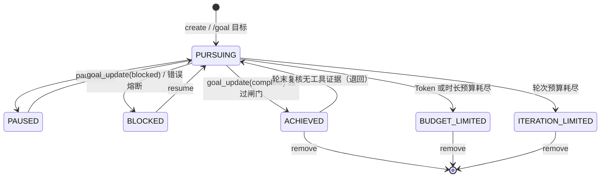

# solon-ai-harness-goal — 会话目标（/goal）

`solon-ai-harness` 的会话插件之一，提供「会话目标」能力：给定一个目标，插件按状态驱动一轮轮自动执行，直到**达成 / 预算耗尽 / 熔断阻塞**。

- 归属是**会话**，每会话最多一个 goal（单槽）；
- 状态以投影存放在会话快照中，随对话持久化，重启后仍在；
- 宿主从装配到运行期只接触一个类：`GoalExtension`；对外只交只读快照 `GoalTask`。

包名：`org.noear.solon.ai.harness.extension.goal`（验证器在子包 `validate`）。本模块只依赖核心契约 `solon-ai-harness-core`，不依赖其它插件。

---

## 一、功能介绍

### 1.1 与 loop 的区别

| 维度 | goal（本模块） | loop（`solon-ai-harness-loop`） |
|---|---|---|
| 数量 | 每会话最多 1 个 | 每会话可多条 |
| 驱动方式 | 状态驱动：固定 5 秒轮询，每轮自判是否续行 | 时间表驱动：间隔 / cron 独立触发 |
| 终止判据 | 模型声明完成并通过校验、预算（Token / 时长 / 轮次）、熔断 | 由任务定义决定 |
| 存储 | 会话快照投影（`session.goal`） | 独立任务文件 |
| 执行通道 | 自持，与 loop 不共享任何执行通道 | 自持 |

两者的执行器、结论类型（`GoalOutcome` / `LoopOutcome`）各自独立，互不共享。

### 1.2 状态机

`GoalTask.Status` 共 6 个值，转移只能经门面、命令或模型工具发生：



- 仅 `PURSUING` 可暂停；`PAUSED` / `BLOCKED` 可恢复；三个终态不可恢复、不可编辑，只能清除（`remove` 对任意状态都可用）。
- `BLOCKED` 的两个来源：模型主动 `goal_update(blocked)`，或异常分级熔断（见 1.5）。熔断后调度自动注销，`resume` 可续。

### 1.3 调度与每轮执行流程

调度由 `GoalScheduler` 完成：每个会话一个 job，`fixedDelay = 5000ms`；`runNow = true` 时 `initialDelay = 0`，否则等一个间隔。job 名为 `goal-<实例序号>:<sessionId>`，多个扩展实例共用 JVM 单例 JobManager 也不会撞名。job 只取**已存在**的会话（`getSessionOrNil`），会话不存在或 goal 已非活跃时自行注销。

每轮 `runRound` 的守卫顺序（任一条命中即退出本轮）：

1. goal 不存在或状态非 `PURSUING` → 退出；
2. 没有任何执行器（宿主注册与内置缺省都没有）→ 退出（`GoalExtension` 恒会装入缺省执行器，正常不会命中）；
3. `engine.isIdle(session) == false`（占用、HITL 挂起或有积压）或会话不存在 → 跳过，不计错误，等下一次调度；
4. 轮前预算守卫，按顺序：
   - 时长：`maxDurationMs > 0` 且已耗时 ≥ 上限 → 先跑一轮「收尾总结」，再转 `BUDGET_LIMITED`；
   - Token：`maxTokens > 0` 且已消耗 ≥ 上限 → 同上，转 `BUDGET_LIMITED`；
   - 轮次：`maxIterations > 0` 且已完成轮次 ≥ 上限 → 直接转 `ITERATION_LIMITED`（无收尾轮）；
5. CAS 防重入：本会话已有一轮在跑则退出（同一会话轮次不会并发）。

轮内流程：

1. `GoalPromptBuilder` 构建本轮提示词（按 Token 剩余比例切换：≥30% 完整引导、15%~30% 精简、<15% 极简；未设 Token 预算按完整引导）。连续无进展达 `stagnation` 阈值时注入「进展质疑」段，有连续同类错误时注入「错误警告」段；
2. 选择执行器：按注册顺序取首个认领者，全部不认领时用内置缺省执行器；
3. 按结论处理：
   - `skip` → 本轮放弃，不计错误、不推进、不改状态；
   - `failed` / 抛异常 / 返回 null → 进入错误分级熔断（见 1.5）；
   - `done` → 记录结果、清零连续错误、轮次 +1、累计 Token、计算执行指纹（无进展检测）；
4. 完成复核（见 1.4）；
5. 轮后预算：Token 超限 → 收尾轮后转 `BUDGET_LIMITED`；轮次达上限 → 转 `ITERATION_LIMITED`；
6. `commit`：写投影、`updateSnapshot()` 落盘，并广播给监听器。

> 无进展检测只做提示：执行指纹 = `是否有工具调用 : 文本长度/200 : 行数/10`，与上一轮相同则停滞计数 +1，达到阈值后在提示词中要求模型换策略或声明阻塞，**不会自动熔断**。

### 1.4 完成判定的几道闸

`goal_update(complete)` 只是声明。工具内按顺序校验，任一不过即返回错误 JSON、状态不变：

| # | 闸门 | 不满足时的错误码 |
|---|---|---|
| 1 | goal 处于 `PURSUING` | `GOAL_NOT_ACTIVE` |
| 2 | 执行证据（提示性）：目标含执行型关键词且「上一轮已写入的证据」为 false 时提前拦截。由于每轮执行前证据会被置空，轮内通常放行 | `ACTION_EVIDENCE_REQUIRED` |
| 3 | TODO 联动：经 `engine.getTodoTalent().readTodo(workspace, sessionId)` 读取清单，存在 `- [ ]` 或 `- [/]` 项则拒绝 | `TODO_UNFINISHED` |
| 4 | 验证器（`validatorEnabled = true` 时）：按目标文本匹配验证器链并执行 | `VALIDATION_FAILED` |

全部通过后状态转 `ACHIEVED`。**权威复核在轮末**：目标为执行型且本轮 `GoalOutcome.hasToolCalls() == false` 时，`ACHIEVED` 被退回 `PURSUING`，`lastResult` 记为「完成声明被拒绝：本轮没有实际工具执行证据……」。

执行型关键词（目标转小写后包含任一即为执行型）：

`create` `generate` `write` `implement` `modify` `edit` `fix` `add` `delete` `remove` `refactor` `build` `test` `run` `install` `configure` `deploy` `file` `生成` `创建` `新建` `编写` `写入` `修改` `编辑` `修复` `实现` `添加` `删除` `重构` `构建` `测试` `运行` `安装` `配置` `部署` `文件`

### 1.5 熔断规则

错误由核心 `ErrorClassifier` 分类（`SSL` / `NETWORK` / `HTTP_4XX` / `HTTP_5XX` / `TOOL_EXECUTION` / `OTHER`）。每次失败记录错误类型与摘要（截断 200 字符），然后：

1. goal 已非活跃或 Token 已超限 → 只落盘，不计数；
2. 连续错误数 +1；
3. 不可恢复错误（`SSL`、`HTTP_4XX`）连续同类 ≥ 2 次 → `BLOCKED`；
4. 任意类型连续同类 ≥ 3 次 → `BLOCKED`；
5. 连续错误数 ≥ `maxErrors`（缺省 3）→ `BLOCKED`；
6. 否则只落盘，由下一次 5 秒轮询重试（单一驱动源，不另行延迟补发）。

一轮 `done` 会清零连续错误与同类计数。

---

## 二、依赖

```xml
<dependency>
    <groupId>org.noear</groupId>
    <artifactId>solon-ai-harness-goal</artifactId>
    <version>${solon-ai.version}</version>
</dependency>
```

本模块传递依赖 `solon-ai-harness-core` 与 `solon-scheduling-simple`（调度使用 `JobManager`）。聚合包 `solon-ai-harness` 已包含本模块；聚合包只聚合依赖、不自动装配，仍需宿主显式挂载扩展。

---

## 三、使用说明

### 3.1 简单示例

装配后直接创建目标；不注册执行器时走内置缺省执行器：`engine.handle(HarnessInput.ofProgram(session, prompt, "goal")).call()`（程序生成的提示词，不解析命令与 @提及）。

```java
HarnessEngine engine = HarnessEngine.of("/data/work", ".solon/")
        .sessionProvider((id, create) -> InMemoryAgentSession.of(id)) // 生产环境应缓存实例
        .modelAdd(chatConfig)
        .defaultModel("deepseek")
        .build();

// 按类型幂等挂载；onAttach 内装配运行态、调度、/goal 命令与模型工具
GoalExtension goal = engine.addExtensionIfAbsent(GoalExtension.builder().build());

// 创建目标并立即调度首轮
GoalTask task = goal.create("cli", GoalSpec.of("修复登录模块的鉴权缺陷并让测试全绿")
        .maxTokens(200_000)
        .maxIterations(20));

System.out.println(task.getId() + " " + task.getStatus()); // PURSUING
```

需要 Solon 容器提供 `JobManager`（`solon-scheduling-simple` 已启动）；取不到且未显式 `jobManager(null)` 时会打印 warn：goal 只存不跑。

### 3.2 完整示例

#### 装配：Builder 全配置

```java
GoalExtension goal = engine.addExtensionIfAbsent(GoalExtension.builder()
        .budget(70, 85)            // 预算提示阈值：警告% / 紧急%
        .stagnation(3)             // 连续无进展多少轮注入进展质疑
        .maxErrors(3)              // 连续错误多少次熔断
        .validatorEnabled(true)    // 完成前验证（验证器在 engine.getWorkspace() 下执行）
        .jobManager(JobManager.getInstance()) // 缺省即取此单例；显式 null = 关闭调度
        .listener((sid, t, removed) -> log.info("goal {} -> {}", sid, t.getStatus()))
        .build());
```

#### 按通道注册执行器

`addExecutor` 必须在扩展挂接到引擎之后调用（之前调用抛 `IllegalStateException`）。认领谓词应互斥；多个同时命中时取首个并告警（每个命中组合一次）。谓词抛异常按不命中处理；`claim` 传 null 表示认领全部。

```java
goal.addExecutor("web", sid -> sid.startsWith("web-"), (sid, prompt) -> {
    if (webRuntimeReady(sid) == false) {
        return GoalOutcome.skip("runtime not ready");   // 本轮放弃，不计错误
    }
    AgentSession session = engine.getSessionOrNil(sid);
    if (session == null) {
        return GoalOutcome.skip("session not found");
    }
    ReActResponse resp = engine.handle(HarnessInput.ofProgram(session, prompt, "web")).call();
    boolean hasToolCalls = resp.getTrace() != null && resp.getTrace().getToolCallCount() > 0;
    long tokens = resp.getMetrics() != null ? resp.getMetrics().getTotalTokens() : 0L;
    return GoalOutcome.done(resp.getContent(), hasToolCalls, tokens); // 必须给出真实证据与 token
});
// 抛异常、返回 GoalOutcome.failed(...) 或 null 都按失败处理，参与熔断
```

`webRuntimeReady` 为宿主自有逻辑。会话忙由插件在调用执行器前统一判定（`engine.isIdle`），执行器无需再判。统计工具证据时可用 `GoalTalent.isGoalTool(toolName)` 排除 `goal_*` 自身工具。

#### 监听：推送前端

```java
goal.addListener((sessionId, task, removed) -> {
    Map<String, Object> row = task.toMap();   // removed=true 时为清除前的快照
    row.put("removed", removed);              // toMap 返回新的可变 Map，可追加宿主字段
    pushToClient(sessionId, row);
});
```

监听器抛异常只记 debug 日志，不影响状态流转。

#### 读取

```java
GoalTask cur = goal.get(sid);              // 当前 goal，无则 null
GoalTask byId = goal.get(sid, taskId);     // taskId 为空 = 当前；不匹配返回 null（与 loop 任务混排时分流）
if (cur != null) {
    Map<String, Object> view = cur.toMap();   // 标准展示视图，type = "GOAL"
    boolean running = cur.isRunning();        // 快照时刻是否有一轮在跑
}

// 状态事实：经引擎状态读取（不受开关影响）
GoalTask.Status st = engine.status(session).get(GoalExtension.STATUS_GOAL); // 无 goal 为 null
```

快照创建后不随运行态变化，需要最新值时重新 `get`。

#### 修改：update 与停流时序

```java
try {
    GoalTask after = goal.update(sid, taskId,
            GoalPatch.create().objective(newPrompt).maxTokens(newMaxTokens), // null 字段保持原值
            () -> {
                engine.cancelStream(engine.getSessionOrNil(sid)); // 停掉在跑轮次
                pushFinalFrame(sid);                              // 渠道侧收尾（宿主自有）
            });
    if (after == null) {
        // 不存在（或 taskId 不匹配）
    }
} catch (IllegalStateException e) {
    // goal 已是终态；或旧轮次 2 秒内未停稳（此时 goal 保持 PAUSED，可重试）
}
```

goal 为 `PURSUING` 时的固定时序：暂停并摘调度 → 执行 `stopper`（null 时用 `engine.cancelStream(session)`；`stopper` 抛异常只记日志）→ 最多等 2 秒让旧轮次停稳 → 改写（一次落盘、一次广播）→ 恢复并重挂调度、立即跑一轮。goal 为 `PAUSED` / `BLOCKED` 时只改写、不改状态、不调用 `stopper`。补丁为空时直接返回当前快照。

#### 暂停 / 恢复 / 立即触发 / 清除

```java
goal.pause(sid, taskId);    // PURSUING → PAUSED 并摘调度；false = 不存在或不可暂停
goal.resume(sid, taskId);   // PAUSED/BLOCKED → PURSUING，挂调度并立即跑；false = 不存在或不可恢复
goal.trigger(sid, taskId);  // 仅活跃态：挂调度（若未挂）并异步立即跑一轮；false = 不存在/非活跃/扩展已停用
goal.remove(sid, taskId);   // 先摘调度再清投影；false = 不存在
```

除 `create` 与 `update` 外，门面用返回值报告失败、不抛异常。

#### 重启恢复：recover

调度 job 只在内存，重启后需宿主批量恢复。`recover` 只对活跃态挂 job、**不立即跑**，已调度的幂等跳过；无调度器或扩展停用时返回 0。

```java
int n = goal.recover(listSessionIds(), sid -> {
    AgentSession s = engine.getSessionOrNil(sid);
    if (s != null) {
        return engine.status(s).get(GoalExtension.STATUS_GOAL);
    }
    // 会话尚未实例化：轻读快照里的投影
    return GoalProjection.statusOf(loadSnapshotContext(sid));
});
```

`listSessionIds` / `loadSnapshotContext` 为宿主自有逻辑；`statusReader` 返回 null 或抛异常按无 goal 处理。

#### 投影读写与迁移：GoalProjection

```java
FlowContext context = session.getContext();

// 读
GoalProjection p = GoalProjection.from(context);           // 无 goal / 非 Map / 缺或非法 status → null
if (p != null && p.isActive()) {
    long used = p.getConsumedTokens();
}
GoalTask.Status status = GoalProjection.statusOf(context); // 只要状态

// 写（历史数据迁移）：字段集合由 harness 定义，调用方只填值
GoalProjection.builder()
        .goalId(oldId)
        .objective(oldObjective)
        .statusName(oldStatusName)  // 非法名不抛异常，getStatus() 为 null
        .consumedTokens(oldUsed)
        .maxTokens(oldMax)
        .maxIterations(oldMaxIter)
        .currentIteration(oldIter)
        .startEpochMs(oldStart)
        .build()
        .writeTo(context);          // 覆盖写入，不落盘
session.updateSnapshot();           // 由调用方决定是否落盘
```

注意：status 为 null 的投影在读取时会被视为「无 goal」；运行态在首次访问后缓存于 `attrs()`，迁移应在该会话首次访问 goal 之前完成。

#### 自定义验证器

```java
goal.registerValidator(
        cond -> cond.contains("lint"),                  // 入参为已转小写的目标文本
        condition -> runLint()                          // 入参为目标原文
                ? GoalValidator.ValidationResult.passed()
                : GoalValidator.ValidationResult.failed("lint 未通过"));
```

同一目标命中多个验证器时按注册顺序 AND 执行，首个失败即返回；无命中时用 `NoopValidator`（恒通过并打 warn）。`registerValidator` 同样须在挂接后调用；matcher 或 validator 为 null 时忽略。

#### /goal 命令

```
/goal                                   # 打印当前目标状态
/goal 修复登录模块的鉴权缺陷             # 创建并立即调度首轮
/goal --max-tokens:2000 --max-iterations:10 让测试全绿
/goal --max-duration:30 重构订单模块     # 单位：分钟
/goal pause | resume | clear
```

命令解析出 `GoalSpec` 后调用与编程门面相同的 `create` 路径，`pause` / `resume` / `clear` 直接转调扩展方法。宿主如何接入命令、如何把每一轮的输出送回渠道，见第八章。

#### 开关：setExtensionEnabled

```java
engine.setExtensionEnabled(goal, false); // 关闭模型工具与 /goal 命令，并停止全部调度
engine.setExtensionEnabled(goal, true);  // 重新开启（不会自动重挂已有 goal 的调度）
```

关闭只停未来的调度，不打断正在执行的那一轮。重新开启后，已有的活跃 goal 需经 `recover` / `trigger` / `resume` 重新挂调度。

#### 测试场景：jobManager(null)

```java
GoalExtension ext = GoalExtension.builder().jobManager(null).build(); // 显式关闭调度，不打 warn
HarnessEngine engine = HarnessEngine.of(workspace, home)
        .sessionProvider((id, c) -> c ? sessions.computeIfAbsent(id, InMemoryAgentSession::of) : sessions.get(id))
        .extensionAdd(ext)
        .build();

GoalTask t = ext.create("s1", GoalSpec.of("目标").runNow(false));
assert ext.hasScheduler() == false;   // 不会自动推进
assert ext.hasActiveGoals() == false; // 无调度器时恒为 false
```

---

## 四、配置说明

### 4.1 GoalExtension.Builder

| 选项 | 类型 | 默认值 | 说明 |
|---|---|---|---|
| `budget(warningPercent, criticalPercent)` | `int, int` | `70, 85` | 预算提示阈值；已用比例 ≥ 警告%（且未达紧急）时提示词附「预算提示」，≥ 紧急% 时附「紧急」提示 |
| `stagnation(threshold)` | `int` | `3` | 连续无进展轮数达到该值后注入进展质疑段 |
| `maxErrors(count)` | `int` | `3` | 连续错误达到该值转 `BLOCKED` |
| `validatorEnabled(enabled)` | `boolean` | `true` | 是否执行完成前验证（第 4 道闸） |
| `jobManager(jobManager)` | `IJobManager` | `JobManager.getInstance()` | 显式传 null = 关闭调度；未显式设置且取不到时 warn |
| `listener(l)` | `GoalListener` | 无 | 预注册生命周期观察者 |
| `build()` | — | — | 构造 `GoalExtension`（构造器私有，只能经 builder） |

默认验证器仅在 `engine.getWorkspace()` 非空时注册。

### 4.2 GoalSpec（创建参数）

入口 `GoalSpec.of(objective)`：正文 null 或空白抛 `IllegalArgumentException("goal objective must not be empty")`，正文会被 `trim`。

| 字段 / 方法 | 类型 | 默认值 | 说明 |
|---|---|---|---|
| `objective`（`of`） | `String` | 必填 | 目标正文 |
| `maxTokens(long)` | `long` | `0` | Token 预算，0 = 不限制，负数按 0 |
| `maxDuration(Duration)` | `Duration` | `0` | 时长预算，null = 不限制 |
| `maxDurationMs(long)` | `long` | `0` | 时长预算毫秒，0 = 不限制，负数按 0 |
| `maxIterations(int)` | `int` | `0` | 轮次预算，0 = 不限制，负数按 0 |
| `displayObjective(String)` | `String` | `null` | 展示正文；null、空白或与正文相同时不区分（见注意事项） |
| `runNow(boolean)` | `boolean` | `true` | true = 首轮立即跑；false = 只挂调度，等一个间隔（5 秒） |

### 4.3 GoalPatch（修改补丁）

入口 `GoalPatch.create()`，null = 保持原值。

| 方法 | 类型 | null 语义 | 其它 |
|---|---|---|---|
| `objective(String)` | `String` | 保持 | 空白也视为未设置；会 `trim` |
| `maxTokens(Long)` | `Long` | 保持 | 0 = 不限制，负数按 0 |
| `maxDurationMs(Long)` | `Long` | 保持 | 0 = 不限制，负数按 0 |
| `maxIterations(Integer)` | `Integer` | 保持 | 0 = 不限制，负数按 0 |

### 4.4 GoalTask.Status

| 值 | 含义 | `isActive` | `isTerminal` | `isResumable` |
|---|---|---|---|---|
| `PURSUING` | 进行中，会被调度推进 | 是 | 否 | 否 |
| `PAUSED` | 已暂停 | 否 | 否 | 是 |
| `BLOCKED` | 模型声明阻塞或错误熔断 | 否 | 否 | 是 |
| `ACHIEVED` | 已达成 | 否 | 是 | 否 |
| `BUDGET_LIMITED` | Token 或时长预算耗尽 | 否 | 是 | 否 |
| `ITERATION_LIMITED` | 轮次预算耗尽 | 否 | 是 | 否 |

单槽判定：已有**非终态** goal 时 `create` 抛 `IllegalStateException("当前会话已有进行中的 Goal，请先清除后再创建")`；已是终态时可直接覆盖创建。

### 4.5 GoalTask.toMap 字段

| 键 | 值 | 说明 |
|---|---|---|
| `id` | String | goal 标识（taskId） |
| `type` | `"GOAL"` | 与 loop 任务同构，便于列表合并渲染 |
| `prompt` | String | 目标正文 |
| `enabled` | boolean | `status.isActive()` |
| `cancelled` | boolean | `status.isTerminal()` |
| `running` | boolean | 快照时刻是否在跑 |
| `intervalMinutes` | `0` | 固定值 |
| `runNow` | `true` | 固定值 |
| `currentIteration` | int | 已完成轮次 |
| `maxTokens` | long | 仅 > 0 时出现 |
| `maxDurationMs` | long | 仅 > 0 时出现 |
| `lastResult` | String | 仅非 null 时出现 |
| `lastExecutedAt` | String | ISO-8601，仅 > 0 时出现 |
| `goal.condition` | String | 目标正文 |
| `goal.status` | String | 状态枚举名 |
| `goal.iteration` | int | 已完成轮次 |
| `goal.maxIterations` | int | 轮次预算 |
| `goal.consumedTokens` | long | 已消耗 Token |
| `goal.maxTokens` | long | Token 预算 |
| `goal.startedAt` | String | ISO-8601，仅 > 0 时出现 |

### 4.6 GoalOutcome（执行器结论）

| 结论 | 构造 | goal 的处理 |
|---|---|---|
| 完成 | `done(finalText, hasToolCalls, tokensUsed)` | 记成功：轮次 +1、累计 token、无进展检测、完成证据复核；`finalText` 为 null 记为空串，空串时 `lastResult` 记为 `ok`；token 负数按 0 |
| 跳过 | `skip(reason)` | 本轮放弃：不计错误、不推进、不改状态，等下一次调度 |
| 失败 | `failed(error)`、抛异常、返回 null | 记失败，进入错误分级熔断 |

判定方法：`isDone()` / `isSkipped()` / `isFailed()`；取值：`getText()`、`hasToolCalls()`、`getTokensUsed()`。

### 4.7 /goal 命令与 flag

| 形式 | 行为 |
|---|---|
| `/goal` | 打印状态（Status / Iteration / Tokens / Elapsed / Last）；无目标时打印用法 |
| `/goal <objective>` | 创建并立即调度首轮；已有非终态 goal 时打印 WARN 与当前目标 |
| `/goal pause` | 暂停（大小写不敏感） |
| `/goal resume` | 恢复 |
| `/goal clear` | 清除 |

| flag | 类型 | 映射 |
|---|---|---|
| `--max-tokens:N` | long | `GoalSpec.maxTokens(N)` |
| `--max-duration:MIN` | long，单位分钟 | `GoalSpec.maxDurationMs(MIN * 60000)` |
| `--max-iterations:N` | int | `GoalSpec.maxIterations(N)` |

格式为 `--key:value`（冒号分隔）。无冒号或未知 key 打印 `Unknown flag` 并跳过；数值非法或正文为空时打印错误与 Usage。非 `--` 开头的参数按空格拼成目标正文。

### 4.8 模型工具（GoalTalent）

仅挂到顶层请求（子代理委派不挂），且仅当会话存在**非终态** goal 时对模型可见（`isSupported`）。

| 工具 | 参数 | 作用 |
|---|---|---|
| `goal_get` | 无 | 返回 `{goal:{taskId, objective, status(小写), iteration, maxIterations?, remainingIterations?, elapsedSeconds, consumedTokens, maxTokens?, budgetExceeded, maxDurationMs?, remainingDurationSeconds?}, remaining_tokens, completionBudgetReport}`；无 goal 返回 `NO_GOAL` |
| `goal_update` | `status`：`complete` 或 `blocked` | `complete` 过闸后标记 `ACHIEVED`，返回含预算摘要的 `completionBudgetReport`；`blocked` 转 `BLOCKED` |

### 4.9 完成判定与工具错误码

错误统一返回 `{"error":true,"code":"...","message":"..."}`。

| 错误码 | 触发条件 |
|---|---|
| `INVALID_PARAMETER` | `status` 为空或不是 `complete` / `blocked` |
| `NO_SESSION` | 无会话 ID |
| `NO_GOAL` | 当前会话无 goal |
| `GOAL_NOT_ACTIVE` | goal 不在 `PURSUING` |
| `ACTION_EVIDENCE_REQUIRED` | 执行型目标且已记录的证据为 false |
| `TODO_UNFINISHED` | TODO 清单有 `- [ ]` / `- [/]` 项 |
| `VALIDATION_FAILED` | 验证器未通过（message 含验证器 detail） |

### 4.10 内置验证器

| 验证器 | 匹配关键词（目标小写包含） | 行为 |
|---|---|---|
| `TestsPassValidator` | `test` `pass` `check` `ensure` `verify` | 按工作区文件选择命令：`pom.xml` → `mvn test`；`build.gradle(.kts)` → `gradle test`；`package.json` → `npm test`；`setup.py` / `pyproject.toml` → `python3 -m pytest`；退出码 0 通过。未识别项目类型、工作区为空或执行异常时**失败** |
| `BuildPassValidator` | `build` `compile` `implement` `refactor` `fix` `create` `add` `write` | `pom.xml` → `mvn compile -q -o`；`build.gradle(.kts)` → `gradle compileJava -q`；退出码非 0 失败。无构建工具、工作区为空或执行异常时**通过** |
| `NoopValidator` | 无命中时使用 | 恒通过，打 warn |

失败 detail 附带输出末尾 500 字符。

### 4.11 状态键

| 常量 | 键名 | 类型 | 说明 |
|---|---|---|---|
| `GoalExtension.STATUS_GOAL` | `goal.status` | `SessionStatus.Key<GoalTask.Status>` | 当前 goal 状态，无 goal 为 null；事实口径，不受开关影响 |

---

## 五、存储

存储介质是会话实现的细节（文件 / 内存 / Redis / JDBC），goal 只依赖 `AgentSession` 接口。

| 位置 | 键（`GoalAttrs`） | 内容 | 是否落盘 |
|---|---|---|---|
| `session.getContext().data()` | `session.goal`（`GoalAttrs.GOAL`） | Map 投影，单槽一条 | 是，每次变更后 `updateSnapshot()` |
| `session.attrs()` | `session.goal.state`（`GoalAttrs.GOAL_STATE`） | 包内运行态，首次访问从投影 hydrate | 否 |
| `session.attrs()` | `session.goal.running`（`GoalAttrs.GOAL_RUNNING`） | 轮次防重入标记 | 否 |

投影字段（由 `GoalProjection` 唯一定义）：`goalId`、`objective` 与 `condition`（双写，读取时 `condition` 优先）、`status`、`consumedTokens`、`maxTokens`、`maxIterations`、`startEpochMs`、`maxDurationMs`、`currentIteration`、`lastResult`、`lastExecutedAt`、`stagnationCount`、`consecutiveErrors`（后四项仅非零/非空时写入）。上一轮指纹、错误类型/摘要、连续同类错误数与工具证据不持久化，重启后从零计。

宿主不应直接读写这些键：投影走 `GoalProjection`，运行态走 `GoalExtension` 门面，状态事实走 `engine.status(session).get(GoalExtension.STATUS_GOAL)`。`GoalAttrs.GOAL` 的值不可改，改值会丢失存量 goal。

`GoalProjection` 速查：

| 方法 | 说明 |
|---|---|
| `from(FlowContext)` / `from(Object)` | 读取投影；无效时返回 null，不抛异常 |
| `statusOf(FlowContext)` | 只读状态枚举 |
| `builder()` … `build()` | 逐字段构造（`statusName` 容忍非法名） |
| `writeTo(FlowContext)` | 覆盖写入上下文，不落盘 |
| `toMap()` | 转为投影 Map |
| `getXxx()` / `isActive()` / `isTerminal()` | 类型化读取 |

---

## 六、API 速查

| 方法 | 返回 | 说明 |
|---|---|---|
| `GoalExtension.builder()` | `Builder` | 唯一构造入口 |
| `addExecutor(channel, claim, executor)` | `GoalExtension` | 挂接后调用；`channel` 为空抛 `IllegalArgumentException`；`executor` 为 null 忽略 |
| `addListener(listener)` | `GoalExtension` | 挂接后调用 |
| `registerValidator(matcher, validator)` | `GoalExtension` | 挂接后调用；AND 语义 |
| `create(sessionId, spec)` | `GoalTask` | 建并挂调度；会话解析不到抛 `IllegalArgumentException`；单槽冲突抛 `IllegalStateException` |
| `get(sessionId)` | `GoalTask` | 当前 goal，无则 null |
| `get(sessionId, taskId)` | `GoalTask` | taskId 为空 = 当前；不匹配 null |
| `update(sessionId, taskId, patch, stopper)` | `GoalTask` | null = 不存在；终态或停稳超时抛 `IllegalStateException` |
| `pause(sessionId, taskId)` | `boolean` | 仅 `PURSUING` |
| `resume(sessionId, taskId)` | `boolean` | `PAUSED` / `BLOCKED` |
| `trigger(sessionId, taskId)` | `boolean` | 仅活跃态且扩展启用 |
| `remove(sessionId, taskId)` | `boolean` | 先摘调度再清除 |
| `recover(sessionIds, statusReader)` | `int` | 实际挂上调度的会话数 |
| `hasActiveGoals()` | `boolean` | 是否仍有 goal 在调度（闲置回收判定） |
| `hasScheduler()` | `boolean` | 是否装配了调度器 |
| `setEnabled(Boolean)` | — | 同时开关工具、命令；关闭时停全部调度（建议经 `engine.setExtensionEnabled`） |
| `GoalExtension.STATUS_GOAL` | `SessionStatus.Key` | 状态事实键 |
| `GoalTalent.isGoalTool(name)` | `boolean` | 是否 `goal_` 前缀工具 |

扩展钩子：`onAttach` 装配运行态、调度、命令与工具；`onRequestAssemble` 为顶层请求挂 `GoalTalent`；`contributeSessionStatus` 贡献 `STATUS_GOAL`；`onSessionRemove` 注销该会话 job；`onDetach` 卸载全部 job（会话里的 goal 记录保留）。

---

## 七、注意事项

1. **执行器注册时机**：`addExecutor` / `addListener` / `registerValidator` 须在扩展挂接到引擎后调用，否则抛 `IllegalStateException("GoalExtension is not attached; ...")`。宿主注册的执行器恒优先于内置缺省执行器，与注册先后无关。
2. **done 必须带真实证据**：执行型目标的完成复核依赖 `hasToolCalls`，没有「从文本推测」的降级入口；`hasToolCalls = false` 时执行型目标永远无法达成。
3. **会话忙不要在执行器里判**：插件在调用执行器前已按 `engine.isIdle` 跳过；执行器只判断本通道此刻能否执行，不能则返回 `skip`。
4. **create 会解析会话**：`create` 经 `engine.getSession(sessionId)` 解析会话，由 `sessionProvider` 决定是否新建；而调度轮次只用 `getSessionOrNil`，会话被删后 job 自行注销，不会重建会话。
5. **停用期间**：`create` 仍会写入状态但不挂调度；`trigger` / `recover` 返回 false / 0。重新启用不会自动恢复调度，需要 `recover`、`trigger` 或 `resume`。
6. **恢复不清零错误计数**：`resume` 只改状态，连续错误数（持久化）要等一轮 `done` 才清零；因错误熔断的 goal 恢复后若立即再失败，可能马上再次熔断。
7. **预算耗尽的收尾轮**：Token / 时长耗尽时会额外执行一轮收尾总结提示词，该轮的 token 不计入 `consumedTokens`，收尾轮失败只记 warn。轮次耗尽没有收尾轮。终态 goal 不能 `update`，无法通过补丁扩容预算，只能清除后重建。
8. **时长预算只在轮前检查**：单轮执行时间可能超出 `maxDurationMs`，下一轮开始前才转 `BUDGET_LIMITED`。
9. **displayObjective 的实际效果**：按当前源码，设置了不同的展示正文后，运行态只保存展示正文；后续每轮提示词、执行型关键词判定与验证器匹配均基于展示正文，执行正文（如拼入的附件全文）不会被保存。
10. **默认验证器会执行真实构建命令**：`mvn test` 等命令在引擎工作区同步执行，可能耗时较长；不需要时用 `validatorEnabled(false)`，或注册更精确的自定义验证器（注意内置验证器按 AND 与自定义验证器一起生效）。
11. **装配用 `addExtensionIfAbsent`**：`addExtension` 不查重，重复挂载会二次 `onAttach`。`/goal` 命令注册幂等，引擎上已有同名命令时保持原实例。
12. **`BudgetThresholds` 为包内类型**：宿主只能通过 `Builder.budget(...)` 配置阈值。

---

## 八、命令路径：/goal 与宿主协作

### 8.1 命令的边界

| 项 | 说明 |
|---|---|
| 注册 | `GoalExtension#onAttach` 自动注册（幂等），宿主不用注册 |
| 会话 | 作用于本次输入所在会话 `ctx.getSession()` |
| 结局 | 恒为 `Kind.REPLY`：命令只建目标或改状态并回执，**不在本次 `handle` 里开流**；后续轮次由调度器驱动，别等 `getRequest()` |
| 渠道 | `terminalOnly() == false`，Web / IM / 桌面可用 |
| 忙态 | `runnableWhenBusy()` 为缺省 `false`：任务（含 goal 自己的一轮）运行中输入的 `/goal ...`，`engine.admit` 给出 `DEFER`（排队）；没装 queue 时给出 `REJECT("busy")` |
| 开关 | `engine.setExtensionEnabled(goal, false)` 后命令回执 `/goal 已停用。发送 /help 查看可用命令。` |
| 回执格式 | 缺省缓冲式命令上下文会去掉 ANSI 颜色，回执从 `outcome.getCommandOutput()` 取回 |

回执（英文，来自 `GoalCommand`）：

| 情形 | 回执 |
|---|---|
| 创建成功 | `Goal registered:`，随后列出 `Objective`、设置了的预算，以及 `State: saved with this conversation` |
| 已有非终态 goal | `WARN: 当前会话已有进行中的 Goal，请先清除后再创建`，`Active: <当前目标>`，`Use /goal clear first to replace the goal.` |
| 正文为空 / 数值非法 | 错误信息 + `Usage: /goal [--max-tokens:N] [--max-duration:MIN] [--max-iterations:N] <objective>` + 示例 |
| `pause` / `resume` / `clear` | `Goal paused.` / `Goal resumed.` / `Goal cleared.`；无 goal 时 `No goal in this session.`；状态不允许时 `Cannot pause/resume goal in state: <状态>` |

### 8.2 宿主接入：完整示例

`/goal` 只负责"立目标"；之后每一轮由调度器调用**执行器**完成，执行器的输出由宿主送回渠道。宿主要接三处：输入入口（命令能执行）、执行器（每一轮有去处）、监听器（状态变化能推给前端或渠道）。

```java
import org.noear.solon.ai.agent.AgentSession;
import org.noear.solon.ai.agent.react.ReActResponse;
import org.noear.solon.ai.harness.HarnessEngine;
import org.noear.solon.ai.harness.extension.goal.GoalExtension;
import org.noear.solon.ai.harness.extension.goal.GoalOutcome;
import org.noear.solon.ai.harness.extension.goal.GoalTalent;
import org.noear.solon.ai.harness.extension.queue.QueueExtension;
import org.noear.solon.ai.harness.input.HarnessInput;
import org.noear.solon.ai.harness.input.InputOrigin;
import org.noear.solon.ai.harness.input.InputOutcome;
import org.noear.solon.ai.harness.turn.AdmitDecision;
import org.noear.solon.ai.harness.turn.InputGate;

import java.util.Map;
import java.util.concurrent.ConcurrentHashMap;

public class ImGoalHost {
    private final HarnessEngine engine;
    private final QueueExtension queue;
    private final GoalExtension goal;
    /** 会话最近一次的回复路由（调度轮次没有入站消息，只能回到这里） */
    private final Map<String, InputOrigin> routes = new ConcurrentHashMap<>();

    public ImGoalHost(HarnessEngine engine) {
        this.engine = engine;
        this.queue = engine.addExtensionIfAbsent(new QueueExtension());
        this.goal = engine.addExtensionIfAbsent(GoalExtension.builder().build()); // 注册 /goal

        // 执行器：挂接后注册；谓词应与其它通道互斥
        goal.addExecutor("im", sid -> sid.startsWith("im-"), (sid, prompt) -> {
            AgentSession session = engine.getSessionOrNil(sid);
            InputOrigin route = routes.get(sid);
            if (session == null || route == null) {
                return GoalOutcome.skip("no session or reply route");   // 本轮放弃，不计错误
            }
            try {
                ReActResponse resp = engine.handle(HarnessInput.ofProgram(session, prompt, "goal")).call();
                reply(route, resp.getContent());
                // 完成判定依赖真实的工具证据与 token：从 trace 读，不要从文本猜
                boolean hasToolCalls = resp.getTrace() != null && resp.getTrace().getToolCallCount() > 0;
                long tokens = resp.getMetrics() != null ? resp.getMetrics().getTotalTokens() : 0L;
                return GoalOutcome.done(resp.getContent(), hasToolCalls, tokens);
            } finally {
                drain(session);   // 这一轮占用期间用户发来的消息（包括 /goal pause）被延后了：立即续发
            }
        });

        // 监听器：状态变化推回渠道（达成、阻塞、预算耗尽等）
        goal.addListener((sid, task, removed) -> {
            InputOrigin route = routes.get(sid);
            if (route != null && (removed || task.getStatus().isActive() == false)) {
                reply(route, "[goal] " + (removed ? "已清除" : task.getStatus().name()));
            }
        });
    }

    /** 输入入口：/goal 命令与普通消息共用 */
    public void onMessage(AgentSession session, String text, InputOrigin origin) {
        AdmitDecision admit = engine.admit(session, text, false, engine::isBusyBypassCommand);
        switch (admit.getKind()) {
            case REJECT:
                reply(origin, admit.getRejectDetail());
                return;
            case DEFER:   // goal 的一轮正在跑时发来的 /goal pause 等：排队，本轮结束后执行
                int pos = queue.enqueue(session, text, origin);
                reply(origin, pos < 0 ? "排队失败，请稍后再试" : "当前一轮结束后执行（第 " + pos + " 位）");
                return;
            default:
                break;
        }

        routes.put(session.getSessionId(), origin);   // 调度轮次的输出回到这里

        boolean acquired = admit.getTicket().isAcquired();
        try (InputGate.Ticket ticket = admit.getTicket()) {
            InputOutcome outcome = engine.handle(HarnessInput.of(session, text).origin(origin));
            if (outcome.getKind() == InputOutcome.Kind.REPLY) {
                reply(origin, outcome.getCommandOutput());          // /goal 的回执
            } else if (outcome.getKind() == InputOutcome.Kind.TASK) {
                reply(origin, outcome.getRequest().call().getContent());
            }
        } catch (Throwable e) {
            reply(origin, "处理失败：" + e.getMessage());
        } finally {
            if (acquired) {
                drain(session);
            }
        }
    }

    private void drain(AgentSession session) {
        queue.drainLoop(session, s -> !engine.status(s).isOccupied(), claim -> {
            onMessage(session, claim.getItem().getText(), claim.getItem().getOrigin());
            return true;
        });
    }

    /** 进程启动：恢复活跃 goal 的调度（只挂 job，不立即跑） */
    public void onStartup(Iterable<String> sessionIds) {
        goal.recover(sessionIds, sid -> {
            AgentSession s = engine.getSessionOrNil(sid);
            return s == null ? null : engine.status(s).get(GoalExtension.STATUS_GOAL);
        });
    }

    private void reply(InputOrigin origin, String text) { /* 按 origin 回投渠道 */ }
}
```

### 8.3 协作要点

1. **命令立目标，调度器跑轮次**：`/goal <目标>` 与 `goal.create(...)` 是同一条路径；创建后首轮由调度器异步发起（命令解析出的 `GoalSpec` 保持缺省 `runNow = true`）。首轮开始时如果宿主还没释放这次输入的受理位，或队列里还有积压，`engine.isIdle` 为假，这一轮会被跳过，5 秒后的下一次轮询再跑，属正常现象。
2. **执行器决定输出去向**：内置缺省执行器只把结果记进 `lastResult`，不会推送给任何渠道；需要让用户看到每一轮的宿主必须按通道注册执行器，并自行保存会话到渠道的回复路由。
3. **`done` 必须带真实证据**：执行型目标（含 `fix`、`build`、`修改` 等关键词）的完成复核依赖 `hasToolCalls`；固定传 `false` 会让这类目标永远无法达成。统计工具调用时可用 `GoalTalent.isGoalTool(name)` 排除 `goal_*` 自身工具。
4. **会话忙由插件判**：调度轮次先判 `engine.isIdle(session)`，执行器不需要再判；本通道此刻不能执行（如前端未连接）时返回 `GoalOutcome.skip(...)`，不要返回失败，否则会计入熔断。
5. **轮次结束要续发队列**：goal 的一轮占用会话期间，用户输入（包括 `/goal pause`、`/goal clear`）被 `DEFER` 进队列。执行器结束时 `drain`；而 goal 调度在队列有积压时也不会开下一轮，所以排队的 `/goal pause` 一定先于下一轮执行。
6. **想立刻停下当前一轮**：`/goal pause` 只阻止下一轮，不打断正在跑的这一轮。要立刻停，用宿主停止入口 `engine.interrupt(session)`，再 `goal.pause(sid, null)`；改目标用 `goal.update(sid, taskId, patch, stopper)`，它自带"暂停 → 停流 → 等停稳 → 改写 → 恢复"的时序。
7. **单槽冲突在回执里**：已有非终态 goal 时命令不会抛异常，只回执 `WARN`；走门面 `create` 时是 `IllegalStateException`，Web 接口宜映射成 409。
8. **重启要恢复调度**：goal 状态随会话快照持久化，但调度 job 只在内存；启动时调 `recover`（只挂 job、不立即跑）。会话尚未加载时可用 `GoalProjection.statusOf(context)` 轻读快照。
9. **删除会话先调 `engine.removeSession`**：它回调 `onSessionRemove` 注销该会话的 job；调度轮次只用 `getSessionOrNil`，会话不存在时 job 自行注销，不会把会话重新建出来。
10. **审批挂起**：goal 的一轮触发 HITL 审批时，会话处于占用状态，调度会持续跳过；审批决策输入在 `admit` 中天然豁免（第 3 个参数传 `true`），续流完成后 goal 才继续。
