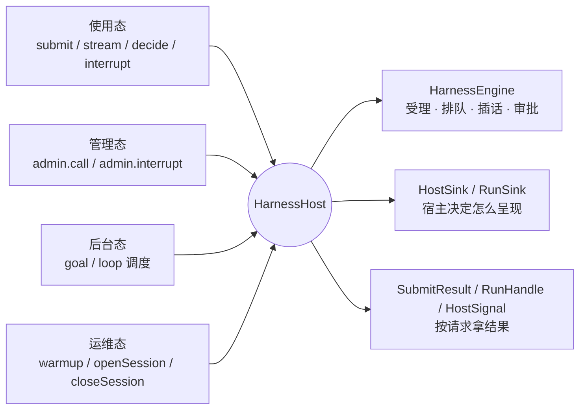

# solon-ai-harness-host

solon-ai harness 的**宿主骨架（L0）**：把「受理 → 开流 → 终态 → 续发积压」整套编排收进框架，宿主只决定**输出怎么呈现**。HTTP 一问一答、SSE、IM 机器人、多会话推送的 Web 应用、管理控制台都用同一套 API，按需加深。

- 包名：`org.noear.solon.ai.harness.host`
- 起始版本：4.2.0（全部类型标注 `@Preview("4.2.0")`，4.2.x 内可能还有调整）
- 依赖：`solon-ai-harness-core` + goal / queue / steer / loop 四个会话插件
- 引擎池 `HarnessEnginePool` 在 core（`org.noear.solon.ai.harness.HarnessEnginePool`），通常作为 `engines(pool::get)` 的来源
- 聚合包 `solon-ai-harness` 只做引用，已包含本模块

> 本文示例都摘自 `src/test/java/features/ai/harness/all/ReadmeSamples.java`（文中省略了 import 与重复的端点），随构建编译，主干流程由 `ReadmeSampleTest` 运行。改示例时两边同步。
> 多租户 SaaS 的引擎构建、权限与上线清单见 [QUICKSTART-SAAS.md](docs/QUICKSTART-SAAS.md)；术语见 [CONCEPTS.md](docs/CONCEPTS.md)；引擎构建与配置见 [core README](../solon-ai-harness-core/README.md)；引擎侧的隔离、作用域、会话归属与容量见 [SAAS.md](../solon-ai-harness-core/docs/SAAS.md)；设计取舍见 [HOST-OPTIMIZATION.md](docs/HOST-OPTIMIZATION.md)。

**目录**

1. [先选对层、先认识哪几个类型](#1-先选对层先认识哪几个类型)
2. [依赖与装配](#2-依赖与装配)
3. [四种时态](#3-四种时态)
4. [使用态：用户在对话里输入](#4-使用态用户在对话里输入)（一问一答 / SSE / IM / Web 推送 / 审批 / 停止 / 忙时策略 / 补充输入）
5. [管理态：用户在界面上操作](#5-管理态用户在界面上操作)
6. [后台态：goal / loop 自己跑](#6-后台态goal--loop-自己跑)
7. [运维态：启动、会话生命周期、多节点](#7-运维态启动会话生命周期多节点)
8. [配置说明](#8-配置说明)
9. [方法说明](#9-方法说明)
10. [回调时序与线程](#10-回调时序与线程)
11. [框架代办的事](#11-框架代办的事)
12. [常见错误](#12-常见错误)
13. [模块边界（守卫测试）](#13-模块边界守卫测试)

---

## 1. 先选对层、先认识哪几个类型

| 层 | 入口 | 适用 |
|---|---|---|
| **L0 宿主骨架**（本模块） | `HarnessHost` + `HarnessInput`（+ 可选 `HostSink` / `RunSink`） | SaaS、IM 机器人、HTTP / SSE、多会话推送、管理控制台 |
| L1 受理 API | `engine.handle` + `InputOutcome` + `RunTicket` | 只要核心、不要插件，或要完全自己掌握编排 |
| L2 扩展 SPI | `HarnessExtension`、`InputBacklog`、`RunDispatch` | 写插件 |

用 L0 时按形态加深，后一档不影响前一档：

| 档 | 要认识的类型 | 写什么 | 够用于 |
|---|---|---|---|
| ① 一问一答 | `HarnessHost`、`HarnessInput`（core，与直连 `engine.handle` 同一个类型）、`SubmitResult`、`RunHandle` / `RunOutcome`、`HostSignal` | 不写 sink | HTTP / SSE / 批处理 / 无头脚本 |
| ② 推送型 | + `HostSink`、`HostInput`、`HostRun` | 覆盖 `HostSink` 的几个回调 | IM 机器人、只发最终文本的推送 |
| ③ 每轮有状态 | + `RunSink`、`RunPrep` | 覆盖 `HostSink#open`，每轮返回一个 `RunSink` | 流式渲染、按轮序号、按轮调整请求 |
| 管理态 | + `SessionAdmin` | 控制器里 `host.admin(tenant).call(...)` | 控制台、后台 API |

三个对象的分工：`HostInput` 是**一次输入**（来源、文本、受理结果），`HostRun` 是这次输入开出的**一轮运行**（0 或 1 个，`run.getInput()` 指回输入），`RunOutcome` 是这一轮的**终态**（恰好一个）。

### 1.1 会话状态：先读引擎，不要自拼

宿主几乎都要回答“现在还能不能接新输入”、“还要不要占住用户”这类问题。答案都已在引擎里，**不要自己拼 `isBusy()` / `isAdmitting()` 的组合**：口径一旦漏项（典型是漏掉积压续发），表现是“偶发、难复现”的错误。

`engine.status(session)` 返回 `SessionStatus` 快照（核心事实一次读全），下表的方法都在这一层或 `HarnessEngine` 上：

| 你要回答的问题 | 用什么 | 不要拿它做什么 |
|---|---|---|
| 有轮次正在跑？跑几个？ | `status.isBusy()`、`status.getActiveRunCount()` | 不含审批挂起：别用它判断“能不能接新输入” |
| 已受理、运行流还没登记？ | `status.isAdmitting()` | 单看它会漏掉已在跑的轮次 |
| 有卡等用户审批？几张？ | `status.hasPendingHitl()`、`status.getPendingHitlCount()` | — |
| **能不能接新输入？** | `status.isOccupied()` | 这是唯一正确口径（受理窗口、在跑、挂起卡都算占用） |
| **还会不会有轮次跑起来？（含积压续发）** | `engine.isIdle(session)` | 审批挂起时它也是 `false`：终端宿主问审批前要先看 `hasPendingHitl()` |
| 这条斜杠命令能否在任务运行中被受理？ | `engine.isRunnableWhenBusy(input)` | 它只回答“忙时是否放行”，不回答“空闲时能否启动任务” |
| 整台引擎能否回收？ | `engine.isQuiescent()`、`engine.getActiveRunCount()` | 引擎池按它回收，不是按会话状态 |

其中 `engine.isIdle(session)` 是关键的一条：它的口径是「不占用 **且** 没有积压能力报告待执行输入」。**一轮结束到续发下一轮开出之间，`isBusy()` 与 `isAdmitting()` 会短暂全假，而 `isIdle()` 仍为 `false`**（队列里那条还没被领取）。所以终端、桌面这类“占住输入直到全部结束”的宿主，直接用 `isIdle()` 即可，**不要自造静默窗口**去兜底。

---

## 2. 依赖与装配

### 2.1 依赖

```xml
<dependency>
    <groupId>org.noear</groupId>
    <artifactId>solon-ai-harness-host</artifactId>
    <version>${solon-ai.version}</version>
</dependency>
```

**引入不等于装配**：插件上了类路径不会自己生效，要在构建引擎时用 `HarnessEngine.Builder.extensionAdd(...)` 挂上（SERVER 模式下 build 之后不能再挂）。不装 queue 时会话忙就直接拒绝（`busy`），不装 steer 时 `whenBusy(STEER)` 退化为排队。引擎的完整构建写法见 [QUICKSTART-SAAS.md §3.1](docs/QUICKSTART-SAAS.md)。

### 2.2 最小装配（单租户、不写 sink）

```java
HarnessHost host = HarnessHost.builder()
        .engines(tenant -> engine)          // 单租户：返回同一个引擎
        .build();

host.openSession("default", sid, null);     // 单用户 / 本地部署可不写主体
RunOutcome o = host.submit("default", sid, HarnessInput.of("hello")).getRun().await(Duration.ofMinutes(5));
```

### 2.3 完整装配（多租户，用到全部配置项）

```java
HarnessEnginePool pool = HarnessEnginePool.builder(this::buildEngine)   // 每个租户一个引擎
        .idleTtl(Duration.ofMinutes(30))
        .maxEngines(500)
        .build();

HarnessHost host = HarnessHost.builder()
        .engines(pool::get)                                     // 必填：租户 → 引擎
        .sink(sink)                                             // 全局输出通道（第 ② ③ 档）
        .wrap((tenant, task) -> () -> {                         // 框架代跑的动作带上租户上下文
            MDC.put("tenant", tenant);
            try {
                task.run();
            } finally {
                MDC.remove("tenant");
            }
        })
        .input((tenant, in) -> in.attr("tenant", tenant))       // 每条输入（含续发、后台轮次）都补上
        .programRuns(sid -> sid.startsWith("web-"))             // 只接管本入口会话的 goal / loop
        .build();
```

每项的缺省值与含义见 [§8 配置说明](#8-配置说明)。在 Solon 里把 `host` 注册成 Bean（`@Bean`），控制器 `@Inject HarnessHost host` 即可。

---

## 3. 四种时态

同一个会话会被四类动作触及。分清时态，才知道该调哪个入口、输出从哪里出来：

| 时态 | 谁触发 | 入口 | 输出从哪里出 | 典型场景 |
|---|---|---|---|---|
| **使用态** | 用户在对话框里输入（含斜杠命令、审批、停止） | `submit` / `stream` / `decide` / `interrupt` | `SubmitResult`、`HostSignal` 流，或 `HostSink` / `RunSink` 回调 | 聊天、IM、SSE 接口 |
| **管理态** | 用户在界面上点按钮（队列、插话、目标、定时任务） | `host.admin(tenant).call(sid, 扩展, 操作)` / `admin.interrupt` | `HarnessResult`（同步）；引起的续发照常走 sink | 控制台、侧边栏面板、后台 API |
| **后台态** | goal / loop 插件按调度自己跑 | 无（框架首次取到引擎时自动接管） | 同使用态：`HostSink#open` → `RunSink` → `runFinished`，`run.isProgram()` 为 true | 长目标、定时提醒 |
| **运维态** | 系统启动、建 / 删会话、引擎回收、多节点 | `warmup` / `openSession` / `closeSession`，`notOwner` 回调 | 返回值、异常 | 重启恢复、删除对话、网关转发 |



四种时态共用同一条运行链：无论一轮是谁开出的（用户、队列续发、管理态入队、goal / loop），都恰好经过一次 `open → … → finished`，结束后框架自动续发积压。

---

## 4. 使用态：用户在对话里输入

### 4.1 一问一答（同步 HTTP，第 ① 档）

不写 sink，按请求等终态。会话忙时直接拒绝：请求结束就没人接排队的那一轮了。

```java
@Controller
public class AskController {
    @Inject
    HarnessHost host;

    @Post
    @Mapping("/ask/{tenant}/{sid}")
    public Result<String> ask(String tenant, String sid, String text, Context ctx) throws InterruptedException {
        SubmitResult r = host.submit(tenant, sid, HarnessInput.of(text)
                .origin(InputOrigin.of("http", userOf(ctx), null, null))
                .principal(principalOf(tenant, userOf(ctx)))        // sessionId 来自客户端：必须校验主体
                .whenBusy(BusyPolicy.REJECT));           // 请求结束就没人接了：忙时不排队

        switch (r.getDisposition()) {
            case STARTED:
                return awaitAnswer(r.getRun());
            case REPLY:                                             // 斜杠命令的回执
                return Result.succeed(r.getReplyText());
            default:                                                // REJECTED / IGNORED / ...
                ctx.status(r.httpStatus());
                return Result.failure(r.httpStatus(),
                        r.getRejectReason() != null ? r.getRejectReason().code() : r.getDisposition().name());
        }
    }

    static Result<String> awaitAnswer(RunHandle run) throws InterruptedException {
        RunOutcome o;
        try {
            o = run.await(Duration.ofMinutes(5));
        } catch (TimeoutException e) {
            run.cancel();                                           // 只停这一轮
            return Result.failure(504, "timeout");
        }

        if (o.getHitlCards().isEmpty() == false) {                  // 挂起等审批
            return Result.failure(409, "approval required: " + o.getHitlCards().get(0).getCallId());
        }
        switch (o.getEnd()) {
            case COMPLETED:
                return o.isAbnormal()
                        ? Result.failure(500, "task not finished (e.g. max turns exceeded)")
                        : Result.succeed(o.getResultText());
            case CANCELLED:
                return Result.failure(409, "cancelled: " + o.getCancelCause());
            default:
                return Result.failure(500, String.valueOf(o.getError()));
        }
    }
}
```

要点：
- 判终态时**先看 `isAbnormal()`**：模型报错、超出 maxTurns 等 ReAct 异常结束时，流本身正常结束，`getEnd()` 仍是 `COMPLETED`，`getResultText()` 可能是半成品或空（`ReadmeSampleTest` 用一个连不上的模型验证了这一点）。
- `FAILED` 是开流失败、流出错；`CANCELLED` 的原因在 `getCancelCause()`。
- 示例里的 `userOf(ctx)` / `principalOf(tenant, user)` 代表你的登录态；主体建议写成 `tenant + "/" + userId`，防止跨租户串号。

### 4.2 SSE 流式（第 ① 档）

`host.stream` 把本次请求「发生了什么」作为信号流返回，直接交给 SSE。**客户端断开会停掉本轮**（框架代办，含 `submit` 还没返回时就断开的情况）。

```java
@Get
@Produces(MimeType.TEXT_EVENT_STREAM_VALUE)
@Mapping("/sse/{tenant}/{sid}")
public Flux<Map<String, Object>> sse(String tenant, String sid, String text, Context ctx) {
    return host.stream(tenant, sid, HarnessInput.of(text)
                    .origin(InputOrigin.of("sse", userOf(ctx), null, null))
                    .principal(principalOf(tenant, userOf(ctx)))
                    .whenBusy(BusyPolicy.REJECT))
            .handle((signal, out) -> {
                Map<String, Object> frame = toFrame(signal);
                if (frame != null) {
                    out.next(frame);
                }
            });
}

/** 信号 → 前端帧（协议由你定，这里是最小的一份） */
static Map<String, Object> toFrame(HostSignal s) {
    Map<String, Object> f = new LinkedHashMap<>();
    switch (s.getType()) {
        case EVENT: {
            AgentEvent e = s.getEvent();
            if (e instanceof ReasonDeltaEvent) {
                ReasonDeltaEvent d = (ReasonDeltaEvent) e;
                f.put("type", d.isThinking() ? "thinking" : "text");
                f.put("text", d.getText());
            } else if (e instanceof ToolCallStartEvent) {
                f.put("type", "tool_start");
                f.put("name", ((ToolCallStartEvent) e).getToolName());
            } else if (e instanceof ToolCallEndEvent) {
                f.put("type", "tool_end");
                f.put("error", ((ToolCallEndEvent) e).isError());
            } else {
                return null;                                    // 其余事件不发给前端
            }
            return f;
        }
        case REPLY:
            f.put("type", "reply");
            f.put("text", s.getText());
            return f;
        case HITL:
            f.put("type", "hitl");
            f.put("callIds", callIdsOf(s.getCards()));
            return f;
        case REJECTED:
            f.put("type", "error");
            f.put("code", s.getRejectReason().code());
            return f;
        case FINISHED: {
            RunOutcome o = s.getOutcome();
            f.put("type", "done");
            f.put("end", o.getEnd().name());
            f.put("tokens", o.getUsage().getTotalTokens());
            return f;
        }
        default:                                                // DEFERRED / STEERED / IGNORED
            f.put("type", s.getType().name().toLowerCase());
            return f;
    }
}
```

信号顺序：开了流时 `REPLY?` → `EVENT*` → `HITL?` → `FINISHED`；没开流时只有一个结局信号（`REPLY` / `DEFERRED` / `STEERED` / `REJECTED` / `HITL` / `IGNORED`）。全局 sink 照常收到全部回调（可同时用来计费、审计）。

### 4.3 IM 机器人（推送型，第 ② 档）

一个群 / 私聊 = 一个会话；只发文本；忙时先插话；审批用文字指令。只覆盖需要的回调，其余用缺省（缺省只记日志）。

```java
/** IM 平台的发送接口（示例） */
interface ImClient {
    void send(String chatId, String text);
}

final class ImBot implements HostSink {
    final HarnessHost host;
    private final ImClient im;

    ImBot(Function<String, HarnessEngine> engines, ImClient im) {
        this.im = im;
        this.host = HarnessHost.builder()
                .engines(engines)
                .sink(this)
                .programRuns(sid -> sid.startsWith("im-"))          // 同一引擎上还有别的入口：只接管 IM 会话
                .build();
    }

    private static String sessionOf(String chatId) { return "im-" + chatId; }
    private static String chatOf(String sessionId) { return sessionId.substring(3); }

    /** IM 平台的消息回调 */
    public SubmitResult onMessage(String tenant, String chatId, String userId, String msgId, String text) {
        String sid = sessionOf(chatId);
        String principal = principalOf(tenant, chatId);              // IM 以「聊天」为主体
        host.openSession(tenant, sid, principal);                    // 幂等：已有且主体相同时直接返回

        InputOrigin origin = InputOrigin.of("im", userId, chatId, msgId);
        if (text.startsWith("approve ") || text.startsWith("reject ")) {
            String[] parts = text.split(" ", 2);
            return host.decide(tenant, sid, parts[1].trim(), HITLAction.of(parts[0]), null, origin);
        }
        return host.submit(tenant, sid, HarnessInput.of(text)
                .origin(origin)
                .principal(principal)
                .whenBusy(BusyPolicy.STEER));            // 边跑边补充；插不进再排队
    }

    @Override
    public void reply(HostInput input, String text) {               // 命令回执
        im.send(chatOf(input.getSessionId()), text);
    }

    @Override
    public void deferred(HostInput input, int position) {
        im.send(chatOf(input.getSessionId()), "Queued (#" + position + "), will run after the current task.");
    }

    @Override
    public void steered(HostInput input) {
        im.send(chatOf(input.getSessionId()), "Got it, added to the current task.");
    }

    @Override
    public void rejected(HostInput input, RejectReason reason, String detail) {
        im.send(chatOf(input.getSessionId()), reason == RejectReason.HITL_PENDING
                ? "Please approve or reject the pending action first."
                : "Not accepted: " + reason.code());
    }

    @Override
    public void hitl(HostInput input, List<HitlCard> cards) {
        for (HitlCard c : cards) {
            im.send(chatOf(input.getSessionId()), "Run " + c.getToolName() + "? Reply 'approve "
                    + c.getCallId() + "' or 'reject " + c.getCallId() + "'.");
        }
    }

    @Override
    public void hitlExpired(HostInput input) {
        im.send(chatOf(input.getSessionId()), "This approval has expired.");
    }

    @Override
    public void runFinished(HostRun run, RunOutcome o) {            // IM 只发最终文本（含 goal / loop 轮次）
        String chat = chatOf(run.getSessionId());
        String prefix = run.isProgram() ? "[" + run.getProgramChannel() + "] " : "";
        if (o.isCompleted()) {
            if (o.isAbnormal()) {
                im.send(chat, prefix + "The task could not be finished.");
            } else if (o.getResultText() != null) {
                im.send(chat, prefix + o.getResultText());
            }
        } else if (o.isFailed()) {
            im.send(chat, prefix + "Something went wrong.");
        } else if (o.getCancelCause() == RunOutcome.CancelCause.INTERRUPT_ALL) {
            im.send(chat, "Stopped.");                              // 只有用户停止才回执
        }
    }
}
```

要点：
- **回复目标从会话 ID 推出来**，不要从 `run.getInput().getOrigin()` 取：后台轮次（goal / loop）的来源是 `channel("goal")` / `channel("loop")`，没有聊天 ID。用户轮次与队列续发的来源都是当初那条消息自己的 `origin`。
- 文案、国际化、要不要提示都由宿主决定，框架只给事实。
- 没覆盖 `open` 时，框架用缺省的 `RunSink.forwardTo`：回执转 `reply`、事件转 `event`、终态转 `runFinished`。

### 4.4 Web 多会话推送（每轮有状态，第 ③ 档）

需要流式渲染、按轮序号、按轮调整请求时，覆盖 `open`，每轮返回自己的 `RunSink`。同一轮的回调串行，**普通字段即可保存按轮状态**。

```java
final class WebPushSink implements HostSink {
    private final Push push;                                        // 你的 WebSocket 推送

    WebPushSink(Push push) {
        this.push = push;
    }

    // ---- 会话级 ----

    @Override
    public void admitted(HostInput input) {
        if (input.isCommand() && input.hasReply() == false) {       // 命令无输出时兜底提示
            push.send(input.getSessionId(), frame("toast", "text", "/" + input.getCommandName() + " done"));
        }
    }

    @Override
    public void reply(HostInput input, String text) {
        push.send(input.getSessionId(), frame("reply", "text", text));
    }

    @Override
    public void deferred(HostInput input, int position) {           // 回放用户消息到「排队中」
        push.send(input.getSessionId(), frame("queued", "text", input.getText(), "position", position));
    }

    @Override
    public void steered(HostInput input) {
        push.send(input.getSessionId(), frame("steered", "text", input.getText()));
    }

    @Override
    public void rejected(HostInput input, RejectReason reason, String detail) {
        push.send(input.getSessionId(), frame("error", "code", reason.code()));
    }

    @Override
    public void hitl(HostInput input, List<HitlCard> cards) {
        push.send(input.getSessionId(), frame("hitl", "callIds", callIdsOf(cards)));
    }

    @Override
    public void hitlExpired(HostInput input) {
        push.send(input.getSessionId(), frame("hitl_expired"));
    }

    // ---- 轮次级：每轮一个 RunSink ----

    @Override
    public RunSink open(HostRun run) {
        return new WebRun(run);                                     // 只建对象，不输出
    }

    final class WebRun implements RunSink {
        private final HostRun run;
        private final String sid;
        private boolean begun;                                      // 按轮状态：普通字段即可（回调串行）
        private int seq;

        WebRun(HostRun run) {
            this.run = run;
            this.sid = run.getSessionId();
        }

        /** 第一次真正输出时才复位前端流（本轮可能在调度窗口里就被取消、根本不开流） */
        private void begin() {
            if (begun == false) {
                begun = true;
                if (run.getInput().isResume() == false) {           // 审批续跑：接着原来的流，不复位
                    push.send(sid, frame("reset", "runId", run.getId(),
                            "source", run.isProgram() ? run.getProgramChannel() : "user"));
                }
            }
        }

        @Override
        public void reply(String text) {                            // 命令触发的任务的回执
            begin();
            push.send(sid, frame("reply", "text", text));
        }

        @Override
        public void prepare(RunPrep prep) {                         // 开流前：按轮调整请求
            begin();
            prep.request().options(o -> o.maxTurns(30));
        }

        @Override
        public void event(AgentEvent e) {
            if (e instanceof ReasonDeltaEvent) {
                push.send(sid, frame("delta", "seq", ++seq, "text", ((ReasonDeltaEvent) e).getText()));
            } else if (e instanceof ToolCallStartEvent) {
                push.send(sid, frame("tool", "seq", ++seq, "name", ((ToolCallStartEvent) e).getToolName()));
            }
        }

        @Override
        public void finished(RunOutcome o) {                        // 恰好一次
            if (o.isFailed()) {
                push.send(sid, frame("error", "text", String.valueOf(o.getError())));
            } else if (o.getCancelCause() == RunOutcome.CancelCause.INTERRUPT_ALL && o.isStreamOpened()) {
                push.send(sid, frame("stopped"));
            }
            push.send(sid, frame("done", "end", o.getEnd().name(),
                    "tokens", o.getUsage().getTotalTokens(), "ms", o.getUsage().getElapsedMs()));
        }
    }
}
```

对应的发消息入口（推送型：内容已经经 sink 发出，控制器只回状态码）：

```java
@Post
@Mapping("/chat/{tenant}/{sid}")
public String send(String tenant, String sid, String text, String model, Context ctx) {
    SubmitResult r = host.submit(tenant, sid, HarnessInput.of(text)
            .origin(InputOrigin.of("web", userOf(ctx), sid, null))
            .principal(principalOf(tenant, userOf(ctx)))
            .whenBusy(BusyPolicy.STEER)
            .selectedModel(model).attr("effort", ctx.param("effort")));
    ctx.status(r.httpStatus());
    return r.getDisposition().name();
}
```

要点：
- **不要在 `open` 里输出**：`open` 在调用线程上，本轮可能在调度窗口里就被取消。流门复位放在第一次输出（`reply` 或 `prepare`）时做；没开流就被停的那一轮只会收到 `finished(CANCELLED)`。
- `prepare` 是按轮调整请求的唯一位置（maxTurns、拦截器、提示词属性）；在这里抛异常按「开流前失败」处理。
- 审批续跑（`isResume()`）接着挂起的那一轮跑，界面应续用原来的输出流。

### 4.5 审批（HITL）

工具调用需要审批时本轮挂起，框架推送 `HostSink#hitl(input, cards)`（一问一答型在 `RunOutcome.getHitlCards()` / `HostSignal.HITL` 里拿）。决策经 `decide` 提交，**写入决策与续流一次完成**：

```java
/** 审批：协议值 approve / reject / skip，脏值抛 IllegalArgumentException */
@Post
@Mapping("/chat/{tenant}/{sid}/hitl")
public String decide(String tenant, String sid, String callId, String action, String note, Context ctx) {
    SubmitResult r = host.decide(tenant, sid, callId, HITLAction.of(action), note,
            InputOrigin.of("web", userOf(ctx), sid, null));
    ctx.status(r.httpStatus());                                 // STARTED = 已续跑；HITL = 还有未决卡或卡已失效
    return r.getDisposition().name();
}
```

| `decide` 的结果 | 含义 | sink 收到 |
|---|---|---|
| `STARTED` | 本批卡都已决策，已续跑（`getRun()`） | `admitted` → `open`（`input.isResume()` 为 true）→ … → `finished` |
| `HITL`（卡非空） | 记下了，但本批还有未决卡 | `hitl(input, 剩余卡)` |
| `HITL`（卡为空） | 卡已失效（任务已结束或 callId 未命中） | `hitlExpired(input)` |
| `REJECTED` | 会话不存在 / 非持有节点等 | `rejected` / `notOwner` |

`note` 可改写工具返回值（例如拒绝时告诉模型原因）。挂起期间用户再发普通消息会被拒绝（`HITL_PENDING`），`/resume`、审批决策、忙时可执行命令不受影响。

### 4.6 停止

普通宿主只需要两个动作：

| 动作 | 写法 | 行为 | 终态原因 |
|---|---|---|---|
| 用户点「停止」 | `host.interrupt(tenant, sid)` | 清空排队、在历史里写取消消息、停当前流 | `INTERRUPT_ALL` |
| 只取消本次请求的那一轮 | `RunHandle.cancel()` | 只停这一轮、保留排队（结束后续发下一条） | `HANDLE` |
| 客户端断开（SSE） | 自动 | 同 `RunHandle.cancel()` | `HANDLE` |

```java
@Post
@Mapping("/chat/{tenant}/{sid}/stop")
public Result<Boolean> stop(String tenant, String sid, Context ctx) {
    HarnessResult<Boolean> r = host.interrupt(tenant, sid);
    if (r.isOk()) {
        return Result.succeed(r.getValue());                    // false = 本来就没有在跑的轮次
    }
    ctx.status(r.httpStatus());
    return Result.failure(r.httpStatus(), r.getReasonOrCode());
}
```

停止就是停止：中断受理之后本轮**不再收到 `event`**，终态一定是 `CANCELLED`。任何时刻都可以调——输入还在受理（`submit` 尚未返回）时，它开出的那一轮同样以 `CANCELLED` 收尾，宿主不用处理「句柄还没拿到」的竞态。返回值为 `true` 时由本轮的 `finished(CANCELLED)` 负责收尾；为 `false` 时没有轮次会收尾，推送型界面应自己补一个结束信号。其它中断方式见 [§9.2 SessionAdmin](#92-sessionadmin)。

### 4.7 忙时策略

会话忙（正在运行 / 受理窗口 / 有积压）时，`HarnessInput.whenBusy(BusyPolicy)` 决定这条输入怎么处理（`QUEUE` / `REJECT` 由引擎在受理的会话锁内判定，不会出现「先判空闲、再被别的输入抢先、结果进了积压」的窗口）：

| 策略 | 行为 | 结果 | 适合 |
|---|---|---|---|
| `QUEUE`（缺省） | 进积压，当前一轮结束后自动续发 | `DEFERRED`（`getBacklogPosition()`），sink 收到 `deferred` | Web 推送：用户能看到「排队中」 |
| `STEER` | 先作为插话交给正在运行的那一轮（需 steer 插件），插不进再排队 | `STEERED` 或 `DEFERRED` | IM、聊天输入框「边跑边补充」 |
| `REJECT` | 直接拒绝 | `REJECTED(BUSY)`，409 | 一问一答：请求结束了，排队的那一轮没人接 |

不受策略影响的：忙时可执行命令（如 `/steer`、`/queue`）照常执行（`input.isBesideRunning()` 为 true）；斜杠命令、带附件的输入不插话；待审批的会话由引擎给出 `HITL_PENDING`。

续发的那一轮按**当初排队那条消息自己的 `origin`** 投递，`input.isDispatched()` 为 true，`input.getQueueItem()` 是那一项。

### 4.8 补充输入：模型、子代理、附件、宿主属性

```java
// 单次提交：本次的附件、显式模型 / 子代理、宿主属性
host.submit(tenant, sid, HarnessInput.of(text)
        .selectedModel("gpt-4o").selectedAgent("reviewer").attr("effort", "high"));

// 每条输入都要补的（用户提交、审批决策、队列续发、后台轮次四处都经过它）
HarnessHost.builder().input((tenant, in) -> in.attr("tenant", tenant).commandOutputFactory(myFactory));

// 只作用于本次请求开出的那一轮的附加监听（在全局 sink 之后调用；进了积压时不调用）
host.submit(tenant, sid, HarnessInput.of(text), new RunSink() {
    @Override
    public void finished(RunOutcome o) {
        billing.record(tenant, o.getUsage());                   // 按轮计费
    }
});
```

写进 `attr` 的宿主属性随输入带回：`HostInput.getAttr(key)`；队列续发时是排队时保存的值。用户这次的选择（`getSelectedModel()` / `getSelectedAgent()`）要不要持久化成会话级选择，由宿主在 `admitted` 里决定（`isBesideRunning()` 为 true 时不要改写，那属于正在运行的任务）。

---

## 5. 管理态：用户在界面上操作

界面上的按钮（队列、插话、目标、定时任务）不走对话输入，而是经 `host.admin(tenant)` 调扩展自己的门面。只有一个入口 `call(sessionId, 扩展类型, 操作)`，按固定顺序检查：`sessionId` 为空 → `INVALID`；扩展未装配 → `DISABLED`；会话不归本节点 → `NOT_OWNER`；会话不存在 → `NOT_FOUND`（只查不建）；执行操作。**成功之后框架自动续发积压**（入队、置顶后会话空闲就立即执行，不用再手动 drain）。

**鉴权不在框架里**：它拿不到角色、租户成员关系、限流等上下文。在控制器 / 拦截器层鉴权，再进管理态。

### 5.1 完整示例：管理接口

```java
@Controller
@Mapping("/admin/{tenant}/{sid}")
public class AdminController {
    @Inject
    HarnessHost host;
    @Inject
    Authz authz;                                                // 你的鉴权

    private SessionAdmin admin(String action, String tenant, String sid, Context ctx) {
        authz.require(action, tenant, userOf(ctx), sid);        // 先鉴权，再进管理态
        return host.admin(tenant);
    }

    /** HarnessResult → 应答：粗码自带状态码；NOT_OWNER 带上持有者给网关转发 */
    static <T> Result<T> reply(HarnessResult<T> r, Context ctx) {
        if (r.isOk()) {
            return Result.succeed(r.getValue());
        }
        ctx.status(r.httpStatus());
        if (r.getCode() == HarnessResult.Code.NOT_OWNER && r.getOwner() != null) {
            ctx.headerSet("X-Session-Owner", r.getOwner());
        }
        return Result.failure(r.httpStatus(), r.getReasonOrCode());
    }

    // ---- queue ----

    @Get
    @Mapping("queue")
    public Result<List<QueueItem>> queueList(String tenant, String sid, Context ctx) {
        return reply(admin("queue.read", tenant, sid, ctx)
                .call(sid, QueueExtension.class, (queue, s) -> HarnessResult.ok(queue.list(s))), ctx);
    }

    @Post
    @Mapping("queue/add")
    public Result<Integer> queueAdd(String tenant, String sid, String text, Context ctx) {
        // 成功后框架自动续发：会话空闲就立即执行
        return reply(admin("queue.write", tenant, sid, ctx)
                .call(sid, QueueExtension.class, (queue, s) -> queue.enqueue(s, text, InputOrigin.channel("console"))), ctx);
    }

    @Post
    @Mapping("queue/top")
    public Result<Void> queueTop(String tenant, String sid, String itemId, Context ctx) {
        return reply(admin("queue.write", tenant, sid, ctx)
                .call(sid, QueueExtension.class, (queue, s) -> queue.promote(s, itemId)), ctx);
    }

    @Post
    @Mapping("queue/cancel")
    public Result<Void> queueCancel(String tenant, String sid, String itemId, Context ctx) {
        return reply(admin("queue.write", tenant, sid, ctx)
                .call(sid, QueueExtension.class, (queue, s) -> queue.cancelItem(s, itemId)), ctx);
    }

    @Post
    @Mapping("queue/clear")
    public Result<Integer> queueClear(String tenant, String sid, Context ctx) {
        return reply(admin("queue.write", tenant, sid, ctx)
                .call(sid, QueueExtension.class, (queue, s) -> queue.clearPending(s)), ctx);
    }

    // ---- steer ----

    @Get
    @Mapping("steer")
    public Result<List<SteerMessage>> steerPending(String tenant, String sid, Context ctx) {
        return reply(admin("steer.read", tenant, sid, ctx)
                .call(sid, SteerExtension.class, (steer, s) -> HarnessResult.ok(steer.pending(s))), ctx);
    }

    @Post
    @Mapping("steer/clear")
    public Result<SteerReceipt> steerClear(String tenant, String sid, Context ctx) {
        return reply(admin("steer.write", tenant, sid, ctx)
                .call(sid, SteerExtension.class, (steer, s) -> steer.cancelPending(s, null)), ctx);
    }

    // ---- goal ----

    @Get
    @Mapping("goal")
    public Result<GoalSnapshot> goalGet(String tenant, String sid, Context ctx) {
        return reply(admin("goal.read", tenant, sid, ctx)
                .call(sid, GoalExtension.class, (goal, s) -> HarnessResult.ok(goal.get(sid))), ctx);
    }

    @Post
    @Mapping("goal/create")
    public Result<GoalSnapshot> goalCreate(String tenant, String sid, String objective, int maxIterations, Context ctx) {
        return reply(admin("goal.write", tenant, sid, ctx)
                .call(sid, GoalExtension.class, (goal, s) ->
                        goal.create(sid, GoalSpec.of(objective).maxIterations(maxIterations).runNow(true))), ctx);
    }

    @Post
    @Mapping("goal/update")
    public Result<GoalSnapshot> goalUpdate(String tenant, String sid, String objective, Context ctx) {
        SessionAdmin admin = admin("goal.write", tenant, sid, ctx);
        // 停在跑轮次走骨架（只停当前轮、保留排队）；不要用 INTERRUPT_ALL，那会清空用户的排队
        return reply(admin.call(sid, GoalExtension.class, (goal, s) -> goal.update(sid,
                GoalPatch.create().objective(objective),
                () -> admin.interrupt(sid, InterruptMode.CANCEL_STREAM))), ctx);
    }

    @Post
    @Mapping("goal/pause")
    public Result<Void> goalPause(String tenant, String sid, Context ctx) {
        return reply(admin("goal.write", tenant, sid, ctx)
                .call(sid, GoalExtension.class, (goal, s) -> goal.pause(sid)), ctx);
    }

    // goal/resume、goal/remove 同理：goal.resume(sid)、goal.remove(sid)

    // ---- loop ----

    @Get
    @Mapping("loop")
    public Result<List<LoopTask>> loopList(String tenant, String sid, Context ctx) {
        return reply(admin("loop.read", tenant, sid, ctx)
                .call(sid, LoopExtension.class, (loop, s) -> HarnessResult.ok(loop.list(sid))), ctx);
    }

    @Post
    @Mapping("loop/trigger")
    public Result<Void> loopTrigger(String tenant, String sid, String taskId, Context ctx) {
        return reply(admin("loop.write", tenant, sid, ctx)
                .call(sid, LoopExtension.class, (loop, s) -> loop.trigger(sid, taskId)), ctx);
    }

    // loop/pause、loop/resume、loop/remove 同理：loop.pause / resume / remove(sid, taskId)

    // ---- 运行控制 ----

    @Post
    @Mapping("stop")
    public Result<Boolean> stop(String tenant, String sid, String mode, Context ctx) {
        // mode：INTERRUPT_ALL（同用户停止）/ CANCEL_STREAM（只停当前轮、保留排队）
        return reply(admin("run.stop", tenant, sid, ctx).interrupt(sid, InterruptMode.valueOf(mode)), ctx);
    }
}
```

### 5.2 界面动作与门面对照

| 界面动作 | 门面（在 `admin.call` 的操作里调） | 成功值 |
|---|---|---|
| 查看队列 | `queue.list(session)` | `List<QueueItem>`（运行中的在首位） |
| 添加 / 置顶 / 撤销一项 / 清空待执行 | `queue.enqueue(session, text, origin)` / `promote(session, id)` / `cancelItem(session, id)` / `clearPending(session)` | 位置 / 无 / 无 / 清掉的条数 |
| 查看 / 撤销插话 | `steer.pending(session)` / `steer.cancelPending(session, ids 或 null)` | `List<SteerMessage>` / `SteerReceipt` |
| 查看 / 创建 / 修改 goal | `goal.get(sid)` / `goal.create(sid, GoalSpec)` / `goal.update(sid, GoalPatch, stopper)` | `GoalSnapshot` |
| 暂停 / 恢复 / 立即跑一轮 / 清除 goal | `goal.pause(sid)` / `resume(sid)` / `trigger(sid)` / `remove(sid)` | 无 |
| 查看 / 暂停 / 恢复 / 立即执行 / 删除 loop 任务 | `loop.list(sid)` / `pause(sid, id)` / `resume(sid, id)` / `trigger(sid, id)` / `remove(sid, id)` | `List<LoopTask>` / 无 |
| 停止 | `admin.interrupt(sid, mode)`（不经 `call`） | 是否有一轮被停掉 |

各插件门面的完整说明见各自 README（[queue](../solon-ai-harness-queue/README.md)、[steer](../solon-ai-harness-steer/README.md)、[goal](../solon-ai-harness-goal/README.md)、[loop](../solon-ai-harness-loop/README.md)）。

### 5.3 结果码

| `HarnessResult.Code` | 含义 | `httpStatus()` |
|---|---|---|
| `OK` | 成功，`getValue()` 为结果 | 200 |
| `NOT_FOUND` | 会话、队列项、goal 或任务不存在 | 404 |
| `NOT_OWNER` | 会话由其它节点持有，`getOwner()` 为持有者 | 307 |
| `DISABLED` | 插件未装配或已停用 | 503 |
| `FULL` | 队列满、loop 任务数或会话配额达上限 | 429 |
| `INVALID` | 参数不合法（重试同样的请求不会成功） | 400 |
| `CONFLICT` | 参数合法但当前状态不允许（goal 已是终态、轮次已切换等） | 409 |
| `FORBIDDEN` | 框架不再产生（码表里保留，便于宿主统一鉴权失败） | 403 |

操作里抛出的 `NotOwnerException` 译为 `NOT_OWNER`，`IllegalArgumentException` 译为 `INVALID`，`IllegalStateException` 译为 `CONFLICT`；返回 null 视为 `OK(null)`。失败时还可能带细分码 `getReason()`（如 steer 的 `BOX_FULL`），透传给前端用 `getReasonOrCode()`。`NOT_OWNER` 用 307 是为了让网关跳转后保持原方法与请求体。

---

## 6. 后台态：goal / loop 自己跑

`HarnessHost` 首次取到某个引擎时自动做三件事：为 goal / loop 登记执行器（通道名 `host`）→ 按 goal 活跃索引恢复调度 → 按 queue 积压索引续发。之后 goal / loop 的每一轮都与用户轮次**走同一条链**：

| 方面 | 后台轮次的表现 |
|---|---|
| 回调 | `HostSink#open` → `prepare` → `event*` → `finished`（与用户轮次相同） |
| 识别 | `run.isProgram()` 为 true，`run.getProgramChannel()` 为 `goal` / `loop`，`run.getInput().getOrigin()` 为 `channel("goal")` / `channel("loop")` |
| 结果 | `RunOutcome.getResultText()`；出错抛给插件参与熔断，被中断或没有最终回答时本轮跳过 |
| 停止 | `host.interrupt` / `admin.interrupt` 同样能停 |
| 续发 | 结束后自动续发积压 |
| goal 完成证据 | 只数成功、且不是内部工具（goal / task / multitask / memory）的调用（`GoalOutcome.isEvidenceTool`） |

后台轮次没人在线等，常见做法是在 `runFinished` 里发通知：

```java
final class ProgramAwareSink implements HostSink {
    @Override
    public void runFinished(HostRun run, RunOutcome o) {
        if (run.isProgram() && o.isCompleted() && o.getResultText() != null) {
            // 例如：给会话主人发通知（站内信 / 邮件 / IM）
            notices.add(run.getSessionId() + " [" + run.getProgramChannel() + "] " + o.getResultText());
        }
    }
}
```

**接管范围**（`Builder.programRuns`）：

| 配置 | 行为 | 适用 |
|---|---|---|
| `programRuns(true)`（缺省） | 接管全部会话的后台工作，首次绑定引擎时恢复全部 | 一个引擎只挂一个宿主 |
| `programRuns(sid -> ...)` | 只接管命中的会话，只恢复命中会话的 goal 与积压；不命中的交给后注册的执行器或插件缺省执行器 | 同一引擎挂了多个入口（如 Web + IM） |
| `programRuns(false)` | 不接管、不恢复，沿用插件缺省执行器 | 无头脚本、与别的入口共用引擎的临时入口（否则会跑掉别人会话的积压） |

goal 由用户输入 `/goal ...` 或管理态 `goal.create` 创建，loop 由 `/loop ...` 或模型调用工具创建；不需要宿主写任何调度代码。

---

## 7. 运维态：启动、会话生命周期、多节点

### 7.1 启动与停止

```java
final class HostBootstrap {
    final HarnessEnginePool pool;
    final HarnessHost host;

    HostBootstrap(Function<String, HarnessEngine> buildEngine, HostSink sink) {
        this.pool = HarnessEnginePool.builder(buildEngine)
                .idleTtl(Duration.ofMinutes(30))                    // 空闲 30 分钟回收
                .maxEngines(500)
                .build();
        this.host = HarnessHost.builder()
                .engines(pool::get)
                .sink(sink)
                .build();
    }

    /** 重启后：提前恢复有后台工作的租户（goal 调度、积压续发）；不调也会在首次用到时恢复 */
    int start(Collection<String> tenantsWithBackgroundWork) {
        return host.warmup(tenantsWithBackgroundWork);
    }

    void stop() {
        pool.close();
    }
}
```

- `warmup` 逐个取引擎，单个失败只记日志，返回成功数。**不要绕过 host 自己取引擎**：那样这些引擎上的后台轮次不经过 sink，结束后也不续发。
- 引擎被池回收后再次用到时会重建，框架对新实例重新做一遍「登记执行器 → 恢复 goal → 续发积压」。回收瞬间撞上的请求（`engine_closed`）框架自动换新引擎重试一次。

### 7.2 会话的开通与删除

```java
/** 新建对话：建会话与写入主体一次完成 */
@Post
@Mapping("/sessions/{tenant}/{sid}/open")
public Result<String> open(String tenant, String sid, Context ctx) {
    host.openSession(tenant, sid, principalOf(tenant, userOf(ctx)));
    return Result.succeed(sid);
}

/** 删除对话：判忙 → 通知扩展（撤掉 goal / loop）→ 删存储 */
@Post
@Mapping("/sessions/{tenant}/{sid}/delete")
public Result<Void> delete(String tenant, String sid, Context ctx) {
    if (host.closeSession(tenant, sid, () -> store.delete(tenant, sid)) == false) {
        ctx.status(409);
        return Result.failure(409, "session is busy");
    }
    return Result.succeed();
}
```

- `submit` / `decide` / `admin.call` 都**只查不建**：没开通的会话返回 `session_not_found`（404）。
- 主体设置后不可改：同一会话再用不同主体 `openSession` 抛 `SecurityException`；相同主体重复调用是幂等的。
- 「忙」包含运行流、待审批、受理窗口：`closeSession` 返回 false 时什么都没做。

### 7.3 多节点

会话归属由引擎的 `SessionOwnership` 决定（`SessionOwnership.namespaced(tenantId, impl)`）。非持有节点上：`submit` / `decide` 返回 `REJECTED(NOT_OWNER)`（307，`getOwner()` 为持有者）并回调 `HostSink#notOwner(input, owner)`（缺省链到 `rejected`）；`interrupt` / `admin.call` 返回 `NOT_OWNER`。要不要转发、怎么转发由网关决定。框架保证先查归属再加载会话，非持有节点不会把会话装进内存，也不会跑它的后台轮次。

### 7.4 线程与上下文

| 配置 | 说明 |
|---|---|
| `executor(Executor)` | 开流动作在哪里执行，缺省 Reactor `boundedElastic`；Agent 管道的同步部分（含 `prepare`）在这里跑 |
| `wrap((tenant, task) -> ...)` | 包装框架代跑的动作（开流、续发、后台轮次）：注入 MDC、日志作用域、租户上下文 |

排查问题时打开 `org.noear.solon.ai.harness.host.HarnessHost` 的 DEBUG 日志：按轮次 id（`HostRun.getId()`）记录每轮的 open / reply / prepare / stream / cancel / finished。

### 7.5 测试

用一个连不上的模型就能离线验证宿主的收尾写法（ReAct 把模型错误收为异常结束），见 `ReadmeSampleTest`：

```java
HarnessHost host = HarnessHost.builder().engines(t -> engine).sink(mySink).build();
host.openSession("acme", "s1", "acme/u1");

SubmitResult r = host.submit("acme", "s1", HarnessInput.of("hello").principal("acme/u1"));
RunOutcome o = r.getRun().await(Duration.ofSeconds(30));

assertTrue(o.isCompleted() && o.isAbnormal());                    // 模型错误 = 异常结束
assertEquals(403, host.submit("acme", "s1", HarnessInput.of("x").principal("acme/u2")).httpStatus());
assertEquals(404, host.submit("acme", "ghost", HarnessInput.of("x")).httpStatus());
```

三种形态的参考宿主（A 无状态 SSE、B 文本 IM、C 多会话推送）见 `ReferenceHosts` / `ReferenceHostsTest`。

---

## 8. 配置说明

### 8.1 `HarnessHost.Builder`

| 方法 | 类型 | 缺省 | 说明 |
|---|---|---|---|
| `engines(fn)` | `Function<String, HarnessEngine>` | **必填**（未设置时 `build()` 抛 `IllegalStateException`） | 租户 → 引擎。同一租户应返回同一实例，直到它被回收；通常传 `pool::get`，单租户传 `t -> engine`。多租户共用一个引擎会让会话互相可见且不会报错 |
| `sink(sink)` | `HostSink` | 只记日志的缺省 sink（null 同缺省） | 全局输出通道，见 [§9.4](#94-hostsink会话级--轮次级回调) |
| `executor(executor)` | `Executor` | Reactor `Schedulers.boundedElastic()`（null 抛 NPE） | 开流动作的执行器；`RunSink.reply` / `prepare` 在这里执行 |
| `wrap(fn)` | `BiFunction<String, Runnable, Runnable>` | 原样执行（null 同缺省） | (租户, 动作) → 包装后的动作。作用于开流、续发、后台轮次 |
| `input(fn)` | `BiConsumer<String, HarnessInput>` | 无 | (租户, 输入) → 就地补充。用户提交、审批决策、队列续发、后台轮次四处都经过它；单次提交的参数直接写在交给 `submit` 的 `HarnessInput` 上 |
| `programRuns(boolean)` | `boolean` | `true` | goal / loop 后台轮次是否接入本骨架。`false` 时不登记执行器、首次绑定引擎时也不恢复 goal、不续发积压 |
| `programRuns(filter)` | `Predicate<String>` | null = 全部会话 | 只接管命中的会话（同时把开关置为 true） |
| `build()` | | | 构建实例（线程安全，整个应用共用一个） |

### 8.2 `HarnessInput`（一次提交）

提交用的就是 core 的 `HarnessInput`，与直连 `engine.handle` 同一个类型（完整方法见 core README）。经骨架提交时通常不带会话：

| 方法 | 缺省 | 说明 |
|---|---|---|
| `HarnessInput.of(text)` | | 用户输入文本，含斜杠命令；可空（只带附件时） |
| `origin(origin)` | `InputOrigin.NONE` | 来源 = 回复路由：`InputOrigin.of(channel, senderId, replyTarget, messageId)` 或 `InputOrigin.channel(name)` |
| `principal(p)` | null（不校验） | 提交者主体，非空时必须与会话主体一致，否则 `REJECTED(SCOPE_UNAVAILABLE)`（403，detail 为 `principal mismatch`）。由引擎在受理前校验，直连 `engine.handle` 同样生效。多用户 SaaS 应当总是传；SERVER 模式下经骨架提交不传只告警一次 |
| `whenBusy(policy)` | `BusyPolicy.QUEUE`（null 同缺省） | 忙时策略：`QUEUE` / `STEER` / `REJECT`，见 [§4.7](#47-忙时策略) |
| `selectedModel` / `selectedAgent` / `selectedSkill` / `selectedMcp` / `attachments` / `media` / `reference` / `attr` 等 | | 本次的模型、子代理、附件、宿主属性 |

框架加载会话后用 `copyFor(session)` 复制一份交给引擎：调用方的对象不会被改动（作用域回写、装饰器补充都落在副本上），同一个对象可以并发复用。输入若已带会话，其 id 必须与 `sid` 一致，否则 `IllegalArgumentException`。

只作用于本次请求开出的那一轮的附加监听，作为 `submit` / `stream` 的第四个参数传入（在全局 sink 之后调用；进了积压时不调用）。

---

## 9. 方法说明

### 9.1 `HarnessHost`

| 方法 | 返回 | 说明 |
|---|---|---|
| `builder()` | `Builder` | 见 §8.1 |
| `openSession(tenant, sid, principal)` | `AgentSession` | 开通会话并写入主体，一次完成。引擎要求作用域（SERVER）时主体必填，否则 `IllegalArgumentException`；会话已有不同主体时 `SecurityException`；相同主体重复调用幂等 |
| `closeSession(tenant, sid, storageCleanup)` | `boolean` | 永久删除：判忙 → 通知全部扩展（撤掉调度等）→ 执行 `storageCleanup`（可空，异常只记日志）。true = 已关闭或本来不存在；false = 会话忙，什么都没做 |
| `closeSession(tenant, sid)` | `boolean` | 同上，不删存储（返回 true 后宿主自行删除） |
| `submit(tenant, sid, input)` | `SubmitResult` | 提交一条用户输入（含斜杠命令），见 §8.2、§9.3。调用线程上完成受理；开流在执行器上 |
| `submit(tenant, sid, input, observer)` | `SubmitResult` | 同上，并附加只作用于本次那一轮的 `RunSink`（可空） |
| `stream(tenant, sid, input[, observer])` | `Flux<HostSignal>` | 提交并把本次请求的信号作为流返回，见 §9.8。订阅时才提交；下游取消 = `RunHandle.cancel()` |
| `decide(tenant, sid, callId, action, note, origin)` | `SubmitResult` | 提交审批决策（`HITLAction.APPROVE` / `REJECT` / `SKIP`），`note` 可改写工具返回值（可空），见 §4.5 |
| `interrupt(tenant, sid)` | `HarnessResult<Boolean>` | 用户停止（`INTERRUPT_ALL`）。OK 时 true = 有一轮会以 `finished(CANCELLED)` 收尾（含还在调度窗口里、尚未开流的，以及正在受理的输入）；false = 没有在跑的轮次。另有 `NOT_FOUND`、`NOT_OWNER` |
| `admin(tenant)` | `SessionAdmin` | 管理态入口（每次新建一个轻量对象），见 §9.2 |
| `warmup(tenants)` | `int` | 预热：逐个取引擎并完成后台工作恢复，单个失败只记日志，返回成功数 |

### 9.2 `SessionAdmin`

| 方法 | 返回 | 说明 |
|---|---|---|
| `call(sid, extensionType, (ext, session) -> HarnessResult)` | `HarnessResult<T>` | 对一个会话执行一次扩展的管理操作。检查顺序与异常翻译见 §5；成功后自动续发积压。**不做鉴权** |
| `interrupt(sid, mode)` | `HarnessResult<Boolean>` | 按指定方式中断（高级用法），见下表 |

| `InterruptMode` | 行为 | 终态原因 |
|---|---|---|
| `INTERRUPT_ALL` | 同 `host.interrupt`：清空排队、停当前流、在历史里写取消消息（内部两段式） | `INTERRUPT_ALL` |
| `CANCEL_STREAM` | 只停当前流，保留排队（结束后续发下一条），不写历史；如停掉 goal 的当前轮次 | `CANCEL_STREAM` |
| `PREEMPT_STREAM` | 为新一轮腾位：只停流，不推进取消代数（一般用不到） | `PREEMPT_STREAM` |

### 9.3 `SubmitResult`

| 方法 | 说明 |
|---|---|
| `getDisposition()` | 这次输入的处置 `Disposition`（去向），见下表；与同一次提交里回调看到的 `HostInput.getDisposition()` 是同一个值 |
| `getRun()` | 本次请求开出的那一轮（仅 `STARTED`，否则 null） |
| `getReplyText()` | 回执文本（仅 `REPLY`；命令无输出时为 null） |
| `getHitlCards()` | 尚未决策的审批卡（仅 `HITL`；卡已失效时为空；永不为 null） |
| `getRejectReason()` / `getRejectDetail()` | 拒绝原因（`RejectReason`，`input` 包，线上值 `.code()`）/ 引擎给出的说明（仅 `REJECTED`） |
| `getBacklogPosition()` | 排队位置，从 1 计（仅 `DEFERRED`） |
| `getOwner()` | 持有者节点标识（仅 `NOT_OWNER`，可空） |
| `httpStatus()` | 建议的 HTTP 状态码，见下表 |

| `Disposition` | 含义 | sink 收到 | `httpStatus()` |
|---|---|---|---|
| `STARTED` | 本轮已交给执行器 | `admitted` → `open` → [`reply`] → `prepare` → `event*` → `finished` → [`hitl`] | 200 |
| `REPLY` | 命令已执行，只有回执 | `admitted` → `reply` | 200 |
| `HITL` | 审批已记录但本批未齐备，或卡已失效 | `hitl` 或 `hitlExpired` | 200 |
| `IGNORED` | 空输入（无文本也无附件） | `admitted` | 200 |
| `DEFERRED` | 会话忙，已排队，空闲后自动续发 | `deferred` | 202 |
| `STEERED` | 已作为插话交给运行中的那一轮 | `steered` | 200 |
| `REJECTED` | 未受理 | `rejected`（`NOT_OWNER` 时 `notOwner`） | 见下表 |

`STARTED` 的含义是「已经交出去了」，不保证流已真的跑起来（调度空档里被取消、启动失败也是它，终态见 `RunOutcome`）。

| `RejectReason`（`.code()`） | 含义 | `httpStatus()` |
|---|---|---|
| `SESSION_NOT_FOUND`（`session_not_found`） | 会话不存在（只查不建） | 404 |
| `NOT_OWNER`（`not_owner`） | 会话由其它节点持有 | 307 |
| `SCOPE_UNAVAILABLE`（`scope_unavailable`） | 作用域解析不到，或提交者主体与会话主体不符 | 403 |
| `ENGINE_CLOSED`（`engine_closed`） | 引擎刚被回收（框架已自动重试一次，一般不会出现） | 503 |
| `BUSY`（`busy`） | 会话忙且无处可延：`whenBusy(REJECT)`、没装 queue、不可排队的输入（续流等） | 409 |
| `HITL_PENDING`（`hitl_pending`） | 有待审批的工具调用，请先审批 | 409 |
| `ATTACHMENTS_NOT_DEFERRABLE`（`attachments_not_deferrable`） | 会话忙且输入带附件（附件不进积压） | 409 |
| `SCOPE_NOT_DEFERRABLE`（`scope_not_deferrable`） | 会话忙且输入显式携带了不可保存的作用域 | 409 |
| `BACKLOG_UNAVAILABLE`（`backlog_unavailable`） | 会话忙，积压拒收（已满 / 超长 / 已停用） | 409 |

### 9.4 `HostSink`（会话级 + 轮次级回调）

全部方法都有缺省实现；回调可能在任意线程上执行，实现应线程安全；回调抛出的异常只记日志。

| 回调 | 级别 | 何时调用 | 缺省 |
|---|---|---|---|
| `admitted(input)` | 会话 | 输入已受理（`STARTED` / `REPLY` / `HITL` / `IGNORED`），分派之前 | 无 |
| `reply(input, text)` | 会话 | 没有任务的命令回执；缺省 `RunSink` 也把命令触发的任务的回执转到这里 | 记 INFO |
| `deferred(input, position)` | 会话 | 会话忙，已进积压 | 记 INFO |
| `steered(input)` | 会话 | 忙时插话成功 | 无 |
| `rejected(input, reason, detail)` | 会话 | 未受理 | 记 WARN |
| `notOwner(input, owner)` | 会话 | 会话由其它节点持有 | 链到 `rejected(NOT_OWNER)` |
| `hitl(input, cards)` | 会话 | 运行流因审批挂起时、或一次审批后本批仍有未决卡时 | 无 |
| `hitlExpired(input)` | 会话 | 审批决策已失效，未续流 | 记 WARN |
| `open(run)` | 轮次 | 一轮开始（每轮一次，调用线程上）；返回本轮的 `RunSink`。**只建对象，不要输出** | `RunSink.forwardTo(this, run)` |
| `event(run, event)` | 轮次 | 缺省 `RunSink` 转来的流事件 | DEBUG 日志 |
| `runFinished(run, outcome)` | 轮次 | 缺省 `RunSink` 转来的终态（恰好一次） | 无 |

### 9.5 `RunSink`（每轮一个）

| 回调 / 静态方法 | 说明 |
|---|---|
| `reply(text)` | 命令触发的任务的回执（执行线程上，调度窗口检查与 `prepare` 之前；命令已执行，即使本轮随后被取消也会发出） |
| `prepare(prep)` | 开流前的准备（执行线程上，调度窗口检查之后、开流之前）：`prep.request().options(...)` 补充请求。抛异常按开流前失败处理（`finished(FAILED)`） |
| `event(event)` | 流事件（按到达顺序）；中断受理之后不再调用 |
| `finished(outcome)` | 终态，每轮恰好一次，在全部其它回调之后 |
| `RunSink.NONE` | 什么都不做的通道 |
| `RunSink.forwardTo(hostSink, run)` | 转发到全局 `HostSink`（`open` 的缺省实现）；覆盖 `open` 又想保留缺省转发时用 |
| `RunSink.compose(list)` | 依次调用多个通道（`prepare` 的异常照常抛出，其余回调单个失败只记日志） |

### 9.6 `HostInput`（一次输入，只读）

| 方法 | 说明 |
|---|---|
| `getTenant()` / `getSessionId()` | 租户（引擎键）/ 会话 ID |
| `getOrigin()` | 回复路由：本次输入的来源；队列续发时为当初排队那条消息的来源；永不为 null |
| `getSession()` | 会话（会话不存在、非持有节点时为 null） |
| `getText()` | 输入文本（审批决策等为 null） |
| `getDisposition()` | 处置 `Disposition`，永不为 null；与同一次 `submit` 返回的 `getDisposition()` 一致（会话不存在、非持有节点、忙时可执行命令触发了任务都是 `REJECTED`，插话成功是 `STEERED`，队列续发与后台轮次开出的一轮是 `STARTED`） |
| `isCommand()` / `getCommandName()` / `getCommand()` | 是否斜杠命令 / 命令名 / 解析结果 |
| `isBesideRunning()` | 是否在正在运行的任务旁边执行（忙时可执行命令）；为 true 时不要改写会话的回复路由与选择 |
| `hasReply()` | 引擎是否给出了回执文本（命令无输出时为 false，可在 `admitted` 里兜底提示） |
| `isResume()` | 是否显式要求续跑（与 `HarnessInput.isResume()` 同义；`host.decide` 总是带续跑），界面应续用原来的输出流 |
| `isHitlDecision()` | 是否是审批决策（与 `HarnessInput.isHitlDecision()` 同义）；经 `submit` + `hitl(...)` 且不带续跑时，它为 true 而 `isResume()` 为 false |
| `isDispatched()` / `getQueueItem()` | 是否由队列续发而来 / 续发的那一项 |
| `getSelectedModel()` / `getSelectedAgent()` | 本次显式选择的模型 / 子代理（未选为 null；续发时为排队时的选择） |
| `getAttrs()` / `getAttr(key)` | 宿主属性（`HarnessInput.attr` / `Builder.input` 写入的；续发时为排队时保存的），只读；会话不存在、非持有节点的拒绝也带着，可用来做请求关联 |

与 `HarnessInput` 同名的读方法（`getText`、`getOrigin`、`getSelectedModel`、`getSelectedAgent`、`getAttrs`、`getAttr`、`isResume`、`isHitlDecision`）含义一致。`HostInput` 不是第二个输入类型，而是「一次输入的处理记录」：输入事实（创建时复制成只读）加上发给谁、引擎怎么处理的。

### 9.7 `HostRun`、`RunPrep`、`RunHandle`

| `HostRun` 方法 | 说明 |
|---|---|
| `getId()` | 轮次 id（进程内递增，日志与排查用，不持久化） |
| `getInput()` | 发起本轮的那次输入 |
| `getTenant()` / `getSessionId()` / `getSession()` | 定位信息 |
| `getAgentName()` | 生效的子代理名（主代理为 null） |
| `getModelName()` | 本轮使用的模型名（未显式选择、走引擎缺省模型时为 null） |
| `isProgram()` / `getProgramChannel()` | 是否 goal / loop 后台轮次 / 渠道名 `goal` 或 `loop`（用户输入为 null） |
| `getCreatedAt()` | 本轮创建时刻（毫秒） |

| `RunPrep` 方法 | 说明 |
|---|---|
| `run()` / `session()` / `engine()` | 本轮 / 会话 / 本租户的引擎（读配置、取模型等） |
| `request()` | 装配好的 `ReActRequest`：用 `request().options(o -> ...)` 补充（maxTurns、拦截器等） |
| `prompt()` | 装配好的提示词（续流等非消息路径为 null） |
| `modelName()` / `agentName()` | 本轮的模型名（未显式选择为 null）/ 子代理名（主代理为 null） |

| `RunHandle` 方法 | 说明 |
|---|---|
| `getRun()` | 对应的 `HostRun` |
| `future()` | `CompletableFuture<RunOutcome>`，每轮恰好完成一次，不会异常完成（失败也是一个 `RunOutcome`） |
| `await(timeout)` | 等待终态；超时抛 `TimeoutException`（本轮仍在运行，需要时调 `cancel()`） |
| `isDone()` | 是否已有终态 |
| `cancel()` | 只停这一轮、保留排队（终态原因 `HANDLE`）；已结束时什么都不做 |

### 9.8 `RunOutcome`、`RunUsage`、`HostSignal`

| `RunOutcome` 方法 | 说明 |
|---|---|
| `getEnd()` / `isCompleted()` / `isFailed()` / `isCancelled()` | 结束方式：`COMPLETED` / `FAILED`（开流失败、流出错）/ `CANCELLED`（含调度窗口内被取消、从未开流） |
| `isAbnormal()` | ReAct 异常结束（模型报错、超出 maxTurns 等）。此时结束方式仍是 `COMPLETED`，`getResultText()` 可能是半成品，应改用安全文案、按失败计费或提示用户 |
| `getCancelCause()` | 仅 `CANCELLED` 时非空：`INTERRUPT_ALL`（用户停止）/ `CANCEL_STREAM`（程序取消）/ `PREEMPT_STREAM`（腾位）/ `HANDLE`（`RunHandle.cancel`、SSE 断开）/ `EXTERNAL`（不经本骨架，如直接调 `engine.interrupt`） |
| `getError()` | 仅 `FAILED` 时非空 |
| `getResultText()` | 最终回答文本（没有时为 null） |
| `isStreamOpened()` | 是否真的开了流（窗口内被取消、开流前失败为 false） |
| `getHitlCards()` | 本轮因审批挂起时尚未决策的卡（同时已经 `hitl` 推送） |
| `getUsage()` | 用量，永不为 null |

| `RunUsage` 方法 | 说明 |
|---|---|
| `getTotalTokens()` / `getPromptTokens()` / `getCompletionTokens()` | token 用量 |
| `getToolCalls()` | 成功的工具调用数（含内部工具） |
| `getElapsedMs()` | 开流到结束的耗时（未开流为 0） |

| `HostSignal.Type` | 取值方法 | 何时出现 |
|---|---|---|
| `REPLY` | `getText()` | 命令回执 |
| `EVENT` | `getEvent()` | 流事件 |
| `DEFERRED` | `getPosition()` | 已排队（流随即结束） |
| `STEERED` | | 已插话（流随即结束） |
| `REJECTED` | `getRejectReason()`，`getText()` 为详情 | 未受理（流随即结束） |
| `HITL` | `getCards()`（卡已失效时为空） | 有待审批卡 |
| `IGNORED` | | 空输入 |
| `FINISHED` | `getOutcome()` | 本轮终态（开了流时为最后一个信号） |

---

## 10. 回调时序与线程

```
submit ─┬─ 会话不存在 / 非持有 / 主体不符 ── rejected / notOwner
        ├─ 忙时插话成功 ───────────────────── steered
        ├─ DEFERRED ───────────────────────── deferred
        └─ 受理（STARTED/REPLY/HITL/IGNORED）── admitted
               ├─ REPLY ── reply
               ├─ HITL ─── hitl / hitlExpired
               └─ STARTED open(run) → [RunSink.reply] → prepare → event* → finished（恰好一次）→ [hitl]
```

| 规则 | 说明 |
|---|---|
| `open` 在调用线程上 | 只建对象、不要输出（本轮可能在调度窗口内就被取消） |
| 同一轮串行 | `reply` / `prepare` / `event` / `finished` 不并发、前后有先行关系；`reply` 与 `prepare` 在执行线程上，事件按流的信号顺序到达（不保证同一个线程）。按轮状态用普通字段即可 |
| 恰好一次 | 每个 `open` 恰好配一次 `finished`，且在全部其它回调之后 |
| 停止就是停止 | 中断受理后不再有 `event`，终态一定是 `CANCELLED` |
| 没开流的轮次 | `(open) → [reply] → finished(CANCELLED)`（窗口内被取消）或 `finished(FAILED)`（开流前失败） |
| 异常隔离 | 回调抛出的异常只记日志，不影响运行（`prepare` 例外：按开流前失败处理） |

---

## 11. 框架代办的事

直连 `engine.handle`（L1）时这些都要宿主自己写对：

1. 按会话 ID 只查不建；多节点先查归属再加载会话；传了主体时校验会话主体；
2. 订阅之前领取 `RunTicket`；调度窗口内、`prepare` 期间被取消则放弃开流；开流前失败则 `discard` 并收口派发；
3. 每轮 `open` 恰好配一次 `finished`，附带用量；
4. 积压续发登记在运行句柄注销之后；回执、排队、审批、空输入、管理态操作之后也会续发；续发的一轮按当初排队那条消息的来源投递；
5. 用户停止内部走两段式（先立屏障、落取消消息、再停流）；受理中的停止请求不丢；
6. 审批决策与续流一次完成，卡已失效时回调 `hitlExpired`，未齐备时推送剩余未决卡；
7. `engine_closed` 自动换新引擎重试一次；
8. goal / loop 后台轮次与用户轮次走同一条链；首次取到引擎时登记执行器、恢复 goal、按积压索引续发；
9. 关闭会话的顺序固定为「判忙 → 通知扩展 → 删存储」。

---

## 12. 常见错误

| 错误写法 | 后果 | 正确写法 |
|---|---|---|
| 多用户 SaaS 不传 `principal` | 拿到别人的 sessionId 就能用别人的会话 | 总是 `HarnessInput.principal(...)`，开通时 `openSession(..., principal)` |
| 一问一答接口用缺省 `QUEUE` | 忙时排队的那一轮没人接，结果丢失 | `whenBusy(REJECT)` |
| 在 `open` 里输出（如复位前端流） | 窗口内被取消的那一轮前端多收一次复位 | 第一次输出（`reply` / `prepare`）时再复位 |
| 只看 `isCompleted()` 就发结果 | 模型报错、超出 maxTurns 时发出半成品或空文本 | 同时判断 `isAbnormal()` |
| 绕过 host 直接从池里取引擎跑 | 后台轮次不经 sink、结束后不续发 | 预热用 `host.warmup`，一切操作经 host |
| 后台轮次按 `getOrigin()` 回复 | goal / loop 的来源是 `channel("goal")`，没有回复目标 | 从会话 ID 推出回复目标 |
| 管理态里修改 goal 时用 `INTERRUPT_ALL` 停流 | 清空了用户的排队 | `goal.update(..., () -> admin.interrupt(sid, CANCEL_STREAM))` |
| 管理态操作后自己再 drain | 多余（框架已自动续发） | 什么都不用做 |
| 同一引擎挂多个入口都用 `programRuns(true)` | 后台轮次被错误的入口执行、跑掉别人会话的积压 | `programRuns(sid -> ...)` 划分范围，或 `programRuns(false)` |
| 在 `SessionAdmin` 里期待鉴权 | 框架不做鉴权 | 在控制器 / 拦截器层先鉴权 |
| 自己拼 `isBusy() || isAdmitting()` 判“全部轮次已结束” | 续发空档里两个都为假：终端提前回到提示符、并发控制失效 | `engine.isIdle(session)`（见 §1.1）；审批挂起另行判 `hasPendingHitl()` |

### 12.1 已知限制

1. **执行器重叠只在 goal 里有告警**。`goal` 发现同一会话被多个通道执行器认领时会 `WARN`（日志含 `host claim predicates are NOT mutually exclusive`，测试口 `overlapWarnCount`）；`loop` **不检测重叠**，只会在无人认领时记一条 `[Loop] no executor claimed session`。两个插件的 `addExecutor(channel, claim, handler)` 签名相同，宿主登记 `loop` 执行器时要自己保证谓词互斥。
2. **goal 的重叠告警按“命中通道组合”去重、键集上限 64**：同一组合只警一次（防批量路径刷屏），超过 64 种组合后新组合不再告警也不计数（防病态注册撑爆内存）。极端谓词爆炸场景会漏报。
3. **同一个引擎上只应该挂一个 host**。多个 host 共享同一引擎不会报错，但 `programRuns` 的归属由先登记者决定，另一个会静默拿不到后台轮次。多入口请用同一个 host + 谓词划分范围。


---

## 13. 模块边界（守卫测试）

| 约束 | 守卫 |
|---|---|
| 聚合包无源码、只引 host；host 只在最上层；插件互不依赖；写门面返回 `HarnessResult`；主代码无弃用标记；无中文用户文案；`AdminAuthorizer` 不复活 | `HarnessStructureGuardTest` |
| 引擎池留在 core | core 的 `HarnessPackageBoundaryTest.enginePoolLivesInCore` |
| **防锁定**：每个扩展点都被参考宿主 A（无状态 SSE）或 B（文本 IM）用到，不能只为「多会话推送 + 每轮状态」这一种宿主存在；主代码无宿主专有词；`HostSink` / `RunSink` 无抽象方法；Builder ≤ 6 个配置方法、`HostSink` ≤ 11 个回调、`RunSink` ≤ 4 个回调；`HostTurn` 不复活 | `HostGenericityGuardTest` |
| README 示例可编译、主干可运行 | `ReadmeSampleTest`（示例源码 `ReadmeSamples`） |
