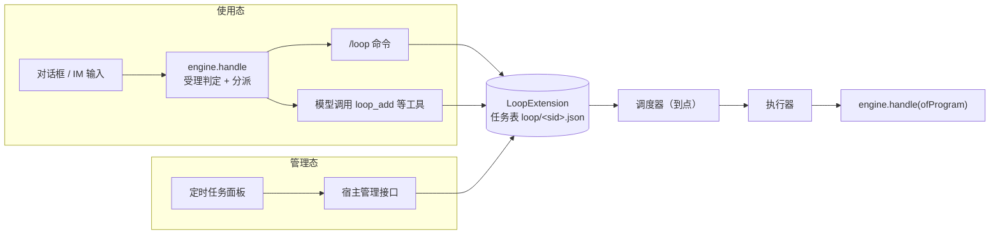

# solon-ai-harness-loop

solon-ai harness 引擎插件：**会话定时任务**（`/loop` 命令、`loop_*` 模型工具、宿主 API）。

每个会话可以建多条任务，按**固定间隔**、**cron** 或**一次性时刻**触发；每次到点向该会话注入一段提示词，执行一轮。任务可持久化到任意 `MountSource`（本地目录、db、http 等）。

- 包名：`org.noear.solon.ai.harness.extension.loop`
- 起始版本：4.2.0（独立模块）
- 宿主只需接触一个类：`LoopExtension`（门面 + Builder）

**两种时态**（第 3 章总览，第 4、5 章分别给出完整示例）：

| 时态 | 用户在哪里操作 | 宿主入口 | 本插件的入口 |
|---|---|---|---|
| 使用态 | 对话框 / IM 里输入 `/loop 30m 检查 CI`，或对模型说"每天 9 点提醒我" | `engine.handle`（唯一执行入口，第 0 步受理判定） | `/loop` 命令；模型调用 `loop_add` 等工具 |
| 管理态 | 定时任务面板里点「新建 / 编辑 / 启停 / 立即执行 / 删除」 | 宿主自己的管理接口（HTTP 等） | `LoopExtension` 门面方法 |

---

## 1. 功能介绍

### 1.1 与 goal 插件的区别

本模块与会话目标（`solon-ai-harness-goal`）是两个独立插件，不共享模型：

| 维度 | loop（本模块） | goal |
|---|---|---|
| 数量 | 每会话可多条 | 每会话一个 |
| 驱动方式 | 按时间表独立触发（间隔 / cron / 一次性） | 由目标状态驱动续轮 |
| 记录内容 | 只记最终文本（`lastResult`）与轮次 | 有预算与完成判定 |
| 执行器签名 | `LoopExecutor`（返回 `LoopOutcome`） | 另有签名，不与 loop 共用 |

### 1.2 调度与执行流程

```
到点（IJobManager 回调）/ 手动 trigger / 失败重试
  └─ 守卫：扩展已摘除？ → 放弃
         任务已删除或已被 update 替换成新版本？ → 静默放弃
         任务已暂停？ → 摘掉 job，放弃
         会话忙？（engine.isIdle(session) 为 false）→ 记日志，放弃本轮（不计错误）
  └─ 运行锁（CAS）：同一任务上一轮未结束 → 放弃本轮
  └─ 认领执行器：按注册顺序取首个谓词命中者；都不命中走缺省执行器；仍无 → skip
  └─ 结论：
         done   → 迭代 +1、记 lastResult、清零错误计数、落盘
         skip   → 本轮放弃，不计错误，不再尝试其它执行器
         failed / 抛异常 → 记 lastResult="error [类型]: 信息"，错误计数 +1；
                           未达阈值：延迟 5s × 计数 后重试；达到阈值：自动停用并摘除 job
  └─ 一次性任务：由调度触发且通过守卫的那一轮结束后自动删除（无论结论如何）
```

要点（均以源码为准）：

- **会话忙判定由插件统一完成**：调用执行器之前用 `engine.isIdle(session)` 判定（会话通过 `getSessionOrNull` 获取，不会因判定而新建会话；取不到会话时**不跳过**）。执行器只需关心「我这个通道此刻能不能跑」（如终端是否空闲）。
- **错误计数是任务级、瞬态的**：一个任务失败不影响其它任务；成功一轮即清零；不持久化。阈值经 `maxErrors` 的 `IntSupplier` 每次实时读取，实际取值 `Math.max(1, supplier.getAsInt())`。
- **退避**：第 n 次连续失败后延迟 `5 × n` 秒重试（5s、10s、15s……），重试不经调度器，不消耗一次性配额。
- **版本与身份**：`update` 会产出同 id 的新版本替换旧版本，新旧版本共享运行锁与错误计数，因此修改执行中的任务不会与在途一轮并发，本轮结果记到新版本上。
- **job 名**：`loop-<实例序号>:<sessionId>:<taskId>`。实例序号在进程内递增，多个扩展实例共用 JVM 单例 `JobManager` 也不会撞名；job 名不落盘。

### 1.3 引擎钩子

| 钩子 | 行为 |
|---|---|
| `onAttach` | 绑定引擎；启用时设置缺省执行器；注册 `/loop` 命令；加载并调度存储中的任务 |
| `onRequestAssemble` | 仅顶层请求挂 `LoopTalent`（委派请求不挂：子代理走临时会话，建出的任务会成为孤儿） |
| `contributeSessionStatus` | 贡献 `STATUS_TASKS`（只读内存计数） |
| `onSessionRemove` | 停止并删除该会话全部任务（幂等） |
| `onDetach` | 卸载全部 job，保留存储记录；此后不再写盘、不再注册 job、不再放行触发，直到下次加载 |

不实现 `onSessionInterrupt`：用户中断不会删除或暂停定时任务。

---

## 2. 依赖

```xml
<dependency>
    <groupId>org.noear</groupId>
    <artifactId>solon-ai-harness-loop</artifactId>
    <version>${solon-ai.version}</version>
</dependency>
```

本模块依赖 `solon-ai-harness-core`、`solon-scheduling-simple`、`java-cron`（cron 预校验，与 `solon-scheduling-simple` 内部同一解析器）。聚合包 `solon-ai-harness` 已包含本模块；**引入不等于装配**，仍需 `addExtensionIfAbsent`。

调度依赖 `JobManager.getInstance()`（需 `solon-scheduling-simple` 已启动）。未显式 `jobManager(null)` 却取不到 JobManager 时，构建时会打 WARN 日志：任务会被存储但永远不会触发。

---

## 3. 装配与两种时态

### 3.1 最小装配

```java
import org.noear.solon.ai.harness.extension.loop.LoopExtension;

// 任务按会话分存到引擎状态来源的 loop/ 目录（每会话一个 <encode(sid)>.json）；
// 不注册执行器则走缺省执行器（engine.handle 同步跑一轮）
LoopExtension loop = engine.addExtensionIfAbsent(LoopExtension.builder()
        .store(engine.getStateSource(), "loop")
        .build());

// 构建期装配（SERVER 模式必须如此）：还没有 engine，用 store("loop")，挂接时取引擎的状态来源
LoopExtension loop = LoopExtension.builder().store("loop").build();
HarnessEngine engine = HarnessEngine.of(ws, ".solon/") /* ... */ .extensionAdd(loop).build();
```

装配完成后两种时态都已可用：用户输入 `/loop ...` 或让模型调用 `loop_add`（使用态），宿主也可以直接调用 `loop.schedule(...)`（管理态）。

### 3.2 Builder 全配置

```java
import org.noear.solon.ai.mount.source.FileMountSource;
import org.noear.solon.scheduling.simple.JobManager;

LoopExtension loop = engine.addExtensionIfAbsent(LoopExtension.builder()
        .store(engine.getStateSource(), "loop", "tasks.json")    // 目录 + 可选的旧单文件（首次加载拆分迁移）；不设 = 只在内存
        .sessionAlive(id -> Files.isDirectory(sessionsRoot.resolve(id))) // 加载时孤儿清理
        .maxErrors(() -> settings.getLoopMaxErrors())            // 连续失败阈值，每次实时读
        .maxTasks(500)                                           // 本实例任务总量上限（跨全部会话）
        .quota(sid -> 20)                                        // 按会话（租户）配额；≤0 = 不限，缺省不限
        .triggerWrapper(r -> () -> withLogScope(r))              // 包装调度线程（如日志归属）
        .defaultExecutor(true)                                   // 是否启用缺省执行器
        .jobManager(JobManager.getInstance())                    // 自备调度器；传 null 关闭调度
        .build());
```

`store` 接收任意 `MountSource`。测试或演示可用内存来源，并关闭调度与缺省执行器：

```java
import org.noear.solon.ai.mount.source.InMemoryMountSource;

LoopExtension loop = LoopExtension.builder()
        .store(new InMemoryMountSource(), "loop")
        .jobManager(null)            // 任务仅作元数据，不依赖 Solon 容器
        .defaultExecutor(false)
        .build();
```

远端（db、http 等）存储：自行实现 `org.noear.solon.ai.mount.source.MountSource` 并传入 `store(...)` 即可。本插件对来源的使用包括 `normalize`、`readStringOrNull`、`writeString`（整体写入）以及损坏备份时的 `move`；写入原子性取决于该来源的 `capabilities().isAtomicWrite()`。

### 3.3 两种时态



| 对比项 | 使用态 | 管理态 |
|---|---|---|
| 用户动作 | 在对话中输入 `/loop 30m 检查 CI`；或用自然语言让模型建任务 | 在任务面板里新建、编辑、启停、立即执行、删除 |
| 宿主入口 | 统一输入入口：`engine.handle(HarnessInput)` | 宿主自己的管理接口，直接调门面 |
| 是否经过 `handle` 受理判定 | 是：任务运行中输入的 `/loop ...` 由引擎入积压，返回 `DEFERRED`；模型工具在任务内执行 | 否：随时可调 |
| 本插件入口 | `LoopCommand`（引擎内分派）、`LoopTalent`（`loop_add` / `loop_list` / `loop_control`） | `schedule` / `update` / `pause` / `resume` / `toggle` / `trigger` / `remove` / `list` |
| 结果怎么返回 | 命令：回执文本 `outcome.getCommandOutput()`；工具：JSON 交给模型 | 返回值：`LoopTask` 快照 / `boolean` / 异常 |
| 只有这一态能做的 | `loop_add` 可建一次性任务 | 修改任务（`update`）、宿主扩展字段（`extra`）、跨会话列表（`listAll`） |

两种时态操作的是**同一张任务表**：对话里 `/loop` 或 `loop_add` 建的任务会出现在面板里；面板上暂停后，对话里 `/loop ls` 看到的也是 `paused`。任务到点后怎么跑、输出回到哪里，由执行器决定（3.4），与任务是哪种时态创建的无关。

### 3.4 执行器：到点的一轮怎么跑、输出回到哪

```java
// 按注册顺序认领，先于缺省执行器；谓词为 null 表示认领全部
loop.addExecutor("cli", "cli"::equals, (sid, prompt) -> {
    if (!terminalIdle()) {
        return LoopOutcome.skip("terminal busy");      // 本轮跳过，不计错误
    }
    return LoopOutcome.done(runRound(sid, prompt));    // 抛异常 = 失败（计错误、退避、达阈值停用）
});

loop.addExecutor("web", id -> id.startsWith("web-"), (sid, prompt) ->
        runtimeReady() ? LoopOutcome.done(runWeb(sid, prompt))
                       : LoopOutcome.failed("runtime not ready")); // 与抛异常等价
```

执行器不得返回 `null`，否则按失败计（`lastResult` 中可见）。缺省执行器只把结果写进 `lastResult`，不推给任何渠道；需要让用户看到每一轮的宿主必须注册自己的执行器（完整写法见 4.4）。

---

## 4. 使用态：用户在对话中输入

### 4.1 用户能输入什么

```text
/loop 30m 检查 CI 是否通过 --now      # 每 30 分钟，并立即跑首轮
/loop cron:"0 0 9 * * ?" 汇总昨日告警  # 每天 9 点
/loop 提醒我喝水                       # 首个参数不是间隔时，按缺省 5 分钟
/loop ls                               # 列出本会话任务
/loop pause <id>  /  /loop resume <id>
/loop stop <id>   /  /loop stop-all
```

| 用法 | 说明 |
|---|---|
| `/loop` 或 `/loop ls` | 列出本会话任务（状态 paused / running / idle、调度、迭代、最近结果） |
| `/loop <interval> <prompt>` | 固定间隔任务；interval 如 `30s`、`5m`、`2h` |
| `/loop <prompt>` | 首个参数不是间隔时，按缺省 5 分钟 |
| `/loop cron:"<expr>" <prompt>` | cron 任务（引号可为双引号或单引号） |
| `--now` | 附加在参数中，创建后立即执行首轮；其它 `--xxx` 提示 Unknown flag |
| `/loop stop <id>` | 删除任务；若该任务正在执行，同时中断会话当前一轮 |
| `/loop stop-all` | 删除本会话全部任务；若有任务正在执行，同时中断会话 |
| `/loop pause <id>` / `/loop resume <id>` | 暂停 / 恢复 |

间隔单位：`s` / `sec` / `seconds`（向上取整为分钟，至少 1 分钟）、`m` / `min` / `minutes`、`h` / `hour` / `hours`；结果收敛到 [1, 1440] 分钟。命令没有 `trigger` 子命令，也不能创建一次性任务。`/loop ls` 与创建回执里打印完整任务 ID，`stop` / `pause` / `resume` 需要传完整 ID。

用户也可以直接用自然语言，例如"明天下午 6 点提醒我提交周报"、"每 10 分钟看一下部署好了没"：模型会调用 `loop_add`（支持 `at` 一次性时刻）、`loop_list`、`loop_control`，参数规则见 6.7。工具只挂在顶层请求上，子代理委派中不可用。

### 4.2 命令的边界

| 项 | 说明 |
|---|---|
| 注册 | `LoopExtension#onAttach` 自动注册，宿主不用注册 |
| 会话 | 命令作用于 `ctx.getSession().getSessionId()`，即本次输入所在会话 |
| 结局 | 恒为 `Kind.REPLY`：命令只改任务表并回执，不在本次 `handle` 里开流 |
| 渠道 | `terminalOnly() == false`，Web / IM / 桌面可用；不需要 `.terminal(true)` |
| 忙态 | `runnableWhenBusy()` 为缺省 `false`：任务运行中输入 `/loop ...`，`engine.handle` 由引擎入积压并返回 `DEFERRED`（空闲后执行）；没装 queue 时返回 `REJECTED("busy")` |
| 开关 | `loop.setEnabled(false)` 只关模型工具，`/loop` 照常可用 |
| 回执格式 | 缺省的缓冲式命令上下文会去掉 ANSI 颜色，回执从 `outcome.getCommandOutput()` 取回 |

### 4.3 命令与工具共用的流程

1. 用户输入 → 宿主 `engine.handle`（第 0 步受理判定：忙时可排队输入由引擎入积压并返回 `DEFERRED`）；
2. `/loop ...`：引擎识别命令，`LoopCommand` 调用与管理态相同的 `schedule` / `pause` / `resume` / `remove`，结局 `REPLY`；
3. 普通消息：结局 `TASK`，模型在这一轮里调用 `loop_add` 等工具，工具同样走 `schedule` 等门面；
4. 到点后调度器调用执行器跑一轮，执行器把输出送回渠道。

### 4.4 宿主接入：完整示例

`/loop` 只负责"建任务"；任务到点后由**执行器**跑一轮，执行器的输出要由宿主送回渠道。所以宿主要接两处：输入入口（让命令能执行）与执行器（让到点的那一轮有去处）。

```java
import org.noear.solon.ai.agent.AgentSession;
import org.noear.solon.ai.harness.HarnessEngine;
import org.noear.solon.ai.harness.extension.loop.LoopExtension;
import org.noear.solon.ai.harness.extension.loop.LoopOutcome;
import org.noear.solon.ai.harness.extension.queue.QueueExtension;
import org.noear.solon.ai.harness.input.HarnessInput;
import org.noear.solon.ai.harness.input.InputOrigin;
import org.noear.solon.ai.harness.input.InputOutcome;

import java.util.Map;
import java.util.concurrent.ConcurrentHashMap;

public class ImLoopHost {
    private final HarnessEngine engine;
    private final QueueExtension queue;
    private final LoopExtension loop;
    /** 会话最近一次的回复路由（定时轮次没有入站消息，只能回到这里） */
    private final Map<String, InputOrigin> routes = new ConcurrentHashMap<>();

    public ImLoopHost(HarnessEngine engine) {
        this.engine = engine;
        this.queue = engine.addExtensionIfAbsent(new QueueExtension());
        this.loop = engine.addExtensionIfAbsent(LoopExtension.builder()
                .store(engine.getStateSource(), "loop")             // 任务随引擎状态来源持久化（按会话分存）
                .sessionAlive(this::sessionExists)                   // 按会话存储判断（勿用内存会话表，重启后会误删）
                .build());

        // 执行器：认领 IM 会话（谓词应互斥），把到点的一轮跑完并送回渠道
        loop.addExecutor("im", id -> id.startsWith("im-"), (sid, prompt) -> {
            AgentSession session = engine.getSessionOrNull(sid);
            InputOrigin route = routes.get(sid);
            if (session == null || route == null) {
                return LoopOutcome.skip("no session or reply route");  // 不计错误
            }
            try {
                // 程序输入：不识别命令与 @提及，来源标记为 loop；忙时 REJECTED("busy")，不进积压
                InputOutcome outcome = engine.handle(HarnessInput.ofProgram(session, prompt, "loop"));
                if (outcome.getKind() != InputOutcome.Kind.TASK) {
                    return LoopOutcome.skip("not runnable: " + outcome.getRejectReason());  // 不计错误
                }
                String text = outcome.getRequest().call().getContent();
                reply(route, text);
                return LoopOutcome.done(text);
            } finally {
                drain(session);   // 这一轮占用期间用户发来的消息被延后了：轮次结束立即续发
            }
        });
    }

    /** 输入入口：/loop 命令与普通消息共用 */
    public void onMessage(AgentSession session, String text, InputOrigin origin) {
        dispatch(session, HarnessInput.of(session, text).origin(origin));
    }

    /** 受理与执行：入站消息与积压续发共用同一个 handle 入口 */
    private void dispatch(AgentSession session, HarnessInput input) {
        InputOutcome outcome = engine.handle(input);   // 第 0 步受理判定：忙时可排队输入由引擎入积压
        InputOrigin origin = outcome.isDispatched() ? outcome.getDispatch().getOrigin() : input.getOrigin();
        switch (outcome.getKind()) {
            case TASK:
                routes.put(session.getSessionId(), origin);   // 记下回复路由，供定时轮次使用
                try {
                    reply(origin, outcome.getRequest().call().getContent()); // 模型可能在这一轮里调用了 loop_add
                } catch (Throwable e) {
                    outcome.discard();   // 幂等；开流前失败时确保占位释放
                    reply(origin, "处理失败：" + e.getMessage());
                }
                drain(session);
                break;
            case REPLY:
                routes.put(session.getSessionId(), origin);
                reply(origin, outcome.getCommandOutput());   // /loop 的回执
                drain(session);
                break;
            case DEFERRED:   // 任务（含 loop 的一轮）运行中发来的 /loop：引擎已入积压，空闲后按命令执行
                reply(origin, "当前任务结束后执行（第 " + outcome.getBacklogPosition() + " 位）");
                drain(session);
                break;
            case REJECTED:
                reply(origin, outcome.getRejectDetail());
                break;
            case HITL:
            case IGNORED:
                drain(session);
                break;
        }
    }

    private void drain(AgentSession session) {
        queue.drainLoop(session, s -> !engine.status(s).isOccupied(), claim -> {
            dispatch(session, claim.getItem().toInput(session));   // 同一线程：引擎识别为派发轮次
            return true;
        });
    }

    /** 宿主永久删除会话：先通知引擎（loop 会删掉该会话全部任务），再删存储 */
    public void deleteSession(String sessionId) {
        engine.removeSession(sessionId);
        routes.remove(sessionId);
        // ... 移出内存、删除存储
    }

    private boolean sessionExists(String sessionId) { /* 查会话存储 */ return true; }
    private void reply(InputOrigin origin, String text) { /* 按 origin 回投渠道 */ }
}
```

### 4.5 使用态要点

1. **命令建任务，执行器跑任务**：`/loop`、`loop_add` 与管理态的 `loop.schedule(...)` 建出的是同一种任务；到点后统一经执行器执行，命令本身从不开流。
2. **执行器决定输出去向**：缺省执行器只把结果写进 `lastResult`，不会推给任何渠道。需要把每一轮推给用户的宿主必须注册自己的通道执行器，并自行保存会话到渠道的回复路由。
3. **会话忙由插件判**：到点时插件先判 `engine.isIdle(session)`，忙（含有积压）则本轮放弃、不计错误；执行器只回答"本通道此刻能不能跑"，不能就返回 `skip`。判空闲与开轮之间仍有窗口：`ofProgram` 的程序轮次忙时返回 `REJECTED("busy")`、不进积压，执行器在非 `TASK` 时返回 `skip`（缺省执行器即如此；它用 `engine.getSessionOrNull(sessionId)` 取会话，会话不存在时也 skip）。
4. **轮次结束要续发队列**：loop 的一轮会占用会话，期间用户发来的消息由 `handle` 入积压并返回 `DEFERRED`；执行器结束时必须 `drain`，否则这些消息要等下一次用户输入才会发出。
5. **`/loop` 在忙时被延后**：它不是忙态旁路命令。任务（包括 loop 自己的一轮）运行中输入的 `/loop stop <id>` 会排队，等这一轮结束后才执行，此时任务已不在运行，命令只删除任务、不会中断。要立刻停掉正在跑的一轮，用宿主的停止入口 `engine.interrupt(session)`（或忙时可执行的 `/interrupt` 命令），再 `loop.remove(sid, taskId)`。所有宿主（Web、IM、命令行终端）都经 `handle` 受理，忙时输入的 `/loop stop` 一律排队；命令里"顺带中断"的分支只是防御性兜底。
6. **中断不删任务**：`engine.interrupt` 只停当前一轮，定时任务照常保留，下次到点继续。
7. **删除会话要先调 `engine.removeSession`**：它回调 `onSessionRemove`，删除该会话的全部任务并注销 job；顺序颠倒时，定时任务可能在删除过程中触发并把会话重新建出来。
8. **一次性任务不能用命令建**：`/loop` 只支持间隔与 cron；一次性提醒让模型用 `loop_add` 的 `at` 参数，或走管理态 `LoopSpec.at(...)`。

---

## 5. 管理态：用户在界面上操作

管理态不经过 `handle`：面板上的每个按钮对应一个宿主接口，接口直接调用 `LoopExtension` 门面。loop 门面只按 `sessionId` 字符串寻址，不需要会话对象。

### 5.1 界面动作与门面对照

| 界面动作 | 门面调用 | 成功返回 | 失败时（建议的 HTTP 映射） |
|---|---|---|---|
| 本会话任务列表 | `loop.list(sid)` | `List<LoopTask>`，用 `toMap()` 渲染 | — |
| 全部会话任务 | `loop.listAll()` | `Map<sessionId, List<LoopTask>>` | — |
| 查看单个（编辑回填） | `loop.get(sid, taskId)` | `LoopTask` | null → 404 |
| 新建 | `loop.schedule(sid, LoopSpec...)` | `LoopTask`（`getId()` 即 taskId） | 参数不合法：`IllegalArgumentException` → 400；总数达上限：`IllegalStateException` → 409 |
| 编辑 | `loop.update(sid, taskId, LoopPatch...)` | 修改后的 `LoopTask` | null → 404；补丁不合法：`IllegalArgumentException` → 400（原任务不变） |
| 启停开关 | `loop.toggle(sid, taskId)`，或 `pause` / `resume` | `true` | `false`：不存在 → 404 |
| 立即执行一轮 | `loop.trigger(sid, taskId)` | `true` | `false`：不存在 → 404 |
| 删除 | `loop.remove(sid, taskId)` | `true` | `false`：不存在 → 404 |
| 清空本会话 | `loop.removeAll(sid)` | — | — |

### 5.2 完整示例：管理接口

```java
import org.noear.solon.ai.agent.AgentSession;
import org.noear.solon.ai.harness.HarnessEngine;
import org.noear.solon.ai.harness.extension.loop.LoopExtension;
import org.noear.solon.ai.harness.extension.loop.LoopPatch;
import org.noear.solon.ai.harness.extension.loop.LoopSpec;
import org.noear.solon.ai.harness.extension.loop.LoopTask;
import org.noear.solon.annotation.*;
import org.noear.solon.core.handle.Result;

import java.time.LocalDateTime;
import java.util.ArrayList;
import java.util.List;
import java.util.Map;

@Controller
@Mapping("/admin/loop")
public class LoopAdminController {
    @Inject
    HarnessEngine engine;

    private LoopExtension loop() {
        return engine.getExtension(LoopExtension.class)
                .orElseThrow(() -> new IllegalStateException("loop extension not attached"));
    }

    /** 缺省执行器到点时会按 sessionId 取会话：给不存在的会话建任务会把会话建出来，先校验（再加上宿主自己的归属校验） */
    private boolean sessionExists(String sessionId) {
        return sessionId != null && engine.getSessionOrNull(sessionId) != null;
    }

    @Get
    @Mapping("list")
    public Result<List<Map<String, Object>>> list(@Param("sessionId") String sessionId) {
        List<Map<String, Object>> rows = new ArrayList<>();
        for (LoopTask t : loop().list(sessionId)) {
            rows.add(t.toMap());                        // 标准视图：id、prompt、cron/intervalMinutes、enabled、running……
        }
        return Result.succeed(rows);
    }

    @Get
    @Mapping("all")
    public Result<List<Map<String, Object>>> all() {
        List<Map<String, Object>> rows = new ArrayList<>();
        loop().listAll().forEach((sid, tasks) -> tasks.forEach(t -> {
            Map<String, Object> row = t.toMap();
            row.put("sessionId", sid);                  // 跨会话列表需要带上 sessionId 供后续操作
            rows.add(row);
        }));
        return Result.succeed(rows);
    }

    @Post
    @Mapping("add")
    public Result<String> add(@Param("sessionId") String sessionId,
                              @Param("prompt") String prompt,
                              @Param(value = "intervalMinutes", required = false) Integer intervalMinutes,
                              @Param(value = "cron", required = false) String cron,
                              @Param(value = "at", required = false) String at,        // 如 2026-12-05T18:00
                              @Param(value = "oneShot", required = false) Boolean oneShot,
                              @Param(value = "runNow", required = false) Boolean runNow) {
        if (!sessionExists(sessionId)) return Result.failure(404, "Session not found");
        try {
            // 请求参数原样交给规格：null（及空白 cron）即未设置；优先级 at > cron > everyMinutes
            LoopTask task = loop().schedule(sessionId, LoopSpec.of(prompt)
                    .everyMinutes(intervalMinutes)
                    .cron(cron)
                    .at(at == null || at.isEmpty() ? null : LocalDateTime.parse(at))
                    .oneShot(oneShot)
                    .runNow(runNow));
            return Result.succeed(task.getId());
        } catch (IllegalArgumentException e) {
            return Result.failure(400, e.getMessage()); // 间隔越界、cron 非法、at 不是未来时刻……
        } catch (IllegalStateException e) {
            return Result.failure(409, e.getMessage()); // 任务总数达到 maxTasks
        }
    }

    @Post
    @Mapping("update")
    public Result<Map<String, Object>> update(@Param("sessionId") String sessionId,
                                              @Param("taskId") String taskId,
                                              @Param(value = "prompt", required = false) String prompt,
                                              @Param(value = "intervalMinutes", required = false) Integer intervalMinutes,
                                              @Param(value = "cron", required = false) String cron,
                                              @Param(value = "runNow", required = false) Boolean runNow) {
        try {
            // null = 保持原值；cron 传 "" = 清除 cron、回到固定间隔
            LoopTask t = loop().update(sessionId, taskId, LoopPatch.create()
                    .prompt(prompt)
                    .everyMinutes(intervalMinutes)
                    .cron(cron)
                    .runNow(runNow));
            return t == null ? Result.failure(404, "Task not found") : Result.succeed(t.toMap());
        } catch (IllegalArgumentException e) {
            return Result.failure(400, e.getMessage());
        }
    }

    @Post
    @Mapping("toggle")
    public Result<Void> toggle(@Param("sessionId") String sessionId, @Param("taskId") String taskId) {
        return loop().toggle(sessionId, taskId) ? Result.succeed() : Result.failure(404, "Task not found");
    }

    @Post
    @Mapping("trigger")
    public Result<Void> trigger(@Param("sessionId") String sessionId, @Param("taskId") String taskId) {
        LoopTask t = loop().get(sessionId, taskId);
        if (t == null) return Result.failure(404, "Task not found");
        if (!t.isEnabled()) return Result.failure(400, "Task is paused");   // 已暂停的任务触发后会被守卫放弃
        loop().trigger(sessionId, taskId);                                   // 异步执行，会话忙时本轮放弃
        return Result.succeed();
    }

    @Post
    @Mapping("remove")
    public Result<Void> remove(@Param("sessionId") String sessionId,
                               @Param("taskId") String taskId,
                               @Param(value = "stopRunning", required = false) Boolean stopRunning) {
        LoopTask t = loop().get(sessionId, taskId);
        if (t == null) return Result.failure(404, "Task not found");
        if (Boolean.TRUE.equals(stopRunning) && t.isRunning()) {
            // 与 /loop stop 同语义：顺带停掉正在跑的这一轮（interrupt 也会清空该会话的排队消息）
            AgentSession session = engine.getSessionOrNull(sessionId);
            if (session != null) engine.interrupt(session);
        }
        loop().remove(sessionId, taskId);
        return Result.succeed();
    }
}
```

### 5.3 新建：LoopSpec 的几种调度

```java
// 固定间隔：[1, 1440] 分钟；everyMinutes(null) = 缺省 5 分钟
loop.schedule(sid, LoopSpec.of("check deploy").everyMinutes(15));

// 每 10 分钟，并在创建后立即跑首轮
loop.schedule(sid, LoopSpec.of("检查 CI 是否通过").everyMinutes(10).runNow(true));

// cron：6 或 7 位（秒 分 时 日 月 周 [年]），日与周必须有一个为 ?
loop.schedule(sid, LoopSpec.of("daily report").cron("0 0 22 * * ?"));

// cron + 一次性：首次触发执行一轮后自动删除
loop.schedule(sid, LoopSpec.of("年终提醒").cron("0 0 9 31 12 ? 2026").oneShot(true));

// 一次性时刻（服务器本地时间），自动转为带年份的 7 位 cron 并标记 oneShot
loop.schedule(sid, LoopSpec.of("remind me").at(LocalDateTime.of(2026, 12, 5, 18, 0)));
```

调度方式优先级 `at > cron > everyMinutes`。校验失败抛 `IllegalArgumentException`，任务总数达上限抛 `IllegalStateException`，失败时不会留下半个任务。

### 5.4 编辑：update + LoopPatch

```java
// null = 保持原值；启停、迭代、最近结果、一次性属性与扩展字段都保留
LoopTask u = loop.update(sid, taskId, LoopPatch.create()
        .prompt(req.prompt)            // null 或空白 = 保持
        .everyMinutes(req.interval)    // null = 保持；越界抛 IllegalArgumentException
        .cron(req.cron)                // null = 保持；"" = 清除 cron，回到固定间隔
        .runNow(req.runNow));          // null = 保持

// 从 cron 切回固定间隔
loop.update(sid, taskId, LoopPatch.create().cron("").everyMinutes(30));
```

非法补丁抛 `IllegalArgumentException`，原任务保持不变（先校验、后替换）。任务正在执行时也可以修改：新版本不会与在途那一轮并发，本轮结果记到新版本上，不需要先停。

### 5.5 宿主扩展字段（extra）

面板常需要给任务挂上自己的元数据（如所属自动化、显示名），用扩展字段：

```java
import org.noear.snack4.ONode;

LoopTask t = loop.schedule(sid, LoopSpec.of("日报")
        .cron("0 0 18 * * ?")
        .extra("automation", new ONode().set("id", "a1").set("name", "日报")));

String name = t.getExtra("automation").get("name").getString();

// 只改列出的键；value 为 null 表示删除该键
loop.update(sid, t.getId(), LoopPatch.create()
        .extra("automation", new ONode().set("id", "a2"))
        .extra("legacy", null));
```

扩展字段随任务原样持久化（插件不解析），`toMap()` 不含扩展字段，需要展示时由宿主自行追加；键为空或与核心字段同名时抛 `IllegalArgumentException`。

### 5.6 刷新界面

loop 没有状态监听器。面板刷新靠重新读取：`list` / `listAll` 返回的快照里有 `running`（是否正在执行）、`enabled`（被连续失败自动停用后为 false）、`currentIteration`、`lastResult`、`lastExecutedAt`。徽章计数可用状态键：

```java
int count = engine.status(session).get(LoopExtension.STATUS_TASKS); // 本会话任务数（含已暂停）
boolean active = loop.hasActiveTasks();                             // 是否有启用中的任务（闲置回收判定用）
```

### 5.7 管理态要点

1. **先校验会话**：门面不检查会话是否存在，给任意 sessionId 都能建任务；缺省执行器到点时用 `engine.getSession(sessionId)` 取会话，可能把它新建出来。管理接口应先确认会话存在并校验归属。
2. **不需要判忙**：管理接口随时可调。会话忙时到点的一轮会被放弃（不计错误），等下一次到点。
3. **立即执行可能被放弃**：`trigger` 是异步的，仍经守卫：任务已暂停或会话正忙时，这一轮直接放弃；返回 `true` 只表示任务存在。
4. **删除不会中断正在跑的一轮**：`remove` 只删任务；需要"停止并删除"时，先 `engine.interrupt(session)` 再 `remove`（示例的 `stopRunning`）。注意 `interrupt` 会同时清空该会话 queue 里的排队消息。
5. **自动停用后需手动恢复**：连续失败达阈值后任务 `enabled = false`，面板上应显示为"已停用"，`resume` 或 `toggle` 会清零计数并重新调度。
6. **修改不会立即执行**：`LoopPatch.runNow` 只更新记录上的标志，立即首轮只在创建时生效；想立刻跑一轮用 `trigger`。
7. **一次性任务只能通过 `schedule` 或 `loop_add` 创建**：`LoopPatch` 不能把普通任务改成一次性。

---

## 6. 配置说明

### 6.1 Builder 选项

| 方法 | 类型 | 默认值 | 说明 |
|---|---|---|---|
| `store(source, dir[, legacyFile])` | `MountSource`, `String`, `String` | 不设置（只在内存） | 任务存储来源与来源内**目录**，按会话分存为 `<dir>/<encode(sessionId)>.json`，变更只重写该会话的文件；建议 `dir = "loop"`（在引擎缺省受保护名单内，其它名字要加进 `protectedStatePaths`）；`legacyFile`（如 `"tasks.json"`）存在时首次加载拆分迁移，旧文件改名为 `.migrated-<时间戳>`；`source` 为 null = 只在内存；`source` 非 null 时 `dir` 不可为空 |
| `quota(sessionIdToLimit)` | `ToIntFunction<String>` | 不限 | 按会话（租户）的任务数上限，≤0 = 不限；异常按不限处理，`maxTasks` 总量仍生效 |
| `sessionAlive(predicate)` | `Predicate<String>` | 恒 `true` | 加载时孤儿判定：返回 false 的会话其任务不再恢复并从存储删除；谓词抛异常按存在处理；传 null 忽略 |
| `maxErrors(supplier)` | `IntSupplier` | `() -> 3`（`DEFAULT_MAX_ERRORS`） | 任务级连续失败阈值，每次实时读取，实际取值不小于 1；传 null 忽略 |
| `maxTasks(max)` | `int` | `200`（`DEFAULT_MAX_TASKS`） | 本扩展实例任务总量上限（跨全部会话），小于 1 时取 1 |
| `triggerWrapper(wrapper)` | `UnaryOperator<Runnable>` | 无（原样执行） | 包装每一轮执行（调度线程无宿主上下文时用于打标）；包装结果为 null 时退回原 Runnable |
| `defaultExecutor(enabled)` | `boolean` | `true` | 是否启用缺省执行器：`engine.handle(HarnessInput.ofProgram(session, prompt, "loop")).call()`，取最终文本 |
| `jobManager(jobManager)` | `IJobManager` | `JobManager.getInstance()` | 自备调度器；显式传 null = 关闭调度（任务仅作元数据，不告警） |

### 6.2 LoopSpec（创建参数）

入口：`LoopSpec.of(String prompt)`。所有可选项都接受 null。

| 方法 | 类型 | 默认 | 规则 |
|---|---|---|---|
| `of(prompt)` | `String` | 必填 | 为空或空白抛 `IllegalArgumentException`；保存前 trim |
| `everyMinutes(minutes)` | `Integer` | 5（`DEFAULT_INTERVAL_MINUTES`） | 须在 [1, 1440]，否则抛异常；设置了 cron 或 at 时不生效 |
| `cron(cron)` | `String` | 不用 | null/空白 = 不用；6 或 7 位；无法解析或已无未来触发时刻抛异常 |
| `at(at)` | `LocalDateTime` | 不用 | 服务器本地时间，须为未来时刻；转为 `0 分 时 日 月 ? 年`，自动 oneShot |
| `oneShot(oneShot)` | `Boolean` | false | 为 true 时必须有 at 或 cron |
| `runNow(runNow)` | `Boolean` | false | 创建后立即执行首轮（仅固定间隔生效）；与一次性互斥 |
| `extra(key, value)` | `String`, `ONode` | 无 | 宿主扩展字段；value 为 null 表示不写；键非法抛异常 |

`schedule` 时统一校验，失败抛 `IllegalArgumentException`：prompt 为空、间隔越界、at 不是未来时刻、一次性却没有 at/cron、一次性又要求 runNow、cron 无法解析或已无未来触发时刻、sessionId 为空。扩展字段键非法在调用 `extra` 时即抛出。

### 6.3 LoopPatch（修改参数）

入口：`LoopPatch.create()`。

| 方法 | 类型 | null 语义 | 其它规则 |
|---|---|---|---|
| `prompt(prompt)` | `String` | 保持 | 空白同样视为保持；保存前 trim |
| `everyMinutes(minutes)` | `Integer` | 保持 | 越界 [1, 1440] 抛 `IllegalArgumentException` |
| `cron(cron)` | `String` | 保持 | 空串 = 清除 cron、回到固定间隔；新 cron 无法解析或不可触发时抛异常 |
| `runNow(runNow)` | `Boolean` | 保持 | 只更新记录上的标志；修改不会触发立即执行（立即首轮只在创建时生效） |
| `extra(key, value)` | `String`, `ONode` | value 为 null = 删除该键 | 只改列出的键；键非法抛异常 |

保留不变：任务 ID、创建时间、启停状态、迭代数、最近结果、一次性属性、未列出的扩展字段。修改后若任务为启用状态，会以新定义重新注册 job；cron 在注册时已不可触发则任务被自动停用并记 WARN。

### 6.4 LoopTask（只读快照）

`LoopTask` 对宿主只读：无公开构造器，无公开修改方法。

| 读取方法 | 类型 | 说明 |
|---|---|---|
| `getId()` | `String` | 任务 ID（新任务为 32 位小写 hex，`HarnessIds.newId()`） |
| `getPrompt()` | `String` | 每轮执行的提示词 |
| `getIntervalMinutes()` | `int` | 固定间隔分钟数（cron 模式下忽略） |
| `getCron()` | `String` | cron 表达式，可能为 null |
| `isCronMode()` | `boolean` | cron 非空即为 cron 模式 |
| `getCreatedAt()` | `Instant` | 创建时间 |
| `isRunNow()` | `boolean` | 是否创建后立即执行 |
| `isOneShot()` | `boolean` | 是否一次性 |
| `isEnabled()` | `boolean` | 是否启用（false = 已暂停或被自动停用） |
| `isCancelled()` | `boolean` | 是否已删除 |
| `isRunning()` | `boolean` | 是否正在执行（瞬态） |
| `getCurrentIteration()` | `int` | 成功轮次数 |
| `getLastResult()` | `String` | 最近一轮结果；失败时为 `error [类型]: 信息` |
| `getLastExecutedAt()` | `Instant` | 最近执行时间 |
| `getExtra(key)` | `ONode` | 宿主扩展字段，不存在为 null |
| `toMap()` | `Map<String, Object>` | 标准展示视图 |
| `toONode()` / `fromONode(node)` | `ONode` | 序列化 / 反序列化（不含 sessionId） |

`toMap()` 字段（按顺序，不含扩展字段）：

| 键 | 出现条件 | 值 |
|---|---|---|
| `id` | 总是 | 任务 ID |
| `prompt` | 总是 | 提示词 |
| `intervalMinutes` | 总是 | 间隔分钟 |
| `cron` | 仅 cron 模式 | cron 表达式 |
| `oneShot` / `runNow` / `enabled` / `cancelled` / `running` | 总是 | boolean |
| `currentIteration` | 总是 | int |
| `lastResult` | 有值时 | 最近结果 |
| `lastExecutedAt` | 有值时 | ISO-8601 字符串 |

### 6.5 LoopOutcome（执行结论）

| 构造 | 判定方法 | 调度器处理 |
|---|---|---|
| `LoopOutcome.done(finalText)` | `isDone()` | 记成功：迭代 +1、`lastResult` = 文本（null 记为空串）、清零错误计数 |
| `LoopOutcome.skip(reason)` | `isSkipped()` | 本轮放弃：不计错误、不再尝试其它执行器，只记日志 |
| `LoopOutcome.failed(error)` | `isFailed()` | 记失败：与抛异常等价，错误计数 +1、退避重试、达到阈值自动停用 |

`getText()`：done 时为最终文本，skip/failed 时为原因。无执行器认领时等同 skip（`no executor claimed`），绝不记成成功。

`LoopExecutor` 签名：`LoopOutcome handle(String sessionId, String prompt) throws Exception`。

### 6.6 状态键

| 常量 | 定义 | 说明 |
|---|---|---|
| `LoopExtension.STATUS_TASKS` | `SessionStatus.Key.count("loop.tasks")` | 本会话任务数（含已暂停）；经 `engine.status(session).get(...)` 读取，只供展示与宿主业务，内核不读 |

### 6.7 模型工具（LoopTalent）

只挂在顶层请求上（委派不挂）。会话 ID 由框架注入（`__sessionId`），无活跃会话时返回 `ERROR:` 文本。所有成功响应为 JSON，附带 `serverNow`（`yyyy-MM-dd'T'HH:mm:ss`）与 `timezone`，供模型换算相对时间。

| 工具 | 参数 | 说明 |
|---|---|---|
| `loop_add` | `prompt`（必填）；`at`、`intervalMinutes`、`cron`、`oneShot`、`runNow`（可选） | 新增任务，返回 `taskId`、`schedule`（cron 模式含 `cron` 与 `nextFireTime`，否则含 `intervalMinutes`）、`oneShot`、`message` |
| `loop_list` | 无 | 返回 `tasks` 与 `total`；每项含 `taskId`、`prompt`（截断 120 字符）、`cron` 或 `intervalMinutes`、`oneShot`、`enabled`、`running`、`lastExecutedAt`、`lastResult`（截断 300 字符） |
| `loop_control` | `action`（`stop` / `pause` / `resume` / `trigger`）、`taskId` | `stop` 删除任务；`pause` / `resume` 启停；`trigger` 异步执行一轮（已暂停的任务拒绝触发） |

`loop_add` 参数规则：

| 参数 | 格式 / 规则 |
|---|---|
| `at` | `yyyy-MM-ddTHH:mm`（如 `2026-09-05T18:00`），须为未来时刻；提供后忽略 `cron` / `intervalMinutes`，强制 `oneShot=true` |
| `intervalMinutes` | 固定间隔，默认 5；提供 `cron` 时以 `cron` 为准 |
| `cron` | 工具描述引导模型写 7 位（秒 分 时 日 月 周 年）；实际校验与宿主相同（6 或 7 位） |
| `oneShot` | 默认 false；为 true 时必须有 `at` 或 `cron` |
| `runNow` | 默认 false；与 `oneShot=true` 互斥 |

### 6.8 /loop 命令（LoopCommand）

语法见 4.1，命令边界见 4.2。

---

## 7. 持久化格式与兼容

存储内容（`store` 指定目录下每个会话一个文件，如 `loop/web-xxx.json`；单个文件损坏只影响该会话）：

```json
{
  "version": 2,
  "tasks": [
    {
      "id": "3f2a...（32 位 hex）",
      "prompt": "daily report",
      "intervalMinutes": 5,
      "cron": "0 0 22 * * ?",
      "createdAt": "2026-11-06T02:00:00Z",
      "autoInterval": false,
      "cancelled": false,
      "enabled": true,
      "lastResult": "...",
      "lastExecutedAt": "2026-11-06T14:00:00Z",
      "currentIteration": 3,
      "oneShot": true,
      "automation": { "id": "a1" },
      "sessionId": "web-1"
    }
  ]
}
```

| 规则 | 说明 |
|---|---|
| 写入时机 | 每次变更（创建、修改、启停、删除、一轮结束、出错）全量写入；写入串行化 |
| 可选字段 | `cron`、`lastResult`、`lastExecutedAt` 有值才写；`runNow`、`oneShot` 仅为 true 时写 |
| 不持久化 | 运行锁 `running`、连续错误计数 |
| 读取缺省 | 缺 `enabled` 视为 true；缺 `currentIteration` 为 0；缺 `runNow` / `oneShot` / `cancelled` / `autoInterval` 为 false |
| 必填字段 | `id`、`prompt`、`intervalMinutes`、`createdAt`；缺失则解析失败，按外来条目处理 |
| 本插件条目 | `type` 缺省、为空、`LOOP` 或 `HEARTBEAT`（历史取值，不区分大小写） |
| 外来条目 | 其它 `type`（如 `GOAL`）、缺 `sessionId`、解析失败的条目：不参与调度，之后每次写入都原样写回 |
| 扩展字段 | 不认识的顶层字段收进 extras，原样写回 |
| 已删除任务 | `cancelled` 的任务不写入；加载时也不恢复 |
| 旧 ID | 新任务为完整 32 位 hex ID；历史数据中的短 ID（如 8 位截断 ID）仍按原值加载与寻址 |
| 孤儿清理 | 加载时 `sessionAlive` 返回 false 的会话，其任务被删除并写回存储（外来条目保留，不会以空快照清空） |
| 损坏文件 | 内容无法解析或结构不对（根不是对象、无 `tasks` 数组）：先改名备份为 `<path>.corrupt-<毫秒时间戳>`，再按空列表继续 |
| 只读模式 | 读取发生 IO 错误，或损坏文件备份失败：本进程不再写入，避免覆盖可救回的数据 |
| 空文件 | 空白内容视为无任务，不备份 |
| 原子性 | 取决于来源的 `MountCapabilities#isAtomicWrite()` |

加载在 `onAttach` 中进行且幂等；扩展摘除（`onDetach`）后允许再次挂接时重新加载。

---

## 8. API 速查

| 方法 | 返回 | 时态 | 说明 |
|---|---|---|---|
| `LoopExtension.builder()` | `Builder` | 装配 | 构建入口 |
| `addExecutor(channel, claim, handler)` | `LoopExtension` | 装配 | 注册通道执行器（可链式）；handler 为 null 时忽略 |
| `schedule(sessionId, LoopSpec)` | `LoopTask` | 管理（`/loop`、`loop_add` 同路径） | 新建并调度；`IllegalArgumentException` / `IllegalStateException` |
| `update(sessionId, taskId, LoopPatch)` | `LoopTask` | 管理 | 按补丁修改；null = 不存在；`IllegalArgumentException` |
| `pause(sessionId, taskId)` | `boolean` | 管理（`/loop pause` 同路径） | 暂停；false = 不存在 |
| `resume(sessionId, taskId)` | `boolean` | 管理（`/loop resume` 同路径） | 恢复并清零错误计数；false = 不存在 |
| `toggle(sessionId, taskId)` | `boolean` | 管理 | 启停切换；false = 不存在 |
| `trigger(sessionId, taskId)` | `boolean` | 管理 | 立即异步执行一轮；false = 不存在 |
| `remove(sessionId, taskId)` | `boolean` | 管理（`/loop stop` 同路径） | 删除；false = 不存在 |
| `removeAll(sessionId)` | `void` | 管理（`/loop stop-all` 同路径） | 删除本会话全部任务 |
| `get(sessionId, taskId)` | `LoopTask` | 管理 | 不存在为 null |
| `list(sessionId)` | `List<LoopTask>` | 管理 | 本会话全部任务（含已暂停） |
| `listAll()` | `Map<String, List<LoopTask>>` | 管理 | 全部会话，按 sessionId 排序 |
| `hasActiveTasks()` | `boolean` | 运维 | 是否存在启用且未删除的任务 |
| `setEnabled(Boolean)` | `void` | 运维 | 只开关模型工具 |
| `STATUS_TASKS` | `SessionStatus.Key<Integer>` | — | 会话任务数状态键 |
| `DEFAULT_MAX_TASKS` / `DEFAULT_MAX_ERRORS` | `int` | — | 200 / 3 |
| `LoopSpec.DEFAULT_INTERVAL_MINUTES` | `int` | — | 5 |

---

## 9. 注意事项

1. **用 `addExtensionIfAbsent` 装配**：按类型幂等；同一实例重复 `addExtension` 只算一次。**SERVER 模式（`runtimeMutable=false`）下 build 之后不能再挂扩展**（抛 `IllegalStateException`）：改在构建期用 `Builder.extensionAdd(...)`。
2. **会话忙时本轮直接放弃**：不计错误、不重试、也不消耗一次性配额，等下一次到点。执行器无需自行判断会话忙。
3. **同一任务不会并发**：上一轮未结束时到点的触发被丢弃。
4. **一次性任务**：由调度触发且通过守卫后，无论 done / skip / failed 都会被删除；`trigger` 手动执行不消耗配额。
5. **`runNow` 只在创建时生效**：加载恢复、恢复启用、修改后重新注册时都按完整间隔延迟首轮；cron 模式下 `runNow` 不起作用。
6. **cron 在恢复路径不会拒绝**：加载、修改、恢复启用时若 cron 已无未来触发时刻，任务被自动停用并记 WARN；创建入口则直接抛异常。
7. **自动停用后需手动恢复**：连续失败达阈值后任务 `enabled=false`，调用 `resume` 会清零计数并重新调度。
8. **时间为服务器本地时区**：`at`、cron、`loop_add` 的 `serverNow` 均基于 JVM 默认时区。
9. **删除会话**：经 `engine.removeSession(sessionId)` 触发 `onSessionRemove`，自动删除该会话全部任务。
10. **无 JobManager**：未显式关闭却取不到时只告警，任务只存不跑；测试中请显式 `jobManager(null)`。
11. **`setEnabled(false)` 不停任务**：只关闭 `loop_*` 工具，`/loop` 与已有任务继续运行；要停任务请 `pause` / `remove`。
12. **缺省执行器**：以程序输入（`HarnessInput.ofProgram`，来源 `loop`）进入引擎，提示词不解析命令与 @提及；执行失败抛给调度器计错误。
