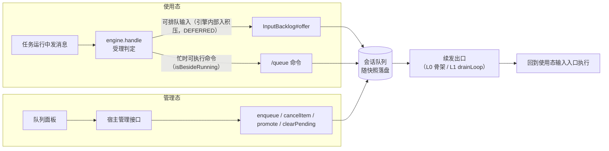

# solon-ai-harness-queue

solon-ai-harness 的会话级排队插件。在当前任务运行时，把后续消息登记到会话队列；当前任务结束、会话空闲后，把队列里的消息作为新任务发送。用 L0 宿主骨架（`HarnessHost`）时续发由骨架代办；自己接线（L1，直连 `engine.handle`）时由宿主驱动领取（`claimNext` / `drainLoop`）。

- 包名：`org.noear.solon.ai.harness.extension.queue`
- 只依赖核心契约（`HarnessExtension` / `spi.InputBacklog` / `spi.RunDispatch`），不依赖其它插件
- 宿主只接触一个门面类：`QueueExtension`

**两种时态**（第四章总览，第五、六章分别给出完整示例；用 L0 时先看第三章）：

| 时态 | 用户在哪里操作 | L0 入口（`HarnessHost`） | L1 入口（自己接线） | 本插件的入口 |
|---|---|---|---|---|
| 使用态 | 任务运行中继续在对话框 / IM 里发消息，或输入 `/queue <消息>` | `host.submit(...)`：忙时按 `whenBusy(QUEUE)`（缺省）进积压，`HostSink#deferred` 收到位置；续发由骨架代办 | `engine.handle`（忙时由引擎经 `InputBacklog#offer` 入队并返回 `DEFERRED`；`/queue` 在运行任务旁边执行）；续发由宿主 `drainLoop` | `InputBacklog#offer` / `/queue` 命令 |
| 管理态 | 队列面板里点「添加 / 删除 / 立即执行 / 清空」 | `host.admin(tenant).call(sid, QueueExtension.class, (queue, s) -> ...)`，成功后骨架自动续发 | 宿主自己的管理接口（HTTP 等）直接调门面，之后自己续发 | `QueueExtension` 门面方法 |

两种时态入队的消息，最终都由同一个续发出口领取（L0 是骨架内部的 drain，L1 是宿主的 `drainLoop`），再回到使用态的输入入口执行。

## 一、功能介绍

### 1.1 与 steer 的区别

| 能力 | 作用对象 | 对进行中任务的影响 | 消费时机 |
|---|---|---|---|
| `/steer`（插话） | 当前正在运行的任务 | 注入当前任务 | 当前任务的推理过程中 |
| `/queue`（排队） | 当前任务之后的新任务 | 无影响 | 当前任务结束、续发出口领取时（L0 骨架自动；L1 宿主调用 `claimNext` / `drainLoop`） |

队列中的每一条都会作为一个独立的新任务发送，而不是并入正在跑的那一轮。任务运行期间队列里的待执行项都可以改（查看、取消、置顶、清空），这个可操作窗口比 `/steer` 宽得多（后者只在推理边界可用）。

steer 的降级目标也是这里：`steer` 返回 `BOX_FULL` 或 `NOT_RUNNING` 时，由调用方改走 `enqueue`，语义从「注入当前任务」变成「排在它后面」（框架不代做这次降级，见 [ENGINE-L1 §3.5](../solon-ai-harness-core/docs/ENGINE-L1.md)）。

### 1.2 生命周期：入队、领取、收口、代际保护

1. **入队**：`enqueue(...)`（或 `/queue` 命令、引擎 `handle` 忙时经 `InputBacklog#offer` 转入）把一条 `QueueItem` 以 `PENDING` 状态追加到队尾，并随会话快照落盘。
2. **领取**：`claimNext(...)` 在会话锁内抢占领取权，然后取出队首，置为 `RUNNING` 并记为 in-flight；生成一个 `QueueClaim`（同时登记为核心槽位 `RunDispatch`），领取瞬间绑定当前代际快照，再交给 `QueueClaimHandler`。
3. **收口**：只有两条路径。
   - handler 返回 `true`（同步完成）：内核当场确认（acknowledge），从 in-flight 移除；
   - handler 返回 `false`（异步启动）：由流终态调用核心 `RunTicket#settle(boolean)`，内部转到 `QueueClaim#settle(boolean)`：`true` 为确认，`false` 为回滚到队首。
   - handler 抛异常：视为启动失败，内核按领取时的代际快照回滚到队首，返回 `START_FAILED`。
4. **代际保护**：引擎中断（`engine.interrupt(session, InterruptMode.INTERRUPT_ALL)` 或 `prepareInterrupt`；L0 的 `host.interrupt` 等价于 `INTERRUPT_ALL`）先回调本插件的 `onSessionInterrupt`，清空待执行、移除 in-flight 记录、注销本插件的派发登记并把代际加一。此后旧 claim 的回滚因代际不匹配被拒绝，任务被丢弃，不会在用户 Stop 后“复活”。

`claimNext` 内部顺序：抢占领取权（同一时刻只允许一个运行者取队首；`canAccept` 与占位在同一把锁内求值）→ 队首出队并置为 RUNNING、记为 in-flight → **领取瞬间绑定代际快照** → 登记派发 → 回调 handler → 异常则注销登记并回滚 → 释放领取权。同步 / 异步只是收口时机不同，领取流程只有这一条。

下图是 L1 下宿主自己续发的时序；用 L0 时图中「宿主」的续发与收口都由骨架完成。

```mermaid
sequenceDiagram
    participant U as 用户/渠道
    participant H as 宿主
    participant Q as QueueExtension
    participant S as 流(Agent)

    participant E as 引擎(handle)

    U->>H: 任务运行中发来消息
    H->>E: handle(HarnessInput)
    E->>Q: offer(session, input)
    Q-->>E: 位置(从 1 计) / -1
    E-->>H: DEFERRED(getBacklogPosition) / REJECTED("backlog_unavailable")
    S-->>H: 当前任务终态
    H->>Q: drainLoop(session, canDrain, handler)
    Q->>Q: 领取权 + 队首出队(RUNNING, in-flight) + 代际快照
    Q->>H: handler.run(claim)
    alt 同步完成(返回 true)
        Q->>Q: acknowledge
    else 异步启动(返回 false)
        H->>S: RunTicket.begin + 开流
        S-->>H: 流终态
        H->>Q: ticket.settle(true/false)
        Note over Q: true=确认; false=回队首(代际已变则丢弃)
    end
    U->>H: Stop
    H->>Q: engine.interrupt -> onSessionInterrupt -> 清空并代际+1
```

### 1.3 与核心的协作

| 核心契约 | 本插件的实现 |
|---|---|
| `spi.InputBacklog#offer(session, HarnessInput)` | 由引擎 `handle` 在忙时调用（宿主不必调）；保存正文、来源（null 时按 `InputOrigin.NONE`）、`selectedModel`、子代理（explicitAgent 优先，否则 selectedAgent）、宿主域属性 `getAttrs()` 与输入快照；受开关控制，返回位置（从 1 计）或 `-1`（满 / 超长 / 停用，引擎据此返回 `REJECTED("backlog_unavailable")`）；成功时登记积压索引 |
| `spi.InputBacklog#hasPending` | `pendingSize(session) > 0`，事实口径，不受开关影响；引擎 `handle` 受理判定的先进先出与 `isIdle` 依赖它 |
| `HarnessExtension#contributeSessionStatus` | 贡献 `QueueExtension.STATUS_PENDING`（待执行数） |
| `HarnessExtension#onSessionInterrupt` | 清空待执行、作废运行中那条的登记并递增代际（清理类，不判开关）；这是「作废全部」的唯一入口，门面不单独提供 |
| `HarnessExtension#onSessionRemove` | 注销该会话的积压索引（队列本体存在会话里，随会话一起消失） |
| `HarnessExtension#onAttach` | 注册 `/queue` 命令；引擎有状态来源时建立积压索引（`INDEX_PATH = "queue/pending"`） |
| `spi.RunDispatch` | `QueueClaim` 实现，领取成功即登记到核心槽位，收口即注销 |

## 二、依赖

```xml
<dependency>
    <groupId>org.noear</groupId>
    <artifactId>solon-ai-harness-queue</artifactId>
    <version>${solon-ai.version}</version>
</dependency>
```

当前源码版本继承自 `solon-ai-parent`（`4.2.0-SNAPSHOT`）。传递依赖 `solon-ai-harness-core`。`solon-ai-harness-host` 已依赖本模块。

**引入不等于装配**：插件上了类路径不会自己生效，要在构建引擎时挂上（见 4.1）。

## 三、用 L0 时（HarnessHost）

用 [solon-ai-harness-host](../solon-ai-harness-host/README.md) 的 `HarnessHost` 时，本插件的续发、收口、恢复都由骨架代办，宿主不写 `drainLoop` / `claimNext` / `RunTicket`。第四章之后标为「自己接线（L1）」的小节可以跳过。

### 3.1 骨架代办了什么

| 事情 | 骨架的做法 |
|---|---|
| 忙时排队 | 会话忙（正在运行 / 受理窗口 / 有积压）时，`whenBusy(QUEUE)`（缺省）由引擎在受理的会话锁内把输入转入积压，返回 `DEFERRED`（`getBacklogPosition()`），`HostSink#deferred(input, position)` 收到通知（见 [host README §4.7](../solon-ai-harness-host/README.md)） |
| 自动续发 | 当前一轮结束后（登记在运行句柄注销之后），以及回执、排队、审批、空输入、管理态操作之后，骨架自动 drain 积压 |
| 续发那一轮的投递 | 按**当初排队那条消息自己的 `origin`** 投递；`input.isDispatched()` 为 true，`input.getQueueItem()` 是那一项；`getSelectedModel()` / `getSelectedAgent()` / `getAttrs()` 是排队时保存的值；`Builder.input(...)` 同样作用于续发输入 |
| 收口 | 开了流的续发轮次在流终态经 `RunTicket` 收口，其余结局当场收口；开流前失败会 `discard` 并收口派发 |
| 重启恢复 | 首次取到某个引擎时按 queue 积压索引（`pendingSessions()`）续发；只续发 `programRuns` 过滤命中、且本节点持有的会话（见 [host README §6](../solon-ai-harness-host/README.md)） |
| 管理态续发 | `host.admin(tenant).call(sid, QueueExtension.class, ...)` 成功后自动续发，入队、置顶后会话空闲就立即执行，不用手动 drain（见 [host README §5](../solon-ai-harness-host/README.md)） |
| 停止 | `host.interrupt(tenant, sid)` 等价 `INTERRUPT_ALL`：清空队列再停流；`RunHandle.cancel()`（及 SSE 断开）只停这一轮、保留排队，结束后续发下一条；`admin.interrupt(sid, InterruptMode.CANCEL_STREAM)` 同样保留排队 |

骨架代办事项的完整清单见 [host README §11](../solon-ai-harness-host/README.md)。

### 3.2 宿主还要做的事

1. **构建期装配**：`HarnessEngine.of(...)...extensionAdd(QueueExtension.builder().maxSize(20).build()).build()`（见 4.1）。不装 queue 时会话忙直接拒绝（`busy`），`host.admin(...).call(sid, QueueExtension.class, ...)` 返回 `DISABLED`。
2. **按需选 `whenBusy` 策略**：

   | 策略 | 行为 | 适合 |
   |---|---|---|
   | `QUEUE`（缺省） | 进积压，当前一轮结束后自动续发 | Web 推送：用户能看到「排队中」 |
   | `STEER` | 先作为插话交给正在运行的那一轮（需 steer 插件），插不进再排队 | IM、聊天输入框「边跑边补充」 |
   | `REJECT` | 直接拒绝（`REJECTED(BUSY)`） | 一问一答：请求结束了，排队的那一轮没人接 |

   忙时可执行命令（如 `/queue`、`/steer`）不受策略影响，照常在运行任务旁边执行（`input.isBesideRunning()` 为 true）。
3. **展示排队**：在 `HostSink#deferred(input, position)` 里提示「已排队（第 N 位）」；在 `HostSink#admitted(input)` 里用 `input.isDispatched()` / `input.getQueueItem()` 识别续发出来的那一轮（例如把面板上那一项标成执行中）。`isBesideRunning()` 为 true 时不要改写会话的回复路由与选择。
4. **管理接口先鉴权，再 `host.admin`**：框架不做鉴权，在控制器 / 拦截器层先校验，再进管理态。

### 3.3 使用态示例：用户在对话里输入

会话忙时发来的普通消息、以及 `/queue <消息>` 命令，都经同一个提交入口：

```java
@Post
@Mapping("/chat/{tenant}/{sid}")
public Result<String> chat(String tenant, String sid, String text, Context ctx) {
    // text 例如："顺便更新 README"（忙时进积压）、"/queue 接着把文档也更新一下"（显式排队）、"/queue list"
    SubmitResult r = host.submit(tenant, sid, HarnessInput.of(text)
            .origin(InputOrigin.of("web", userOf(ctx), sid, null)));        // 缺省 whenBusy(QUEUE)
    switch (r.getDisposition()) {
        case DEFERRED:                                                  // 忙：已进积压，当前一轮结束后自动续发
            return Result.succeed("已排队（第 " + r.getBacklogPosition() + " 位）");
        case REPLY:                                                     // /queue 的回执（忙时也照常执行）
            return Result.succeed(r.getReplyText());
        case STARTED:                                                   // 不忙：直接开了一轮
            return Result.succeed(r.getRun().await(Duration.ofMinutes(5)).getResultText());
        default:
            ctx.status(r.httpStatus());
            return Result.failure(r.httpStatus(), r.getRejectDetail());
    }
}
```

续发出来的那一轮没有请求在等，推送型宿主在 sink 里接住：

```java
final class QueueAwareSink implements HostSink {
    @Override
    public void deferred(HostInput input, int position) {
        push(input.getSessionId(), "已排队（第 " + position + " 位）");
    }

    @Override
    public void admitted(HostInput input) {
        if (input.isDispatched()) {                                     // 队列续发的一轮：按那条消息自己的 origin 投递
            markRunning(input.getSessionId(), input.getQueueItem().getId());
        }
    }
}
```

`push`、`markRunning` 为宿主自有逻辑。

### 3.4 管理态示例：面板上的队列按钮

与 [host README §5.1](../solon-ai-harness-host/README.md) 的写法一致（`reply` 为 `HarnessResult` → 应答的转换）：

```java
private SessionAdmin admin(String action, String tenant, String sid, Context ctx) {
    authz.require(action, tenant, userOf(ctx), sid);        // 先鉴权，再进管理态
    return host.admin(tenant);
}

@Get
@Mapping("queue")
public Result<List<QueueItem>> queueList(String tenant, String sid, Context ctx) {
    return reply(admin("queue.read", tenant, sid, ctx)
            .call(sid, QueueExtension.class, (queue, s) -> HarnessResult.ok(queue.list(s))), ctx);
}

@Post
@Mapping("queue/add")
public Result<Integer> queueAdd(String tenant, String sid, String text, Context ctx) {
    // 成功后框架自动续发：会话空闲就立即执行
    return reply(admin("queue.write", tenant, sid, ctx)
            .call(sid, QueueExtension.class, (queue, s) -> queue.enqueue(s, text, InputOrigin.channel("console"))), ctx);
}

@Post
@Mapping("queue/top")
public Result<Void> queueTop(String tenant, String sid, String itemId, Context ctx) {
    return reply(admin("queue.write", tenant, sid, ctx)
            .call(sid, QueueExtension.class, (queue, s) -> queue.promote(s, itemId)), ctx);
}

// queue/cancel、queue/clear 同理：queue.cancelItem(s, itemId)、queue.clearPending(s)
```

`call` 按固定顺序检查：`sessionId` 为空 → `INVALID`；扩展未装配 → `DISABLED`；会话不归本节点 → `NOT_OWNER`；会话不存在 → `NOT_FOUND`（只查不建）；再执行操作。

### 3.5 L0 下的注意点

- **管理态操作后不要自己再 drain**：骨架已自动续发。
- **一问一答接口用 `whenBusy(REJECT)`**：缺省 `QUEUE` 会让忙时排队的那一轮没人接、结果丢失。
- **同一引擎挂了多个入口**：用 `programRuns(sid -> ...)` 划分范围，否则重启恢复时会跑掉别的入口会话的积压。
- **不要绕过 host 直接从池里取引擎跑**：那一轮结束后不会续发。
- 门面语义（结果码、受控 / 不受控、`id` 幂等、附件不进队列等）与 L1 相同，见第六、七章。

## 四、装配与两种时态

### 4.1 装配

推荐在构建期挂上：

```java
HarnessEngine engine = HarnessEngine.of(workspace, harnessHome)
        // ... 模型、会话存储等其它配置
        .extensionAdd(QueueExtension.builder().maxSize(20).build())   // 或 new QueueExtension()（缺省 20 条 / 4096 字符）
        .build();

QueueExtension queue = engine.getExtension(QueueExtension.class).get();
```

`onAttach` 注册 `/queue` 命令，并作为引擎的积压能力（`InputBacklog`）。调整上限用 builder：`QueueExtension.builder().maxSize(50).maxTextLength(8192).build()`。

运行期写法（仅 `runtimeMutable` 时可用，STANDALONE 缺省；SERVER 模式 build 之后调用抛 `IllegalStateException`）：

```java
// 按类型幂等：已有 QueueExtension 时返回已挂载的那个实例
QueueExtension queue = engine.addExtensionIfAbsent(new QueueExtension());
```

装配后，引擎 `handle` 才会把"任务运行中的普通消息"自行入积压并返回 `DEFERRED`（没装 queue 时返回 `REJECTED("busy")`）；steer 插件的残留插话也会转入这里。不可排队的输入不进积压：程序轮次（`HarnessInput.ofProgram(...)`）与续流忙时返回 `REJECTED("busy")`，带附件的输入返回 `REJECTED("attachments_not_deferrable")`，显式携带不可保存作用域的输入返回 `REJECTED("scope_not_deferrable")`。

### 4.2 两种时态



| 对比项 | 使用态 | 管理态 |
|---|---|---|
| 用户动作 | 任务运行中照常发消息（自动排队）；或输入 `/queue <消息>` 显式排队 | 在队列面板里添加、删除一条、立即执行一条、清空 |
| 宿主入口 | L0：`host.submit`；L1：`engine.handle(HarnessInput)`（忙时由引擎入积压，宿主不调 `enqueue`） | L0：`host.admin(tenant).call(...)`；L1：宿主自己的管理接口，直接调门面 |
| 是否经过 `handle` 受理判定 | 是；`/queue` 声明 `runnableWhenBusy`，运行中在运行任务旁边执行（`isBesideRunning()`） | 否 |
| 本插件入口 | `InputBacklog#offer(session, input)`（引擎调用）、`QueueCommand`（`/queue <消息>` / `list` / `cancel` / `clear`） | `list` / `enqueue`（带 `id` 幂等）/ `cancelItem` / `promote` / `clearPending` |
| 结果怎么返回 | `DEFERRED` 的 `outcome.getBacklogPosition()`（L0 为 `HostSink#deferred` 的 position）；命令回执 `outcome.getCommandOutput()` | 写操作返回 `HarnessResult`（按 `getCode()` 判定）；读操作返回队列快照 |
| 只有这一态能做的 | 自动排队（`DEFERRED`，连同宿主域属性 `attr` 一起保存） | 删除单条、置顶、清空、幂等入队、带模型 / agent 等执行参数入队 |

两种时态写的是**同一个队列**：忙时自动排进来的消息会出现在面板上，面板上可以删掉或置顶它们。

### 4.3 续发：两态共用的唯一出口（自己接线（L1））

> 用 L0 时骨架代办，本节可跳过。

无论消息是怎么进队列的，都只有一个出口：宿主在合适的时机调用 `drainLoop`，在领取回调里把这条消息交回**使用态的输入入口**执行。这个出口要在三处调用：

| 时机 | 原因 |
|---|---|
| 一次输入处理完之后（`REPLY` / `DEFERRED` / `HITL` / `IGNORED`，以及 `TASK` 跑完） | 覆盖"空闲时 `/queue` 入队"、同步命令、"会话只是积压未清"等场景 |
| 任务（含 goal / loop 的一轮）终态之后 | 运行期间排进来的消息要接着发 |
| 管理接口添加或置顶之后 | 会话可能正空闲，没有终态可等 |

```java
queue.drainLoop(session, s -> !engine.status(s).isOccupied(), claim -> {
    InputOutcome outcome = engine.handle(claim.getItem().toInput(session)); // 同一线程：引擎识别为派发轮次
    handleOutcome(session, outcome, claim.getItem().getOrigin()); // 与入站消息共用的结局处理（见 5.3）
    return true;                                         // 同步跑完：内核当场收口
});
```

`QueueItem#toInput(session)` 把队列项还原为续发输入：正文、来源、模型、子代理、宿主域属性（`getAttrs()`）与输入快照原样带回，正文仍按命令识别。引擎在派发线程上识别出这一轮（`outcome.getDispatch()` 非空），免于"有积压就延后"的判定。

`drainLoop` 的终止条件（任一成立即返回）：`canDrain` 返回 false、领取结果为 `NO_TASK`、领取结果为 `START_FAILED`（不重试）、启动成功后队列已无待执行项。

> `canDrain` 不要用 `engine.isIdle(session)`：它把积压也算作不空闲（见 1.3），队列非空时恒为 false，队列永远不会被领取。传 `null` 表示不预判，完全由队列状态决定。

> 谓词在**领取权的同一把会话锁内**求值，因此宿主不需要再写 `synchronized (session.attrs())` 包住派发，也不需要领完再复核一次忙态——那种写法两次判定之间必然有窗口。`drainLoop` 在入锁前也会先判一次谓词，只是快速出口，权威判定在锁内。

宿主侧接线的整体约定（插件协作契约、装配、命令文本 / handle / 门面三条路径）见 [ENGINE-L1 §3](../solon-ai-harness-core/docs/ENGINE-L1.md)。

## 五、使用态：用户在对话中输入

### 5.1 用户能输入什么

| 用户动作 | 发生了什么 |
|---|---|
| 任务运行中发一条普通消息 | 引擎调 `InputBacklog#offer` 入队并返回 `DEFERRED`，宿主回复"已排队（第 `getBacklogPosition()` 位）"（L0 在 `HostSink#deferred` 里回复） |
| 任务运行中发 `/goal ...`、`/loop ...` 等非忙时可执行命令 | 同上：以原文入队，续发时经同一入口按命令执行 |
| 任务运行中发带附件的消息 | 不可排队，返回 `REJECTED("attachments_not_deferrable")` |
| `/queue 跑完顺便把文档也更新一下` | 任务运行中也能受理（`runnableWhenBusy`，在运行任务旁边执行，`isBesideRunning() == true`），命令入队并回执 |
| 空闲时 `/queue <消息>` | 照样入队；`REPLY` 后立即续发（L0 骨架自动；L1 宿主在 `REPLY` 后 drain），它会马上作为新任务执行 |
| `/queue list` | 列出队列（运行中的在首位），每条带序号与 id |
| `/queue cancel <id\|序号>` | 取消一条待执行；序号按 `/queue list` 的编号；正在执行的那条不能取消 |
| `/queue clear` | 清空全部待执行（`clearPending`：不动正在执行的那条，不递增代际） |
| `/queue -- <消息>` | 转义：消息恰好是 `list`、`clear` 等子命令词时使用 |

子命令只在参数形态完全匹配时生效：`list`、`clear` 独占整行，`cancel` 后恰好一个参数。`/queue list all files` 这类自然语言照常入队。IM 渠道没有队列面板，查看和管理都靠这几个子命令；Web 前端有面板时，排队编排在面板与管理接口完成，同一条输入不要再拼成 `/queue ...` 重复入队。

`/queue` 回执：

| 情形 | 回执文案 |
|---|---|
| 无参数 | `用法：/queue <消息>（当前任务结束后自动作为新任务发送）`，另起一行列出子命令 |
| 超长 | `排队内容过长（上限 4096 字符）` |
| 入队失败（队列已满） | `排队失败（队列已满，上限 20 条），请稍后再试` |
| 成功 | `已加入队列（第 N 位），将按顺序在任务空闲后自动发送` |
| `list` 队空 | `队列为空` |
| `cancel` 命中运行中那条 | `这条正在执行，不能从队列取消（停止当前任务用 /interrupt）` |
| `cancel` 成功 | `已取消：<id>` |
| `cancel` 未命中 | `未找到待执行的消息：<参数>` |
| `clear` | `已清空 N 条待执行（正在执行的不受影响）`，队空时 `队列里没有待执行的消息` |
| 扩展已停用（命令层拦截） | `/queue 已停用。发送 /help 查看可用命令。` |

文案中的上限取本实例的 `maxTextLength` / `maxSize`。

### 5.2 命令的边界

- `runnableWhenBusy() == true`、`terminalOnly() == false`：任务运行中可受理，Web / IM / 桌面都可用；
- 结局恒为 `Kind.REPLY`，命令本身不开流；
- 来源取宿主透传的 `origin`（`HarnessInput.origin(...)`），为 null 时用 `InputOrigin.NONE`，不兜底渠道名；
- 命令只负责入队与管理（`list` / `cancel` / `clear`），**不负责续发**；
- **命令文本与门面调用是同一个动作，返回值不同**：`engine.handle(HarnessInput.of(s, "/queue 跑测试"))` 得到 `Kind.REPLY` + 人读回执；`queue.enqueue(s, "跑测试")` 得到 `HarnessResult<Integer>`（OK 时值为位置）。要程序判定走门面，要现成文案走命令文本；**两条都走会入队两次**（命令路径没有 `id` 幂等保护）。三条路径的对照见 [ENGINE-L1 §3.3](../solon-ai-harness-core/docs/ENGINE-L1.md)；
- 命令直接写队列：不经门面的归属检查，也不登记积压索引（见 6.3）。

### 5.3 宿主接入：完整示例（自己接线（L1））

> 用 L0 时骨架代办，本节可跳过。

队列要真正"动起来"，宿主只需两段：**受理与执行**（`engine.handle` 一步完成，忙时可排队输入由引擎自己入积压）→ **续发**（输入处理完或任务终态后领取队首）。下面是一个同步执行的 IM 宿主，完整覆盖 `/queue` 命令、忙态普通消息与队列派发；`drain` 设为 public，供管理接口（6.2）复用：

```java
import org.noear.solon.ai.agent.AgentSession;
import org.noear.solon.ai.harness.HarnessEngine;
import org.noear.solon.ai.harness.extension.queue.QueueExtension;
import org.noear.solon.ai.harness.input.HarnessInput;
import org.noear.solon.ai.harness.input.InputOrigin;
import org.noear.solon.ai.harness.input.InputOutcome;

public class ImQueueHost {
    private final HarnessEngine engine;
    private final QueueExtension queue;

    public ImQueueHost(HarnessEngine engine) {
        this.engine = engine;
        // 构建期已 extensionAdd(new QueueExtension())，这里只取实例（/queue 已由 onAttach 注册）
        this.queue = engine.getExtension(QueueExtension.class)
                .orElseThrow(() -> new IllegalStateException("queue extension not attached"));
    }

    /** 唯一输入入口：用户消息与 /queue 命令都走这里 */
    public void onMessage(AgentSession session, String text, InputOrigin origin, String effort) {
        // 第 0 步受理判定在 handle 内：忙态普通消息 → 引擎入积压并返回 DEFERRED；
        // 任务运行中的 /queue → 在运行任务旁边执行（REPLY，isBesideRunning() == true）
        InputOutcome outcome = engine.handle(HarnessInput.of(session, text)
                .origin(origin)
                .attr("reasoningEffort", effort));   // 宿主域属性：进积压时原样保存，续发时原样带回
        handleOutcome(session, outcome, origin);
    }

    /** 结局处理：入站消息与队列派发的一轮共用 */
    private void handleOutcome(AgentSession session, InputOutcome outcome, InputOrigin origin) {
        // 派发轮次沿用派发事务的来源（回复要回到当初排队的那个渠道）
        InputOrigin route = outcome.isDispatched() ? outcome.getDispatch().getOrigin() : origin;
        switch (outcome.getKind()) {
            case TASK:       // 普通消息（含派发出来的那一轮）：同步跑完，call() 结束即释放占位
                try {
                    if (outcome.hasReply()) {
                        reply(route, outcome.getCommandOutput());
                    }
                    reply(route, outcome.getRequest().call().getContent());
                } catch (Throwable e) {
                    outcome.discard();   // 幂等；开流前失败时确保占位释放
                    if (outcome.isDispatched()) {
                        throw new IllegalStateException("queued run failed to start", e); // 交回派发侧回滚到队首
                    }
                    reply(route, "处理失败：" + e.getMessage());
                }
                drain(session);
                break;
            case REPLY:      // /queue 恒为 REPLY；isBesideRunning() 为真时不要改写会话的回复路由
                reply(route, outcome.getCommandOutput());
                drain(session);  // 覆盖"空闲时 /queue 入队"与同步命令场景
                break;
            case DEFERRED:   // 引擎已入积压；会话可能只是"积压未清"而并不忙：立即尝试续发
                reply(route, "已排队（第 " + outcome.getBacklogPosition() + " 位）");
                drain(session);
                break;
            case REJECTED:   // hitl_pending / busy / attachments_not_deferrable / backlog_unavailable
                reply(route, outcome.getRejectDetail());
                break;
            case HITL:
            case IGNORED:
                drain(session);
                break;
        }
    }

    /** 续发：领取队首，在同一线程回到 handle（使用态与管理态共用） */
    public void drain(AgentSession session) {
        queue.drainLoop(session, s -> !engine.status(s).isOccupied(), claim -> {
            // 同线程调用：引擎识别出"派发轮次"（outcome.getDispatch() 非空）
            InputOutcome outcome = engine.handle(claim.getItem().toInput(session));
            handleOutcome(session, outcome, claim.getItem().getOrigin());
            return true;                                         // 同步跑完，内核当场确认
        });
    }

    private void reply(InputOrigin origin, String text) { /* 按 origin 回投渠道 */ }
}
```

### 5.4 异步开流的宿主：claimNext + settle（自己接线（L1））

> 用 L0 时骨架代办，本节可跳过。

流式宿主不能在领取回调里同步跑完，改为返回 `false`，在流终态收口：

```java
QueueClaimStatus st = queue.claimNext(session,
        s -> !engine.status(s).isOccupied(),   // 与领取权同一把会话锁内求值；false 时不消耗队列项；null = 不预判
        claim -> {
            QueueItem item = claim.getItem();
            startStreamAsync(session, item);  // 见下方
            return false;                     // 异步启动：收口交给流终态
        });

void startStreamAsync(AgentSession session, QueueItem item) {
    // 同线程回到 handle：引擎识别为派发轮次
    InputOutcome outcome = engine.handle(item.toInput(session));
    if (outcome.getKind() != InputOutcome.Kind.TASK) {
        handleOutcome(session, outcome, item.getOrigin());
        return;
    }
    // 必须在订阅前、领取回调内调用：此时会捕获本次 QueueClaim
    RunTicket ticket = RunTicket.begin(session);
    // 终态后续发下一条：登记在「运行句柄注销之后」（见下方要点）
    outcome.afterRun(() -> queue.drainLoop(session, s -> !engine.status(s).isOccupied(), this::dispatch));
    executor.execute(() -> {
        if (ticket.isCancelled()) {
            outcome.discard();
            ticket.settle(false);               // 调度窗口内被取消；若已被中断作废则为空操作
            return;
        }
        outcome.getRequest().stream()
                .doOnNext(e -> render(session, e))
                .doFinally(s -> ticket.settle(true))   // 幂等；此时会话仍算忙，不要在这里 drain
                .subscribe();
    });
}
// dispatch 即本例的 QueueClaimHandler：claim -> { startStreamAsync(session, claim.getItem()); return false; }
```

要点：

- **终态续发用 `outcome.afterRun(...)`，不要写在流的 `doFinally` 里**：Reactor 正常终止时下游的 `doFinally` 先于上游执行，而运行句柄在请求内部最上游才注销——宿主 `doFinally` 里 `isOccupied` 仍为 true，`drainLoop` 会直接返回，排队消息要等下一次外部触发才发出。`blockLast()` 等待同样不可靠（它在 `onComplete` 时就返回）。`afterRun` 在句柄注销后、执行线程上运行；未开流就放弃时不会执行。四端时序见 [ENGINE-L1 §2.4](../solon-ai-harness-core/docs/ENGINE-L1.md)。
- 返回值必须诚实。异步却返回 `true`，流失败后无法回滚；同步却返回 `false`，会留下未收口的 in-flight，挡住后续领取。
- 同一会话同时只有一条 in-flight。它未收口前，再次 `claimNext` 返回 `NO_TASK`。
- 收口路径只有两条：同步由 handler 返回 `true`，异步由流终态 `RunTicket.settle(...)`（它收口会话当前的派发事务）。没有持有凭据时兜底用 `RunDispatch.current(session).settle(...)`；宿主不传 item id，身份校验由插件内部完成。
- `QueueClaim.current(session)` 可取回会话当前未收口的队列领取（槽位里是别的插件的派发时返回 null）。
- 判断“当前线程是否在派发调用栈里”用 `claim.isOnDispatchThread()`；判断“这条派发是否仍未收口”用 `claim.isCurrent()`（跨线程可用）。两者不可混用：异步订阅失败发生在别的线程上，用线程判定必然得到 false，会形成「回滚到队首 → 立即续发 → 又领到同一条 → 再失败」的死循环。

### 5.5 使用态要点

1. **命令注册由插件完成**：`QueueExtension#onAttach` 已注册 `/queue`，宿主不用注册。
2. **忙态由引擎处理，宿主不要自己拦**：所有输入直接交给 `engine.handle`（L0 交给 `host.submit`）。`/queue` 声明 `runnableWhenBusy`，运行中在运行任务旁边执行（`isBesideRunning() == true`，宿主不要据此改写回复路由）；其余可排队输入由引擎调 `InputBacklog#offer` 入队并返回 `DEFERRED`。宿主侧不要再为忙态调 `queue.enqueue`，否则会重复入队。
3. **空闲时的 `/queue` 也会入队**（L1）：此时没有终态可等，必须在 `REPLY` 后立即 `drain`（示例的 `handleOutcome`），否则这条要等下一个任务结束才会被发出。L0 骨架在回执后自动续发。
4. **续发在同一线程回到 `handle`**（L1）：在领取回调里调用 `engine.handle(claim.getItem().toInput(session))`，引擎用 `RunDispatch#isOnDispatchThread()` 识别派发轮次（`outcome.getDispatch()` 非空），免于"有积压就延后"的判定；派发线程上的 `TASK` 同样占位，直到请求被订阅或 `call()` 结束。异步开流的宿主改为在领取回调里 `RunTicket.begin(session)`，流终态 `ticket.settle(ok)`（5.4）。
5. **派发轮次的回复路由取当初入队时的来源**：L1 为 `outcome.getDispatch().getOrigin()`，L0 为 `HostInput#getOrigin()`（续发时即排队那条的来源），而不是触发续发的那次请求。
6. **派发轮次启动失败要抛出**（L1）：抛给 `drainLoop` 的回调后，内核按领取时的代际回滚到队首并返回 `START_FAILED`，不会无限重试。
7. **排队的可以是命令**：忙态下用户发 `/goal ...`、`/loop ...` 这类非忙时可执行命令时，`handle` 把它们以原文入队并返回 `DEFERRED`，续发时经同一入口按命令执行。宿主域属性（如 `attr("reasoningEffort", ...)`）随队列项保存，`toInput` 时原样带回。
8. **审批挂起**：有待审批卡时，普通输入返回 `REJECTED("hitl_pending")`；`/queue` 等忙时可执行命令、审批决策、续流与派发轮次由引擎按输入本身豁免，宿主无需传任何谓词。
9. **停止**：`engine.interrupt(session, InterruptMode.INTERRUPT_ALL)`（L0 为 `host.interrupt`）会先清空队列再停流，终态回调里的 `drain` 不会把刚停掉的内容重新推起来。

## 六、管理态：用户在界面上操作

管理态不经过 `handle`：队列面板上的每个按钮对应一个宿主接口，接口直接调用 `QueueExtension` 门面。用 L0 时经 `host.admin(tenant).call(...)`，成功后骨架自动续发（见 3.3）；自己接线（L1）时，添加或置顶后调用使用态的续发入口（4.3），让会话空闲时立刻开始执行。

### 6.1 界面动作与门面对照

写操作统一返回 `HarnessResult<T>`：`isOk()` 时 `getValue()` 为结果，失败时按 `getCode()` 映射状态、`getDetail()` 为原因。没有 `-1` / `-2` / `boolean` 哨兵值，「不归本节点管」（`NOT_OWNER`）和「条目不存在」（`NOT_FOUND`）可以区分。L0 下可直接用 `r.httpStatus()` 映射（见 [host README §5.3](../solon-ai-harness-host/README.md)）。

| 界面动作 | 门面调用 | 成功（OK） | 失败码（建议的 HTTP 映射） |
|---|---|---|---|
| 队列列表 | `queue.list(session)` | `List<QueueItem>`，运行中那条在首位，用 `toMap()` 渲染 | —（读操作） |
| 添加一条 | `queue.enqueue(HarnessInput, id)` + 续发 | 值为位置（从 1 计） | `FULL` → 429；`INVALID`（文本为空、超长）→ 400；`CONFLICT`（`id` 重复）→ 409；`DISABLED` → 409 |
| 删除一条 | `queue.cancelItem(session, itemId)` | 无值 | `NOT_FOUND`（不存在或已在运行）→ 404 |
| 立即执行一条 | `queue.promote(session, itemId)` + 续发 | 无值 | `NOT_FOUND`（不存在或已在运行）→ 404 |
| 清空待执行 | `queue.clearPending(session)` | 值为清掉的条数 | — |
| 作废全部（Stop 语义） | `engine.interrupt(session, InterruptMode.INTERRUPT_ALL)`（L0：`host.interrupt` / `admin.interrupt(sid, INTERRUPT_ALL)`） | `HarnessResult<Boolean>` | 不是队列门面：引擎先回调本插件清空并递增代际，再停流（Web 两段式用 `prepareInterrupt`） |
| 停止正在跑的那条、保留排队 | `engine.interrupt(session, InterruptMode.CANCEL_STREAM)`（L0：`RunHandle.cancel()` / `admin.interrupt(sid, CANCEL_STREAM)`） | — | 不清队列；结束后续发下一条（见 6.6） |

所有写操作在多节点部署下还可能返回 `NOT_OWNER`（`getOwner()` 为持有者，宿主转发）。门面只查会话归属，不校验作用域；多租户的管理接口先自行鉴权。

### 6.2 完整示例：管理接口（自己接线（L1））

> 用 L0 时见 3.3，本节可跳过。

```java
import org.noear.solon.ai.agent.AgentSession;
import org.noear.solon.ai.harness.HarnessEngine;
import org.noear.solon.ai.harness.HarnessResult;
import org.noear.solon.ai.harness.extension.queue.QueueExtension;
import org.noear.solon.ai.harness.extension.queue.QueueItem;
import org.noear.solon.ai.harness.input.HarnessInput;
import org.noear.solon.ai.harness.input.InputOrigin;
import org.noear.solon.annotation.*;
import org.noear.solon.core.handle.Result;

import java.util.ArrayList;
import java.util.List;
import java.util.Map;

@Controller
@Mapping("/admin/queue")
public class QueueAdminController {
    @Inject
    HarnessEngine engine;
    @Inject
    ImQueueHost host;   // 5.3 的宿主：管理接口复用它的续发入口

    private QueueExtension queue() {
        return engine.getExtension(QueueExtension.class)
                .orElseThrow(() -> new IllegalStateException("queue extension not attached"));
    }

    @Get
    @Mapping("list")
    public Result<List<Map<String, Object>>> list(@Param("sessionId") String sessionId) {
        AgentSession session = engine.getSessionOrNull(sessionId);   // 只读：不顺带建会话
        List<Map<String, Object>> rows = new ArrayList<>();
        if (session != null) {
            for (QueueItem item : queue().list(session)) {
                rows.add(item.toMap());                              // id、text、status(PENDING/RUNNING)、createdAt……
            }
        }
        return Result.succeed(rows);
    }

    @Post
    @Mapping("add")
    public Result<Integer> add(@Param("sessionId") String sessionId,
                               @Param("text") String text,
                               @Param(value = "id", required = false) String id,          // 前端生成，HTTP 重试去重
                               @Param(value = "model", required = false) String model,
                               @Param(value = "agent", required = false) String agent) {
        AgentSession session = engine.getSessionOrNull(sessionId);   // 再加上宿主自己的归属校验
        if (session == null) return Result.failure(404, "Session not found");

        // 模型、子代理与宿主域属性（如推理强度）都放在输入上，队列原样保存、续发时原样带回
        HarnessInput input = HarnessInput.of(session, text)
                .origin(InputOrigin.channel("web"))
                .selectedModel(model)
                .selectedAgent(agent);
        HarnessResult<Integer> r = queue().enqueue(input, id);
        if (!r.isOk()) return toFailure(r);

        host.drain(session);   // 会话空闲时立刻开始执行；忙时什么也不做，等当前任务终态
        return Result.succeed(r.getValue());
    }

    @Post
    @Mapping("cancel")
    public Result<Void> cancel(@Param("sessionId") String sessionId, @Param("itemId") String itemId) {
        AgentSession session = engine.getSessionOrNull(sessionId);
        if (session == null) return Result.failure(404, "Session not found");
        HarnessResult<Void> r = queue().cancelItem(session, itemId);
        return r.isOk() ? Result.succeed() : toFailure(r);
    }

    @Post
    @Mapping("run")
    public Result<Void> runNow(@Param("sessionId") String sessionId, @Param("itemId") String itemId) {
        AgentSession session = engine.getSessionOrNull(sessionId);
        if (session == null) return Result.failure(404, "Session not found");
        HarnessResult<Void> r = queue().promote(session, itemId);   // 只有置顶，不插队打断当前任务
        if (!r.isOk()) return toFailure(r);
        host.drain(session);
        return Result.succeed();
    }

    @Post
    @Mapping("clear")
    public Result<Integer> clear(@Param("sessionId") String sessionId) {
        AgentSession session = engine.getSessionOrNull(sessionId);
        if (session == null) return Result.succeed(0);
        HarnessResult<Integer> r = queue().clearPending(session);   // 只清待执行，正在跑的那条照常跑完
        return r.isOk() ? Result.succeed(r.getValue()) : toFailure(r);
    }

    /** 结果码 → HTTP（各宿主按自己的协议映射即可） */
    private static <T> Result<T> toFailure(HarnessResult<?> r) {
        switch (r.getCode()) {
            case NOT_FOUND: return Result.failure(404, r.getDetail());
            case INVALID:   return Result.failure(400, r.getDetail());
            case CONFLICT:  return Result.failure(409, r.getDetail());   // id 重复
            case FULL:      return Result.failure(429, r.getDetail());
            case DISABLED:  return Result.failure(409, r.getDetail());
            case NOT_OWNER: return Result.failure(409, "owned by " + r.getOwner());
            default:        return Result.failure(500, String.valueOf(r.getCode()));
        }
    }
}
```

面板刷新：队列没有变化监听器，添加、删除、续发之后重新调用 `list` 即可；徽章计数用状态键：

```java
int pending = engine.status(session).get(QueueExtension.STATUS_PENDING); // 不含运行中那条
```

### 6.3 重启恢复：积压索引 / isPersisted / hasItems

队列随会话快照落盘，进程重启后首次访问自动恢复，但不会自己开始执行，需要对有积压的会话各续发一次。

**用 L0 时**：骨架首次取到引擎时按积压索引自动续发，宿主什么都不用写（见第三章）。

**自己接线（L1）时**：引擎有状态来源（`getStateSource()`）时，插件在其下 `queue/pending`（`QueueExtension.INDEX_PATH`）维护积压索引，每个可能有积压的会话一个空标记文件。索引是超集：门面 `enqueue` 与 `offer` 入队成功时登记，`cancelItem` / `clearPending` / `importItems` / 中断清空后按队列是否为空同步，`drainLoop` 观察到队空（`NO_TASK`）时注销，会话删除时注销。启动时据此续发，不需要枚举会话目录：

```java
for (String sid : queue.pendingSessions()) {        // 未挂接或引擎没有状态来源时为空
    if (engine.checkOwner(sid).isOwned() == false) continue;   // 多节点：只续发本节点持有的
    AgentSession session = engine.getSessionOrNull(sid);       // 只查不建
    if (session != null) {
        host.drain(session);   // 首次访问时自动从快照恢复；上次进程 RUNNING 的项回到队首并重置为 PENDING
    }
}
```

`/queue` 命令与绕过门面写入的队列不登记索引；索引上线之前的存量数据也没有索引。对这类会话可用 `queue.markPending(sessionId)` 补登（幂等），或用快照探测：

```java
// 会话快照里是否有队列（静态，按 FlowContext 探测，不需要扩展实例）
if (QueueExtension.isPersisted(context)) {
    // ...
}

boolean any = queue.hasItems(session);       // 含运行中
int pending = queue.pendingSize(session);    // 不含运行中
```

> **探测不要实例化会话**：`engine.getSession(id)` 是 `computeIfAbsent` 语义，不存在就新建，存在则把会话连全量历史常驻内存。外部传入的会话 ID 用 `getSessionOrNull` / `requireSession`；内存会话用 `queue.hasItems(session)`；只有快照时用 `QueueExtension.isPersisted(context)`（宿主先把快照反序列化成 `FlowContext` 再判定，存储无关）。

### 6.4 旧数据迁移：importItems

```java
// rows 来自旧版 queue-tasks.json / queue.json 的 Map 行
HarnessResult<Integer> r = queue.importItems(session, rows);   // OK 时值为实际导入条数
```

迁移规则：按 `id` 去重；文本为空的行被丢弃（超长防御值为 1000000 字符）；RUNNING 行重置为 PENDING 并放到队首（保持相对顺序），其余追加到队尾；总数达到容量上限（`maxSize`）即停止；有导入时写快照。

### 6.5 停用：受控与不受控

```java
engine.setExtensionEnabled(queue, false);   // 同时停用 /queue 命令
```

- 没有「只关命令」的开关：`QueueExtension` 只有无参构造与 `builder()`，`onAttach` 里无条件注册 `/queue`。要下线只有停用这一条路，它是「命令 + 门面」一起关。
- `setExtensionEnabled` 同样受 `runtimeMutable` 约束：SERVER 模式 build 之后调用抛 `IllegalStateException`。
- 未加入引擎的扩展会先被加入再直接返回；需要初始即停用时，在 `extensionAdd` 之前调 `queue.setEnabled(false)`。

停用后 `/queue` 回执为命令已停用提示（核心 `CommandDispatcher.COMMAND_DISABLED_HINT`：`已停用。发送 /help 查看可用命令。`）。

| 类别 | 方法 | 停用后 |
|---|---|---|
| 受控 | `enqueue`（三个重载） | 返回 `DISABLED` |
| 受控 | `offer`（引擎积压入口） | 返回 `-1`，引擎据此返回 `REJECTED("backlog_unavailable")` |
| 受控 | `claimNext`、`drainLoop` | 返回 `NO_TASK`，不领取 |
| 不受控 | `QueueClaim#settle`（收口）/ `cancelItem` / `promote` / `clearPending` / `importItems` / `onSessionInterrupt` | 照常执行，保证停用前已入队、已领取的项可以清理和收口 |
| 不受控（事实口径） | `pendingSize` / `hasItems` / `list` / `hasPending` / `STATUS_PENDING` | 照常反映真实队列 |

### 6.6 与 engine.interrupt 的关系

```java
if (Boolean.TRUE.equals(engine.interrupt(session, InterruptMode.INTERRUPT_ALL).getValue())) {   // 先回调 onSessionInterrupt 清队列，再停流
    queue.enqueue(session, "回到上一个方案并跑一遍测试");   // 返回 HarnessResult<Integer>
}
```

- `InterruptMode.INTERRUPT_ALL` / `engine.prepareInterrupt` 保证在停流之前回调 `onSessionInterrupt`，因此终态回调里的续发不会把刚被停掉的队列再推起来。
- 无运行流时 `interrupt` 返回 false，但队列仍会被清空。
- 中断会清掉队列里所有待执行项，这是“用户停止”的刻意语义。
- `CANCEL_STREAM` / `PREEMPT_STREAM` 不走扩展中断回调，不清队列。需要「停当前、留队列」用 `CANCEL_STREAM`（L0 为 `RunHandle.cancel()` 或 `admin.interrupt(sid, InterruptMode.CANCEL_STREAM)`）。
- 「停下来重来」直接停止后 `enqueue`；「运行中改主意」才用 steer，两者是互斥场景。各中断方式的对照与两段式中断见 [ENGINE-L1 §3.5](../solon-ai-harness-core/docs/ENGINE-L1.md)。

### 6.7 管理态要点

1. **添加和置顶之后要续发**（L1）：管理接口不经输入入口，没有受理位释放的时机；会话空闲时不调续发，这条要等下一次用户输入或任务终态才会执行。L0 的 `host.admin(...).call(...)` 成功后已自动续发，不要再 drain。
2. **续发只走一个入口**（L1）：管理接口调用的是使用态宿主的同一个 `drain`，执行在领取回调里经 `engine.handle(item.toInput(session))` 完成；不要在管理接口里自己 `engine.handle`，否则绕过受理判定、回复路由和派发收口。
3. **同一条输入只走一个入口入队**：前端已经调了添加接口，就不要再拼成 `/queue ...` 发出去；HTTP 重试靠 `enqueue(input, id)` 的 `id` 去重（同 id 已在待执行或运行中返回 `CONFLICT`）。
4. **运行中那条不能删、不能置顶**：`cancelItem` / `promote` 只作用于待执行项，对运行中那条的 id 一律返回 `NOT_FOUND`；要停掉运行中的那条用 `InterruptMode.INTERRUPT_ALL`，它会同时清空整个队列。
5. **`promote` 只有置顶**：没有“插到第 3 位”的重排；需要精确排序请 `cancelItem` 后重新 `enqueue`。
6. **`clearPending` 不等于停任务**：它不动 in-flight、不递增代际；要连运行中那条一起作废，用 `INTERRUPT_ALL`。
7. **列表是快照**：`list` 读到的下一刻队首就可能被领取；"删除""立即执行"按返回值判断是否成功，不要按界面上的旧状态推断。
8. **队列不保存附件**：队列只保存文本与执行参数，`enqueue` 会忽略输入上的附件。带附件的消息要么由宿主自行保存附件、续发时再装配（需要标记时写进 `attr(...)`），要么在管理接口里直接拒绝入队。

## 七、配置与限制

本插件只有两个容量类配置项，经 `QueueExtension.builder()` 设置；无参构造与 `builder().build()` 等价。builder 没有关闭命令注册的选项。

### 7.1 容量与长度

| Builder 方法 | 缺省 | 取值范围 | 读取方式 | 说明 |
|---|---|---|---|---|
| `maxSize(int)` | `20` | 1 ~ 10000 | `queue.getMaxSize()` | 每会话待执行条数上限，不含运行中那条（运行中的不占容量）；满时 `enqueue` 返回 `FULL` |
| `maxTextLength(int)` | `4096` | 1 ~ 1000000 | `queue.getMaxTextLength()` | 单条文本最大字符数（门面按 trim 后长度校验） |

越界时 builder 抛 `IllegalArgumentException`。上限是实例级的（没有静态读取方法），读出的值仅用于展示或预校验；受理判定以 `enqueue` 的结果码为准。

### 7.2 QueueItem 字段

`QueueItem` 是 final 类，对外只读（状态只由插件内部修改）。

| 访问器 | `toMap()` 键 | 含义 |
|---|---|---|
| `getId()` | `id` | 任务 id；入队未指定或空白时为 `"q_" + UUID` |
| `getText()` | `text` | 任务文本（trim 后） |
| — | `displayText` | 展示文本，当前与 `text` 相同 |
| `getStatus()` | `status` | `QueueItem.Status`：`PENDING` 或 `RUNNING` |
| `isRunning()` | — | `status` 是否为 `RUNNING` |
| `getCreatedAt()` | `createdAt` | 入队时间（毫秒） |
| `getClaimedAt()` | `claimedAt` | 领取时间（毫秒），未领取为 null，此时不输出该键 |
| `getModel()` | `model` | 执行时使用的模型，空时不输出 |
| `getSelectedAgent()` | `selectedAgent` | 选定的 agent，空时不输出 |
| `getOrigin()` | — | 来源身份，永不为 null（缺省 `InputOrigin.NONE`） |
| `getSource()` | `source` | `origin.getChannel()`，为 null 时不输出 |
| `getAttrs()` | `attrs` | 宿主域属性（入队时带入的 `HarnessInput#getAttrs()`，如推理强度、思考模式），只读、永不为 null，空时不输出 |
| `getInputSnapshot()` | — | 输入快照（技能 / MCP 视野、终端标记、显式作用域），只读；旧格式条目为空表 |
| `toInput(session)` | — | 还原为续发输入（正文、来源、模型、子代理、宿主域属性、输入快照），仍按命令识别；续发时交给 `engine.handle` |

队列不解释 `model` 与 `attrs`，只透传与持久化，执行时由宿主自行使用。推理强度、思考模式这类宿主字段没有专门的访问器，一律走 `getAttrs()`（旧数据里的顶层 `reasoningEffort` / `thinkingMode` 读取时自动并入 attrs，attrs 里已有的优先）。

### 7.3 enqueue 重载

| 重载 | 说明 |
|---|---|
| `enqueue(session, text)` | 来源缺省为 `InputOrigin.channel("queue")` |
| `enqueue(session, text, origin)` | 携带来源身份；null 按 `InputOrigin.NONE` |
| `enqueue(HarnessInput input, String id)` | 完整入队：会话取自 `input.getSession()`；正文、来源、`selectedModel`、子代理（explicitAgent 优先）、`attr(...)` 与技能 / MCP 视野原样保存；附件不进队列。`id` 为幂等键（null = 自动生成） |

三个重载都返回 `HarnessResult<Integer>`。门面入队不经 `handle` 受理，不做作用域预检；作用域在续发时由解析器解析（`scopeRequired` 下解析不到即被拒绝）。

结果码：

| 码 | 情形 |
|---|---|
| `OK` | 值为队列位置（从 1 计） |
| `DISABLED` | 扩展已停用 |
| `FULL` | 待执行已满（缺省 20 条），detail 为 `队列已满，上限 20 条` |
| `INVALID` | `session` 为 null、文本为空或超过上限（缺省 4096 字符） |
| `CONFLICT` | `id` 与待执行或运行中的某条重复 |
| `NOT_OWNER` | 多节点：会话由其它节点持有 |

### 7.4 QueueClaimStatus 与 claimNext 返回值

`claimNext` 只有三参形式 `claimNext(session, canAccept, handler)`（`canAccept` 传 null 表示不预判）。

| 值 | 含义 | 宿主处理 |
|---|---|---|
| `STARTED` | 已领取并交给 handler 启动成功 | 同步：已收口；异步：等流终态 settle |
| `NO_TASK` | 没有可领取的任务：队空、已有 in-flight、领取权被占、`canAccept` 为 false、扩展停用、本节点不持有会话或参数为 null | 可以停 |
| `START_FAILED` | 已领取但启动失败（handler 抛异常，或同步完成时确认被拒），任务已回滚到队首或因代际变化被丢弃 | 勿立即重试，等下一个终态时机 |

按 handler 的表现：

| 情形 | 行为 | 返回值 |
|---|---|---|
| 回调返回 `true`（同步已完成） | 内核当场确认收口；确认被拒（期间被 Stop）时改走回滚，代际已变则丢弃 | `STARTED` / `START_FAILED` |
| 回调返回 `false`（异步启动） | 不收口：终态由宿主在流终态调 `RunTicket.settle(...)` | `STARTED` |
| 回调抛异常 | 注销派发登记，内核用领取瞬间的代际自动回队首 | `START_FAILED` |
| 领取权占位失败（已有 in-flight、谓词为 false 等）/ 队首为空 | 不执行，释放领取权 | `NO_TASK` |

`drainLoop` 返回最后一次领取的结果（未发生领取时为 `NO_TASK`）。

### 7.5 会话属性键（QueueAttrs）

以下键归本插件所有（`QueueAttrs` 包内可见），在插件与宿主之间是一字不改的约定；宿主只通过 `QueueExtension` 操作，**不应直接读写**这些键——登记出来是为了「改键名时有据可查」。键名由 `QueueExtensionTest.attrKeysAreStable` 守住。

| 常量 | 值 | 位置 | 含义 |
|---|---|---|---|
| `QUEUE` | `session.queue` | `session.attrs()`（瞬态） | 待执行队列本体（`Deque<QueueItem>`） |
| `QUEUE_ITEMS` | `session.queue.items` | `FlowContext.data()`（持久化） | 快照投影 `List<Map>`，运行中项在首位；值不可改，否则丢失存量队列 |
| `QUEUE_IN_FLIGHT` | `session.queue.inFlight` | `session.attrs()` | 当前运行中的队列项 |
| `QUEUE_GENERATION` | `session.queue.generation` | `session.attrs()` | 清空代际，中断回调 `onSessionInterrupt` 加一 |
| `QUEUE_CLAIM` | `session.queue.claim` | `session.attrs()` | 领取权占位，`claimNext` 调用栈内存活，返回即释放 |
| 核心 `HarnessAttrs.RUN_DISPATCH` | `session.run.dispatch` | `session.attrs()` | **跨线程存活的派发事务**（`QueueClaim`，实现 `RunDispatch`），到流终态收口才清；槽位由核心持有，本插件只是登记方之一 |

派发槽位尤其不要自己读写：它的两个判定（`isOnDispatchThread` / `isCurrent`）语义不同，自己实现极易混淆（见 5.4）。

#### 命名空间规约（宿主必读）

`session.*` 前缀归引擎与插件契约（核心契约键的唯一清单是 `HarnessAttrs`，`session.queue.*` 归本插件），宿主可以读、**不得写自有键**；宿主私有键必须用自有前缀：

| 前缀 | 归属 | 宿主可否写入 |
|---|---|---|
| `session.*` | 引擎 / 插件契约 | **禁止**写自有键 |
| `cli.*` / `im.*` / `web.*` / `desktop.*` | 宿主私有 | 可用，必须用自有前缀 |
| `_xxx` | 宿主临时态 | 可用 |

撞名的后果是静默故障：引擎新增契约键与宿主私货同名时，读侧无法区分，旧值被当成契约值解析，没有异常、只有行为诡异。soloncode 宿主的真实反例：

| 反例 | 后果与修正 |
|---|---|
| 把 `session.replyRoute`、`session.queue.executing`、`session.input.admitting` 写进引擎命名空间 | 改为 `cli.replyRoute` / `cli.input.admitting`，并用架构护栏测试（禁止宿主源码出现 `"session.` 字面量）锁定 |
| 重抄引擎内部键 `"_loop_last_total_tokens"`（已彻底删除） | 引擎改键名后宿主静默失效：loop / goal 预算控制恒为零。现指标随 `RoundResult` 回流，不再有旁路键 |
| 把 `HarnessEngine.ATTR_CWD` 当私有状态用并硬编码默认值 `"."` | 与引擎 workspace 默认值不一致。现统一走 `engine.getSessionCwd / setSessionCwd / setSessionCwdIfAbsent` |
| 无前缀键 `"streamDoneSent"`、写入后无人读的 `"_plan_mode"` | 前者规范为 `web.streamDoneSent`，后者删除 |

建议宿主建一份自己的 `HostAttrs` 集中登记私有键。核心会话属性的完整说明见 [solon-ai-harness-core README](../solon-ai-harness-core/README.md)。

### 7.6 状态键

| 常量 | 名称 | 类型 | 含义 |
|---|---|---|---|
| `QueueExtension.STATUS_PENDING` | `queue.pending` | `SessionStatus.Key<Integer>`（计数，缺省 0） | 待执行数（不含运行中，等于 `pendingSize`）；事实口径，不受开关影响；内核不读 |

## 八、持久化与恢复语义

- **快照即持久化**：每次队列变更（入队、领取、确认、回滚、取消、置顶、导入、有内容时的清空）都会把“in-flight + 待执行”写入 `FlowContext.data()` 的 `session.queue.items`，并调用 `session.updateSnapshot()`。没有独立的队列文件。
- **空队列移除投影**：投影行为空时删除该键；对本就为空的会话执行中断清空不写快照。
- **惰性恢复**：`session.attrs()` 是瞬态的。首次访问队列时，若 attrs 中没有队列，就从投影重建；只读操作（`pendingSize` / `hasItems` / `list`）同样会重建，因此重启后队列对只读接口依然可见。
- **RUNNING 回到队首**：投影中 `RUNNING` 的项只说明上一个进程领取过，重建时重置为 `PENDING`、清空 `claimedAt`，并排在其余待执行项之前。重启后它会被重新执行一次。
- **非法行丢弃**：文本为空的行在恢复时被跳过；恢复时只按绝对上限（1000000 字符）防御，实例上限在入队时校验。
- **落盘格式**：持久化键为 `id`、`text`、来源字段（`source` / `sourceUserId` / `replyTarget` / `messageId`）、`status`、`createdAt`，以及非空时的 `claimedAt`、`model`、`selectedAgent`、`attrs`、`input`（输入快照）。`status` 仍写枚举名字符串（`PENDING` / `RUNNING`）。旧数据里的顶层 `reasoningEffort` / `thinkingMode` 读取时并入 `attrs`，`hasFiles` 忽略。持久化格式与展示用 `toMap()` 相互独立。
- **积压索引**：状态来源下 `queue/pending` 目录，每会话一个空标记文件（文件名为编码后的 sessionId），只用于重启后找到要续发的会话；多个节点共用状态来源时各写各的文件（见 6.3）。
- **代际不持久化**：代际、领取权、派发登记只存在于内存。
- **会话删除**：队列存在会话中，随会话一起消失；积压索引在 `onSessionRemove` 时注销。

## 九、API 速查

`QueueExtension`（`extends AbsHarnessExtension implements InputBacklog`）：

| 方法 | 返回 | 受开关控制 | 时态 | 说明 |
|---|---|---|---|---|
| `enqueue(session, text)` | `HarnessResult<Integer>` | 是 | 使用 / 管理 | 入队，来源 `channel("queue")` |
| `enqueue(session, text, origin)` | `HarnessResult<Integer>` | 是 | 使用 / 管理 | 入队，携带来源（忙态排队由引擎经 `offer` 完成，宿主无需调用） |
| `enqueue(input, id)` | `HarnessResult<Integer>` | 是 | 管理 | 完整入队（模型、子代理、attrs、视野），`id` 幂等 |
| `offer(session, input)` | `int` | 是 | 内核 | `InputBacklog` 入口，由引擎 `handle` 忙时调用；保存正文、来源、`selectedModel`、子代理与 `getAttrs()` |
| `claimNext(session, canAccept, handler)` | `QueueClaimStatus` | 是 | 续发（L1） | 领取并执行队首一条；`canAccept` 在领取锁内求值（null = 不预判） |
| `drainLoop(session, canDrain, handler)` | `QueueClaimStatus` | 是 | 续发（L1） | 循环领取，返回最后一次领取结果 |
| `pendingSize(session)` | `int` | 否 | 管理 | 待执行数 |
| `hasItems(session)` | `boolean` | 否 | 管理 | 是否有任务（含运行中） |
| `hasPending(session)` | `boolean` | 否 | 内核 | `InputBacklog` 能力，待执行数大于 0 |
| `list(session)` | `List<QueueItem>` | 否 | 管理 | 运行中在首位，其余为待执行 |
| `cancelItem(session, itemId)` | `HarnessResult<Void>` | 否 | 管理 | 取消一条待执行；`NOT_FOUND` = 不存在或已在运行 |
| `promote(session, itemId)` | `HarnessResult<Void>` | 否 | 管理 | 置顶一条待执行；`NOT_FOUND` 同上 |
| `clearPending(session)` | `HarnessResult<Integer>` | 否 | 管理 | 清空待执行（不动运行中那条、不递增代际），值为清掉的条数 |
| `importItems(session, rows)` | `HarnessResult<Integer>` | 否 | 运维 | 旧数据迁移，值为实际导入条数 |
| `pendingSessions()` | `List<String>` | — | 运维 | 积压索引中的会话（超集）；未挂接或没有状态来源时为空。L0 骨架首次取到引擎时自动使用 |
| `markPending(sessionId)` | `void` | — | 运维 | 为已有积压的会话补登索引（存量数据、绕过门面写入的队列用；幂等） |
| `static isPersisted(FlowContext)` | `boolean` | — | 运维 | 快照中是否有队列投影 |
| `getMaxSize()` | `int` | — | — | 本实例的待执行条数上限（缺省 `20`） |
| `getMaxTextLength()` | `int` | — | — | 本实例的单条文本上限（缺省 `4096`） |
| `static builder()` | `Builder` | — | 装配 | `maxSize(int)` / `maxTextLength(int)` |
| `STATUS_PENDING` / `INDEX_PATH` | 常量 | — | — | 状态键 `queue.pending` / 索引目录 `queue/pending` |

门面没有 `cancelPending`：「作废全部」只经引擎中断（6.6）。

`QueueClaim`（`implements RunDispatch`，由插件创建）：

| 方法 | 说明 |
|---|---|
| `static current(session)` | 会话当前未收口的队列领取，无则 null |
| `getItem()` | 本次领取的任务 |
| `getOrigin()` | 等于 `item.getOrigin()`，用于回复路由 |
| `settle(boolean started)` | 幂等收口：true 确认，false 回滚到队首；返回本次调用是否完成收口 |
| `isSettled()` | 是否已收口 |
| `isOnDispatchThread()` | 当前线程是否为发起派发的线程 |
| `isCurrent()` | 是否仍是会话当前的派发事务 |

`QueueClaimHandler`（函数式接口）：`boolean run(QueueClaim claim) throws Exception`，返回 true 表示同步完成，false 表示异步启动。

## 十、注意事项

1. **入队只是登记**：装配插件、执行 `/queue`、调用管理接口都不会让队列自己动起来。用 L0 时骨架代办续发；自己接线（L1）时，宿主必须在受理位释放、任务终态、管理接口添加之后调用 `drainLoop` 或 `claimNext`，否则队列永远不消费。不要自己取队首再执行，领取 / 确认 / 回队全在插件内，重复实现会丢任务。
2. **canDrain / canAccept 要传“是否被占用”而不是 `isIdle`**：`engine.isIdle` 把积压也算作不空闲，队列非空时恒为 false。
3. **drainLoop 的返回值是最后一次领取的结果**：异步 handler 启动一条后若仍有待执行项，且 `canDrain` 仍为 true（或为 null），下一次领取会因已有 in-flight 而得到 `NO_TASK` 并返回它。不要用返回值判断“本次是否启动过任务”。drainLoop 单次调用的循环次数以 `maxSize + 1` 为上限，作为失控保护。
4. **START_FAILED 不要立即重试**：任务已回到队首，立即重试会对同一条失败任务无限循环。
5. **回滚不受 `maxSize` 限制**：in-flight 回到队首时不因待执行已满而被拒，只在待执行超过绝对上限（10000）时被拒；被拒时任务保持 in-flight，派发登记也保持，需要再次收口。
6. **「作废全部」只经引擎中断**：队列门面没有 `cancelPending`；`InterruptMode.INTERRUPT_ALL` / `prepareInterrupt`（L0 为 `host.interrupt`）先回调 `onSessionInterrupt`（清空、移除 in-flight 记录、注销派发、递增代际）再停流，被停那条流终态的 `settle` 为空操作。只清待执行、让当前这条照常跑完用 `clearPending`；只停当前、保留排队用 `CANCEL_STREAM`（L0 为 `RunHandle.cancel()`）。
7. **代际由 claim 持有**：不要在终态自己读代际再判断——中断已递增代际，现取的必然是新代际，校验恒真，被用户 Stop 掉的任务会重新入队继续执行。收口一律通过 `RunTicket#settle` 或 handler 返回值。
8. **RunTicket.begin 必须在领取回调内、订阅之前调用**：否则捕获不到本次 `QueueClaim`（`settle` 会退回收口会话当前的派发）。
9. **不要直接读写 `session.queue.*` 与 `session.run.dispatch`**：宿主只经 `QueueExtension` 操作，`QueueStore` 为包内实现；宿主私有键不要放在 `session.*` 下（7.5）。
10. **重启后 RUNNING 会重新执行**：如果任务不可重放，宿主需要自行做幂等处理。
11. **装配走构建期 `extensionAdd`**：`HarnessEngine.of(...)...extensionAdd(QueueExtension.builder().maxSize(20).build()).build()`；同一实例重复 `extensionAdd` 只算一次。运行期 `engine.addExtensionIfAbsent(...)` 按类型幂等（已有 `QueueExtension` 时返回已挂载的实例），仅 `runtimeMutable` 时可用（STANDALONE 缺省）；**SERVER 模式 build 之后调用抛 `IllegalStateException`**。
12. **命令文本与门面别混用**：`/queue ...` 返回 `REPLY` + 回执，门面返回 `HarnessResult<Integer>`；两条都走会入队两次（5.2）。
13. **外部传入的会话 ID 用 `getSessionOrNull` / `requireSession`**：`engine.getSession(id)` 不存在就新建（6.3）。
