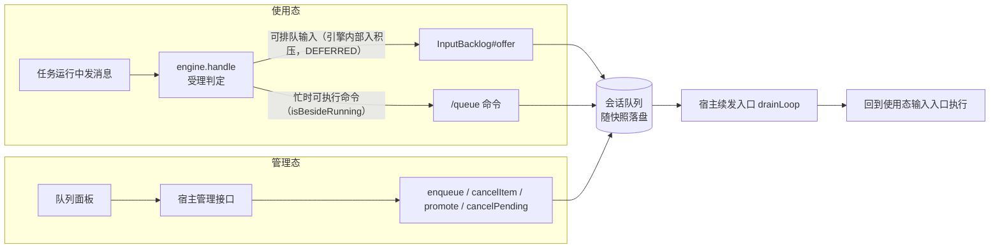

# solon-ai-harness-queue

solon-ai-harness 的会话级排队插件。在当前任务运行时，把后续消息登记到会话队列；当前任务结束、会话空闲后，由宿主驱动领取（`claimNext` / `drainLoop`），把队列里的消息作为新任务发送。

- 包名：`org.noear.solon.ai.harness.extension.queue`
- 只依赖核心契约（`HarnessExtension` / `spi.InputBacklog` / `spi.TurnDispatch`），不依赖其它插件
- 宿主只接触一个门面类：`QueueExtension`

**两种时态**（第三章总览，第四、五章分别给出完整示例）：

| 时态 | 用户在哪里操作 | 宿主入口 | 本插件的入口 |
|---|---|---|---|
| 使用态 | 任务运行中继续在对话框 / IM 里发消息，或输入 `/queue <消息>` | `engine.handle`（忙时由引擎经 `InputBacklog#offer` 入队并返回 `DEFERRED`；`/queue` 在运行任务旁边执行） | `InputBacklog#offer` / `/queue` 命令 |
| 管理态 | 队列面板里点「添加 / 删除 / 立即执行 / 清空」 | 宿主自己的管理接口（HTTP 等） | `QueueExtension` 门面方法 |

两种时态入队的消息，最终都由宿主的同一个续发入口（`drainLoop`）领取，再回到使用态的输入入口执行。

## 一、功能介绍

### 1.1 与 steer 的区别

| 能力 | 作用对象 | 对进行中任务的影响 | 消费时机 |
|---|---|---|---|
| `/steer`（插话） | 当前正在运行的任务 | 注入当前任务 | 当前任务的推理过程中 |
| `/queue`（排队） | 当前任务之后的新任务 | 无影响 | 当前任务结束、宿主调用 `claimNext` / `drainLoop` 时 |

队列中的每一条都会作为一个独立的新任务发送，而不是并入正在跑的那一轮。

### 1.2 生命周期：入队、领取、收口、代际保护

1. **入队**：`enqueue(...)`（或 `/queue` 命令、引擎 `handle` 忙时经 `InputBacklog#offer` 转入）把一条 `QueueItem` 以 `PENDING` 状态追加到队尾，并随会话快照落盘。
2. **领取**：`claimNext(...)` 在会话锁内抢占领取权，然后取出队首，置为 `RUNNING` 并记为 in-flight；生成一个 `QueueClaim`（同时登记为核心槽位 `TurnDispatch`），领取瞬间绑定当前代际快照，再交给 `QueueClaimHandler`。
3. **收口**：只有两条路径。
   - handler 返回 `true`（同步完成）：内核当场确认（acknowledge），从 in-flight 移除；
   - handler 返回 `false`（异步启动）：由流终态调用核心 `SessionTurn#settle(boolean)`，内部转到 `QueueClaim#settle(boolean)`：`true` 为确认，`false` 为回滚到队首。
   - handler 抛异常：视为启动失败，内核按领取时的代际快照回滚到队首，返回 `START_FAILED`。
4. **代际保护**：`cancelPending`（以及 `engine.interrupt` 触发的 `onSessionInterrupt`）会清空待执行、移除 in-flight 记录、注销本插件的派发登记并把代际加一。此后旧 claim 的回滚因代际不匹配被拒绝，任务被丢弃，不会在用户 Stop 后“复活”。

```mermaid
sequenceDiagram
    participant U as 用户/渠道
    participant H as 宿主
    participant Q as QueueExtension
    participant S as 流(Agent)

    participant E as 引擎(handle)

    U->>H: 任务运行中发来消息
    H->>E: handle(HarnessInput)
    E->>Q: offer(session, input)
    Q-->>E: 位置(从 1 计) / -1
    E-->>H: DEFERRED(getBacklogPosition) / REJECTED("backlog_unavailable")
    S-->>H: 当前任务终态
    H->>Q: drainLoop(session, canDrain, handler)
    Q->>Q: 领取权 + 队首出队(RUNNING, in-flight) + 代际快照
    Q->>H: handler.run(claim)
    alt 同步完成(返回 true)
        Q->>Q: acknowledge
    else 异步启动(返回 false)
        H->>S: SessionTurn.begin + 开流
        S-->>H: 流终态
        H->>Q: turn.settle(true/false)
        Note over Q: true=确认; false=回队首(代际已变则丢弃)
    end
    U->>H: Stop
    H->>Q: engine.interrupt -> onSessionInterrupt -> cancelPending(代际+1)
```

### 1.3 与核心的协作

| 核心契约 | 本插件的实现 |
|---|---|
| `spi.InputBacklog#offer(session, HarnessInput)` | 由引擎 `handle` 在忙时调用（宿主不必调）；保存正文、来源（null 时按 `InputOrigin.NONE`）、`selectedModel`、子代理（explicitAgent 优先，否则 selectedAgent）与宿主域属性 `getAttrs()`；受开关控制，返回位置（从 1 计）或 `-1`（满 / 超长 / 停用，引擎据此返回 `REJECTED("backlog_unavailable")`） |
| `spi.InputBacklog#hasPending` | `pendingSize(session) > 0`，事实口径，不受开关影响；引擎 `handle` 受理判定的先进先出与 `isIdle` 依赖它 |
| `HarnessExtension#contributeSessionStatus` | 贡献 `QueueExtension.STATUS_PENDING`（待执行数） |
| `HarnessExtension#onSessionInterrupt` | 调用 `cancelPending`（清理类，不判开关） |
| `HarnessExtension#onAttach` | 注册 `/queue` 命令 |
| `spi.TurnDispatch` | `QueueClaim` 实现，领取成功即登记到核心槽位，收口即注销 |

## 二、依赖

```xml
<dependency>
    <groupId>org.noear</groupId>
    <artifactId>solon-ai-harness-queue</artifactId>
    <version>${solon-ai.version}</version>
</dependency>
```

当前源码版本继承自 `solon-ai-parent`（`4.2.0-SNAPSHOT`）。传递依赖 `solon-ai-harness-core`。

## 三、装配与两种时态

### 3.1 装配

```java
// 无参构造 = 缺省上限（20 条 / 4096 字符）；onAttach 注册 /queue 命令，并作为引擎的积压能力（InputBacklog）
QueueExtension queue = engine.addExtensionIfAbsent(new QueueExtension());

// 调整上限用 builder
QueueExtension queue2 = QueueExtension.builder().maxSize(50).maxTextLength(8192).build();
```

装配后，引擎 `handle` 才会把"任务运行中的普通消息"自行入积压并返回 `DEFERRED`（没装 queue 时返回 `REJECTED("busy")`）；steer 插件的残留插话也会转入这里。不可排队的输入不进积压：程序轮次（`HarnessInput.ofProgram(...)`）与续流忙时返回 `REJECTED("busy")`，带附件的输入返回 `REJECTED("attachments_not_deferrable")`。

### 3.2 两种时态



| 对比项 | 使用态 | 管理态 |
|---|---|---|
| 用户动作 | 任务运行中照常发消息（自动排队）；或输入 `/queue <消息>` 显式排队 | 在队列面板里添加、删除一条、立即执行一条、清空 |
| 宿主入口 | 统一输入入口：`engine.handle(HarnessInput)`（忙时由引擎入积压，宿主不调 `enqueue`） | 宿主自己的管理接口，直接调门面 |
| 是否经过 `handle` 受理判定 | 是；`/queue` 声明 `runnableWhenBusy`，运行中在运行任务旁边执行（`isBesideRunning()`） | 否 |
| 本插件入口 | `InputBacklog#offer(session, input)`（引擎调用）、`QueueCommand` | `list` / `enqueue`（带 `id` 幂等）/ `cancelItem` / `promote` / `cancelPending` |
| 结果怎么返回 | `DEFERRED` 的 `outcome.getBacklogPosition()`；命令回执 `outcome.getCommandOutput()` | 返回值：位置 / `boolean` / 队列快照 |
| 只有这一态能做的 | 自动排队（`DEFERRED`，连同宿主域属性 `attr` 一起保存） | 删除单条、置顶、清空、幂等入队、带模型 / agent 等执行参数入队 |

两种时态写的是**同一个队列**：忙时自动排进来的消息会出现在面板上，面板上可以删掉或置顶它们。

### 3.3 续发：两态共用的唯一出口

无论消息是怎么进队列的，都只有一个出口：宿主在合适的时机调用 `drainLoop`，在领取回调里把这条消息交回**使用态的输入入口**执行。这个出口要在三处调用：

| 时机 | 原因 |
|---|---|
| 一次输入处理完之后（`REPLY` / `DEFERRED` / `HITL` / `IGNORED`，以及 `TASK` 跑完） | 覆盖"空闲时 `/queue` 入队"、同步命令、"会话只是积压未清"等场景 |
| 任务（含 goal / loop 的一轮）终态之后 | 运行期间排进来的消息要接着发 |
| 管理接口添加或置顶之后 | 会话可能正空闲，没有终态可等 |

```java
queue.drainLoop(session, s -> !engine.status(s).isOccupied(), claim -> {
    InputOutcome outcome = engine.handle(claim.getItem().toInput(session)); // 同一线程：引擎识别为派发轮次
    handleOutcome(session, outcome, claim.getItem().getOrigin()); // 与入站消息共用的结局处理（见 4.3）
    return true;                                         // 同步跑完：内核当场收口
});
```

`QueueItem#toInput(session)` 把队列项还原为续发输入：正文、来源、模型、子代理与宿主域属性（`getAttrs()`）原样带回，正文仍按命令识别。引擎在派发线程上识别出这一轮（`outcome.getDispatch()` 非空），免于"有积压就延后"的判定。

> `canDrain` 不要用 `engine.isIdle(session)`：它把积压也算作不空闲（见 1.3），队列非空时恒为 false，队列永远不会被领取。传 `null` 表示不预判，完全由队列状态决定。

## 四、使用态：用户在对话中输入

### 4.1 用户能输入什么

| 用户动作 | 发生了什么 |
|---|---|
| 任务运行中发一条普通消息 | `engine.handle` 由引擎调 `InputBacklog#offer` 入队并返回 `DEFERRED`，宿主回复"已排队（第 `getBacklogPosition()` 位）" |
| 任务运行中发 `/goal ...`、`/loop ...` 等非忙时可执行命令 | 同上：以原文入队，续发时经同一入口按命令执行 |
| 任务运行中发带附件的消息 | 不可排队，返回 `REJECTED("attachments_not_deferrable")` |
| `/queue 跑完顺便把文档也更新一下` | 任务运行中也能受理（`runnableWhenBusy`，在运行任务旁边执行，`isBesideRunning() == true`），命令入队并回执 |
| 空闲时 `/queue <消息>` | 照样入队；宿主在 `REPLY` 后立即续发，它会马上作为新任务执行 |

`/queue` 回执：

| 情形 | 回执文案 |
|---|---|
| 无参数 | `用法：/queue <消息>（当前任务结束后自动作为新任务发送）` |
| 超长 | `排队内容过长（上限 4096 字符）` |
| 入队失败（满 / 停用等） | `排队失败（队列已满，上限 20 条），请稍后再试` |
| 成功 | `已加入队列（第 N 位），将按顺序在任务空闲后自动发送` |
| 扩展已停用（命令层拦截） | `/queue 已停用。发送 /help 查看可用命令。` |

### 4.2 命令的边界

- `runnableWhenBusy() == true`、`terminalOnly() == false`：任务运行中可受理，Web / IM / 桌面都可用；
- 结局恒为 `Kind.REPLY`，命令本身不开流；
- 来源取宿主透传的 `origin`（`HarnessInput.origin(...)`），为 null 时用 `InputOrigin.NONE`，不兜底渠道名；
- 命令只负责入队，**不负责续发**；
- 命令路径没有 `id` 幂等保护，同一内容不要既调门面又拼 `/queue ...`。

### 4.3 宿主接入：完整示例

队列要真正"动起来"，宿主只需两段：**受理与执行**（`engine.handle` 一步完成，忙时可排队输入由引擎自己入积压）→ **续发**（输入处理完或任务终态后领取队首）。下面是一个同步执行的 IM 宿主，完整覆盖 `/queue` 命令、忙态普通消息与队列派发；`drain` 设为 public，供管理接口（5.2）复用：

```java
import org.noear.solon.ai.agent.AgentSession;
import org.noear.solon.ai.harness.HarnessEngine;
import org.noear.solon.ai.harness.extension.queue.QueueExtension;
import org.noear.solon.ai.harness.input.HarnessInput;
import org.noear.solon.ai.harness.input.InputOrigin;
import org.noear.solon.ai.harness.input.InputOutcome;

public class ImQueueHost {
    private final HarnessEngine engine;
    private final QueueExtension queue;

    public ImQueueHost(HarnessEngine engine) {
        this.engine = engine;
        this.queue = engine.addExtensionIfAbsent(new QueueExtension());   // 注册 /queue
    }

    /** 唯一输入入口：用户消息与 /queue 命令都走这里 */
    public void onMessage(AgentSession session, String text, InputOrigin origin, String effort) {
        // 第 0 步受理判定在 handle 内：忙态普通消息 → 引擎入积压并返回 DEFERRED；
        // 任务运行中的 /queue → 在运行任务旁边执行（REPLY，isBesideRunning() == true）
        InputOutcome outcome = engine.handle(HarnessInput.of(session, text)
                .origin(origin)
                .attr("reasoningEffort", effort));   // 宿主域属性：进积压时原样保存，续发时原样带回
        handleOutcome(session, outcome, origin);
    }

    /** 结局处理：入站消息与队列派发的一轮共用 */
    private void handleOutcome(AgentSession session, InputOutcome outcome, InputOrigin origin) {
        // 派发轮次沿用派发事务的来源（回复要回到当初排队的那个渠道）
        InputOrigin route = outcome.isDispatched() ? outcome.getDispatch().getOrigin() : origin;
        switch (outcome.getKind()) {
            case TASK:       // 普通消息（含派发出来的那一轮）：同步跑完，call() 结束即释放占位
                try {
                    if (outcome.hasReply()) {
                        reply(route, outcome.getCommandOutput());
                    }
                    reply(route, outcome.getRequest().call().getContent());
                } catch (Throwable e) {
                    outcome.discard();   // 幂等；开流前失败时确保占位释放
                    if (outcome.isDispatched()) {
                        throw new IllegalStateException("queued turn failed to start", e); // 交回派发侧回滚到队首
                    }
                    reply(route, "处理失败：" + e.getMessage());
                }
                drain(session);
                break;
            case REPLY:      // /queue 恒为 REPLY；isBesideRunning() 为真时不要改写会话的回复路由
                reply(route, outcome.getCommandOutput());
                drain(session);  // 覆盖"空闲时 /queue 入队"与同步命令场景
                break;
            case DEFERRED:   // 引擎已入积压；会话可能只是"积压未清"而并不忙：立即尝试续发
                reply(route, "已排队（第 " + outcome.getBacklogPosition() + " 位）");
                drain(session);
                break;
            case REJECTED:   // hitl_pending / busy / attachments_not_deferrable / backlog_unavailable
                reply(route, outcome.getRejectDetail());
                break;
            case HITL:
            case IGNORED:
                drain(session);
                break;
        }
    }

    /** 续发：领取队首，在同一线程回到 handle（使用态与管理态共用） */
    public void drain(AgentSession session) {
        queue.drainLoop(session, s -> !engine.status(s).isOccupied(), claim -> {
            // 同线程调用：引擎识别出"派发轮次"（outcome.getDispatch() 非空）
            InputOutcome outcome = engine.handle(claim.getItem().toInput(session));
            handleOutcome(session, outcome, claim.getItem().getOrigin());
            return true;                                         // 同步跑完，内核当场确认
        });
    }

    private void reply(InputOrigin origin, String text) { /* 按 origin 回投渠道 */ }
}
```

### 4.4 异步开流的宿主：claimNext + settle

流式宿主不能在领取回调里同步跑完，改为返回 `false`，在流终态收口：

```java
QueueClaimStatus st = queue.claimNext(session,
        s -> !engine.status(s).isOccupied(),   // 与领取权同一把会话锁内求值；false 时不消耗队列项
        claim -> {
            QueueItem item = claim.getItem();
            startStreamAsync(session, item);  // 见下方
            return false;                     // 异步启动：收口交给流终态
        });

void startStreamAsync(AgentSession session, QueueItem item) {
    // 同线程回到 handle：引擎识别为派发轮次
    InputOutcome outcome = engine.handle(item.toInput(session));
    if (outcome.getKind() != InputOutcome.Kind.TASK) {
        handleOutcome(session, outcome, item.getOrigin());
        return;
    }
    // 必须在订阅前、领取回调内调用：此时会捕获本次 QueueClaim
    SessionTurn turn = SessionTurn.begin(session);
    // 终态后续发下一条：登记在「运行句柄注销之后」（见下方要点）
    outcome.afterRun(() -> queue.drainLoop(session, s -> !engine.status(s).isOccupied(), this::dispatch));
    executor.execute(() -> {
        if (turn.isCancelled()) {
            outcome.discard();
            turn.settle(false);               // 调度窗口内被取消；若已被 cancelPending 作废则为空操作
            return;
        }
        outcome.getRequest().stream()
                .doOnNext(e -> render(session, e))
                .doFinally(s -> turn.settle(true))   // 幂等；此时会话仍算忙，不要在这里 drain
                .subscribe();
    });
}
// dispatch 即本例的 QueueClaimHandler：claim -> { startStreamAsync(session, claim.getItem()); return false; }
```

要点：

- **终态续发用 `outcome.afterRun(...)`，不要写在流的 `doFinally` 里**：Reactor 正常终止时下游的 `doFinally` 先于上游执行，而运行句柄在请求内部最上游才注销——宿主 `doFinally` 里 `isOccupied` 仍为 true，`drainLoop` 会直接返回，排队消息要等下一次外部触发才发出。`blockLast()` 等待同样不可靠（它在 `onComplete` 时就返回）。`afterRun` 在句柄注销后、执行线程上运行；未开流就放弃时不会执行。
- 返回值必须诚实。异步却返回 `true`，流失败后无法回滚；同步却返回 `false`，会留下未收口的 in-flight，挡住后续领取。
- 同一会话同时只有一条 in-flight。它未收口前，再次 `claimNext` 返回 `NO_TASK`。
- `QueueClaim.current(session)` 可取回会话当前未收口的队列领取（槽位里是别的插件的派发时返回 null）。
- 判断“当前线程是否在派发调用栈里”用 `claim.isOnDispatchThread()`；判断“这条派发是否仍未收口”用 `claim.isCurrent()`（跨线程可用）。两者不可混用。

### 4.5 使用态要点

1. **命令注册由插件完成**：`QueueExtension#onAttach` 已注册 `/queue`，宿主不用注册。
2. **忙态由引擎处理，宿主不要自己拦**：所有输入直接交给 `engine.handle`。`/queue` 声明 `runnableWhenBusy`，运行中在运行任务旁边执行（`isBesideRunning() == true`，宿主不要据此改写回复路由）；其余可排队输入由引擎调 `InputBacklog#offer` 入队并返回 `DEFERRED`。宿主侧不要再为忙态调 `queue.enqueue`，否则会重复入队。
3. **空闲时的 `/queue` 也会入队**：此时没有终态可等，必须在 `REPLY` 后立即 `drain`（示例的 `handleOutcome`），否则这条要等下一个任务结束才会被发出。
4. **续发在同一线程回到 `handle`**：在领取回调里调用 `engine.handle(claim.getItem().toInput(session))`，引擎用 `TurnDispatch#isOnDispatchThread()` 识别派发轮次（`outcome.getDispatch()` 非空），免于"有积压就延后"的判定；派发线程上的 `TASK` 同样占位，直到请求被订阅或 `call()` 结束。异步开流的宿主改为在领取回调里 `SessionTurn.begin(session)`，流终态 `turn.settle(ok)`（4.4）。
5. **派发轮次的回复路由取 `outcome.getDispatch().getOrigin()`**：即当初入队时的来源，而不是触发续发的那次请求。
6. **派发轮次启动失败要抛出**：抛给 `drainLoop` 的回调后，内核按领取时的代际回滚到队首并返回 `START_FAILED`，不会无限重试。
7. **排队的可以是命令**：忙态下用户发 `/goal ...`、`/loop ...` 这类非忙时可执行命令时，`handle` 把它们以原文入队并返回 `DEFERRED`，续发时经同一入口按命令执行。宿主域属性（如 `attr("reasoningEffort", ...)`）随队列项保存，`toInput` 时原样带回。
8. **审批挂起**：有待审批卡时，普通输入返回 `REJECTED("hitl_pending")`；`/queue` 等忙时可执行命令、审批决策、续流与派发轮次由引擎按输入本身豁免，宿主无需传任何谓词。
9. **停止**：`engine.interrupt(session)` 会先清空队列再停流，终态回调里的 `drain` 不会把刚停掉的内容重新推起来。

## 五、管理态：用户在界面上操作

管理态不经过 `handle`：队列面板上的每个按钮对应一个宿主接口，接口直接调用 `QueueExtension` 门面；添加或置顶后调用使用态的续发入口（3.3），让会话空闲时立刻开始执行。

### 5.1 界面动作与门面对照

| 界面动作 | 门面调用 | 成功返回 | 失败时（建议的 HTTP 映射） |
|---|---|---|---|
| 队列列表 | `queue.list(session)` | `List<QueueItem>`，运行中那条在首位，用 `toMap()` 渲染 | — |
| 添加一条 | `queue.enqueue(session, text, origin, id, model, ...)` + 续发 | 位置（从 1 计） | `-1`：已满、超长、文本为空、`id` 重复或已停用 → 409 |
| 删除一条 | `queue.cancelItem(session, itemId)` | `true` | `false`：不存在或已在运行 → 404 |
| 立即执行一条 | `queue.promote(session, itemId)` + 续发 | `true` | `false`：不存在或已在运行 → 404 |
| 清空 | `queue.cancelPending(session)` | `true` | — |
| 停止正在跑的那条 | `engine.interrupt(session)` | — | 同时清空整个队列（见 5.6） |

### 5.2 完整示例：管理接口

```java
import org.noear.solon.ai.agent.AgentSession;
import org.noear.solon.ai.harness.HarnessEngine;
import org.noear.solon.ai.harness.extension.queue.QueueExtension;
import org.noear.solon.ai.harness.extension.queue.QueueItem;
import org.noear.solon.ai.harness.input.InputOrigin;
import org.noear.solon.annotation.*;
import org.noear.solon.core.handle.Result;

import java.util.ArrayList;
import java.util.List;
import java.util.Map;

@Controller
@Mapping("/admin/queue")
public class QueueAdminController {
    @Inject
    HarnessEngine engine;
    @Inject
    ImQueueHost host;   // 4.3 的宿主：管理接口复用它的续发入口

    private QueueExtension queue() {
        return engine.getExtension(QueueExtension.class)
                .orElseThrow(() -> new IllegalStateException("queue extension not attached"));
    }

    @Get
    @Mapping("list")
    public Result<List<Map<String, Object>>> list(@Param("sessionId") String sessionId) {
        AgentSession session = engine.getSessionOrNull(sessionId);   // 只读：不顺带建会话
        List<Map<String, Object>> rows = new ArrayList<>();
        if (session != null) {
            for (QueueItem item : queue().list(session)) {
                rows.add(item.toMap());                              // id、text、status(PENDING/RUNNING)、createdAt……
            }
        }
        return Result.succeed(rows);
    }

    @Post
    @Mapping("add")
    public Result<Integer> add(@Param("sessionId") String sessionId,
                               @Param("text") String text,
                               @Param(value = "id", required = false) String id,          // 前端生成，HTTP 重试去重
                               @Param(value = "model", required = false) String model,
                               @Param(value = "agent", required = false) String agent) {
        AgentSession session = engine.getSessionOrNull(sessionId);   // 再加上宿主自己的归属校验
        if (session == null) return Result.failure(404, "Session not found");

        int pos = queue().enqueue(session, text, InputOrigin.channel("web"), id,
                model, null, null, agent, false);                    // model 等字段队列只透传，执行时由宿主使用
        if (pos < 0) return Result.failure(409, "Queue is full, text invalid or duplicated");

        host.drain(session);   // 会话空闲时立刻开始执行；忙时什么也不做，等当前任务终态
        return Result.succeed(pos);
    }

    @Post
    @Mapping("cancel")
    public Result<Void> cancel(@Param("sessionId") String sessionId, @Param("itemId") String itemId) {
        AgentSession session = engine.getSessionOrNull(sessionId);
        return session != null && queue().cancelItem(session, itemId)
                ? Result.succeed() : Result.failure(404, "Queue item not found");
    }

    @Post
    @Mapping("run")
    public Result<Void> runNow(@Param("sessionId") String sessionId, @Param("itemId") String itemId) {
        AgentSession session = engine.getSessionOrNull(sessionId);
        if (session == null || !queue().promote(session, itemId)) {   // 只有置顶，不插队打断当前任务
            return Result.failure(404, "Queue item not found");
        }
        host.drain(session);
        return Result.succeed();
    }

    @Post
    @Mapping("clear")
    public Result<Void> clear(@Param("sessionId") String sessionId) {
        AgentSession session = engine.getSessionOrNull(sessionId);
        if (session != null) {
            queue().cancelPending(session);   // 只清队列，不停正在跑的流
        }
        return Result.succeed();
    }
}
```

面板刷新：队列没有变化监听器，添加、删除、续发之后重新调用 `list` 即可；徽章计数用状态键：

```java
int pending = engine.status(session).get(QueueExtension.STATUS_PENDING); // 不含运行中那条
```

### 5.3 重启恢复：isPersisted / hasItems

队列随会话快照落盘，进程重启后首次访问自动恢复，但不会自己开始执行。启动时对有队列的会话调一次续发：

```java
// 会话快照里是否有队列（静态，按 FlowContext 探测，不需要扩展实例）
if (QueueExtension.isPersisted(session.getContext())) {
    // 首次访问时自动从快照恢复；上次进程 RUNNING 的项回到队首并重置为 PENDING
    host.drain(session);
}

boolean any = queue.hasItems(session);       // 含运行中
int pending = queue.pendingSize(session);    // 不含运行中
```

### 5.4 旧数据迁移：importItems

```java
// rows 来自旧版 queue-tasks.json / queue.json 的 Map 行
int imported = queue.importItems(session, rows);
```

迁移规则：按 `id` 去重；文本为空或超过 4096 字符的行被丢弃；RUNNING 行重置为 PENDING 并放到队首（保持相对顺序），其余追加到队尾；总数达到容量上限即停止；有导入时写快照。

### 5.5 停用：受控与不受控

```java
engine.setExtensionEnabled(queue, false);   // 同时停用 /queue 命令
```

停用后 `/queue` 回执为命令已停用提示（核心 `CommandDispatcher.COMMAND_DISABLED_HINT`：`已停用。发送 /help 查看可用命令。`）。

| 类别 | 方法 | 停用后 |
|---|---|---|
| 受控 | `enqueue`（三个重载）、`offer` | 返回 `-1` |
| 受控 | `claimNext`（两个重载）、`drainLoop` | 返回 `NO_TASK`，不领取 |
| 不受控 | `cancelItem` / `promote` / `cancelPending` / `importItems` / `onSessionInterrupt` | 照常执行，保证停用前已入队的项可以清理 |
| 不受控（事实口径） | `pendingSize` / `hasItems` / `list` / `hasPending` / `STATUS_PENDING` | 照常反映真实队列 |

### 5.6 与 engine.interrupt 的关系

```java
if (engine.interrupt(session)) {              // 先回调 onSessionInterrupt 清队列，再停流
    queue.enqueue(session, "回到上一个方案并跑一遍测试");
}
```

- `engine.interrupt` / `engine.prepareInterrupt` 保证在停流之前回调 `onSessionInterrupt`，因此终态回调里的 `drainLoop` 不会把刚被停掉的队列再推起来。
- 无运行流时 `interrupt` 返回 false，但队列仍会被清空。
- 中断会清掉队列里所有待执行项，这是“用户停止”的刻意语义。
- `engine.cancelStream` / `engine.preemptStream` 不走扩展中断回调，不清队列。

### 5.7 管理态要点

1. **添加和置顶之后要续发**：管理接口不经输入入口，没有受理位释放的时机；会话空闲时不调续发，这条要等下一次用户输入或任务终态才会执行。
2. **续发只走一个入口**：管理接口调用的是使用态宿主的同一个 `drain`，执行在领取回调里经 `engine.handle(item.toInput(session))` 完成；不要在管理接口里自己 `engine.handle`，否则绕过受理判定、回复路由和派发收口。
3. **同一条输入只走一个入口入队**：前端已经调了添加接口，就不要再拼成 `/queue ...` 发出去；HTTP 重试靠 `enqueue` 的 `id` 去重（同 id 已在待执行或运行中返回 -1）。
4. **运行中那条不能删、不能置顶**：`cancelItem` / `promote` 只作用于待执行项；要停掉运行中的那条用 `engine.interrupt`，它会同时清空整个队列。
5. **列表是快照**：`list` 读到的下一刻队首就可能被领取；"删除""立即执行"按返回值判断是否成功，不要按界面上的旧状态推断。
6. **队列不保存附件**：队列只保存文本与执行参数，`hasFiles` 只是标记。带附件的消息要么由宿主自行保存附件、续发时再装配，要么在管理接口里直接拒绝入队。

## 六、配置与限制

本插件只有两个容量类配置项，经 `QueueExtension.builder()` 设置；无参构造与 `builder().build()` 等价。

### 6.1 容量与长度

| Builder 方法 | 缺省 | 取值范围 | 读取方式 | 说明 |
|---|---|---|---|---|
| `maxSize(int)` | `20` | 1 ~ 10000 | `queue.getMaxSize()` | 每会话待执行条数上限，不含运行中那条；满时 `enqueue` 返回 -1 |
| `maxTextLength(int)` | `4096` | 1 ~ 1000000 | `queue.getMaxTextLength()` | 单条文本最大字符数（门面按 trim 后长度校验） |

上限是实例级的（没有静态读取方法），读出的值仅用于展示或预校验；受理判定以 `enqueue` 返回值为准。

### 6.2 QueueItem 字段

`QueueItem` 是 final 类，对外只读（状态只由插件内部修改）。

| 访问器 | `toMap()` 键 | 含义 |
|---|---|---|
| `getId()` | `id` | 任务 id；入队未指定或空白时为 `"q_" + UUID` |
| `getText()` | `text` | 任务文本（trim 后） |
| — | `displayText` | 展示文本，当前与 `text` 相同 |
| `getStatus()` | `status` | `PENDING` 或 `RUNNING` |
| `isRunning()` | — | `status` 是否为 `RUNNING` |
| `getCreatedAt()` | `createdAt` | 入队时间（毫秒） |
| `getClaimedAt()` | `claimedAt` | 领取时间（毫秒），未领取为 null，此时不输出该键 |
| `getModel()` | `model` | 执行时使用的模型，空时不输出 |
| `getReasoningEffort()` | `reasoningEffort` | 推理强度；显式字段为空时回读同名宿主域属性，空时不输出 |
| `getThinkingMode()` | `thinkingMode` | 思考模式；显式字段为空时回读同名宿主域属性，空时不输出 |
| `getSelectedAgent()` | `selectedAgent` | 选定的 agent，空时不输出 |
| `hasFiles()` | `hasFiles` | 是否带附件，仅为 true 时输出 |
| `getOrigin()` | — | 来源身份，永不为 null（缺省 `InputOrigin.NONE`） |
| `getSource()` | `source` | `origin.getChannel()`，为 null 时不输出 |
| `getAttrs()` | `attrs` | 宿主域属性（引擎积压入口带入的 `HarnessInput#getAttrs()`），只读、永不为 null，空时不输出 |
| `toInput(session)` | — | 还原为续发输入（正文、来源、模型、子代理、宿主域属性），仍按命令识别；续发时交给 `engine.handle` |

队列不解释 `model` 等字段，只透传与持久化，执行时由宿主自行使用。

### 6.3 enqueue 重载参数

| 重载 | 参数 | 说明 |
|---|---|---|
| `enqueue(session, text)` | — | 来源缺省为 `InputOrigin.channel("queue")` |
| `enqueue(session, text, origin)` | `origin` | 来源身份；null 按 `InputOrigin.NONE` |
| `enqueue(session, text, origin, id, model, reasoningEffort, thinkingMode, selectedAgent, hasFiles)` | `id` | 幂等键；非 null 且与待执行或运行中的某条相同时返回 -1 |
| | `model` / `reasoningEffort` / `thinkingMode` / `selectedAgent` | 随任务保存，原样透传 |
| | `hasFiles` | 是否带附件的标记 |

返回 -1 的情形：扩展已停用、`session` 或 `text` 为 null、trim 后为空、超过 4096 字符、待执行已满 20 条、`id` 重复。

### 6.4 QueueClaimStatus

| 值 | 含义 | 宿主处理 |
|---|---|---|
| `STARTED` | 已领取并交给 handler 启动成功 | 同步：已收口；异步：等流终态 settle |
| `NO_TASK` | 没有可领取的任务：队空、已有 in-flight、领取权被占、`canAccept` 为 false、扩展停用或参数为 null | 可以停 |
| `START_FAILED` | 已领取但启动失败（handler 抛异常，或同步完成时确认被拒），任务已回滚到队首或因代际变化被丢弃 | 勿立即重试，等下一个终态时机 |

### 6.5 会话属性键（QueueAttrs）

以下键归本插件所有，宿主不应读写，应只通过 `QueueExtension` 操作。

| 常量 | 值 | 位置 | 含义 |
|---|---|---|---|
| `QUEUE` | `session.queue` | `session.attrs()`（瞬态） | 待执行队列本体（`Deque<QueueItem>`） |
| `QUEUE_ITEMS` | `session.queue.items` | `FlowContext.data()`（持久化） | 快照投影 `List<Map>`，运行中项在首位；值不可改，否则丢失存量队列 |
| `QUEUE_IN_FLIGHT` | `session.queue.inFlight` | `session.attrs()` | 当前运行中的队列项 |
| `QUEUE_GENERATION` | `session.queue.generation` | `session.attrs()` | 清空代际，`cancelPending` 加一 |
| `QUEUE_CLAIM` | `session.queue.claim` | `session.attrs()` | 领取权占位，`claimNext` 返回即释放 |

### 6.6 状态键

| 常量 | 名称 | 类型 | 含义 |
|---|---|---|---|
| `QueueExtension.STATUS_PENDING` | `queue.pending` | `SessionStatus.Key<Integer>`（计数，缺省 0） | 待执行数（不含运行中，等于 `pendingSize`）；事实口径，不受开关影响；内核不读 |

## 七、持久化与恢复语义

- **快照即持久化**：每次队列变更（入队、领取、确认、回滚、取消、置顶、导入、有内容时的清空）都会把“in-flight + 待执行”写入 `FlowContext.data()` 的 `session.queue.items`，并调用 `session.updateSnapshot()`。没有独立的队列文件。
- **空队列移除投影**：投影行为空时删除该键；对本就为空的会话执行 `cancelPending` 不写快照。
- **惰性恢复**：`session.attrs()` 是瞬态的。首次访问队列时，若 attrs 中没有队列，就从投影重建。
- **RUNNING 回到队首**：投影中 `RUNNING` 的项只说明上一个进程领取过，重建时重置为 `PENDING`、清空 `claimedAt`，并排在其余待执行项之前。重启后它会被重新执行一次。
- **非法行丢弃**：文本为空或超过 4096 字符的行在恢复时被跳过。
- **落盘格式**：持久化键为 `id`、`text`、来源字段（`source` / `sourceUserId` / `replyTarget` / `messageId`）、`status`、`createdAt`，以及非空时的 `claimedAt`、`model`、`reasoningEffort`、`thinkingMode`、`selectedAgent`、`hasFiles`、`attrs`。持久化格式与展示用 `toMap()` 相互独立。
- **代际不持久化**：代际、领取权、派发登记只存在于内存。
- **会话删除**：队列存在会话中，随会话一起消失。

## 八、API 速查

`QueueExtension`（`extends AbsHarnessExtension implements InputBacklog`）：

| 方法 | 返回 | 受开关控制 | 时态 | 说明 |
|---|---|---|---|---|
| `enqueue(session, text)` | `int` | 是 | 使用 / 管理 | 入队，来源 `channel("queue")` |
| `enqueue(session, text, origin)` | `int` | 是 | 使用 / 管理 | 入队，携带来源（忙态排队由引擎经 `offer` 完成，宿主无需调用） |
| `enqueue(session, text, origin, id, model, reasoningEffort, thinkingMode, selectedAgent, hasFiles)` | `int` | 是 | 管理 | 完整参数，`id` 幂等 |
| `offer(session, input)` | `int` | 是 | 内核 | `InputBacklog` 入口，由引擎 `handle` 忙时调用；保存正文、来源、`selectedModel`、子代理与 `getAttrs()` |
| `claimNext(session, handler)` | `QueueClaimStatus` | 是 | 续发 | 领取并执行队首一条 |
| `claimNext(session, canAccept, handler)` | `QueueClaimStatus` | 是 | 续发 | 同上，带锁内原子谓词 |
| `drainLoop(session, canDrain, handler)` | `QueueClaimStatus` | 是 | 续发 | 循环领取，返回最后一次领取结果 |
| `pendingSize(session)` | `int` | 否 | 管理 | 待执行数 |
| `hasItems(session)` | `boolean` | 否 | 管理 | 是否有任务（含运行中） |
| `hasPending(session)` | `boolean` | 否 | 内核 | `InputBacklog` 能力，待执行数大于 0 |
| `list(session)` | `List<QueueItem>` | 否 | 管理 | 运行中在首位，其余为待执行 |
| `cancelItem(session, itemId)` | `boolean` | 否 | 管理 | 取消一条待执行 |
| `promote(session, itemId)` | `boolean` | 否 | 管理 | 置顶一条待执行 |
| `cancelPending(session)` | `boolean` | 否 | 管理 | 清空并递增代际；session 非 null 即返回 true |
| `importItems(session, rows)` | `int` | 否 | 运维 | 旧数据迁移，返回实际导入条数 |
| `static isPersisted(FlowContext)` | `boolean` | — | 运维 | 快照中是否有队列投影 |
| `getMaxSize()` | `int` | — | — | 本实例的待执行条数上限（缺省 `20`） |
| `getMaxTextLength()` | `int` | — | — | 本实例的单条文本上限（缺省 `4096`） |
| `static builder()` | `Builder` | — | 装配 | `maxSize(int)` / `maxTextLength(int)` |

`QueueClaim`（`implements TurnDispatch`，由插件创建）：

| 方法 | 说明 |
|---|---|
| `static current(session)` | 会话当前未收口的队列领取，无则 null |
| `getItem()` | 本次领取的任务 |
| `getOrigin()` | 等于 `item.getOrigin()`，用于回复路由 |
| `settle(boolean started)` | 幂等收口：true 确认，false 回滚到队首；返回本次调用是否完成收口 |
| `isSettled()` | 是否已收口 |
| `isOnDispatchThread()` | 当前线程是否为发起派发的线程 |
| `isCurrent()` | 是否仍是会话当前的派发事务 |

`QueueClaimHandler`（函数式接口）：`boolean run(QueueClaim claim) throws Exception`，返回 true 表示同步完成，false 表示异步启动。

## 九、注意事项

1. **入队只是登记**：装配插件、执行 `/queue`、调用管理接口都不会让队列自己动起来。宿主必须在受理位释放、任务终态、管理接口添加之后调用 `drainLoop` 或 `claimNext`，否则队列永远不消费。
2. **canDrain / canAccept 要传“是否被占用”而不是 `isIdle`**：`engine.isIdle` 把积压也算作不空闲，队列非空时恒为 false。
3. **drainLoop 的返回值是最后一次领取的结果**：异步 handler 启动一条后若仍有待执行项，且 `canDrain` 仍为 true（或为 null），下一次领取会因已有 in-flight 而得到 `NO_TASK` 并返回它。不要用返回值判断“本次是否启动过任务”。drainLoop 单次调用的循环次数有上限作为失控保护。
4. **START_FAILED 不要立即重试**：任务已回到队首，立即重试会对同一条失败任务无限循环。
5. **回滚遇到队列已满**：回滚允许在待执行已有 20 条时再放回 1 条；超过时回滚被拒，任务保持 in-flight，派发登记也保持，需要再次收口。
6. **cancelPending 不停流**：它只清空队列、移除 in-flight 记录并递增代际，正在跑的流需要用 `engine.interrupt` 停止。之后该流终态的 `settle` 为空操作。
7. **代际由 claim 持有**：不要在终态自己读代际再判断，那样拿到的总是新代际。收口一律通过 `SessionTurn#settle` 或 handler 返回值。
8. **SessionTurn.begin 必须在领取回调内、订阅之前调用**：否则捕获不到本次 `QueueClaim`（`settle` 会退回收口会话当前的派发）。
9. **不要直接读写 `session.queue.*`**：宿主只经 `QueueExtension` 操作。`QueueStore` 为包内实现。
10. **重启后 RUNNING 会重新执行**：如果任务不可重放，宿主需要自行做幂等处理。
11. **装配建议用 `addExtensionIfAbsent`**：`addExtension` 不查重，重复添加会再次回调 `onAttach`。
