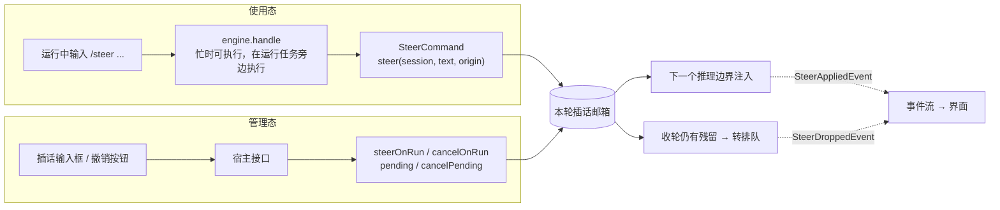

# solon-ai-harness-steer — 运行中插话（/steer）

`solon-ai-harness` 的会话插件之一，提供「插话」能力：任务正在运行时，用户补充一句话，插件把它注入**当前任务**的工作记忆，在下一个推理边界生效，**不打断**进行中的模型流和工具调用。

- 包名：`org.noear.solon.ai.harness.extension.steer`
- 只依赖核心契约 `solon-ai-harness-core`，不依赖其它插件（残留插话经核心 `spi.InputBacklog` 转排队，当前由 queue 插件实现）
- 宿主从装配到运行期只接触一个类：`SteerExtension`

**两种时态**（第三章总览，第四、五章分别给出完整示例）：

| 时态 | 用户在哪里操作 | 宿主入口 | 本插件的入口 |
|---|---|---|---|
| 使用态 | 任务运行中在对话框 / IM 里输入 `/steer 改用 PostgreSQL 方言` | `engine.handle`（忙时可执行命令，在运行任务旁边执行） | `/steer` 命令（不比对轮次） |
| 管理态 | 界面上的插话输入框、待生效列表、撤销 / 清空按钮 | 宿主自己的接口（HTTP 等） | `steerOnRun` / `pending` / `cancelOnRun` / `cancelPending`（按轮次绑定） |

---

## 一、功能介绍

### 1.1 与 queue 的区别

| 维度 | `/steer`（本模块） | `/queue`（`solon-ai-harness-queue`） |
|---|---|---|
| 影响对象 | 当前任务本轮的工作记忆 | 当前任务之后的新任务 |
| 生效时机 | 下一个推理边界（`onReasonStart`） | 当前任务结束、宿主领取时 |
| 任务未运行时 | 失败（`NOT_RUNNING` / `TURN_CHANGED`） | 照常入队 |
| 持久化 | 零持久化（只在 `session.attrs()`，不进快照、不进消息历史） | 随会话快照落盘 |
| 容量 | 缺省 5 条（可配） | 20 条 |
| 溢出 | 返回 `BOX_FULL`，由调用方决定改排队还是直发 | 拒绝入队 |

插话会加速上下文膨胀，所以邮箱很小；高频补充应引导用户改用 `/queue`。

### 1.2 生命周期

插件在每次**顶层请求**装配时挂上 `SteerInterceptor`（`onRequestAssemble`，`isDelegated == true` 的 `task` / `multitask` 委派任务不挂）。拦截器在三个边界上工作：

| 边界 | 动作 |
|---|---|
| `onAgentStart`（开轮） | 记录本轮 `runId`。若上一轮没有正常收尾（被 interrupt 或异常退出时 `onAgentEnd` 不会触发），把上一轮残留转排队并推送 `SteerDroppedEvent(RUN_SUPERSEDED)` |
| `onReasonStart`（推理边界） | 满足注入守卫时排空本轮邮箱，逐条注入工作记忆，推送 `SteerAppliedEvent` |
| `onAgentEnd`（收轮） | 清除 `runId`；仍有残留则转排队并推送 `SteerDroppedEvent(RUN_ENDED)`；迟到的旧轮次回调被忽略 |

残留处理（"已接受的插话绝不静默丢失"）：

1. 残留逐条经 `InputBacklog#offer` 转入积压（排队）；**先落队列，再推事件**，与有没有订阅者无关；
2. 转入失败的（未装 queue、queue 已停用或已满、入队异常）暂存为 orphans：**永不注入模型**，下次开轮或收轮时重试，可随时撤销；
3. 结果经 `SteerDroppedEvent` 告知：`getQueued()` 已进队列，`getFailed()` 未进队列。

### 1.3 注入守卫与注入格式

| 守卫 | 说明 |
|---|---|
| 首轮不注入 | `trace.getTurnCount() <= 1` 时跳过，保证原始提示词先被采样 |
| tool_calls 未闭合不注入 | 工作记忆最后一条是带 `tool_calls` 的 assistant 消息时跳过（避免打断 tool_use / tool_result 配对），等结果补齐后的下一轮再注入 |

注入消息由公开协议类 `SteerProtocol` 定义：

| 项 | 值 |
|---|---|
| 消息类型 | `UserMessage` |
| 正文 | `SteerProtocol.PREFIX + 原话`，即 `"[用户实时补充] " + 原话` |
| metadata | `source = "steer"`（`SteerProtocol.SOURCE`），`steerId = <插话 ID>`（`SteerProtocol.META_STEER_ID`） |
| 位置保证 | 只出现在本任务第一条 assistant 消息之后 |

回放历史时用 `SteerProtocol.textOf(message)` 识别：是插话返回去掉前缀的原话，否则返回 null（metadata 为主判据，正文前缀为兜底，快照往返后 metadata 未必保留）。

### 1.4 与核心的协作

| 核心契约 | 本插件的实现 |
|---|---|
| `HarnessExtension#onAttach` | 注册 `/steer` 命令（幂等） |
| `HarnessExtension#onRequestAssemble` | 非委派请求挂 `SteerInterceptor` |
| `HarnessExtension#contributeSessionStatus` | 贡献 `SteerExtension.STATUS_PENDING`（本轮邮箱 + orphans 条数） |
| `spi.InputBacklog` | 残留转排队的目标，每次从引擎现取（与插件装配顺序无关） |

---

## 二、依赖

```xml
<dependency>
    <groupId>org.noear</groupId>
    <artifactId>solon-ai-harness-steer</artifactId>
    <version>${solon-ai.version}</version>
</dependency>
```

建议同时装配 `solon-ai-harness-queue`：没有它时残留插话无处可转，只能暂存为 orphans（不丢、不注入，但也不会执行）。

---

## 三、装配与两种时态

### 3.1 装配

```java
// 无参构造即全部缺省（邮箱 5 条、单条 4096 字符、ID 128 字符）
SteerExtension steer = engine.addExtensionIfAbsent(new SteerExtension());

// 或自定义容量
SteerExtension steer = engine.addExtensionIfAbsent(SteerExtension.builder()
        .maxBoxSize(8)          // 邮箱容量
        .maxTextLength(8192)    // 单条插话字符上限
        .maxIdLength(64)        // steerId 字符上限
        .build());

SteerLimits limits = steer.getLimits();   // 投递与提示文案读同一份约束
```

### 3.2 两种时态



| 对比项 | 使用态 | 管理态 |
|---|---|---|
| 用户动作 | 任务运行中在对话框里输入 `/steer <补充内容>` | 在插话输入框里提交；在待生效列表里撤销一条或清空 |
| 宿主入口 | 统一输入入口：`engine.handle(HarnessInput)`（运行中在运行任务旁边执行，`isBesideRunning() == true`） | 宿主自己的接口，直接调门面 |
| 轮次绑定 | 不比对：投给"当前正在跑的那一轮" | 严格比对：带上前端看到的 `runId`，换轮了就返回 `TURN_CHANGED` |
| 幂等 | 无（同一内容输两次投两次） | 前端生成 `steerId`，重试返回 `DUPLICATE_STEER_ID` |
| 结果怎么返回 | 回执文本 `outcome.getCommandOutput()` | `SteerResult` / `SteerCancelResult` 状态码，映射成 HTTP 应答 |
| 只有这一态能做的 | IM / CLI 等只有文本输入的渠道也能插话 | 撤销、批量撤销、刷新后重建待生效列表 |

两种时态投进的是**同一个邮箱**：`/steer` 投递的插话会出现在 `pending(session)` 里，界面上也能撤销；生效与转排队都通过同一组事件通知（3.3）。

### 3.3 插话怎样生效：事件流

两个事件都继承 `AbsReActEvent`，随 `outcome.getRequest().stream()` 推出；**刻意不覆写 `getText()`**，按文本兜底渲染的宿主不会把它们打印进对话，需要展示时按类型分支：

```java
outcome.getRequest().stream().doOnNext(e -> {
    if (e instanceof SteerAppliedEvent) {
        // 已注入：清除这些插话的"待生效"标记，落到当前回复气泡里
        for (SteerMessage m : ((SteerAppliedEvent) e).getItems()) {
            markApplied(m.getId(), m.getText());
        }
    } else if (e instanceof SteerDroppedEvent) {
        SteerDroppedEvent d = (SteerDroppedEvent) e;
        // d.getReason()：RUN_ENDED（正常结束仍有残留）/ RUN_SUPERSEDED（上一轮被中断，新轮开始时交接）
        d.getQueued().forEach(m -> markQueued(m.getId()));      // 已转为排队任务：清除待生效气泡
        if (d.hasFailed()) {
            d.getFailed().forEach(m -> markNotQueued(m.getId())); // 未排队：保留气泡并提示用户
        }
    } else {
        render(e);
    }
}).blockLast();
```

事件只是展示：非流式调用（`call()`）或订阅已取消时事件会被静默丢弃，但转排队已在推事件之前完成，不受影响。

---

## 四、使用态：用户在对话中输入

### 4.1 用户能输入什么

`/steer <补充内容>`，内部调用的就是门面 `steer.steer(session, text, origin)`，开关、忙判定、容量与门面完全同源。

| 结果 | 回执文案 |
|---|---|
| 无参数 | `用法：/steer <补充内容>（在任务执行中向当前任务插入实时补充）` |
| `STEERED` | `已插话，将在下一步注入当前任务（待生效 N 条）` |
| `BOX_FULL` | `插话邮箱已满（上限 N 条），可用 /queue 排队` |
| `NOT_RUNNING` / `TURN_CHANGED` | `当前无正在执行的任务可插话，可直接发送或用 /queue 排队` |
| `TEXT_TOO_LONG` | `插话内容过长（上限 N 字符）` |
| `DISABLED` | `插话能力已停用，可直接发送或使用 /queue 排队` |
| 其它 | `插话未生效：<状态码>` |
| 扩展已停用（命令层拦截） | `/steer 已停用。发送 /help 查看可用命令。` |

插件**只做投递，不做降级**：任何失败都如实回执，不会代为排队或直接发送。

### 4.2 命令的边界

| 项 | 说明 |
|---|---|
| 注册 | `SteerExtension#onAttach` 自动注册，宿主不用注册 |
| 忙态 | `SteerCommand` 声明 `runnableWhenBusy() == true`：任务运行中 `handle` 第 0 步放行，在运行任务旁边执行（`outcome.isBesideRunning() == true`，宿主不要改写回复路由） |
| 渠道 | `terminalOnly() == false`：Web / IM / 桌面都能用，无需 `.terminal(true)` |
| 结局 | 恒为 `Kind.REPLY`，不会产生 `TASK` |
| 来源 | 取宿主透传的 `origin`；渠道为空时命令补成 `"command"`。插话没被注入而转排队时，排队项沿用这份来源 |

### 4.3 宿主接入：完整示例

命令只负责投递，"任务运行中能不能把这条输入交给引擎"由 `engine.handle` 第 0 步的受理判定决定，它已经知道 `/steer` 是忙时可执行命令；宿主只管把输入交给 `handle` 并按结局分支：

```java
import org.noear.solon.ai.agent.AgentSession;
import org.noear.solon.ai.harness.HarnessEngine;
import org.noear.solon.ai.harness.extension.queue.QueueExtension;
import org.noear.solon.ai.harness.extension.steer.SteerExtension;
import org.noear.solon.ai.harness.input.HarnessInput;
import org.noear.solon.ai.harness.input.InputOrigin;
import org.noear.solon.ai.harness.input.InputOutcome;

public class ImInputHandler {
    private final HarnessEngine engine;
    private final QueueExtension queue;

    public ImInputHandler(HarnessEngine engine) {
        this.engine = engine;
        engine.addExtensionIfAbsent(new SteerExtension());          // 注册 /steer
        this.queue = engine.addExtensionIfAbsent(new QueueExtension()); // 承接残留插话与忙态输入
    }

    /** IM 渠道的一条入站消息（可能是普通消息，也可能是 /steer ...） */
    public void onMessage(AgentSession session, String text, InputOrigin origin) {
        // 受理判定、命令识别、执行、回执都在 handle 内完成（判定与占位、入积压同一把会话锁）
        InputOutcome outcome = engine.handle(HarnessInput.of(session, text).origin(origin));
        switch (outcome.getKind()) {
            case TASK:       // 普通消息：同步跑完；占位由请求自己释放
                setReplyRoute(session, origin);
                try {
                    if (outcome.hasReply()) {
                        reply(origin, outcome.getCommandOutput());
                    }
                    reply(origin, outcome.getRequest().call().getContent());
                } catch (Throwable e) {
                    outcome.discard();   // 幂等；开流前失败时确保占位释放
                    reply(origin, "处理失败：" + e.getMessage());
                }
                drain(session);
                break;
            case REPLY:      // /steer 恒为 REPLY：把回执发回来源渠道即可
                if (!outcome.isBesideRunning()) {
                    setReplyRoute(session, origin);   // 在运行任务旁边执行的命令不能改写运行中任务的回复目标
                }
                reply(origin, outcome.getCommandOutput());
                drain(session);
                break;
            case DEFERRED:   // 任务运行中的普通消息：引擎已入积压
                reply(origin, "已排队（第 " + outcome.getBacklogPosition() + " 位）");
                drain(session);
                break;
            case REJECTED:   // "hitl_pending"：有待审批卡；"busy"：引擎没装 queue 无处可延；等
                reply(origin, outcome.getRejectDetail());
                break;
            case HITL:
            case IGNORED:
                drain(session);
                break;
        }
    }

    private void drain(AgentSession session) {
        queue.drainLoop(session, s -> !engine.status(s).isOccupied(), claim -> {
            InputOutcome outcome = engine.handle(claim.getItem().toInput(session)); // 同一线程：派发轮次
            // 按上面的结局分支处理，回复路由取 outcome.getDispatch().getOrigin()（略）
            return true;
        });
    }

    private void reply(InputOrigin origin, String text) { /* 按 origin.getChannel()/getReplyTarget() 回投 */ }
    private void setReplyRoute(AgentSession session, InputOrigin origin) { /* 宿主私有 */ }
}
```

不想让用户输入命令前缀的渠道（如 IM 里"任务运行中发的消息一律当作插话"），可以在交给 `handle` 之前先试着直接调门面；插话没生效时再照常交给 `handle`，忙时由引擎入积压（`DEFERRED`），宿主不必自己 `enqueue`：

```java
if (engine.status(session).isBusy() && !text.startsWith("/")) {
    SteerResult r = steer.steer(session, text, origin);   // origin 随插话保存，转排队后回复路由不丢
    if (r.isSteered()) {
        reply(origin, "已插话（待生效 " + r.getPendingCount() + " 条）");
        return;
    }
    // 邮箱满、刚好换轮等：继续交给 handle，由引擎决定排队或直接执行
}
onMessage(session, text, origin);
```

### 4.4 停、改、重排

```java
// 场景 A：任务还在跑，改主意了 —— 插话（不打断）
SteerResult r = steer.steer(session, "先别改了，回到上一个方案");
if (r.isNotRunning() || r.isTurnChanged()) {
    queue.enqueue(session, "回到上一个方案");        // 宿主自己决定降级为排队
}

// 场景 B：必须停下来重来 —— 中断后排队（不要再 steer）
if (engine.interrupt(session)) {
    queue.enqueue(session, "回到上一个方案");
}
```

`interrupt` 之后当前轮次已不存在，`steer` 只会得到 `NOT_RUNNING`；被中断那一轮邮箱里的残留，会在下一个任务开轮时以 `RUN_SUPERSEDED` 转排队。

### 4.5 使用态要点

1. **注册不需要宿主做**：`SteerExtension#onAttach` 已注册命令；宿主只要不自己再注册一个同名命令。
2. **忙态放行由 `handle` 完成**：`SteerCommand` 声明 `runnableWhenBusy`，任务运行中输入 `/steer ...`，`handle` 第 0 步放行并在运行任务旁边执行（`isBesideRunning() == true`）。宿主不要在 `handle` 之前自己拦忙，否则 `/steer` 会被挡住或排进队列，变成"任务结束后才插话"，永远是 `NOT_RUNNING`。
3. **空闲时也能受理**：此时命令照常执行（`REPLY`，`isBesideRunning() == false`）并回复"当前无正在执行的任务可插话……"，不会被当成普通消息发给模型。
4. **在运行任务旁边执行的命令不改回复路由**：运行中任务的回复目标属于那个任务；`/steer` 的回执直接回给本条消息的来源。
5. **审批挂起期间**：`handle` 对普通输入返回 `REJECTED("hitl_pending")`；`/steer`、`/queue` 等声明了 `runnableWhenBusy` 的命令、审批决策与续流由引擎按输入本身豁免，宿主无需传谓词。
6. **回执怎么落地**：缺省的缓冲式命令上下文会去掉 ANSI 颜色，回执从 `getCommandOutput()` 一次取回；CLI 想实时写终端，再给 `HarnessInput` 配 `commandContextFactory(...)`。
7. **不要两条路都走**：已经用门面 `steer.steer(...)` 投递过的内容，不要再拼成 `/steer ...` 交给 `handle`，会投递两次。

---

## 五、管理态：用户在界面上操作

Web / 桌面界面通常有专门的插话输入框和"待生效"气泡列表。这些按钮不经 `handle`，由宿主接口直接调门面。与命令最大的区别是**按轮次绑定**：前端在任务结束、下一轮开始的窄窗里提交的插话，必须能识别出"已经不是我看到的那一轮了"。

### 5.1 界面动作与门面对照

| 界面动作 | 门面调用 | 结果 |
|---|---|---|
| 打开 / 刷新页面时恢复状态 | `steer.activeRunId(session)`、`steer.pending(session)` | 当前轮次（无则 null）；待生效列表（本轮邮箱在前、orphans 在后） |
| 提交插话 | `steer.steerOnRun(session, runId, steerId, text, origin)` | `SteerResult`（9 种状态码，5.4 给出 HTTP 映射） |
| 撤销一条 | `steer.cancelOnRun(session, runId, steerId)` | `SteerCancelResult`：`CANCELED` / `NOT_PENDING` / `TURN_CHANGED` / `INVALID_STEER_ID` |
| 全部撤销 | `steer.cancelPending(session, null)`（或传 id 列表） | `SteerCancelResult`，`getCanceled()` 为实际移除条数 |
| 徽章计数 | `engine.status(session).get(SteerExtension.STATUS_PENDING)` | 待生效条数 |

### 5.2 完整示例：管理接口

```java
import org.noear.solon.ai.agent.AgentSession;
import org.noear.solon.ai.harness.HarnessEngine;
import org.noear.solon.ai.harness.extension.steer.SteerCancelResult;
import org.noear.solon.ai.harness.extension.steer.SteerExtension;
import org.noear.solon.ai.harness.extension.steer.SteerMessage;
import org.noear.solon.ai.harness.extension.steer.SteerResult;
import org.noear.solon.ai.harness.input.InputOrigin;
import org.noear.solon.annotation.*;
import org.noear.solon.core.handle.Result;

import java.util.*;

@Controller
@Mapping("/admin/steer")
public class SteerAdminController {
    @Inject
    HarnessEngine engine;

    private SteerExtension steer() {
        return engine.getExtension(SteerExtension.class).orElse(null);
    }

    /** 刷新 / 重连后重建插话面板：当前轮次 + 待生效列表 + 容量 */
    @Get
    @Mapping("state")
    public Result<Map<String, Object>> state(@Param("sessionId") String sessionId) {
        SteerExtension steer = steer();
        if (steer == null) return Result.failure(503, "STEER_UNAVAILABLE");
        AgentSession session = engine.getSessionOrNull(sessionId);   // 只读：不顺带建会话

        List<Map<String, Object>> rows = new ArrayList<>();
        for (SteerMessage m : steer.pending(session)) {              // session 为 null 时返回空列表
            Map<String, Object> row = new LinkedHashMap<>();
            row.put("steerId", m.getId());
            row.put("text", m.getText());
            rows.add(row);
        }
        Map<String, Object> data = new LinkedHashMap<>();
        data.put("runId", steer.activeRunId(session));               // 无活跃轮次为 null：输入框置灰
        data.put("pending", rows);
        data.put("maxBoxSize", steer.getLimits().getMaxBoxSize());
        data.put("maxTextLength", steer.getLimits().getMaxTextLength());
        return Result.succeed(data);
    }

    /** 提交插话：runId 来自前端看到的事件流，steerId 由前端生成用于重试幂等 */
    @Post
    @Mapping("submit")
    public Result<Map<String, Object>> submit(@Param("sessionId") String sessionId,
                                              @Param("runId") String runId,
                                              @Param(value = "steerId", required = false) String steerId,
                                              @Param("text") String text) {
        SteerExtension steer = steer();
        if (steer == null) return Result.failure(503, "STEER_UNAVAILABLE");
        AgentSession session = engine.getSessionOrNull(sessionId);
        if (session == null) return Result.failure(409, "NOT_RUNNING");

        SteerResult r = steer.steerOnRun(session, runId, steerId, text, InputOrigin.channel("web"));
        switch (r.getCode()) {
            case STEERED: {
                Map<String, Object> data = new LinkedHashMap<>();
                data.put("steerId", r.getSteerId());                  // 未传时由后端生成 "s_" + UUID
                data.put("pending", r.getPendingCount());
                return Result.succeed(data);
            }
            case EMPTY_TEXT:
            case TEXT_TOO_LONG:
            case INVALID_STEER_ID:
                return Result.failure(400, r.getCodeName());          // 参数非法：前端提示后不再重试
            default:
                // NOT_RUNNING / TURN_CHANGED：前端改为普通发送或排队；BOX_FULL：建议改排队；
                // DUPLICATE_STEER_ID：重试命中，按已投递处理；DISABLED：能力已停用
                return Result.failure(409, r.getCodeName());
        }
    }

    @Post
    @Mapping("cancel")
    public Result<Map<String, Object>> cancel(@Param("sessionId") String sessionId,
                                              @Param("runId") String runId,
                                              @Param("steerId") String steerId) {
        SteerExtension steer = steer();
        if (steer == null) return Result.failure(503, "STEER_UNAVAILABLE");
        return toResult(steer.cancelOnRun(engine.getSessionOrNull(sessionId), runId, steerId));
    }

    @Post
    @Mapping("cancelAll")
    public Result<Map<String, Object>> cancelAll(@Param("sessionId") String sessionId,
                                                 @Param(value = "steerIds", required = false) String steerIds) {
        SteerExtension steer = steer();
        if (steer == null) return Result.failure(503, "STEER_UNAVAILABLE");
        List<String> ids = (steerIds == null || steerIds.trim().isEmpty())
                ? null : Arrays.asList(steerIds.split(","));          // null = 清空全部（不比对轮次）
        return toResult(steer.cancelPending(engine.getSessionOrNull(sessionId), ids));
    }

    private static Result<Map<String, Object>> toResult(SteerCancelResult r) {
        if (r.isCanceled()) {
            Map<String, Object> data = new LinkedHashMap<>();
            data.put("canceled", r.getCanceled());
            data.put("pending", r.getRemaining());                    // 直接回填剩余条数，不必再查一次
            return Result.succeed(data);
        }
        // NOT_PENDING：已被注入或已转排队，终态以 applied / dropped 事件为准，不能宣称撤销成功
        return Result.failure(r.getCode() == SteerCancelResult.Code.INVALID_STEER_ID ? 400 : 409, r.getCodeName());
    }
}
```

### 5.3 前端如何拿到 runId

- **事件流**：本轮任何事件的 `AbsReActEvent.getTrace().getRunId()`，宿主随事件信封推给前端；
- **状态接口**：示例的 `state` 返回 `steer.activeRunId(session)`，用于刷新或重连后恢复。

`runId` 在拦截器 `onAgentStart` 写入。任务刚受理、尚未开轮时提交会得到 `NOT_RUNNING` / `TURN_CHANGED`，这不是错误，前端应按普通发送或排队处理。

### 5.4 状态码与界面处理

| `steerOnRun` 结果 | 原因 | 建议的界面处理 |
|---|---|---|
| `STEERED` | 已进邮箱，下一个推理边界注入 | 显示"待生效"气泡，等 `SteerAppliedEvent` / `SteerDroppedEvent` |
| `NOT_RUNNING` | 当前没有运行中的轮次 | 回落为普通发送 |
| `TURN_CHANGED` | `runId` 为空、已不是当前轮次，或当前无轮次 | 转为排队（或提示刷新） |
| `BOX_FULL` | 本轮邮箱已满 | 提示"可改为排队" |
| `DUPLICATE_STEER_ID` | 同一 steerId 已在邮箱（先判重再判容量） | 按已投递处理 |
| `EMPTY_TEXT` / `TEXT_TOO_LONG` / `INVALID_STEER_ID` | 参数非法 | 提示并停止重试 |
| `DISABLED` | 扩展已停用 | 隐藏插话入口 |

### 5.5 开关

```java
engine.setExtensionEnabled(steer, false);   // 停用：命令回停用提示、拦截器停止注入、steer() 返回 DISABLED
engine.setExtensionEnabled(steer, true);
```

`pending` / `cancelOnRun` / `cancelPending` / `activeRunId` / 状态贡献不受开关控制，保证停用前已投递的插话仍可查询和撤销。

### 5.6 管理态要点

1. **用 `steerOnRun`，不要用 `steer`**：界面提交一定带 `runId`，否则任务结束、下一轮刚开始的窄窗里，插话会投进用户没看到的新任务。
2. **降级由界面决定**：插件不代为排队或直接发送。`NOT_RUNNING` 一般回落为普通发送，`TURN_CHANGED` / `BOX_FULL` 一般转排队（调 queue 的管理接口）。
3. **撤销以返回值为准**：`pending` 只是快照，读到的下一刻就可能被推理线程消费；`cancelOnRun` 返回 `NOT_PENDING` 时不能把气泡删掉，要等 applied / dropped 事件给出终态。
4. **orphans 不比对轮次**：转排队失败的残留与轮次无关，任务结束后也能撤；批量撤销（`cancelPending`）同样不比对轮次。
5. **"停止"按钮不是插话**：要停下当前任务用宿主的停止入口 `engine.interrupt(session)`，之后只能排队，不能再插话。
6. **能力缺失与状态不允许分开报**：扩展没装配时返回 503（示例的 `STEER_UNAVAILABLE`），不要和 409 的状态码混在一起，前端才能区分"隐藏入口"和"这次没投进去"。

---

## 六、配置与状态码

### 6.1 Builder（SteerLimits）

| 方法 | 类型 | 默认值 | 说明 |
|---|---|---|---|
| `maxBoxSize(int)` | int | `5` | 本轮邮箱容量；满时投递返回 `BOX_FULL` |
| `maxTextLength(int)` | int | `4096` | 单条插话字符上限（按 trim 后长度）；超出返回 `TEXT_TOO_LONG` |
| `maxIdLength(int)` | int | `128` | steerId 字符上限；超出返回 `INVALID_STEER_ID` |

三个值都必须为正数，否则 `build()` 抛 `IllegalArgumentException("steer limits must be positive")`。`new SteerExtension()` 等价于 `builder().build()`（`SteerLimits.DEFAULT`）。

### 6.2 SteerResult.Code（投递）

| 值 | 含义 |
|---|---|
| `STEERED` | 已进入本轮邮箱，将在下一个推理边界注入 |
| `NOT_RUNNING` | 当前没有运行中的轮次（`runId` 为 null 的投递；`session` 为 null 也返回它） |
| `TURN_CHANGED` | 请求所带 `runId` 为空（仅 `steerOnRun`）、已不是当前轮次，或当前无轮次 |
| `BOX_FULL` | 本轮邮箱已满 |
| `DUPLICATE_STEER_ID` | 同一 steerId 已在邮箱中（重试幂等） |
| `EMPTY_TEXT` | 正文为空或全空白 |
| `TEXT_TOO_LONG` | 正文超长 |
| `INVALID_STEER_ID` | steerId 超过长度上限 |
| `DISABLED` | 扩展已停用，本次未入邮箱 |

`SteerResult` 访问器：`getCode()`、`getCodeName()`、`getSteerId()`、`getPendingCount()`（投递后本轮邮箱条数）、`isSteered()`、`isBoxFull()`、`isNotRunning()`、`isTurnChanged()`。

`steerOnRun` 的入参情形：

| 情形 | 结果 |
|---|---|
| `runId` 为空 | `TURN_CHANGED`（不生成 steerId） |
| `runId` 与当前轮次不同，或当前没有轮次 | `TURN_CHANGED` |
| 同一 `steerId` 已在邮箱 | `DUPLICATE_STEER_ID`（先判重再判容量，满邮箱中的重试也能拿到准确结果） |
| `steerId` 为 null | 由后端生成 `"s_" + UUID` |

投递后的复查：入邮箱后会在锁外复查会话是否仍忙（`engine.status(session)` 的 busy 或 admitting），并比对轮次代际。不忙或已换轮时尝试回滚：回滚成功报 `NOT_RUNNING`（同轮）/ `TURN_CHANGED`（换轮）；回滚失败（已被注入或已转排队）一律报 `STEERED`，防止调用方降级后重复执行。

### 6.3 SteerCancelResult.Code（撤销）

| 值 | 含义 |
|---|---|
| `CANCELED` | 已从待生效列表移除（批量撤销恒为此值，看 `getCanceled()`） |
| `NOT_PENDING` | 不在待生效列表（已注入或已转排队） |
| `TURN_CHANGED` | `runId` 为空或不是当前轮次（只针对本轮邮箱；orphans 不比对轮次） |
| `INVALID_STEER_ID` | steerId 为空或超长 |

访问器：`getCode()`、`getCodeName()`、`getSteerId()`（批量为 null）、`getCanceled()`、`getRemaining()`、`isCanceled()`。

### 6.4 事件

| 事件 | 时机 | 主要方法 |
|---|---|---|
| `SteerAppliedEvent` | 插话已注入工作记忆（"已生效"的唯一信号） | `getItems()` |
| `SteerDroppedEvent` | 有未消费插话被交接 | `getReason()`、`getQueued()`、`getFailed()`、`hasFailed()` |

| `SteerDroppedEvent.Reason` | 含义 |
|---|---|
| `RUN_ENDED` | 任务正常结束，仍有未消费插话 |
| `RUN_SUPERSEDED` | 上一任务被中断或异常退出，新任务开始时交接 |

`SteerMessage`：`getId()`、`getText()`、`getOrigin()`（永不为 null）。

### 6.5 常量与键

| 常量 | 值 | 说明 |
|---|---|---|
| `SteerExtension.STATUS_PENDING` | `SessionStatus.Key.count("steer.pending")` | 待生效插话数（本轮邮箱 + orphans），不受开关影响 |
| `SteerAttrs.STEER` | `"session.steer"` | 会话级插话状态（`attrs()`，瞬态）；**宿主不得读写**，一律走门面 |
| `SteerProtocol.PREFIX` / `SOURCE` / `META_STEER_ID` | `"[用户实时补充] "` / `"steer"` / `"steerId"` | 注入消息协议 |

---

## 七、API 速查

| 方法 | 返回 | 受开关控制 | 时态 | 说明 |
|---|---|---|---|---|
| `new SteerExtension()` / `builder()…build()` | — | — | 装配 | 装配 |
| `steer(session, text)` | `SteerResult` | 是 | 使用 | 投给当前活跃轮次，来源 `NONE` |
| `steer(session, text, origin)` | `SteerResult` | 是 | 使用（`/steer` 同路径） | 同上，携带来源 |
| `steerOnRun(session, runId, steerId, text)` | `SteerResult` | 是 | 管理 | 严格轮次绑定 |
| `steerOnRun(session, runId, steerId, text, origin)` | `SteerResult` | 是 | 管理 | 同上，携带来源 |
| `cancelOnRun(session, runId, steerId)` | `SteerCancelResult` | 否 | 管理 | 撤销一条 |
| `cancelPending(session, ids)` | `SteerCancelResult` | 否 | 管理 | 批量撤销，null = 全部 |
| `pending(session)` | `List<SteerMessage>` | 否 | 管理 | 待生效快照（副本） |
| `activeRunId(session)` | `String` | 否 | 管理 | 当前轮次，无则 null |
| `getLimits()` | `SteerLimits` | — | — | 生效的容量约束 |
| `SteerProtocol.textOf(message)` | `String` | — | — | 识别插话消息并还原原话 |

---

## 八、注意事项

1. **"改"的窗口比"停"窄**：`runId` 在拦截器 `onAgentStart` 写入。任务刚受理、尚未开轮时投递会得到 `NOT_RUNNING` / `TURN_CHANGED`，这不是错误。
2. **steer 与 interrupt 互斥**：中断后只能排队，不能再插话。
3. **首轮不注入**：插话最早在第二个推理回合生效；任务如果一回合就结束，插话会以 `RUN_ENDED` 转排队，作为下一个任务执行。
4. **零持久化**：插话状态只在 `session.attrs()`，不写消息历史、不占会话窗口；进程重启后未注入的插话丢失（orphans 也在内存）。
5. **委派任务不挂**：`task` / `multitask` 的子代理跑在临时会话上，没有插话语义；面板或 `@` 选中的子代理属于顶层请求，可以插话。
6. **orphans 不会执行**：未装 queue 或 queue 拒收时，残留只暂存、只重试转排队，永远不注入。需要"一定执行"请装配 queue。
7. **`pending` 是快照**：读到的下一刻就可能被推理线程消费，只能作 UI 依据，不能保证"一定还能撤销"。
8. **未挂接的门面**：直接 `new SteerExtension()` 而不加入引擎时，忙判定一律视为忙（只按轮次判定），且没有积压能力，适合单元测试。
9. **装配用 `addExtensionIfAbsent`**：`addExtension` 不查重，重复挂载会二次 `onAttach`。
