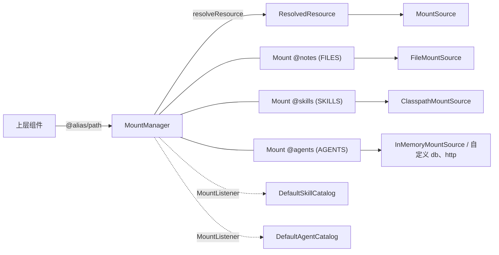

# solon-ai-mount

Solon AI 的通用挂载 / IO 抽象模块：用统一的 `MountSource` 接口读写本地磁盘、classpath、内存，或由第三方实现的 db / http 等来源。

> 本模块基于 Solon 框架（不是 Spring）。包名 `org.noear.solon.ai.mount`（子包 `source`、`catalog`）。
> 大部分类型标注了 `@Preview`，API 仍可能调整。

## 1. 功能介绍

上层组件（harness 引擎、loop 存储、TODO 清单、长期记忆 MD 文件、命令加载等）不直接操作 `java.nio.file`，而是通过 `MountSource` 读写。这样同一份上层逻辑可以落在本地磁盘、内存，也可以换成数据库或远程 API，不需要改动上层代码。

核心概念：

| 概念 | 类型 | 说明 |
|---|---|---|
| 挂载源 | `source.MountSource` | 一个虚拟文件树的 IO 实现（stat / list / find / 读 / 写 / 删 / 移动），来源内路径用 `/` 分隔，空串表示根 |
| 能力 | `source.MountCapabilities` | 挂载源声明自己支持哪些操作（可写、可搜索、版本、原子写等） |
| 挂载 | `Mount` | 挂载配置：别名（`@xxx`）+ 类型 + 是否启用/可写/可见 + 一个 `MountSource` |
| 挂载管理器 | `MountManager` | 维护挂载表（别名 → 挂载），把逻辑路径（`@alias/sub/path`、工作区相对路径）解析成「来源 + 来源内路径」 |
| 监听器 | `MountListener` | 订阅挂载注册 / 移除事件 |
| 目录 | `catalog.SkillCatalog` / `catalog.AgentCatalog` | 在挂载之上的索引层：扫描 `SKILLS` / `AGENTS` 类型的挂载，提供技能、子代理的查询 |



`MountManager` 只做 IO 层的事：不创建、不持有技能 / 子代理目录。`DefaultSkillCatalog`、`DefaultAgentCatalog` 在构造时向 `MountManager` 注册监听器，挂载变化后自动刷新。

## 2. 依赖

```xml
<dependency>
    <groupId>org.noear</groupId>
    <artifactId>solon-ai-mount</artifactId>
    <version>${solon-ai.version}</version>
</dependency>
```

本模块依赖 `solon-ai-core`（目录解析 Markdown frontmatter 会用到其中的 `org.noear.solon.ai.util.Markdown` / `MarkdownUtil`）。

## 3. 使用说明

### 3.1 简单示例

本地目录读写文本：

```java
import org.noear.solon.ai.mount.source.FileMountSource;
import org.noear.solon.ai.mount.source.MountEntry;

import java.nio.file.Files;
import java.nio.file.Path;

public class FileDemo {
    public static void main(String[] args) throws Exception {
        Path root = Files.createTempDirectory("mount-demo");
        FileMountSource source = FileMountSource.of(root);

        source.writeString("memory/notes.md", "# 笔记\n");        // 自动创建父目录，覆盖写（原子）
        String text = source.readStringOrNull("memory/notes.md"); // 不存在或是目录时返回 null

        MountEntry entry = source.stat("memory/notes.md");      // 不存在时返回 null
        System.out.println(text + " size=" + entry.getSize() + " version=" + entry.getVersion());

        source.deleteIfExists("memory/notes.md");               // 返回是否确有删除
    }
}
```

内存来源（无本地路径，适合测试与临时会话数据）：

```java
import org.noear.solon.ai.mount.source.InMemoryMountSource;
import org.noear.solon.ai.mount.source.MountSource;
import org.noear.solon.ai.mount.source.WriteOptions;

import java.nio.charset.StandardCharsets;

public class MemoryDemo {
    public static void main(String[] args) throws Exception {
        MountSource source = new InMemoryMountSource("session-1");

        source.writeString("todo/list.md", "- [ ] a\n");
        source.writeBytes("todo/list.md", "- [ ] b\n".getBytes(StandardCharsets.UTF_8),
                WriteOptions.builder().append(true).build());   // 追加写

        System.out.println(source.readStringOrNull("todo/list.md"));
        System.out.println(source.isDirectory("todo"));          // true：目录是隐式的
    }
}
```

### 3.2 完整示例

构建管理器、注册多个挂载、按 `@alias` 解析、监听、乐观锁写入、find / list / move / delete，以及技能 / 子代理目录。

```java
import org.noear.solon.ai.mount.Mount;
import org.noear.solon.ai.mount.MountListener;
import org.noear.solon.ai.mount.MountManager;
import org.noear.solon.ai.mount.MountType;
import org.noear.solon.ai.mount.ResolvedResource;
import org.noear.solon.ai.mount.catalog.AgentDescriptor;
import org.noear.solon.ai.mount.catalog.DefaultAgentCatalog;
import org.noear.solon.ai.mount.catalog.DefaultSkillCatalog;
import org.noear.solon.ai.mount.catalog.SkillContent;
import org.noear.solon.ai.mount.catalog.SkillDescriptor;
import org.noear.solon.ai.mount.source.ClasspathMountSource;
import org.noear.solon.ai.mount.source.FileMountSource;
import org.noear.solon.ai.mount.source.FindOptions;
import org.noear.solon.ai.mount.source.InMemoryMountSource;
import org.noear.solon.ai.mount.source.MountConflictException;
import org.noear.solon.ai.mount.source.MountEntry;
import org.noear.solon.ai.mount.source.MountSource;
import org.noear.solon.ai.mount.source.MoveOptions;
import org.noear.solon.ai.mount.source.WriteOptions;

import java.io.IOException;
import java.nio.charset.StandardCharsets;
import java.nio.file.Files;
import java.nio.file.Path;
import java.nio.file.Paths;

public class MountDemo {
    public static void main(String[] args) throws Exception {
        Path work = Files.createTempDirectory("work");
        Path notesDir = Files.createDirectories(work.resolve("notes"));
        Path agentsDir = Files.createDirectories(work.resolve("agents"));
        Files.write(agentsDir.resolve("coder.md"),
                "---\nname: coder\ndescription: Code expert\n---\nYou are a code expert.\n"
                        .getBytes(StandardCharsets.UTF_8));

        // 1. 管理器：工作区默认是 workDir 上的 FileMountSource
        MountManager manager = new MountManager(work.toString());

        // 2. 监听挂载变更（回调在管理器锁外同步执行；抛出的异常只记日志）
        manager.addListener(new MountListener() {
            @Override
            public void onMountRegistered(Mount mount) {
                System.out.println("+ " + mount.getAlias() + " -> " + mount.getSource().getScheme());
            }

            @Override
            public void onMountRemoved(Mount mount) {
                System.out.println("- " + mount.getAlias());
            }
        });

        // 3. 注册挂载；别名会被规范化为 "@xxx"，请使用 register 的返回值
        Mount notes = manager.register(Mount.builder()
                .alias("notes")                      // -> "@notes"
                .description("个人笔记")
                .type(MountType.FILES)
                .writable(true)
                .source(FileMountSource.of(notesDir))
                .build());

        manager.register(Mount.builder()
                .alias("@builtin-skills")
                .type(MountType.SKILLS)
                .visible(false)                      // 不在上层展示，不影响解析与使用
                .source(ClasspathMountSource.of("skills"))
                .build());

        manager.register(Mount.builder()
                .alias("@agents")
                .type(MountType.AGENTS)
                .source(FileMountSource.of(agentsDir))
                .build());

        manager.register(Mount.builder()
                .alias("@cache")
                .type(MountType.FILES)
                .writable(true)
                .source(new InMemoryMountSource("cache"))
                .build());

        // 4. 解析逻辑路径 -> 来源 + 来源内路径
        ResolvedResource res = manager.resolveResource("@notes/todo.md");
        MountSource src = res.getSource();
        String path = res.getSourcePath();               // "todo.md"
        Mount mount = res.getMount();                     // 工作区路径时为 null
        if (mount != null && !(mount.isWritable() && src.capabilities().isWritable())) {
            throw new IOException("只读挂载: " + res.getMountAlias());
        }
        src.writeString(path, "- [ ] 写 README\n");

        // 本地路径（仅 FileMountSource 挂载 / 工作区可用，其他来源抛 SecurityException）
        Path local = manager.resolve(Paths.get(manager.getWorkDir()), "@notes/todo.md");
        System.out.println(local);

        // 5. 乐观锁写入：先取版本，带 expectedVersion 写；版本不符抛 MountConflictException
        if (src.capabilities().isVersioned()) {
            String version = src.stat(path).getVersion();
            byte[] next = "- [x] 写 README\n".getBytes(StandardCharsets.UTF_8);
            try {
                src.writeBytes(path, next, WriteOptions.builder().expectedVersion(version).build());
            } catch (MountConflictException e) {
                // 内容已被他人修改：e.getExpectedVersion() / e.getActualVersion()（已删除时为 null）
                // 通常做法：重新读取、合并，再用新版本重试
                System.out.println("conflict on " + e.getPath() + ", actual=" + e.getActualVersion());
            }
        }

        // 6. list / find / move / delete
        src.writeString("2026/11/a.md", "a");
        src.writeString("2026/11/b.txt", "b");
        for (MountEntry e : src.list("2026/11")) {       // 直接子条目，按名称排序
            System.out.println(e.getPath() + (e.isDirectory() ? "/" : ""));
        }
        for (MountEntry e : src.find("2026", FindOptions.builder()
                .glob("**/*.md")                         // 相对搜索起点匹配
                .filesOnly(true)
                .maxDepth(3)
                .maxEntries(100)
                .build())) {
            System.out.println("found " + e.getPath());   // 返回的 path 相对来源根
        }
        src.move("2026/11/a.md", "archive/2026/a.md", MoveOptions.defaults()); // 自动创建目标上级目录
        src.delete("2026/11/b.txt");                      // 文件或空目录；不递归
        src.delete("2026/11");
        src.delete("2026");

        // 7. 目录：构造时立即扫描，并订阅挂载变更自动刷新
        DefaultSkillCatalog skills = new DefaultSkillCatalog(manager);
        DefaultAgentCatalog agents = new DefaultAgentCatalog(manager);

        for (SkillDescriptor d : skills.searchDescriptors("weather translate")) {
            System.out.println(d.getId() + " : " + d.getDescription());
        }
        SkillContent content = skills.readContent("@builtin-skills/weather"); // 未找到/被禁用/失败时为 null
        if (content != null) {
            System.out.println(content.getRenderedText());
        }
        skills.disallowSkill("@builtin-skills/weather");  // 按技能 id 禁用

        AgentDescriptor coder = agents.getAgent("coder");  // 名称来自 frontmatter 的 name
        System.out.println(coder.getMountAlias() + " " + coder.getSourcePath() + " " + coder.getFilePath());

        // 8. 移除挂载（目录会自动刷新）
        manager.remove("@cache");
        System.out.println(manager.getMountKeySet() + " primary=" + notes.isPrimary());
    }
}
```

### 3.3 实现自定义挂载源（db / http）

`InMemoryMountSource` 的类注释将其定位为 db / http 来源的实现样板：目录隐式（存在 `dir/` 前缀的文件即视为目录存在）、写入在 `close` 时一次提交、版本为单调递增序号。下面的骨架沿用同样的思路，把存储访问收敛为四个原语，具体用 JDBC 或 HTTP 客户端实现即可：

```java
import org.noear.solon.ai.mount.source.*;

import java.io.*;
import java.nio.file.FileAlreadyExistsException;
import java.nio.file.FileSystems;
import java.nio.file.PathMatcher;
import java.nio.file.Paths;
import java.time.Instant;
import java.util.*;

public abstract class RemoteMountSource implements MountSource {
    /** 远端的一条文件记录。 */
    public static final class StoredFile {
        public final byte[] data;
        public final String version;
        public final Instant modified;

        public StoredFile(byte[] data, String version, Instant modified) {
            this.data = data;
            this.version = version;
            this.modified = modified;
        }
    }

    // ---- 存储原语（db 表 / http api 实现）----
    /** 读取文件记录；不存在返回 null。 */
    protected abstract StoredFile load(String path) throws IOException;
    /** 返回以 prefix 开头的全部文件路径（prefix 为 "" 表示全部）。 */
    protected abstract List<String> keys(String prefix) throws IOException;
    /** 原子写入并生成新版本；expectedVersion 非空且与当前版本不符时抛 MountConflictException。 */
    protected abstract void put(String path, byte[] data, String expectedVersion) throws IOException;
    /** 删除文件记录；返回是否确有删除。 */
    protected abstract boolean remove(String path) throws IOException;

    private final MountCapabilities capabilities = MountCapabilities.builder()
            .readWrite().versioned(true).atomicWrite(true).build();

    @Override
    public MountCapabilities capabilities() { return capabilities; }

    @Override
    public String normalize(String path) {
        if (path == null) return "";
        Deque<String> parts = new ArrayDeque<>();
        for (String seg : path.replace('\\', '/').split("/")) {
            if (seg.isEmpty() || ".".equals(seg)) continue;
            if ("..".equals(seg)) {
                if (parts.isEmpty()) throw new SecurityException("Path escapes mount root: " + path);
                parts.removeLast();
            } else {
                parts.addLast(seg);
            }
        }
        return String.join("/", parts);
    }

    private boolean isDir(String p) throws IOException {
        return p.isEmpty() || !keys(p + "/").isEmpty();
    }

    private static String nameOf(String p) {
        int i = p.lastIndexOf('/');
        return i < 0 ? p : p.substring(i + 1);
    }

    @Override
    public MountEntry stat(String path) throws IOException {
        String p = normalize(path);
        StoredFile r = p.isEmpty() ? null : load(p);
        if (r != null) return new MountEntry(p, nameOf(p), false, r.data.length, r.modified, r.version);
        if (isDir(p)) return new MountEntry(p, p.isEmpty() ? getLocation() : nameOf(p), true, -1, null, null);
        return null;
    }

    @Override
    public List<MountEntry> list(String path) throws IOException {
        String p = normalize(path);
        if (!isDir(p)) throw new IOException("Not a directory: " + path);
        List<MountEntry> result = find(p, FindOptions.builder().maxDepth(1).build());
        result.sort(Comparator.comparing(MountEntry::getName));
        return result;
    }

    @Override
    public List<MountEntry> find(String path, FindOptions options) throws IOException {
        FindOptions opt = options == null ? FindOptions.defaults() : options;
        String base = normalize(path);
        String prefix = base.isEmpty() ? "" : base + "/";
        PathMatcher matcher = opt.getGlob() == null ? null
                : FileSystems.getDefault().getPathMatcher("glob:" + opt.getGlob());
        TreeSet<String> candidates = new TreeSet<>();
        for (String key : keys(prefix)) {
            String[] segs = key.substring(prefix.length()).split("/");
            StringBuilder acc = new StringBuilder();
            for (int i = 0; i < segs.length && i < opt.getMaxDepth(); i++) {
                if (i > 0) acc.append('/');
                acc.append(segs[i]);
                candidates.add(acc.toString());
            }
        }
        List<MountEntry> result = new ArrayList<>();
        for (String rel : candidates) {
            if (result.size() >= opt.getMaxEntries()) break;
            MountEntry e = stat(prefix + rel);
            if (e == null) continue;
            if (opt.isFilesOnly() && e.isDirectory() || opt.isDirectoriesOnly() && !e.isDirectory()) continue;
            if (matcher != null && !matcher.matches(Paths.get(rel))) continue;
            result.add(e);
        }
        result.sort(Comparator.comparing(MountEntry::getPath));
        return result;
    }

    @Override
    public InputStream openRead(String path) throws IOException {
        String p = normalize(path);
        StoredFile r = p.isEmpty() ? null : load(p);
        if (r == null) throw new FileNotFoundException(path);
        return new ByteArrayInputStream(r.data);
    }

    @Override
    public OutputStream openWrite(String path, WriteOptions options) throws IOException {
        final WriteOptions opt = options == null ? WriteOptions.replace() : options;
        final String p = normalize(path);
        if (p.isEmpty()) throw new IOException("Cannot write mount root");
        if (isDir(p)) throw new IOException("Is a directory: " + path);
        int slash = p.lastIndexOf('/');
        if (!opt.isCreateParents() && slash > 0 && !isDir(p.substring(0, slash))) {
            throw new FileNotFoundException("Parent not found: " + path);
        }
        String expected = opt.getExpectedVersion();
        if (expected != null) {                       // 打开时先校验一次，尽早失败
            StoredFile cur = load(p);
            String actual = cur == null ? null : cur.version;
            if (!expected.equals(actual)) throw new MountConflictException(p, expected, actual);
        }
        return new ByteArrayOutputStream() {          // 缓冲到 close 再一次提交 => 原子可见
            private boolean closed;

            @Override
            public void close() throws IOException {
                if (closed) return;
                closed = true;
                byte[] data = toByteArray();
                if (opt.isAppend()) {
                    StoredFile old = load(p);
                    if (old != null) {
                        byte[] merged = new byte[old.data.length + data.length];
                        System.arraycopy(old.data, 0, merged, 0, old.data.length);
                        System.arraycopy(data, 0, merged, old.data.length, data.length);
                        data = merged;
                    }
                }
                put(p, data, opt.getExpectedVersion()); // 提交时由存储层再做一次 CAS
            }
        };
    }

    @Override
    public void delete(String path) throws IOException {
        String p = normalize(path);
        if (p.isEmpty()) throw new SecurityException("Cannot delete mount root");
        if (remove(p)) return;
        if (isDir(p)) throw new IOException("Directory not empty: " + path);
        throw new FileNotFoundException(path);
    }

    @Override
    public void move(String source, String target, MoveOptions options) throws IOException {
        String from = normalize(source);
        String to = normalize(target);
        boolean replace = options != null && options.isReplaceExisting();
        StoredFile r = from.isEmpty() ? null : load(from);
        if (r != null) {
            if (!replace && stat(to) != null) throw new FileAlreadyExistsException(target);
            put(to, r.data, null);
            remove(from);
            return;
        }
        if (from.isEmpty() || !isDir(from)) throw new FileNotFoundException(source);
        if (!replace && stat(to) != null) throw new FileAlreadyExistsException(target);
        String prefix = from + "/";
        for (String key : keys(prefix)) {             // db 实现建议放进同一事务
            StoredFile child = load(key);
            if (child != null) {
                put(to + "/" + key.substring(prefix.length()), child.data, null);
                remove(key);
            }
        }
    }
}
```

具体实现只需给出 `getScheme()` 与四个原语。例如 JDBC 实现中，`put` 可用 `UPDATE ... SET data=?, version=? WHERE path=? AND version=?` 的影响行数判定冲突；不再需要时在 `close()` 中释放连接池等资源（`MountSource` 继承 `AutoCloseable`，默认 `close()` 为空实现）。

### 3.4 用契约测试 MountSourceContract 验证

`org.noear.solon.ai.mount.testkit.MountSourceContract` 位于本模块 `src/test`，通过 `maven-jar-plugin` 的 `test-jar` 目标单独发布（只打包 `org/noear/solon/ai/mount/testkit/**`）。第三方实现以 `type=test-jar` 引入，并自备 JUnit 5（如 `solon-test`）：

```xml
<dependency>
    <groupId>org.noear</groupId>
    <artifactId>solon-ai-mount</artifactId>
    <version>${solon-ai.version}</version>
    <type>test-jar</type>
    <scope>test</scope>
</dependency>
```

继承契约类并实现 `create()`（返回一个空的、可写的来源）。下面用一个 Map 实现上节的四个原语来跑契约：

```java
import org.noear.solon.ai.mount.source.MountConflictException;
import org.noear.solon.ai.mount.source.MountSource;
import org.noear.solon.ai.mount.testkit.MountSourceContract;

import java.io.IOException;
import java.time.Instant;
import java.util.ArrayList;
import java.util.List;
import java.util.Map;
import java.util.TreeMap;

public class RemoteMountSourceContractTest extends MountSourceContract {
    @Override
    protected MountSource create() {
        return new MapMountSource();
    }

    static class MapMountSource extends RemoteMountSource {
        private final Map<String, StoredFile> map = new TreeMap<>();
        private long seq;

        @Override
        public String getScheme() { return "map"; }

        @Override
        protected synchronized StoredFile load(String path) { return map.get(path); }

        @Override
        protected synchronized List<String> keys(String prefix) {
            List<String> result = new ArrayList<>();
            for (String key : map.keySet()) {
                if (key.startsWith(prefix)) result.add(key);
            }
            return result;
        }

        @Override
        protected synchronized void put(String path, byte[] data, String expectedVersion) throws IOException {
            StoredFile cur = map.get(path);
            String actual = cur == null ? null : cur.version;
            if (expectedVersion != null && !expectedVersion.equals(actual)) {
                throw new MountConflictException(path, expectedVersion, actual);
            }
            map.put(path, new StoredFile(data, String.valueOf(++seq), Instant.now()));
        }

        @Override
        protected synchronized boolean remove(String path) { return map.remove(path) != null; }
    }
}
```

契约覆盖的用例（以 `MountSourceContract` 源码为准）：

| 用例 | 校验内容 |
|---|---|
| `normalizeRejectsEscape` | `""` → `""`；`/a/./b.md` → `a/b.md`；`../x`、`a/../../x` 抛 `SecurityException` |
| `missingEntryContract` | 不存在时 `stat` 为 null、`exists` 为 false、`readStringOrNull` 为 null、`openRead` 抛 `IOException`、`deleteIfExists` 为 false |
| `writeReadRoundTripWithParents` | `writeString` 自动建父目录；条目名称、大小正确 |
| `replaceAndAppend` | 覆盖写与追加写 |
| `listAndFind` | `list` 按名称排序；`glob` 相对搜索起点匹配；`maxDepth`；对文件 `list` 抛 `IOException` |
| `deleteAndMove` | 移动、目标已存在且未替换时失败、`replaceExisting`、删除根抛 `SecurityException`、移动不存在的来源失败 |
| `deleteIsNotRecursive` | 删除非空目录抛 `IOException` 且内容不变 |
| `moveAcrossDirectories` | 跨目录移动，自动创建目标上级目录 |
| `moveDirectoryCarriesContents` | 目录连同内容移动；目标存在时失败且两边不变 |
| `atomicWriteInvisibleUntilClose` | 仅 `isAtomicWrite()` 为 true 时执行：close 前读到旧内容，提交后无临时条目残留 |
| `versionChangesWithContentAndGuardsWrites` | 仅 `isVersioned()` 为 true 时执行：版本非空且随内容变化，旧版本写入抛 `MountConflictException`，条目已删除时也冲突 |

注意：只有最后两项按能力位跳过，其余用例都会执行写入，因此契约面向可写来源；只读来源（如 classpath）无法直接通过。

## 4. 配置说明

### 4.1 Mount.Builder

| 方法 | 类型 | 默认值 | 含义 |
|---|---|---|---|
| `alias(String)` | String | null | 挂载别名。注册时去首尾空白并补 `@` 前缀；不能为空、不能是 `@` 或保留的 `@workspace`，不能含 `/`、`\` 或空白，否则 `register` 抛 `IllegalArgumentException` |
| `description(String)` | String | null | 挂载描述 |
| `type(MountType)` | MountType | `FILES` | 内容类型：`SKILLS`（技能）、`AGENTS`（子代理）、`FILES`（文件） |
| `primary(boolean)` | boolean | false | 是否为主挂载（本模块内只做记录，不改变行为） |
| `enabled(boolean)` | boolean | true | 是否启用。禁用后 `resolve` / `resolveResource` 抛 `SecurityException`，目录也不扫描 |
| `writable(boolean)` | boolean | false | 挂载是否可写。属于声明信息，`MountManager` 与 `MountSource` 不据此拦截写入，由上层检查 |
| `visible(boolean)` | boolean | true | 是否在上层展示；不影响启用、解析和运行时使用 |
| `source(MountSource)` | MountSource | null | 内容来源，必填；`build()` 时为 null 抛 `IllegalArgumentException` |

### 4.2 MountCapabilities

只能通过 `MountCapabilities.builder()` 构建，未声明的能力一律为 `false`。快捷方式：`MountCapabilities.readOnly()`（readable + searchable）、`Builder.readWrite()`（readable + writable + searchable + deletable + movable）。

| 能力位 | 默认 | 含义 | File | Classpath | InMemory |
|---|---|---|---|---|---|
| `readable` | false | 可读取 | 是 | 是 | 是 |
| `writable` | false | 可写入 | 是 | 否 | 是 |
| `searchable` | false | 可搜索（find） | 是 | 是 | 是 |
| `deletable` | false | 可删除 | 是 | 否 | 是 |
| `movable` | false | 可移动 | 是 | 否 | 是 |
| `shellAccessible` | false | 可通过 Shell 直接访问 | 是 | 否 | 否 |
| `localPathAccessible` | false | 可访问本地路径（`getLocalRoot` / `getLocalPath` 有值） | 是 | 否 | 否 |
| `materializable` | false | 可物化到本地目录（`materialize`）；声明为 true 时必须覆写 `getFingerprint` | 否 | 是 | 否 |
| `versioned` | false | 文件条目 `getVersion()` 非空且随内容变化；`expectedVersion` 不匹配时抛 `MountConflictException` | 是 | 否 | 是 |
| `atomicWrite` | false | 覆盖写在流 close 成功前对读者不可见，失败不留残留 | 是 | 否 | 是 |

### 4.3 WriteOptions

| 字段 | Builder 方法 | 默认值 | 含义 |
|---|---|---|---|
| `append` | `append(boolean)` | false | 追加写入 |
| `createParents` | `createParents(boolean)` | true | 自动创建父目录 |
| `expectedVersion` | `expectedVersion(String)` | null | 期望版本（乐观锁），null 表示不校验 |

`WriteOptions.replace()` 等价于 `builder().build()`：覆盖写、创建父目录。

### 4.4 FindOptions

| 字段 | Builder 方法 | 默认值 | 含义 |
|---|---|---|---|
| `glob` | `glob(String)` | null | 路径匹配模式，相对搜索起点匹配；null 表示不过滤 |
| `maxDepth` | `maxDepth(int)` | `Integer.MAX_VALUE` | 最大查找深度，不能为负 |
| `maxEntries` | `maxEntries(int)` | `Integer.MAX_VALUE` | 最多返回条目数，不能为负；为 0 时返回空列表 |
| `filesOnly` | `filesOnly(boolean)` | false | 仅文件 |
| `directoriesOnly` | `directoriesOnly(boolean)` | false | 仅目录；与 `filesOnly` 互斥，同时为 true 时 `build()` 抛 `IllegalArgumentException` |

快捷方式：`FindOptions.defaults()`、`FindOptions.glob(String)`。

### 4.5 MoveOptions

| 工厂方法 | `isReplaceExisting()` | 含义 |
|---|---|---|
| `MoveOptions.defaults()` | false | 目标已存在时失败 |
| `MoveOptions.replaceExisting()` | true | 替换已有目标 |

### 4.6 内置挂载源的构造

| 类 | 构造 / 工厂方法 | 参数说明 | `getScheme()` / `getLocation()` |
|---|---|---|---|
| `FileMountSource` | `new FileMountSource(Path rootPath)`、`new FileMountSource(Path rootPath, boolean followExternalLinks)`、`of(Path)`、`of(Path, boolean)`、`of(String)`、`of(String, boolean)` | `rootPath` 不可为 null（否则 `IllegalArgumentException`），内部转为绝对并规范化；`followExternalLinks` 默认 false，是否跟随指向根外的符号链接 / Junction | `file` / 根目录绝对路径 |
| `ClasspathMountSource` | `new ClasspathMountSource(ClassLoader, String basePath)`、`of(ClassLoader, String basePath)`、`of(String basePath)` | `classLoader` 为 null 时用线程上下文类加载器；`basePath` 去首尾 `/` 后补尾部 `/`，null 视为空 | `classpath` / 规范化后的 basePath（如 `skills/`） |
| `InMemoryMountSource` | `new InMemoryMountSource()`、`new InMemoryMountSource(String location)` | `location` 默认（或 null 时）为 `"memory"`，也用作根条目名 | `memory` / 构造时的 location |

### 4.7 MountManager 构造

| 构造器 | 说明 |
|---|---|
| `MountManager(String workDir)` | 工作区来源为 `FileMountSource.of(workDir)` |
| `MountManager(String workDir, MountSource workspaceSource)` | 指定工作区来源，null 时同上。源码注释警告：远程工作区尚未打通，目前只应传入指向 workDir 的本地来源，否则会造成读写分裂 |

## 5. 行为约定

### 5.1 路径

- 来源内路径以 `/` 分隔，空串表示根；`\` 会被转换为 `/`，前导 `/` 被剥离。
- `normalize` 拒绝越过根的路径并抛 `SecurityException`。`FileMountSource` 与 `InMemoryMountSource` 会折叠 `a/../b` 为 `b`；`ClasspathMountSource` 对任何 `..` 片段一律拒绝。
- `MountManager.resolveResource(path)` 的解析规则：
  - null、空串、`.` → 工作区根；`@workspace` 或 `@workspace/...`（也接受 `\`）→ 工作区；
  - `@alias/...` → 对应挂载，未注册或已禁用抛 `SecurityException`；
  - 其他 → 工作区相对路径（`./` 前缀被去掉；前导 `/` 经 `normalize` 剥离，绝对路径降级为工作区相对路径）。
- `MountManager.resolve(Path workDir, String path)` 返回本地 `Path`：只支持工作区与 `FileMountSource` 挂载（其他来源抛 `SecurityException`），工作区下的绝对路径直接拒绝；未开启 `followExternalLinks` 时还会检查最近的已存在祖先的真实路径，符号链接越界抛 `SecurityException`。

### 5.2 FileMountSource

- **版本号**：`Long.toHexString(修改时间纳秒) + "-" + Long.toHexString(大小)`，目录无版本（null）。纳秒精度取决于文件系统，粗粒度时钟下同一刻度内的等长改写可能检测不到（尽力而为）。不使用内容摘要，避免 `list` 时逐个计算的开销。
- **覆盖写原子替换**：先写入同目录的隐藏临时文件 `.<文件名>.<去掉横线的 UUID>.tmp`（`CREATE_NEW`，权限按 umask），close 时用 `ATOMIC_MOVE` 替换目标（不支持时退化为普通替换），并尽量复制原文件的 POSIX 权限；目标是符号链接时替换链接指向的真实文件。任一次 write 失败，close 只清理临时文件、不动目标。
- **追加写非原子**：直接以 `APPEND` 打开目标文件。
- **乐观锁**：设置 `expectedVersion` 时，覆盖写在打开与提交前各校验一次；追加写只在打开时校验一次。不一致（含文件已不存在）抛 `MountConflictException`。
- **delete**：删除文件或空目录；非空目录、不存在都会抛 `IOException`（来自 `Files.delete`）；删除根抛 `SecurityException`。
- **move**：自动创建目标上级目录，可跨目录；目标存在且未指定 `replaceExisting` 时失败；指定时使用 `REPLACE_EXISTING`。
- **list**：直接子条目，按名称排序；对非目录抛 `IOException`。`stat` 中目录大小为 -1，`lastModified` 为毫秒精度。
- **符号链接**（默认 `followExternalLinks=false`）：显式访问时，已存在路径按真实路径检查是否仍在根内，写入时检查父目录，越界抛 `SecurityException`；`find` 枚举不跟随符号链接，真实路径落在根外的目录（如 Windows Junction）整棵跳过。`followExternalLinks=true` 时跟随链接、不做真实路径检查，但仍拒绝 `..` / 绝对路径这类语法级越界。
- **find 容错**：单个条目异常（越界、无权限、遍历中被删）只跳过该条目；根目录不可解析时返回空列表；起点不存在返回空列表。

### 5.3 InMemoryMountSource

- 目录是隐式的：存在以 `dir/` 为前缀的文件即视为目录存在，因此不存在空目录；删光文件后目录自动消失。
- 版本为单调递增序号；所有写入都缓冲到 `close` 时提交（含追加写），提交前再次校验 `expectedVersion`。
- `createParents=false` 时父目录（隐式）不存在抛 `FileNotFoundException`；写根或写到目录路径抛 `IOException`。
- 移动文件会生成新版本；目标已存在且未替换抛 `FileAlreadyExistsException`。

### 5.4 ClasspathMountSource

- 只读：`openWrite` / `delete` / `move` 抛 `UnsupportedOperationException`（不是 `IOException`）。
- 首次查询时扫描 classpath（目录与 jar）建立索引并缓存，之后新增资源不可见，调用 `refresh()` 丢弃索引；`getFingerprint()` 每次都会重新扫描。
- basePath 下的 `index` 文件作为兜底清单（每行一个相对路径，`#` 开头为注释），用于没有目录条目的 jar；真实扫描到的条目优先，兜底条目的 `size` 为 -1。
- 同一路径存在于多个 classpath 根时，以第一个为准（与 `ClassLoader.getResourceAsStream` 一致）。
- `materialize(path, targetDirectory)` 把文件或子树复制到本地目录（内容快照，不回写），POSIX 下对 `.sh` / `.bash` / `.command` 补可执行位；`targetDirectory` 为 null 返回空。
- `getFingerprint()` 返回 `sha256:` 前缀的内容摘要；扫描或读取失败抛 `IllegalStateException`。

### 5.5 MountManager 与监听器

- 同别名再次 `register` 会替换旧挂载，只触发 `onMountRegistered`（不触发 `onMountRemoved`）。
- `register` 返回的是别名规范化后新建的 `Mount` 实例。
- 监听回调在挂载表更新完成、管理器锁释放后同步调用，回调内可安全读取挂载表；单个监听器抛异常只记录日志，不影响挂载操作和其他监听器。同一监听器实例重复添加只生效一次。
- `remove` 不存在的别名返回 null，且不通知。
- `getMounts()` / `getMountKeySet()` 按注册顺序返回不可修改的快照。

### 5.6 目录（catalog）

- `DefaultSkillCatalog` 扫描已启用的 `SKILLS` 挂载，查找 `**/SKILL.md` 与 `**/skill.md`（`maxDepth=3`、`maxEntries=10000`）。技能 id 为 `@别名/技能目录`；名称为技能目录的来源内路径（`SKILL.md` 位于挂载根时为去掉 `@` 的别名）；描述、版本取自 frontmatter。
- `getDescriptor` / `readContent` 依次按 id、补 `@` 后的 id、唯一短名查找；多个技能同名时该短名不可用。`searchDescriptors` 按空白拆分关键词，匹配名称 / 描述 / id 任一，最多 15 条。
- 禁用列表由 `DefaultSkillCatalog` 维护（`disallowSkill` / `allowSkill` / `setDisallowSkills` / `isSkillDisallowed`），键为技能 id，`refresh` 不清空。
- `DefaultAgentCatalog` 扫描已启用的 `AGENTS` 挂载中 `maxDepth=3` 以内的 `.md` 文件，跳过以 `.` 开头的文件或目录；frontmatter 必须有 `name`，否则跳过。按名称索引，重名时先扫描到的保留。
- 发现阶段是尽力而为：来源故障或单个条目解析失败只记 debug 日志并跳过，不会让挂载注册失败。

## 6. API 速查

### MountSource

| 方法 | 说明 |
|---|---|
| `String getScheme()` | 协议名 |
| `String getLocation()` | 位置标识，默认返回协议名 |
| `String normalize(String path)` | 规范化来源内路径，越界抛 `SecurityException` |
| `MountEntry stat(String path)` | 条目信息，不存在返回 null |
| `boolean exists(String path)` | 默认 `stat != null` |
| `boolean isDirectory(String path)` | 存在且为目录 |
| `List<MountEntry> list(String path)` | 直接子条目 |
| `List<MountEntry> find(String path, FindOptions options)` | 按选项递归查找 |
| `InputStream openRead(String path)` | 读取流，不存在抛 `IOException` |
| `OutputStream openWrite(String path, WriteOptions options)` | 写入流 |
| `byte[] readBytes(String path)` | 读取全部字节 |
| `String readStringOrNull(String path)` | UTF-8 文本；不存在或是目录返回 null |
| `void writeBytes(String path, byte[] data, WriteOptions options)` | 整体写入；options 为 null 时等同 `WriteOptions.replace()` |
| `void writeString(String path, String content)` | UTF-8 覆盖写，创建父目录 |
| `boolean deleteIfExists(String path)` | 不存在时返回 false |
| `void delete(String path)` | 删除文件或空目录，不递归 |
| `void move(String source, String target, MoveOptions options)` | 移动文件或目录 |
| `MountCapabilities capabilities()` | 能力声明 |
| `Optional<Path> getLocalRoot()` / `getLocalPath(String)` | 本地路径，默认空 |
| `Optional<Path> materialize(String path, Path targetDirectory)` | 物化到本地，默认空 |
| `String getFingerprint()` | 内容指纹，默认返回 `getLocation()` |
| `void close()` | 释放资源，默认空实现 |

### MountManager

| 方法 | 说明 |
|---|---|
| `Mount register(Mount mount)` | 注册（同别名替换）并通知监听器 |
| `Mount remove(String alias)` | 移除，不存在返回 null |
| `Mount getMount(String alias)` / `boolean hasMount(String alias)` | 查询；别名会规范化，非法别名抛 `IllegalArgumentException` |
| `Collection<Mount> getMounts()` / `Set<String> getMountKeySet()` | 不可修改快照 |
| `ResolvedResource resolveResource(String path)` | 逻辑路径 → 来源 + 来源内路径 |
| `Path resolve(Path workDir, String path)` | 逻辑路径 → 本地路径（仅本地来源） |
| `void addListener(MountListener)` / `removeListener(MountListener)` | 订阅 / 取消订阅 |
| `MountSource getWorkspaceSource()` / `String getWorkDir()` | 工作区来源 / 目录 |

### ResolvedResource

`getLogicalPath()`、`getMountAlias()`（工作区为 `@workspace`）、`getMount()`（工作区为 null）、`getSource()`、`getSourcePath()`、`getLocalPath()`。

### MountEntry

`getPath()`（相对来源根）、`getName()`、`isDirectory()`、`getSize()`（目录为 -1）、`getLastModified()`（可能为 null）、`getVersion()`（未提供版本时为 null）。

### MountConflictException（继承 IOException）

`getPath()`、`getExpectedVersion()`、`getActualVersion()`（条目不存在时为 null）。

### SkillCatalog / DefaultSkillCatalog

| 方法 | 说明 |
|---|---|
| `refresh()` / `refreshByMount(String)` | 全量重扫（默认实现忽略别名参数） |
| `int getSkillCount()` | 允许访问的技能数量 |
| `Collection<SkillDescriptor> getDescriptors()` | 全部技能，不按权限过滤 |
| `Collection<SkillDescriptor> searchDescriptors(String query)` | 关键词搜索，过滤禁用，最多 15 条 |
| `SkillDescriptor getDescriptor(String name)` | 按 id 或短名查找，不过滤 |
| `SkillContent readContent(String name)` | 读取正文；未找到、被禁用或失败返回 null |
| `boolean isAllowed(SkillDescriptor)` | 已索引且未被禁用 |
| `disallowSkill` / `allowSkill` / `setDisallowSkills` / `isSkillDisallowed` / `getDisallowSkills` | 禁用列表（仅 `DefaultSkillCatalog`） |

`SkillDescriptor`：`getId()`、`getName()`、`getDescription()`、`getVersion()`（后两者缺省为空串）。`SkillContent`：`getDescriptor()`、`getText()`（原文）、`getRenderedText()`（包含访问提示与文件清单的 `<skill_content>` 文本）。

### AgentCatalog / DefaultAgentCatalog

| 方法 | 说明 |
|---|---|
| `refresh()` / `refreshByMount(String)` | 全量重扫 |
| `Collection<AgentDescriptor> getAgents()` | 全部子代理 |
| `Collection<AgentDescriptor> getAgentsByMount(String mountAlias)` | 指定挂载（可不带 `@`），别名无效返回空集合 |
| `AgentDescriptor getAgent(String name)` | 按名称查询，不存在返回 null |

`AgentDescriptor`：`parse(mountAlias, source, sourcePath)`（缺少 frontmatter `name` 抛 `IOException`）、`getName()`、`getDescription()`、`getMarkdown()`、`getMountAlias()`、`getSource()`、`getSourcePath()`、`open()`、`getFilePath()`（非本地来源返回 null）。

## 7. 注意事项

1. **`Mount.writable` 不会自动拦截写入。** `MountManager` 与 `MountSource` 都不检查它；需要写保护的调用方应同时检查 `mount.isWritable()` 与 `source.capabilities().isWritable()`。只读的 `ClasspathMountSource` 写入会抛 `UnsupportedOperationException`，不是 `IOException`。
2. **调用方半途可能失败时，先在内存中备好完整内容再调用 `writeBytes`。** 原子写只保证单次流的「全新或全旧」，不保证多次写之间的一致性。
3. **追加写不是原子的**（`FileMountSource`），也只在打开时校验一次版本；需要强一致时请读出、拼接、带 `expectedVersion` 覆盖写。
4. **`delete` 不递归。** 删除目录要先自底向上删空；`InMemoryMountSource` 的目录在删光文件后自动消失，`FileMountSource` 需显式删空目录（可用 `deleteIfExists` 兼容两者）。
5. **glob 语义因实现而异。** `FileMountSource` / `InMemoryMountSource` 使用 JDK 的 `PathMatcher`，`**/*.md` 不匹配搜索起点下第一层的 `x.md`；`ClasspathMountSource` 使用自带的匹配器，只支持 `*`、`?` 与整段 `**`（`**` 可匹配零层），`**/*.md` 也会匹配第一层文件。
6. **`find` 返回的 `MountEntry.getPath()` 相对来源根，而 glob 相对搜索起点匹配**，两者基准不同。
7. **覆盖写期间同目录会短暂存在 `.<name>.<uuid>.tmp` 隐藏文件**，`FileMountSource.list` / `find` 不过滤以 `.` 开头的条目，扫描时可能看到它。
8. **`resolve` 与 `resolveResource` 对绝对路径的处理不同**：前者对工作区绝对路径抛 `SecurityException`，后者剥离前导 `/` 后按工作区相对路径解析。
9. **非本地来源只能用 `resolveResource`。** `resolve` 只接受 `FileMountSource` 挂载；工作区来源目前也只应使用本地来源（见 4.7）。
10. **目录构造即订阅，且没有取消订阅的 API。** 对同一个 `MountManager` 反复创建 `DefaultSkillCatalog` / `DefaultAgentCatalog` 会累积监听器，每次挂载变更都会触发所有实例全量刷新；应复用单例。
11. **`ClasspathMountSource` 的索引会缓存。** 开发期 classpath 目录内容变化后需调用 `refresh()`。
12. **`followExternalLinks=true` 会放开真实路径检查**，只用于用户自有、可信的目录（例如经符号链接 / Junction 放到其他盘的技能目录）。
13. **子代理按 frontmatter `name` 去重**，跨挂载重名时只保留先扫描到的（按注册顺序）；技能短名重名时短名查找失效，需改用完整 id（`@alias/dir`）。
